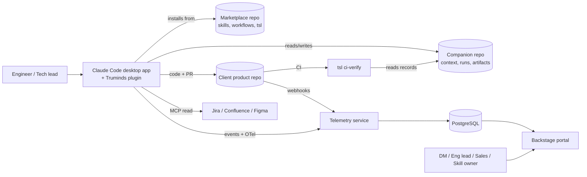
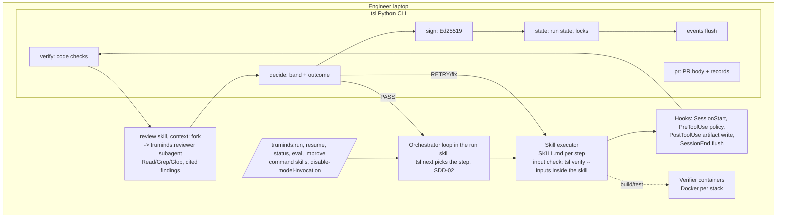
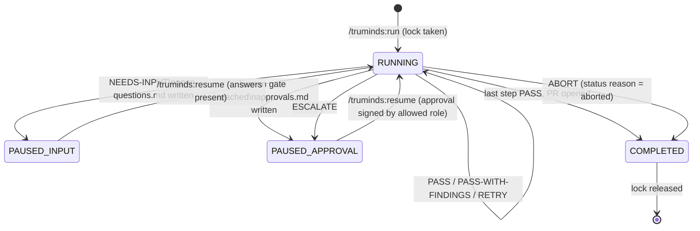
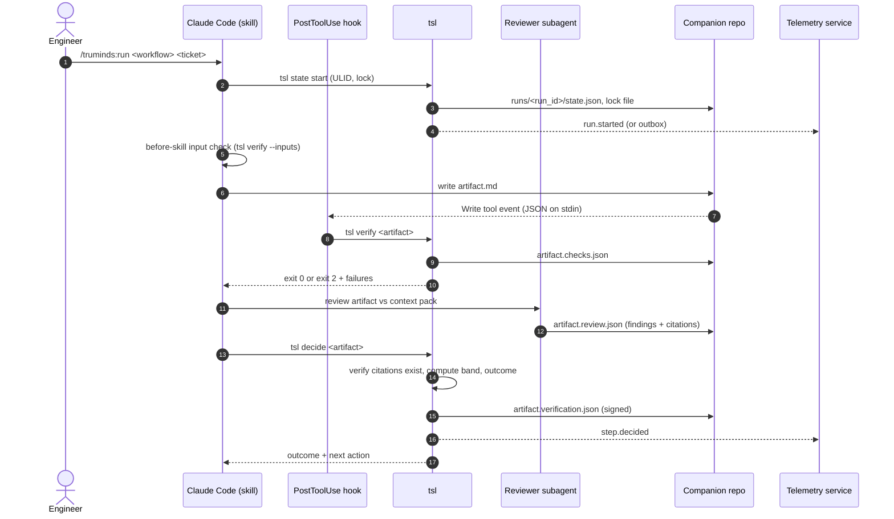
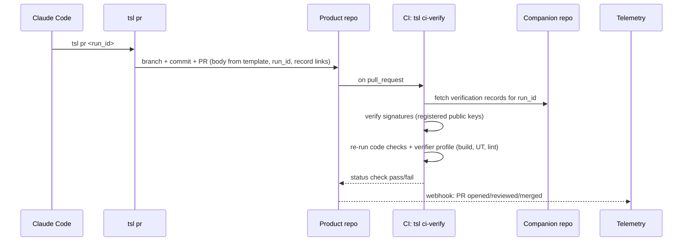
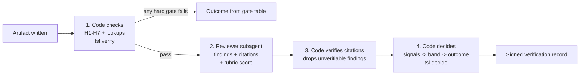
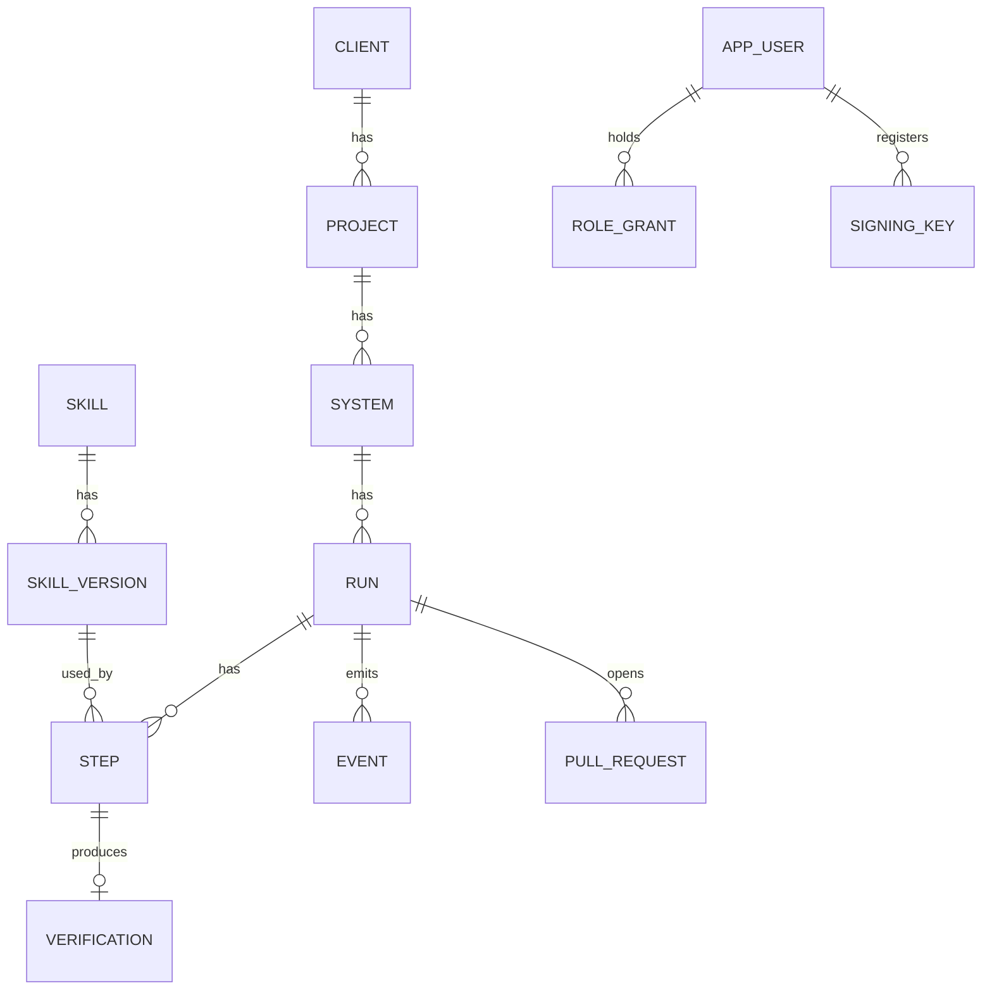

# Truminds AI Skill Library — 3. System Architecture & Tech Stack

Oct 6, 2026 · @Puneet Singh Nanda

## 1. Document control

| Field | Value |
| --- | --- |
| Document | 3 of 6 — System Architecture & Tech Stack |
| Status | Draft for review |
| Owner | Puneet Singh Nanda |
| Approver | Puneet Singh Nanda |
| Co-approver | Open (OQ-01 in Doc 1) |
| Execution model | Local only: Claude Code desktop app + Truminds plugin on company Claude seats. No Claude API. |

**What this document answers:** how the system is built — components, repos, run flow, harness algorithm, signing, data model, NFRs, stack and test strategy.

**The six-document set**

| # | Document | Holds |
| --- | --- | --- |
| 1 | [PRD](../product/01-prd.md) | Problem, goals, FR list, release plan, decisions, open questions |
| 2 | [User Personas and Stories](../product/02-personas-and-stories.md) | Personas, tenancy and roles, US-01..US-22 |
| 3 | System Architecture & Tech Stack (this doc) | How it is built |
| 4 | Design & UI/UX Assets | Portal screens, CLI messages, templates |
| 5 | API Specifications & Rules | tsl CLI, JSON schemas, hook contracts, telemetry API |
| 6 | Constraints & Out-of-Scope | Constraints, limitations, compliance, DO NOT BUILD list |

**ID scheme used here:** NFR-xx (non-functional requirement), TM-xx (threat), DEF-xx (definition), T-xx (test rule). FR, US, C and X ids point to Docs 1, 2 and 6.

## 2. Architecture overview

The system has five planes. Only one of them runs an LLM, and it runs on the engineer's laptop inside Claude Code.

| Plane | Where it runs | What it holds | LLM? | Owner |
| --- | --- | --- | --- | --- |
| **Content plane** | GitHub repo `truminds-skill-library` (plugin marketplace) | Skills, agents, workflows, rubrics, eval cases, verifier profiles, domain packs, `tsl` package | No | Skill owners; Shubham (packaging) |
| **Execution plane** | Engineer laptop: Claude Code desktop app + Truminds plugin + `tsl` + hooks + Docker | Running runs, harness code checks, reviewer subagent, verifier containers | **Yes** (company seat) | Abhishek (runner/state), Japman (harness), Shubham (hooks) |
| **Knowledge plane** | One Truminds-owned companion repo per client system | Context pack, run state, artifacts and verification records | No | Tech lead of the system |
| **Delivery plane** | Client product repo(s) + their CI (GitHub Actions) | Code changes, PRs, `tsl ci-verify` job | No | Client repo owners |
| **Insight plane** | Truminds cloud (hosting TBD, OQ-02) | Telemetry service, PostgreSQL, OTel collector, webhook receiver, Backstage portal | No | Abhishek (service), Ekjot and Gaurav (portal) |

### 2.1 Context diagram



### 2.2 Components inside the execution plane

*Updated per SDD-05 §8.3.*



**Rule of thumb:** code decides, the LLM proposes. Every PASS/RETRY/ESCALATE decision is made by `tsl decide`, never by the model.

**How the parts plug into Claude Code** (SDD-05 §4, §5):

- **Commands are skills.** Each `/truminds:*` command is a skill folder in the plugin with `disable-model-invocation: true`, so only a person starts a run.
- **Input check is inside each skill.** A skill runs `` !`tsl verify --inputs` `` as code before Claude reads it. There is no PreToolUse hook on the `Skill` tool.
- **Reviewer through the `review` skill.** The `review` skill has `context: fork` and `agent: truminds:reviewer`, so the reviewer runs in a fresh context with Read, Grep and Glob only. `tsl review record` stores its JSON; `tsl decide` re-checks every citation.

## 3. Companion repo layout

One companion repo per client **system** (D-13). It is Truminds-owned and which GitHub org hosts it (Truminds or client) is open — OQ-10, listed in Doc 1 §8. The product repo only ever receives code changes and PRs.

```text
<system>-companion/
├─ tsl.yaml                      # system id, product repos, verifier profile, policy, thresholds
├─ context/
│  ├─ system-baseline.md         # human-curated: architecture, modules, conventions
│  ├─ intent-baseline.md         # human-curated: goals, NFRs, constraints
│  ├─ glossary.md
│  ├─ generated/                 # tsl context build output
│  │  ├─ module-map.json
│  │  ├─ api-inventory.json
│  │  └─ dependency-graph.json
│  └─ pack.signature.json        # tech lead signature + source commit SHAs
├─ runs/
│  ├─ active/<ticket>__<workflow>.lock
│  └─ <run_id>/
│     ├─ state.json
│     ├─ open-questions.md
│     └─ approvals.md
└─ artifacts/<ticket>/<run_id>/
   ├─ <artifact>.md               # artifact with YAML envelope
   ├─ <artifact>.checks.json      # code check results
   ├─ <artifact>.review.json      # reviewer subagent result
   └─ <artifact>.verification.json # signed decision record
```

**Why per-run folders:** two engineers on different tickets never touch the same file, so merges on the companion repo are conflict-free. The only shared write is the lock file.

### 3.1 Multi-repo and monorepo

| Case | How `tsl.yaml` describes it | Behaviour |
| --- | --- | --- |
| One system, one repo | `product_repos: [{name, path: .}]` | Default |
| One system, many repos (e.g. firmware + cloud + app) | `product_repos:` list, each with its own `verifier_profile` | A run may open one PR per affected repo; all PRs carry the same run\_id and link to one verification record set |
| Monorepo with many systems | One companion repo per system; `product_repos: [{name, path: services/billing}]` scopes the system to a sub-path | Context extraction and code checks only look inside the scoped path; edits outside it are a hard gate failure (H5 scope) |
| Shared library used by several systems | Listed as `read_only_repos` | Readable as context; never edited by a run |

**Rule:** a run edits only repos and paths listed in `product_repos` for its system. The PreToolUse policy hook blocks writes elsewhere.

## 4. Run lifecycle

### 4.1 Run states



### 4.2 One step, end to end



### 4.3 Pause and resume

```mermaid
sequenceDiagram
  actor E as Engineer
  participant CC as Claude Code
  participant T as tsl
  participant C as Companion repo
  CC->>T: tsl decide -> NEEDS-INPUT
  T->>C: open-questions.md, state=PAUSED_INPUT
  T-->>CC: exit 4
  CC-->>E: "Answer runs/<run_id>/open-questions.md, then /truminds:resume"
  Note over E,C: Session can close. Answers can be filled by anyone with access.
  E->>CC: /truminds:resume <run_id>
  CC->>T: tsl state resume
  T->>C: check every question has an answer; state=RUNNING
  CC->>CC: rerun the step with answers as input
```

### 4.4 PR and CI verify



**What CI does not do:** it does not re-run the reviewer (no LLM in CI). The reviewer's result is trusted as a signed attestation plus the human PR review (see §8).

## 5. Harness: algorithm, gates, band formula

The harness runs after **every** skill step. Four steps, always in this order:



### 5.1 Hard gates (any failure blocks PASS)

| Gate | Check | On failure |
| --- | --- | --- |
| H1 | Artifact validates against its JSON schema (envelope + body sections) | RETRY |
| H2 | Required sections present, including Known / Assumed / Unknown | RETRY |
| H3 | Verifier profile checks pass (build, unit tests, lint, security scan, secrets scan) | Fix loop (max 3), then ESCALATE |
| H4 | No forbidden content: invented values in acceptance criteria, secrets, PII, client names in shared outputs | ABORT for secrets or PII; RETRY for invented values |
| H5 | Trace links to Foundation items present and resolving; edits only inside allowed repos/paths | RETRY (trace); ABORT (out-of-scope write) |
| H6 | All inputs current, not stale (DEF-02) | Re-run the stale upstream step |
| H7 | Only permitted tools were called (policy log from PreToolUse hook) | ABORT |

### 5.2 Signals

| Signal | Measure | Computed by |
| --- | --- | --- |
| S1 Evidence coverage | Verified citations ÷ claims that need one | Code, after step 3 |
| S2 Soft check pass rate | Non-blocking checks passed ÷ run (lint warnings, style, optional rules) | Code |
| S3 Reviewer score | Rubric score 1–5 from reviewer subagent | LLM, recorded by code |
| S4 Open blockers | Count of verified blocker findings + unanswered questions | Code |
| S5 Context freshness | Context pack fresh (DEF-01) and all declared inputs present | Code |
| S6 Change risk | Diff lines, files touched, sensitive paths vs the skill's limit (DEF-05) | Code |

### 5.3 Band formula (proposed thresholds, tuned per skill after pilot)

| Band | All of these must hold |
| --- | --- |
| **High** | S1 ≥ 0.90 · S2 = 1.0 · S3 ≥ 4.0 · S4 = 0 · S5 = fresh · S6 ≤ limit |
| **Medium** | S1 ≥ 0.75 · S2 ≥ 0.90 · S3 ≥ 3.0 · S4 = 0 · S6 ≤ 2 × limit (S5 may be stale → cap applies) |
| **Low** | Hard gates pass but Medium does not hold |

**Caps:** pack not fresh → band at most Medium. Reviewer could not run (tool error) → band at most Low.

### 5.4 Outcome decision

```python
def decide(gates, signals, findings, attempts):
    if gates.failed:
        return gate_outcome(gates, attempts)        # table 5.1, with retry limits
    if signals.S4 > 0:
        return "NEEDS-INPUT"                         # writes open-questions.md
    if any(f.severity == "major" for f in findings) and attempts.review < 2:
        return "RETRY"                               # skill re-runs with findings as input
    band = compute_band(signals)                     # 5.3 + caps
    if band == "Low":
        return "ESCALATE"                            # human gate, PAUSED_APPROVAL
    if findings:                                     # only minor findings left
        return "PASS-WITH-FINDINGS"
    return "PASS"
```

| Outcome | What happens next |
| --- | --- |
| PASS | Next workflow step (or PR if last) |
| PASS-WITH-FINDINGS | Next step; findings listed in PR body |
| RETRY | Same skill re-runs with failures/findings as input. Max 2 for code checks and major findings, max 3 in the verifier fix loop; then ESCALATE |
| NEEDS-INPUT | `open-questions.md` written, run → PAUSED\_INPUT, `tsl` exit 4 |
| ESCALATE | `approvals.md` written, run → PAUSED\_APPROVAL, tech lead decides |
| ABORT | Run stops, lock released, security event sent, `tsl` exit 5 |

### 5.5 Autonomy by band

| Action | High | Medium | Low |
| --- | --- | --- | --- |
| Draft artifact (read-only) | Auto-proceed | Proceed, findings flagged | Human review |
| Write to Jira / Confluence | Review before write | Review before write | Human rewrite |
| Open a pull request | Open for review | Open as draft | Human decides |
| Merge, deploy, infra change | Always human | Always human | Always human |

### 5.6 Calibration

A tech lead audits a sample of High-band outcomes per skill (sampling rate is open: OQ-11). If audits find a miss, that skill's thresholds tighten and an eval case is added. The reviewer subagent runs on the same company seat as the generator, with its own context and rubric; a different model is not guaranteed (see Doc 6 limitations).

## 6. Definitions

Every value below is a **default** in `tsl.yaml`; a tech lead can tighten it per system. Defaults are proposals until pilot data exists.

| ID | Term | Definition (machine-checkable) | Default |
| --- | --- | --- | --- |
| DEF-01 | **Fresh pack** | `pack.signature.json` verifies, AND its recorded source SHA for every product repo equals that repo's current default-branch head OR the drift since then is below the drift limit (DEF-03), AND it was signed within the age limit | Age limit 30 days |
| DEF-02 | **Stale input** | An upstream artifact whose content hash differs from the hash recorded when the downstream artifact consumed it, or whose verification record is older than its own source | — |
| DEF-03 | **Drift** | Files changed on the product repo default branch since the pack's source SHA, inside paths the pack covers, counted by `tsl context build --check` | Drift limit: 50 files or any change to a path marked `critical` in `tsl.yaml` |
| DEF-04 | **Size budget** | Max tokens of context a skill may load (pack sections + inputs). Over budget → the skill must load section by section via the pack index, never the whole pack | Declared per skill in `skill-metadata.v1` |
| DEF-05 | **Change risk limit** | Per skill: max diff lines, max files touched, and a list of sensitive path globs (auth, crypto, payments, migrations, CI config) | 400 lines, 15 files; any sensitive path → S6 over limit |
| DEF-06 | **Stale lock** | A lock file whose run has had no state change for longer than the lock timeout and whose owner is not the current user | 24 hours of inactivity |
| DEF-07 | **Claim needing a citation** | Any statement in an artifact that names a system element (service, table, endpoint, file, config key) or asserts a constraint; detected by the artifact schema's `claims[]` block | — |
| DEF-08 | **Verified citation** | `path#anchor` exists in the companion or product repo at the recorded SHA, AND the cited lines contain the named element (string or AST match) | — |
| DEF-09 | **Blocker / major / minor** | Blocker = needs a human decision; major = skill can fix with the finding as input; minor = note only | Severity set by reviewer; code may raise, never lower |

The 30-day age, 50-file drift, 400-line and 24-hour figures are proposals; Puneet to confirm or replace (OQ-12).

## 7. Release-1 skill catalogue

Each skill is one SKILL.md with a `skill-metadata.v1` file, a rubric and eval cases. Skills are domain-agnostic; system knowledge comes only from the context pack.

| Agent | Skill | Inputs | Output artifact | Main checks (code) |
| --- | --- | --- | --- | --- |
| Business Analyst | `requirement-review` | Ticket, intent baseline | `intent.v1` | Numbered items, Known/Assumed/Unknown, glossary terms |
| Business Analyst | `story-split` | `intent.v1` | `stories.v1` | Each story traces to a REQ; AC format |
| Solution Architect | `impact-analysis` | `intent.v1`, context pack | `impact.v1` | Named modules/APIs/tables exist in `generated/` |
| Solution Architect | `design` | `impact.v1`, `stories.v1` | `design.v1` | No clashes with existing endpoints; citations resolve |
| Developer | `implement` | `design.v1`, `stories.v1` | Code diff + `change.v1` | H3 verifier, H5 scope, S6 risk |
| Developer | `unit-test` | Code diff, `stories.v1` | Tests + `ut-result.v1` | Tests run, coverage not lower |
| Developer | `defect-triage` | Defect ticket, logs | `triage.v1` | Candidate components exist; citations |
| QA | `test-plan` | `stories.v1`, `design.v1` | `test-plan.v1` | Every AC has ≥ 1 test |
| QA | `test-automation` | `test-plan.v1` | Test code + `test-result.v1` | Tests run; results linked to ACs |
| DevOps | `pipeline-review` | CI config, `tsl.yaml` | `pipeline-review.v1` | Cited jobs/steps exist |
| DevOps | `deployment-failure-analysis` | Failed job log | `deploy-failure.v1` | Cited log lines exist |
| Security | `threat-model` | `design.v1` | `threat-model.v1` (STRIDE) | Every component in design has ≥ 1 STRIDE row |
| Security | `secure-code-review` | Code diff | `secure-review.v1` | Secrets/SAST scan results attached |
| UX | `ux-flow-review` | Figma file (MCP, read-only) | `ux-flow.v1` | Every finding cites a node id |
| UX | `accessibility-review` | Figma file | `a11y.v1` | Findings map to WCAG 2.1 AA criteria |
| Delivery Manager | `estimate-review` | `stories.v1`, `design.v1` | `estimate.v1` | Each size cites evidence; else UNSIZED |
| Delivery Manager | `status-report` | Run states for a project | `status.v1` | Counts match `state.json` files |
| Orchestrator | (workflow runner) | `workflow.yaml` | `state.json` | Step order, gates, locks |

### 7.1 Release-1 workflows

| Workflow | Steps (agent.skill) | Human gates |
| --- | --- | --- |
| `brownfield-change` | BA.requirement-review → BA.story-split → SA.impact-analysis → SA.design → \[gate\] → SEC.threat-model → DEV.implement → DEV.unit-test → SEC.secure-code-review → QA.test-plan → PR | Design approval; PR review |
| `greenfield-feature` | Same chain; impact-analysis replaced by design against the intent baseline only | Design approval; PR review |
| `defect-fix` | DEV.defect-triage → DEV.implement → DEV.unit-test → PR | PR review |
| `ux-review` | UX.ux-flow-review → UX.accessibility-review | Comment approval |
| `estimate` | DM.estimate-review | None (read-only) |

Which workflows are in the pilot is open (OQ-04 in Doc 1).

## 8. Trust, signing and threat model

### 8.1 What a signature proves (and what it does not)

| Signed thing | Signed by | Proves | Does not prove |
| --- | --- | --- | --- |
| `artifact.verification.json` | Engineer's key (via `tsl decide`) | This user ran the harness on this artifact hash with this outcome | That the reviewer's judgment was right |
| `pack.signature.json` | Tech lead's key (`tsl context sign`) | A tech lead approved this pack at these source SHAs | That the pack is complete |
| Eval result | Skill author's key | These eval cases ran on this skill version with this pass rate | That evals cover every case |
| `approvals.md` entry | Approver's key | This person, holding this role, approved this gate | — |

### 8.2 Key lifecycle

```mermaid
sequenceDiagram
  actor U as User
  participant T as tsl login
  participant IDP as Company SSO
  participant S as Telemetry service (key registry)
  U->>T: tsl login
  T->>IDP: OIDC device flow
  IDP-->>T: ID token (user, groups)
  T->>T: generate Ed25519 key pair\nprivate key in OS keychain
  T->>S: register public key (ID token)
  S-->>T: key_id, roles
  Note over S: Revocation: admin revokes key_id;\nCI rejects records signed after revocation time
```

**CI trust rule:** `tsl ci-verify` accepts a verification record only if (1) the signature verifies against a registered, non-revoked key; (2) the signer held `engineer` for that project at signing time; (3) the artifact hash in the record matches the file; (4) code checks re-run in CI give the same pass/fail. A PR with code changes but no records fails the check (this catches plain Claude use outside the plugin).

### 8.3 STRIDE threat model

| ID | STRIDE | Threat | Mitigation | Residual |
| --- | --- | --- | --- | --- |
| TM-01 | Spoofing | Someone signs records as another engineer | Keys bound to SSO identity; private key in OS keychain; revocation list | Stolen unlocked laptop |
| TM-02 | Spoofing | Fake events sent to `/v1/events` | Bearer token from SSO; event user must match token | — |
| TM-03 | Tampering | Artifact edited after PASS | Record holds artifact hash; CI recomputes | — |
| TM-04 | Tampering | Engineer edits `checks.json` to fake a pass | CI re-runs code checks itself | Reviewer result cannot be re-run (no LLM in CI) → human PR review |
| TM-05 | Tampering | Malicious skill version in marketplace | Marketplace PRs need skill-owner approval, signed evals, CI validation; plugin version pinned in managed settings | Compromised owner account |
| TM-06 | Tampering | Prompt injection from repo files, tickets or Figma | PreToolUse policy blocks writes outside allowed paths and network calls; reviewer must cite; H7 permitted tools | Reviewer may be misled → human gates |
| TM-07 | Repudiation | "I didn't approve that design" | Signed `approvals.md` entries with role check | — |
| TM-08 | Information disclosure | Client code or data in telemetry | Events carry metadata only (ids, counts, outcomes, durations); schema rejects free text fields over a size limit; no file content | Mis-coded hook → code review + schema test |
| TM-09 | Information disclosure | Secrets or PII read into Claude context | PreToolUse hook blocks reads of paths in `sensitive_paths` (.env, keys, dumps); secrets scan H4 | PII inside normal source files cannot be masked (Doc 6) |
| TM-10 | Information disclosure | Client names leak into shared eval/demo content | H4 forbidden-content check; capability map shows production skills and aggregates only | — |
| TM-11 | Denial of service | Telemetry service down blocks work | Offline outbox; runs never wait on the service | — |
| TM-12 | Denial of service | Stale lock blocks a ticket | Stale lock rule DEF-06; tech lead release | — |
| TM-13 | Elevation of privilege | Engineer approves own design gate | Approver role check; same user cannot generate and approve a gate (configurable) | Small teams may need an override → logged |
| TM-14 | Elevation of privilege | Run writes to Jira/Confluence/client without approval | MCP write tools blocked by policy unless an approval entry exists for that action | — |

## 9. Data model

The cloud database holds **metadata only**. Artifacts and code stay in the companion and product repos.



### 9.1 DDL (PostgreSQL 16)

*Superseded by [SDD-08](../design/SDD-08-telemetry-insights.md) §10.2, which owns every table name (plural) and column; see the [registry](registry.md) §7. Kept here as the original sketch.*

```sql
CREATE TABLE client   (id uuid PRIMARY KEY, code text UNIQUE NOT NULL,  -- code, never the name, outside admin views
                       display_name text NOT NULL, consent_recorded_at timestamptz, consent_ref text);
CREATE TABLE project  (id uuid PRIMARY KEY, client_id uuid REFERENCES client, code text NOT NULL, UNIQUE(client_id, code));
CREATE TABLE system   (id uuid PRIMARY KEY, project_id uuid REFERENCES project, code text NOT NULL,
                       companion_repo text NOT NULL, pack_signed_at timestamptz, pack_source_sha jsonb);
CREATE TABLE app_user (id uuid PRIMARY KEY, sso_subject text UNIQUE NOT NULL,
                       pseudonym text UNIQUE NOT NULL,           -- shown on dashboards
                       email text NOT NULL, active boolean DEFAULT true);
CREATE TABLE role_grant (user_id uuid REFERENCES app_user, role text NOT NULL
                       CHECK (role IN ('viewer','engineer','tech_lead','skill_owner','stage_approver','eng_lead','admin')),
                       scope_type text NOT NULL CHECK (scope_type IN ('org','client','project','system','skill')),
                       scope_id uuid, granted_at timestamptz NOT NULL, revoked_at timestamptz,
                       PRIMARY KEY (user_id, role, scope_type, scope_id));
CREATE TABLE signing_key (key_id text PRIMARY KEY, user_id uuid REFERENCES app_user, public_key bytea NOT NULL,
                       created_at timestamptz NOT NULL, revoked_at timestamptz);
CREATE TABLE skill    (id text PRIMARY KEY, agent text NOT NULL, owner_id uuid REFERENCES app_user);
CREATE TABLE skill_version (skill_id text REFERENCES skill, version text NOT NULL,
                       status text CHECK (status IN ('draft','pilot','production','deprecated')),
                       eval_pass_rate numeric, eval_signed_by text REFERENCES signing_key, published_at timestamptz,
                       PRIMARY KEY (skill_id, version));
CREATE TABLE run      (id text PRIMARY KEY,                      -- run_<ULID>
                       system_id uuid REFERENCES system, workflow text NOT NULL, workflow_version text NOT NULL,
                       ticket_ref text NOT NULL, user_id uuid REFERENCES app_user,
                       status text CHECK (status IN ('RUNNING','PAUSED_INPUT','PAUSED_APPROVAL','COMPLETED')),
                       end_reason text, started_at timestamptz, updated_at timestamptz);
CREATE TABLE step     (run_id text REFERENCES run, seq int, skill_id text, skill_version text,
                       attempt int NOT NULL, outcome text, band text, signals jsonb,
                       duration_ms int, tokens_in int, tokens_out int,
                       PRIMARY KEY (run_id, seq, attempt),
                       FOREIGN KEY (skill_id, skill_version) REFERENCES skill_version);
CREATE TABLE verification (run_id text, seq int, attempt int, artifact_sha256 text NOT NULL,
                       key_id text REFERENCES signing_key, signature bytea NOT NULL, ci_verified boolean,
                       PRIMARY KEY (run_id, seq, attempt), FOREIGN KEY (run_id, seq, attempt) REFERENCES step);
CREATE TABLE pull_request (run_id text REFERENCES run, repo text, number int, state text,
                       opened_at timestamptz, merged_at timestamptz, review_comments int, PRIMARY KEY (repo, number));
CREATE TABLE event    (event_id text PRIMARY KEY,                -- ULID, idempotency key
                       run_id text, type text NOT NULL, schema_version int NOT NULL,
                       user_pseudonym text, occurred_at timestamptz NOT NULL, received_at timestamptz DEFAULT now(),
                       body jsonb NOT NULL);
CREATE INDEX ON event (run_id, occurred_at);
```

### 9.2 Schema evolution

| Thing that changes | Rule |
| --- | --- |
| JSON schemas (artifact, state, records, `tsl.yaml`) | Every file carries `schema: <name>.v<N>`. Additive changes keep N; breaking changes bump N. `tsl` reads N and N-1. |
| Older files in a companion repo | `tsl migrate --to v<N>` rewrites files in a branch and opens a PR on the companion repo; signed records are never rewritten, only re-wrapped with a migration note |
| Event schemas | `schema_version` per event; the service accepts current and previous version; unknown versions → HTTP 422, kept in outbox |
| Database | Alembic migrations, forward-only, reviewed like code |
| Skills | Semantic version; a run pins the skill versions it started with until it completes |

## 10. Non-functional requirements

Numbers are **proposed** until Puneet confirms them (OQ-09 in Doc 1). Each NFR has a test in §12.

| ID | Area | Requirement | Proposed target |
| --- | --- | --- | --- |
| NFR-01 | Harness overhead | `tsl verify` + `tsl decide` (code parts only) per artifact | ≤ 5 s p95 on a standard laptop, excluding verifier containers |
| NFR-02 | Hook latency | PostToolUse / PreToolUse hook added time per tool call | ≤ 500 ms p95 |
| NFR-03 | Offline | All `/truminds:*` commands work with the telemetry service down | 100%; outbox holds ≥ 7 days of events |
| NFR-04 | Delivery | Events reach the service once network returns | At-least-once send, exactly-once store (event\_id) |
| NFR-05 | Service availability | Telemetry API and portal | 99.5% monthly (business tool, not on the critical path) |
| NFR-06 | Ingest capacity | Events per second sustained | 50 eps; batch of up to 500 events per request |
| NFR-07 | Portal speed | Dashboard page load | ≤ 3 s p95 for 90 days of data |
| NFR-08 | Security | Data in transit / at rest | TLS 1.2+; database and backups encrypted at rest |
| NFR-09 | Auth | All human access | Company SSO (OIDC); no local passwords |
| NFR-10 | Privacy | Telemetry content | Metadata only; no source, artifact text, prompts or client names in events |
| NFR-11 | Retention | Event and run data | Open (OQ-08); default proposal 13 months, then aggregated |
| NFR-12 | Portability | Skills | Agent Skills standard; no Claude-only syntax inside SKILL.md body |
| NFR-13 | Platforms | `tsl` and hooks | macOS, Windows (WSL2 and native), Linux; Python 3.12 |
| NFR-14 | Reproducibility | Code checks in CI vs laptop | Same inputs give the same pass/fail 100% |
| NFR-15 | Accessibility | Portal | WCAG 2.1 AA |
| NFR-16 | Audit | Verification and approval records | Kept in companion repo for the life of the engagement; tamper-evident via signatures |
| NFR-17 | Upgrade | Plugin and `tsl` updates | No running run breaks: runs pin versions until COMPLETED |

## 11. Tech stack

| Layer | Choice | Why | Alternatives considered | Status |
| --- | --- | --- | --- | --- |
| LLM runtime | Claude Code desktop app on company Claude seats | Decided local-only, no API (D-10, D-11) | — | Decided |
| Skill format | Agent Skills standard (SKILL.md) | Open standard; supported by Claude Code, Copilot, Cursor, Codex, Gemini CLI | Custom prompt files | Decided |
| Distribution | Claude Code plugin marketplace (git repo + `marketplace.json`), required via managed settings | Native install/update; admins can enforce | Manual clone | Decided |
| Integrations | MCP servers: Jira, Confluence, GitHub, Figma (read by default) | MCP is the standard tool protocol (Linux Foundation AAIF) | Custom REST calls in skills | Decided |
| CLI + hooks | Python 3.12, Typer, Pydantic v2, jsonschema, `cryptography` (Ed25519), `python-ulid`, GitPython | Team skill; one language end to end (D-14) | Go, Node | Decided |
| Policy | YAML policy file evaluated by a `tsl` PreToolUse hook | Simple, versioned in the plugin; no extra runtime | OPA/Rego (dropped: extra engine for a small rule set) | Proposed |
| Verifiers | Docker images per stack (verifier profile), e.g. Java/Maven, Node, Python, C/C++ with Renode for firmware; Android/iOS in Phase 2 | Same checks on laptop and CI | Host toolchains | Decided (Docker) |
| Telemetry API | FastAPI + Uvicorn, SQLAlchemy 2, Alembic | Python; OpenAPI out of the box | Django | Proposed |
| Database | PostgreSQL 16 | Relational joins on run\_id; jsonb for signals | ClickHouse (later, if volume needs it) | Decided |
| OTel ingest | OpenTelemetry Collector → PostgreSQL via the service (Claude Code OTel export) | Standard export from Claude Code | Vendor APM | Proposed |
| Portal | Custom React app on the FastAPI insights service, served by its own nginx image (ADR 0001, supersedes D-15; SDD-09, OPS-01 §5.2) | The prototype is already a custom design; Backstage adds a large framework for a few screens | Backstage (dropped), Grafana | Decided |
| Source control + CI | GitHub, GitHub Actions (`tsl ci-verify` action) | Current Truminds tooling | — | Decided |
| Hosting | Open (OQ-02) | — | — | Open |
| Identity | Microsoft Entra ID via OIDC (ADR 0002): device code for `tsl login`, auth code + PKCE for the portal | Org rule: company SSO only | — | Decided |

**Not in the stack** (were in earlier drafts): Temporal, LiteLLM, Claude Agent SDK, Langfuse, promptfoo, OPA. Reason: all assumed server-side LLM execution, which D-10/D-11 removed.

## 12. Test strategy and definition of done

### 12.1 Test layers

| Layer | What | Where it runs |
| --- | --- | --- |
| Unit | `tsl` functions, decide logic, schema validation, signing | GitHub Actions on every PR |
| Contract | JSON schemas and OpenAPI vs fixtures; hook stdin/stdout contracts | GitHub Actions |
| Golden-file | `tsl decide` on stored checks/review files gives the stored outcome (band formula regression) | GitHub Actions |
| Skill evals | Eval cases per skill, run locally with `/truminds:eval`, signed | Skill author's seat; CI checks signature + pass rate |
| End-to-end | Full `brownfield-change` and `greenfield-feature` run on a Truminds-owned sample system (no client code) | Before each plugin release, on a team seat |
| Security | SAST, dependency scan, secrets scan on all Truminds repos | GitHub Actions |
| NFR | Hook latency, harness overhead, ingest load (NFR-01, 02, 06) | Release checklist |

**Test-data rule (T-01):** no client code, names or data in any fixture, eval or demo. The sample systems are written by Truminds for this purpose.

### 12.2 Definition of done per module

| Module | Owner | Done when |
| --- | --- | --- |
| Run state, locks, `tsl state`, `/truminds:run`/`resume`/`status` | Abhishek | State machine §4.1 fully tested; lock conflict and stale lock covered; ULIDs; resume after closed session works in E2E |
| Telemetry service + DB | Abhishek | OpenAPI published; idempotency test (same event twice → one row); outbox replay test; NFR-04/06 met; Alembic migrations |
| Plugin packaging, marketplace, managed settings | Shubham | Install from marketplace on clean macOS + Windows; version pin works; `tsl validate` gate in marketplace CI |
| Hooks + policy YAML | Shubham | Contract tests for each hook event; blocked write/read/MCP-write cases; NFR-02 met |
| `tsl pr`, `tsl ci-verify` GitHub Action | Shubham | PR body from template; CI rejects missing/forged/revoked records; re-run checks match laptop (NFR-14) |
| Verifier containers | Shubham | One profile per pilot stack builds and runs tests in Docker, same result laptop and CI |
| Harness (`verify`, `decide`), rubrics, citation verifier | Japman | Golden-file suite covers every outcome and cap; H1–H7 each have a failing fixture |
| Evals + context extractors (`tsl context build`) | Japman | Extractors produce `generated/` for the sample systems; drift check (DEF-03) tested; eval runner signs results |
| Backstage catalogue + capability map | Ekjot | Skills/workflows listed from marketplace; production-only filter; no client names (automated check); WCAG 2.1 AA |
| Dashboards, templates, pod builder UI (Phase 3) | Gaurav | Run status, usage, skill performance pages from DB; pseudonyms by default; open-questions/PR/approvals templates validated by schema |

### 12.3 Open questions raised in this document

To be copied into Doc 1 §8:

- **OQ-10** Which GitHub org hosts companion repos (Truminds or client)?
- **OQ-11** Sampling rate for calibration audits of High-band outcomes.
- **OQ-12** Confirm defaults in §6: pack age 30 days, drift 50 files, change limit 400 lines / 15 files, stale lock 24 h.
