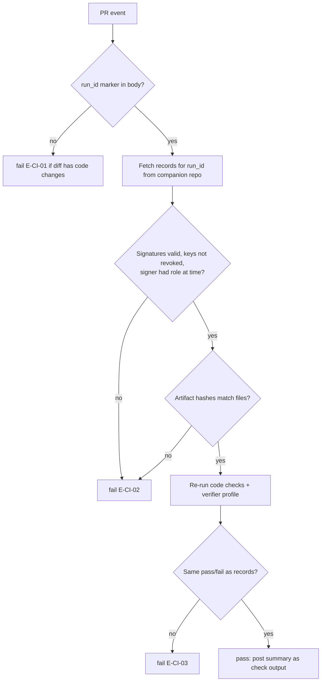

# Truminds AI Skill Library — 5. API Specifications & Rules

Oct 6, 2026 · @Puneet Singh Nanda

## 1. Document control and conventions

| Field | Value |
| --- | --- |
| Document | 5 of 6 — API Specifications & Rules |
| Status | Draft for review |
| Owner | Puneet Singh Nanda; contract owners Abhishek (state, telemetry API), Shubham (hooks, CI, webhooks), Japman (harness records) |
| Approver | Puneet Singh Nanda |
| Related | [PRD](../product/01-prd.md) · [Personas & Stories](../product/02-personas-and-stories.md) · [Architecture](03-architecture.md) · [Design & UX](../ux/04-design-and-ux.md) |

### 1.1 Conventions

| Topic | Rule |
| --- | --- |
| IDs | Run ids `run_<ULID>`; event ids `evt_<ULID>`; key ids `key_<ULID>`. ULIDs are sortable by time and safe to create offline on many laptops |
| Time | ISO 8601 UTC with `Z` in every file and payload |
| Encoding | UTF-8; JSON files 2-space indent, keys sorted (stable hashes); markdown with YAML front matter |
| Hashes | SHA-256, lowercase hex, over the file bytes after normalising line endings to LF |
| Signatures | Ed25519 over the canonical JSON (RFC 8785 JCS) of the record without its `signature` field; base64url |
| Schema ids | Every file has `schema: <name>.v<N>`; JSON Schema draft 2020-12; schemas published in the marketplace repo under `schemas/` |
| Versioning | Skills, workflows, plugin and `tsl`: SemVer. API: path version `/v1`. Breaking change = new major / new path |
| Paths | Always relative to the companion repo root unless prefixed with a product repo name (`orders-api:src/...`) |

## 2. Commands

### 2.1 Plugin slash commands (in Claude Code)

*Updated per SDD-05 §8.3.* Each command is a **skill** in the plugin (`plugins/truminds/skills/<name>/SKILL.md`), not a command file. Every command skill sets `disable-model-invocation: true`, so Claude never starts one on its own. The first `tsl` call runs as code through `` !`...` `` before Claude reads the skill; if it returns `"ok": false`, the skill shows `message` and `next` and stops. Full design: SDD-05 §4.

| Command | Skill folder | Args | First call (as code) | What it does | Then calls |
| --- | --- | --- | --- | --- | --- |
| `/truminds:run` | `skills/run` | `<workflow> <ticket>` | `tsl state start <workflow> <ticket> --json` | Starts a run: lock, state, then steps in order | Per step: `tsl next`, the step's skill, the `review` skill, `tsl decide`; at end `tsl pr` |
| `/truminds:resume` | `skills/resume` | `<run_id>` | `tsl state resume <run_id> --json` | Continues a paused run; refuses if blocking questions are unanswered | Same loop as `run` |
| `/truminds:status` | `skills/status` | `[run_id]` | `tsl state show [run_id] --json` | Shows the current run(s) and next action | — |
| `/truminds:eval` | `skills/eval` | `<skill> [version]` | `tsl eval plan <skill> --json` | Runs the skill's eval cases locally, signs the result | `tsl eval run` |
| `/truminds:improve` | `skills/improve` | `<skill>` | `tsl improve plan <skill> --json` | Skill owner flow: read report, add failing eval case first, propose change | `tsl eval run`, `tsl validate` |

The harness reviewer step is the non-user skill `skills/review` (`context: fork`, `agent: truminds:reviewer`, `user-invocable: false`). It calls `tsl review prepare`, and the main session stores the result with `tsl review record` (SDD-05 §4.4).

### 2.2 `tsl` CLI

*Updated per the [registry](registry.md) §3.* SDD-04 §6 now owns the full command surface; the rows below use the registry names (renames in registry §3.3, no aliases).

Global flags: `--json` (machine output on stdout, human text on stderr), `--repo <companion path>` (default: walk up from cwd), `-v`.

| Command | Args / flags | Who | Output | Exit codes |
| --- | --- | --- | --- | --- |
| `tsl login` | `[--rotate-key]` | Anyone | Registers key, prints roles | 0, 10 |
| `tsl init` | `--system <code> --product-repo <name>=<url>...` | Tech lead | Creates `tsl.yaml` and the companion template (SDD-12 §5.3) | 0, 3 (E-CONS-01, E-AUTH-04, E-INIT-01/02) |
| `tsl context build` | `[--check]` | Engineer, tech lead | Builds `context/generated/*`; `--check` only reports drift | 0, 2, 3 (E-CONS-01) |
| `tsl context sign` | — | Tech lead | Writes `pack.signature.json` | 0, 3 (E-AUTH-04) |
| `tsl state start` | `<workflow> <ticket>` | Engineer | `run_id`; creates lock and `state.json` | 0, 3 (E-LOCK-01, E-AUTH-03) |
| `tsl state resume` | `<run_id>` | Run owner | Next step | 0, 2 (E-RUN-03), 3 |
| `tsl state show` | `[run_id]` | Engineer | State summary | 0 |
| `tsl state unlock` | `<ticket> <workflow>` | Tech lead | Removes stale lock (DEF-06), logs event | 0, 3 |
| `tsl verify` | `<artifact path> [--inputs]` | Hook / skill | `<artifact>.checks.json` | 0, 2, 5 |
| `tsl decide` | `<artifact path>` | Skill | `<artifact>.verification.json`; outcome | 0 PASS/PWF, 2 RETRY, 4 NEEDS-INPUT/ESCALATE, 5 ABORT |
| `tsl approve` | `<run_id> <gate>` | Approver | Signed block in `approvals.md` | 0, 3 (E-AUTH-05/06) |
| `tsl pr` | `<run_id> [--draft]` | Engineer | Branch, commit, PR URL per product repo | 0, 3, 10 |
| `tsl ci-verify` | `--pr <n> --repo <r>` | CI | Pass/fail with E-CI-\* reasons | 0, 2 |
| `tsl validate` | `<skill or workflow path>` | Skill author / CI | Validation report | 0, 2 |
| `tsl eval run` | `<skill> [--version X.Y.Z]` | Skill author | Scores the cases and writes the signed eval file | 0, 2 |
| `tsl migrate` | `--to v<N> [--dry-run]` | Tech lead | Branch + PR on companion repo | 0, 2 |
| `tsl events flush` | — | Hook / any | Sent count | 0, 10 |

### 2.3 JSON output envelope (`--json`)

```json
{
  "ok": false,
  "code": "E-LOCK-01",
  "exit": 3,
  "message": "ABC-142 / brownfield-change is locked by eng-4f2a in run_01J9ZK2M...",
  "next": "/truminds:resume run_01J9ZK2M...",
  "data": { "run_id": "run_01J9ZK2M...", "holder": "eng-4f2a" }
}
```

Skills read `code`, `exit` and `next` only; they never parse `message`.

## 3. File schemas

Full JSON Schemas live in the marketplace repo `schemas/`. Below: one annotated example per file; required fields marked `# req`.

### 3.1 `tsl.yaml` (tsl-config.v1)

```yaml
schema: tsl-config.v1
system: {code: SYS-ORD, project: PRJ-07, client: CL-03}        # req, codes not names
product_repos:                                                   # req
  - {name: orders-api, url: git@github.com:org/orders-api.git, path: ., verifier_profile: java-maven@2}
  - {name: orders-web, url: git@github.com:org/orders-web.git, path: ., verifier_profile: node-20@1}
read_only_repos: [{name: common-lib, url: ...}]
context: {max_commits_behind: 50, drift_files: 50, critical_paths: ["orders-api:src/main/**/billing/**"]}   # full key list: SDD-04 §7.2, SDD-06 §7.2
change_limits: {lines: 400, files: 15, sensitive_paths: ["**/auth/**", "**/migrations/**", ".github/**"]}
policy: policy.yaml                                              # §4.3
gates: {self_approval: false, lock_timeout_hours: 24}
telemetry: {endpoint: https://<host>/v1, enabled: true}
```

### 3.2 `skill-metadata.v1` (in each skill folder)

```yaml
schema: skill-metadata.v1
id: design                     # req, kebab-case, unique
version: 1.4.0                 # req, SemVer
agent: solution-architect      # req
status: production             # draft | pilot | production | deprecated (SDD-01 §7)
owner: skill-owner-9c          # req
inputs:  [{name: impact, schema: impact.v1, required: true}, {name: stories, schema: stories.v1, required: true}]
outputs: [{name: design, schema: design.v1}]
context_sections: [system-baseline#architecture, generated/api-inventory.json]
size_budget_tokens: 60000      # DEF-04
rubric: rubric.md              # req
evals: {path: evals/, min_cases: 10, min_pass_rate: 0.9}
allowed_tools: [Read, Grep, Glob, Write]   # H7
change_limits: null            # only for skills that edit code
```

### 3.3 `workflow.v1`

```yaml
schema: workflow.v1
id: brownfield-change
version: 1.3.0
status: production             # draft | pilot | production | deprecated (SDD-02 §3.2, OPS-03 §7)
requires_fresh_pack: true
steps:
  - {id: req,    skill: requirement-review@^1.0}
  - {id: split,  skill: story-split@^1.0, after: [req]}
  - {id: impact, skill: impact-analysis@^1.1, after: [req]}
  - {id: design, skill: design@^1.4, after: [split, impact]}
  - {gate: G-design, role: tech_lead, after: [design]}
  - {id: threat, skill: threat-model@^1.0, after: [G-design]}
  - {id: impl,   skill: implement@^1.0, after: [threat]}
  - {id: ut,     skill: unit-test@^1.0, after: [impl]}
  - {id: secrev, skill: secure-code-review@^1.0, after: [impl]}
  - {id: tplan,  skill: test-plan@^1.0, after: [design]}
  - {pr: true, after: [ut, secrev, tplan]}
```

### 3.4 `state.json` (run-state.v1)

```json
{
  "schema": "run-state.v1",
  "run_id": "run_01J9ZK2M4Q8X7T3B5N6R0VWYCD",
  "workflow": "brownfield-change@1.3.0",
  "ticket": "ABC-142",
  "system": "SYS-ORD",
  "owner": "key_01J9...",
  "status": "PAUSED_INPUT",
  "pinned": {"plugin": "1.6.0", "tsl": "1.6.0", "skills": {"design": "1.4.0"}},
  "pack": {"signed_at": "2026-10-01T09:00:00Z", "fresh": true},
  "steps": [
    {"id": "design", "attempts": [{"n": 1, "outcome": "NEEDS-INPUT", "record": "artifacts/ABC-142/run_01J9.../design.verification.json"}]}
  ],
  "updated_at": "2026-10-06T10:20:00Z"
}
```

### 3.5 Lock file (`runs/active/<ticket>__<workflow>.lock`, run-lock.v1)

```json
{"schema": "run-lock.v1", "run_id": "run_01J9...", "holder": "eng-4f2a", "key_id": "key_01J9...", "created_at": "...", "heartbeat_at": "..."}
```

Taken by commit + push to the companion repo; a push rejected because the file already exists = lock held (E-LOCK-01). This uses git as the lock server, so it needs network; offline runs cannot start (E-LOCK-03; they can continue). The push is retried 3 times; if it is still rejected with the network up, E-LOCK-04 (SDD-02 §11.1). There is one lock file; no separate claim file (registry §10).

### 3.6 Artifact envelope (front matter of every `<artifact>.md`)

```yaml
---
schema: design.v1
run_id: run_01J9...
step: design
attempt: 2
skill: design@1.4.0
inputs: [{path: artifacts/ABC-142/run_01J9.../impact.md, sha256: 9be1...}]
pack_sha: {orders-api: 4c1e..., orders-web: a77d...}
claims:                     # DEF-07
  - {id: C1, text: "OrderService exposes GET /orders", cites: ["orders-api:src/main/java/.../OrderController.java#L40"]}
trace: [REQ-1, REQ-2]
known: [...]
assumed: [...]
unknown: [...]
---
```

### 3.7 Records

| File | Schema | Key fields |
| --- | --- | --- |
| `<artifact>.checks.json` | checks.v1 | `artifact_sha256`, `gates[{id, pass, detail}]`, `soft[{id, pass}]`, `tool_log_sha256` |
| `<artifact>.review.json` | review.v1 | `rubric_score`, `findings[{id, severity, text, cites[]}]`, `reviewer: {skill, version}` |
| `<artifact>.verification.json` | verification.v1 | below |

```json
{
  "schema": "verification.v1",
  "run_id": "run_01J9...", "step": "design", "attempt": 2,
  "artifact_sha256": "3f9a...", "checks_sha256": "...", "review_sha256": "...",
  "findings_dropped": ["F-3"],
  "signals": {"S1": 0.94, "S2": 1.0, "S3": 4.2, "S4": 0, "S5": "fresh", "S6": {"lines": 0, "files": 0, "sensitive": false}},
  "band": "High", "outcome": "PASS", "caps": [],
  "decided_by": "tsl@1.6.0", "decided_at": "2026-10-06T11:02:00Z",
  "key_id": "key_01J9...", "signature": "base64url..."
}
```

Other schemas: `open-questions.v1` and `approvals.v1` (Doc 4 §3–4), `pack-signature.v1`, `eval-result.v1`, one body schema per artifact type in Doc 3 §7.

## 4. Hook contracts and policy

*Updated per SDD-05 §8.3.* This section is now a summary. The hook design in [SDD-05](../design/SDD-05-claude-code-integration.md) §5 replaces the earlier hook list, and `policy.v1` is replaced by `policy.v2` plus managed permission deny rules (SDD-05 §6).

Hooks ship inside the plugin (`hooks/hooks.json`). Each hook runs `"${CLAUDE_PLUGIN_ROOT}/bin/tsl-hook" <event>`, a small launcher that checks the `tsl` version and calls `tsl hook <event>`. Claude Code passes a JSON object on stdin with at least `session_id`, `cwd`, `hook_event_name`, and for tool events `tool_name`, `tool_input`. The name of the tool-result field after a tool runs is not yet verified (SDD-05 U-02, spike S-04).

### 4.1 Registered hooks

| Event | Matcher | Command | Purpose | Blocks? | Timeout |
| --- | --- | --- | --- | --- | --- |
| SessionStart | — | `tsl-hook session-start` | Check `tsl` version and login; flush outbox; export `TSL_SESSION_ID`; remind about an unfinished run | No (warns) | 15 s |
| PreToolUse | `Write\|Edit\|NotebookEdit\|Bash` | `tsl-hook pre-tool` | Only while this session holds a run lock: write paths and run-context Bash patterns (§4.3) | Yes (deny, E-POL-01/02) | 10 s |
| PreToolUse | `mcp__.*` | `tsl-hook pre-mcp` | Classify MCP tool as read or write; writes need a signed approval in the run's `approvals.md` | Yes (deny, E-POL-03) | 10 s |
| PostToolUse | `Write\|Edit\|NotebookEdit` | `tsl-hook post-write` | If the path is an artifact: run `tsl verify`; return failures to Claude | Feedback only (`decision: "block"`, E-CHK-01) | 90 s |
| SessionEnd | — | `tsl-hook session-end` | Write heartbeat to `state.json`; send `session.ended`; flush outbox | No | 15 s |

**Removed:** the PreToolUse hook on the `Skill` tool. Each skill now checks its inputs with `` !`tsl verify --inputs` `` before Claude starts (E-IN-01/02 unchanged). Static read, edit and network blocks moved from the hook into managed deny rules (§4.3).

### 4.2 Hook I/O

**pre-tool — deny example (stdout):**

```json
{
  "hookSpecificOutput": {
    "hookEventName": "PreToolUse",
    "permissionDecision": "deny",
    "permissionDecisionReason": "E-POL-02 Blocked: read of sensitive file orders-api:.env"
  }
}
```

**post-write — check failed (stdout):**

```json
{"decision": "block", "reason": "E-CHK-01 H2 failed: section 'Unknown' missing in design.md. Add it and write again."}
```

The `reason` is shown to Claude, which fixes and rewrites; this counts toward the RETRY limit. Every hook writes one line to `~/.truminds/hook.log` and one event to the outbox (`hook.decision`). Time budget: NFR-02.

**Failure rules** (SDD-05 §5.4):

| Situation | pre-tool / pre-mcp | post-write | session-start / session-end |
| --- | --- | --- | --- |
| `tsl` missing or wrong version | Inside a run: deny `E-HOOK-01`. Outside a run: allow | Allow, warn | Warn |
| `tsl` crashes or times out | Inside a run: deny (fail closed) | Allow, warn (fail open; never lose the user's work) | Ignore, log locally |
| Telemetry service unreachable | Not affected | Not affected | Events stay in the outbox (R-04) |

### 4.3 Policy: managed deny rules plus `policy.v2`

Policy now has two parts (SDD-05 §6):

1. **Static blocks** sit in the managed settings that IT delivers, as permission deny rules, for example `Read(**/.env)`, `Read(**/*.pem)`, `Edit(**/*.key)`, `Bash(curl *)`, `Bash(git push --force*)`, `Bash(gh pr merge*)`. Claude Code enforces them natively; an engineer's allow rule cannot override a deny. Template: `managed-settings/` in the repo (SDD-05 §6.2). The exact glob syntax is confirmed by spikes S-01 and S-02.
2. **Run-dependent rules** sit in `policy.yaml` (`policy.v2`), shipped in the plugin and read by the `pre-tool` and `pre-mcp` hooks:

```yaml
schema: policy.v2
write_scope:                     # applies only while this session holds a run lock
  allow:
    - "<companion>/artifacts/**"
    - "<companion>/runs/<run_id>/**"
    - "<product_repos>/**"       # expanded from tsl.yaml of the system
  deny:
    - "<companion>/context/pack.signature.json"
    - "**/.github/workflows/**"
bash_in_run:
  deny_patterns: ["git push", "git commit --amend", "rm -rf"]   # tsl pr does pushes, not Claude
mcp:
  read_tools: ["*__get*", "*__search*", "*__list*", "*__fetch*"]
  write_tools_need_approval: ["*__create*", "*__update*", "*__edit*", "*__add*", "*__transition*", "*__delete*"]
  unknown_tools: deny            # anything not classified is treated as a write
merge_and_deploy: never
```

The org-level policy ships in the plugin; a system's `policy.yaml` may only **add** denies, never remove them (checked by `tsl validate`).

### 4.4 Limits of hooks (also in Doc 6)

- Hooks run only when the plugin is installed and enabled; plain Claude use elsewhere is not intercepted. CI catches it: code changes without records fail (E-CI-01).
- Under `allowManagedHooksOnly`, plugin hooks run only if the plugin is force-enabled in managed `enabledPlugins` (SDD-05 V-08). Behaviour in the desktop app is confirmed by spike S-06.
- Plugins load only in local sessions, not in cloud or WSL sessions (C-16, C-17).
- Bash pattern matching is best-effort, not a sandbox.

## 5. Telemetry API and events

### 5.1 Endpoints (`/v1`)

| Method | Path | Auth | Purpose |
| --- | --- | --- | --- |
| POST | `/v1/events` | Bearer (SSO access token via `tsl login`) | Batch of up to 500 events |
| POST | `/v1/keys` | Bearer | Register a signing public key |
| GET | `/v1/keys/{key_id}` | Bearer or CI token | Public key + revoked\_at (used by `tsl ci-verify`) |
| GET | `/v1/me` | Bearer | User pseudonym and role grants |
| POST | `/v1/webhooks/github` | GitHub HMAC (`X-Hub-Signature-256`) | PR events (§6) |
| GET | `/v1/health` | none | Liveness |

The portal reads through the read API (SDD-09, ADR 0001). The full endpoint list is SDD-08 §3.3 and the [registry](registry.md) §4.

### 5.2 `POST /v1/events` (OpenAPI excerpt)

```yaml
openapi: 3.1.0
paths:
  /v1/events:
    post:
      security: [{bearerAuth: []}]
      requestBody:
        content:
          application/json:
            schema:
              type: object
              required: [events]
              properties:
                events: {type: array, maxItems: 500, items: {$ref: '#/components/schemas/Event'}}
      responses:
        '202': {description: 'Accepted', content: {application/json: {schema: {$ref: '#/components/schemas/BatchResult'}}}}
        '400': {description: 'Malformed batch'}
        '401': {description: 'Token invalid or expired (client: tsl login)'}
        '413': {description: 'Batch too large'}
        '429': {description: 'Rate limited; honour Retry-After'}
components:
  schemas:
    Event:
      type: object
      required: [event_id, type, schema_version, occurred_at, body]
      additionalProperties: false
      properties:
        event_id: {type: string, pattern: '^evt_[0-9A-HJKMNP-TV-Z]{26}$'}
        type: {type: string}
        schema_version: {type: integer}
        run_id: {type: string}
        occurred_at: {type: string, format: date-time}
        body: {type: object}
    BatchResult:
      type: object
      properties:
        accepted: {type: integer}
        duplicates: {type: array, items: {type: string}}
        rejected: {type: array, items: {type: object, properties: {event_id: {type: string}, code: {type: string}, reason: {type: string}}}}
```

**Per-event results:** a batch is accepted as a whole (202) and each event is accepted, a duplicate (same `event_id` already stored → ignored, counted as success) or rejected (schema error → stays in the outbox `dead/` folder and shows in `tsl outbox flush` output). The server sets the user from the token; a `user` field in the body is not accepted.

### 5.3 Event types (body schemas, version 1)

| Type | Body fields | Sent by |
| --- | --- | --- |
| `run.started` | workflow, workflow\_version, ticket\_ref, system, plugin\_version, pinned\_skills | `tsl state start` |
| `run.status_changed` | from, to, reason\_code | `tsl state` |
| `step.decided` | step, skill, skill\_version, attempt, outcome, band, signals, caps, gate\_failures\[\], findings\_count{blocker,major,minor}, duration\_ms, verification\_sha256 | `tsl decide` |
| `question.created` / `question.answered` | step, question\_id, blocking, ask\_role, age\_s | `tsl decide` / `tsl state resume` |
| `approval.recorded` | gate, decision, approver\_role | `tsl approve` |
| `hook.decision` | hook, decision (allow/deny/feedback), code | hooks |
| `pr.opened` | repo, number, draft, lowest\_band | `tsl pr` |
| `ci.verified` | repo, number, result, codes\[\] | `tsl ci-verify` |
| `context.signed` / `context.drift` | system, age\_days, drift\_files | `tsl context sign` / `tsl context build --check` |
| `eval.recorded` | skill, version, cases, pass\_rate | `tsl eval run` |
| `security.abort` | code (E-SEC/E-POL), step | `tsl decide`, hooks |

**Never in any event:** file content, artifact text, prompts, findings text, client names, file paths outside the companion repo layout. Free-text string fields are capped at 200 characters and checked against a deny list in CI (TM-08).

### 5.4 Claude Code OpenTelemetry

Managed settings turn on Claude Code's OTel export to the Truminds collector. The collector keeps only metrics (token counts, cost, session duration, tool decisions) and drops any attribute holding prompt content. Records are joined to runs via the `session_id` that hooks also send. Prompt logging stays **off**.

## 6. GitHub webhook and CI contract

### 6.1 Webhook

| GitHub event | Actions used | Stored as | Join key |
| --- | --- | --- | --- |
| `pull_request` | opened, reopened, ready\_for\_review, closed (merged true/false) | `pull_request` row state, opened\_at, merged\_at | `<!-- tsl:run_id=... -->` in PR body |
| `pull_request_review` | submitted (approved, changes\_requested) | review count, first review time | repo + PR number |
| `pull_request_review_comment` | created | count only (no text) | repo + PR number |
| `check_run` | completed (name `tsl-ci-verify`) | ci result | repo + head SHA |

Rules: verify `X-Hub-Signature-256` with the shared secret; reject otherwise (401). Idempotency by `X-GitHub-Delivery` id. PRs without a `tsl:run_id` marker are counted only as "PR without run" (feeds E-CI-01 adoption metric), no other data stored. Installed on product repos only with client consent (E-CONS-01).

### 6.2 CI action (`truminds/tsl-ci-verify`)

```yaml
# .github/workflows/tsl-ci-verify.yml in the product repo
on: pull_request
jobs:
  tsl-ci-verify:
    runs-on: ubuntu-latest
    steps:
      - uses: actions/checkout@v4
      - uses: truminds/tsl-ci-verify@v1
        with:
          companion-repo: org/sys-ord-companion
          companion-token: ${{ secrets.TSL_COMPANION_READ_TOKEN }}   # read-only
          telemetry-token: ${{ secrets.TSL_CI_TOKEN }}               # optional
```



Output: a GitHub check named `tsl-ci-verify` with a summary table (step, outcome, band, CI re-check result). Making it a required check is the repo owner's decision (per client).

## 7. Rules

| ID | Area | Rule |
| --- | --- | --- |
| R-01 | Retry | Code-check RETRY and major-finding RETRY: max 2 per step, then ESCALATE |
| R-02 | Retry | Verifier fix loop (H3): max 3 attempts, then ESCALATE |
| R-03 | Retry | Every attempt writes its own records (`attempt` number); nothing is overwritten |
| R-04 | Network retry | Outbox send: exponential backoff 1 s → 5 min cap, honour `Retry-After`; events never dropped, only moved to `dead/` on 4xx schema errors |
| R-05 | Idempotency | `event_id` (events), `X-GitHub-Delivery` (webhooks), `run_id + step + attempt` (records) are unique keys; repeats are no-ops |
| R-06 | Signing | Only `tsl` signs; private keys never leave the OS keychain; one active key per user per device |
| R-07 | Signing | A record is valid only if signed by a key active at `decided_at` and the signer held the needed role then |
| R-08 | Versioning | Runs pin plugin, `tsl`, workflow and skill versions at start; resume uses pinned versions even after an upgrade |
| R-09 | Versioning | `tsl` reads schema versions N and N-1; older needs `tsl migrate` |
| R-10 | Versioning | Skill major version bump required when inputs/outputs schemas change |
| R-11 | Locks | One active run per ticket + workflow; lock released at COMPLETED; stale per DEF-06 |
| R-12 | Decisions | Only `tsl decide` sets outcome and band; the model's own claim of success is ignored |
| R-13 | Citations | A finding or claim with a citation that does not verify (DEF-08) is dropped and counted against S1 |
| R-14 | External writes | No write to Jira, Confluence, Figma or any client system without an approval entry for that action |
| R-15 | Data | No client names, customer data or credentials in any Truminds repo, event, eval, fixture or demo |
| R-16 | Seats | Client code is processed only on company Claude seats, never personal accounts, and only after written client consent |
| R-17 | Conflicts | When a rule conflicts with a request, the skill stops and raises it (NEEDS-INPUT or ESCALATE); it never works around a rule |
