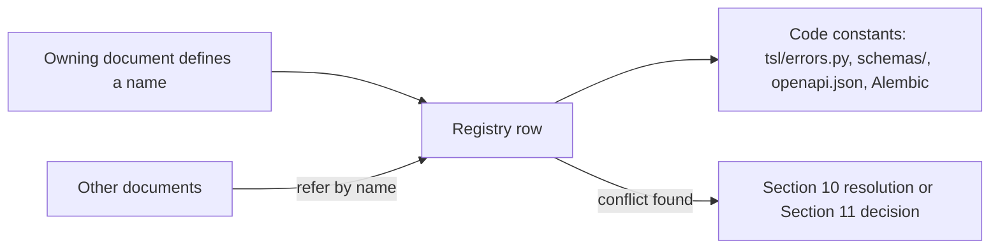

# REG-01 · Canonical registry of names and IDs

| Field | Value |
| --- | --- |
| Status | Draft for owner review |
| Owner | Puneet Singh Nanda (integrator); each row names its owning document |
| Approver | Puneet Singh Nanda |
| Related docs | [Doc 3 Architecture](03-architecture.md) · [Doc 5 API and Rules](05-api-and-rules.md) · [Doc 4 Design and UX](../ux/04-design-and-ux.md) §5.2 · [SDD-04 `tsl`](../design/SDD-04-tsl-cli.md) · [SDD-08 Telemetry and database](../design/SDD-08-telemetry-insights.md) · [GOV-01 Change process](../governance/GOV-01-adr-and-change-process.md) |

## 1. Scope

Thirty documents were written in parallel, and some of their names and IDs collided. This registry is the single list that code is built from. It covers error codes, `tsl` commands, HTTP endpoints, event types, JSON schema IDs, database tables and views, companion-repo paths and ID series.

Rules:

- **This registry wins.** If a document disagrees with a row here, the document is wrong. Fix it by pull request (GOV-01) and update this registry in the same pull request.
- **One owner per name.** The owning document defines the meaning. Other documents only refer to it.
- **Never reuse an ID.** A retired code or ID stays listed as obsolete (OPS-03 §7).
- **New names** are added here first, with the next free number, in the same pull request that introduces them.
- Section 10 records every conflict this registry resolved. Section 11 lists the policy questions that only Puneet can decide.

## 2. Error codes

Every code lives in `tsl/src/tsl/core/errors.py` (CLI codes) or the insights service error module (service codes), and in the Doc 4 §5.2 catalogue. **Exit** is the `tsl` process exit code (Doc 4 §5.2: 0 ok or warning, 1 usage, 2 check failed, 3 blocked, 4 paused, 5 abort, 10 auth or network). **HTTP** is the status the insights service returns. "Per event" means the code appears inside a `202` batch result.

| Code | Meaning | Exit / HTTP | Emitted by | Owning doc |
| --- | --- | --- | --- | --- |
| E-ADM-01 | An admin cannot grant a role to themselves | 403 | Insights service admin routes | SDD-13 §10 |
| E-API-01 | Invalid parameter, or a cursor used with other filters | 400 | Read API | SDD-09 §5.1.4 |
| E-API-02 | Token missing, invalid, expired, wrong audience or tenant | 401 | Read API | SDD-09 §5.1.4 |
| E-API-03 | Role does not allow this route | 403 | Read API | SDD-09 §5.1.4 |
| E-API-04 | Not found, or outside the caller's scope | 404 | Read API | SDD-09 §5.1.4 |
| E-API-05 | Rate limited | 429 | Read API | SDD-09 §5.1.4 |
| E-API-06 | Database unavailable or statement timeout | 503 | Read API | SDD-09 §5.1.4 |
| E-AUTH-01 | Not logged in to Truminds | 10 | `tsl` (any online command) | Doc 4 §5.2 |
| E-AUTH-02 | Signing key revoked or unknown | 10 | `tsl login`, `decide`, `approve` | Doc 4 §5.2 |
| E-AUTH-03 | No `engineer` grant on system `<code>` | 3 | `state start`, `context build`, `improve plan` | Doc 4 §5.2 |
| E-AUTH-04 | Action needs the `tech_lead` grant on the system (sign pack, `init`, `state unlock`) | 3 | `context sign`, `init`, `state unlock` | Doc 4 §5.2 |
| E-AUTH-05 | Approver lacks the gate's role | 3 | `approve`, `state resume` | Doc 4 §5.2 |
| E-AUTH-06 | Self-approval refused | 3 | `approve` | Doc 4 §5.2 |
| E-AUTH-07 | Role cache older than 24 h and service unreachable | 10 | Role-checked commands offline | SDD-04 §5 |
| E-AUTH-08 | No Truminds app role, or account deactivated | 3 / 403 | `tsl login`; insights service | SDD-07 §12 |
| E-CFG-01 | Config or definition file invalid, or a limit looser than the org default | 1 | Any command reading config; `validate` | SDD-04 §5 |
| E-CHK-01 | Hard gate failed; retry | 2 | `verify`, `decide`, post-write hook | Doc 4 §5.2 |
| E-CI-01 | PR has code changes but no records | 2 | `ci-verify` | Doc 4 §5.2 |
| E-CI-02 | Record signature invalid, or signer lacked the role at signing time | 2 | `ci-verify` | Doc 4 §5.2 |
| E-CI-03 | CI re-run of code checks differs from the laptop result | 2 | `ci-verify` | Doc 4 §5.2 |
| E-CI-04 | PR code differs from the verified change (tree or diff hash) | 2 | `ci-verify` | SDD-03 §14 |
| E-CI-05 | Record chain incomplete | 2 | `ci-verify` | SDD-03 §14 |
| E-CI-06 | Companion repo or key registry unreachable; fail closed | 2 | `ci-verify` | SDD-03 §14 |
| E-COMP-01 | Companion check: schema invalid | 2 | `companion check` | SDD-12 §6.4 |
| E-COMP-02 | Companion check: protected path changed by direct push | 2 | `companion check` | SDD-12 §6.4 |
| E-COMP-03 | Companion check: a record was modified or deleted | 2 | `companion check` | SDD-12 §6.4 |
| E-COMP-04 | Companion check: forbidden content | 2 | `companion check` | SDD-12 §6.4 |
| E-COMP-05 | Companion check: file or repo too large | 2 | `companion check` | SDD-12 §6.4 |
| E-COMP-06 | Cannot archive: runs not completed | 3 | `companion archive` | SDD-12 §11.1 |
| E-COMP-07 | System is archived (read-only) | 3 | `state start` and writers | SDD-12 §11.1 |
| E-CONS-01 | No client consent recorded, or scope missing | 3 | `init`, `context build`, `state start` | Doc 4 §5.2 |
| E-CONS-02 | Consent does not cover opening PRs on product repos | 3 | `pr` | SDD-12 §11.1 |
| E-CTX-01 | Context pack missing, or a required section missing | 3 | `verify --inputs`, `state start`, `context sign` | SDD-06 §11 |
| E-CTX-02 | Context pack stale; band capped at Medium (warning) | 0 | `state start`, `decide`, `context build` | SDD-06 §11 |
| E-CTX-03 | Pack signature does not verify | 3 | `state start`, `decide` | SDD-06 §11 |
| E-CTX-04 | Section not reviewed | 2 | `context sign` | SDD-06 §11 |
| E-CTX-05 | Size limit exceeded | 2 | `context build` | SDD-06 §11 |
| E-CTX-06 | Secret, personal data or denied term in the pack | 2 | `context build` | SDD-06 §11 |
| E-CTX-07 | Pack lint failed (anchors or citations) | 2 | `context build`, `context sign` | SDD-06 §11 |
| E-CTX-08 | Extractor failed; section not rebuilt | 2 | `context build` | SDD-06 §11 |
| E-CTX-09 | Manifest out of date, or a product repo cannot be read at the SHA | 3 | `context build`, `context sign` | SDD-06 §11 |
| E-DEC-01 | Gate still pending | 3 | `decide` | SDD-03 §14 |
| E-DEC-02 | Artifact changed since checks ran | 3 | `decide` | SDD-03 §14 |
| E-DEP-01 | Command, flag or item is deprecated (warning in `warnings[]`) | 0 | Any command | OPS-03 §7 |
| E-ENV-01 | Prerequisite missing | 3 | `doctor`, `state start` | SDD-04 §5 |
| E-ENV-02 | Full-disk encryption cannot be confirmed (warning) | 0 | `doctor` | SDD-13 §3.6 (was "E-ENV-07") |
| E-EVAL-01 | Eval pass rate or case count below minimum | 2 | `eval run` | SDD-04 §5 |
| E-GIT-01 | Git operation failed | 10 | `state`, `approve`, `pr` | SDD-04 §5 |
| E-HARN-01 | Harness accuracy below its target on the labelled set | 2 | `tsl harness eval` | SDD-03 §16.4 (new; added by the `tsl` build) |
| E-HOOK-01 | `tsl` missing, wrong version, crashed or timed out while a run is active; the write is denied | deny (hook JSON, process exit 0) | `bin/tsl-hook`, `tsl hook pre-tool`, `pre-mcp` | SDD-05 §5.4 |
| E-IMP-01 | New eval case does not fail before the change | 2 | `improve check` | SDD-11 §6 |
| E-IMP-02 | Regression, or cases removed or edited without justification | 2 | `improve check` | SDD-11 §6 |
| E-IMP-03 | Pass rate below minimum or below before | 2 | `improve check` | SDD-11 §6 |
| E-IMP-04 | Eval result unsigned, signer mismatch or skill hash mismatch | 2 | `improve check` | SDD-11 §6 |
| E-IMP-05 | Forbidden content in eval files | 2 | `improve check` | SDD-11 §6 |
| E-IN-01 | Required input missing | 2 | `verify --inputs` | Doc 4 §5.2 |
| E-IN-02 | Input stale (H6) | 2 | `verify --inputs` | Doc 4 §5.2 |
| E-INIT-01 | System has no companion repo registered | 3 | `init` | SDD-12 §11.1 |
| E-INIT-02 | Companion repo is not empty | 3 | `init` | SDD-12 §11.1 |
| E-ING-01 | Envelope or body fails its JSON Schema | per event | `POST /v1/events` | SDD-08 §4.3 |
| E-ING-02 | Unknown `schema_version` for the type (kept queued) | per event | `POST /v1/events` | SDD-08 §4.3 |
| E-ING-03 | Forbidden field present | per event | `POST /v1/events` | SDD-08 §4.3 |
| E-ING-04 | Free-text field failed the deny-list | per event | `POST /v1/events` | SDD-08 §4.3 |
| E-ING-05 | Token kind not allowed to send this type | per event | `POST /v1/events` | SDD-08 §4.3 |
| E-ING-06 | Batch is not JSON, or `events` missing | 400 | `POST /v1/events` | SDD-08 §4.3 |
| E-ING-07 | Ingest token invalid, expired, wrong audience or tenant | 401 | Ingest and key routes | SDD-08 §4.3 |
| E-INT-01 | Internal error with `log_id` | 1 | Any command | SDD-04 §5 |
| E-KEY-01 | No usable OS keychain backend | 10 | `login`, signing commands | SDD-04 §5 |
| E-KEY-02 | Key proof does not verify, or `iat` too old | 400 | `POST /v1/keys` | SDD-07 §12 |
| E-KEY-03 | Key id already registered with another public key | 409 | `POST /v1/keys` | SDD-07 §12 |
| E-KEY-04 | Key not found, or not yours | 404 | `POST /v1/keys/{key_id}/revoke` | SDD-07 §12 |
| E-KEY-05 | Signing key expired | 10 | Signing commands | SDD-07 §12 |
| E-KEY-06 | `compromised_since` out of range | 422 | `POST /v1/keys/{key_id}/revoke` | SDD-07 §12 |
| E-LOCK-01 | Ticket and workflow already locked by another run | 3 | `state start` | Doc 4 §5.2 |
| E-LOCK-02 | Lock lost or released (run closed with `end_reason: lock_released`) | 3 | Run-bound commands | SDD-02 §12 |
| E-LOCK-03 | Cannot take a lock offline | 10 | `state start` | SDD-02 §12 |
| E-LOCK-04 | Could not push the run lock after 3 retries (network is up) | 10 | `state start` | SDD-12 §3.3 (new; was SDD-12 "E-LOCK-02") |
| E-NET-01 | Telemetry offline; events queued (warning) | 0 | Any command | Doc 4 §5.2 |
| E-NET-02 | Insights service unreachable | 10 | Online-only commands | SDD-04 §5 |
| E-POD-01 | Workflow belongs to more than one pod on the system; pass `--pod` | 3 | `state start` | SDD-10 §5 |
| E-POL-01 | Write outside allowed paths (H5) | 5 | pre-tool hook, `verify` | Doc 4 §5.2 |
| E-POL-02 | Read of a sensitive file | 5 | pre-tool hook | Doc 4 §5.2 |
| E-POL-03 | MCP write without approval | 5 | pre-mcp hook | Doc 4 §5.2 |
| E-POL-04 | Tool not permitted for the skill (H7) | 5 | `verify` | SDD-03 §14 |
| E-POL-05 | Tool log missing or altered | 5 | `verify` | SDD-03 §14 |
| E-PR-01 | Run has records that are not pushed to the companion repo | 3 | `pr` | SDD-12 §4.2 |
| E-REPO-01 | Not inside a companion repo | 1 | Repo-bound commands | SDD-04 §5 |
| E-REV-01 | Cannot prepare review: checks missing or failing | 3 | `review prepare` | SDD-03 §14 |
| E-REV-02 | Reviewer output is not valid `review.v1` | 2 | `review record` | SDD-03 §14 |
| E-REV-03 | Review is for an older artifact or package | 2 | `review record` | SDD-03 §14 |
| E-REV-04 | Reviewer could not review; band capped at Low (warning) | 0 | `review record --unavailable` | SDD-03 §14 |
| E-RUN-01 | Run paused for input | 4 | `decide`, `next` | Doc 4 §5.2 |
| E-RUN-02 | Run paused for approval | 4 | `decide`, `next` | Doc 4 §5.2 |
| E-RUN-03 | Cannot resume: blocking questions unanswered | 2 | `state resume` | Doc 4 §5.2 |
| E-RUN-04 | Run not found | 3 | Run-bound commands | SDD-04 §5 |
| E-RUN-05 | Run or gate is in the wrong status for this command | 3 | `approve`, `pr`, `next`, `decide`, `state unlock` | SDD-04 §5 |
| E-RUN-06 | Run belongs to another user | 3 | `state resume` | SDD-04 §5 |
| E-RUN-07 | Frozen answers changed after resume | 2 | `state resume` | SDD-02 §12 |
| E-RUN-08 | Approval does not match the artifact | 3 | `state resume`, `next` | SDD-02 §12 |
| E-RUN-09 | Step is not the open step of the active run | 3 | `verify --inputs`, `next` | SDD-02 §12 (new; was SDD-02 "E-RUN-04") |
| E-RUN-10 | Pinned skill version not installed; `tsl state repin` offered | 3 | `next`, `state resume` | SDD-02 §11.4 (new; was SDD-02 "E-RUN-05") |
| E-RUN-11 | Run busy in another process or session | 3 | Run-bound commands | SDD-02 §11.2 (new; was SDD-02 "E-RUN-06") |
| E-SCH-01 | Schema version this `tsl` does not read | 1 | Any reader | Doc 4 §5.2 |
| E-SEC-01 | Secret or PII detected in artifact (H4) | 5 | `verify`, `decide` | Doc 4 §5.2 |
| E-SEC-02 | Personal data detected in artifact (H4) | 5 | `verify` | SDD-03 §14 |
| E-USE-01 | Invalid arguments | 1 | Any command | SDD-04 §5 |
| E-VER-01 | `tsl` version does not match the plugin or the run pin | 3 | hooks, `state *` | SDD-04 §5 |
| E-WFL-01 | Workflow file does not match `workflow.v1` | 2 | `validate` | SDD-02 §3.5 |
| E-WFL-02 | Workflow graph invalid (ids, cycles, reachability, gate placement) | 2 | `validate` | SDD-02 §3.5 |
| E-WFL-03 | Input binding missing or schema mismatch | 2 | `validate` | SDD-02 §3.5 |
| E-WFL-04 | Skill range does not resolve | 2 | `validate --lock` | SDD-02 §3.5 |
| E-WFL-05 | Retry limits exceed org maximums | 2 | `validate` | SDD-02 §3.5 |

Obsolete or never-valid spellings: `E-VAL-07` (use E-CFG-01), `E-ENV-07` (use E-ENV-02). Non-error codes used in events (`H1`–`H7`, `S1`–`S6`, `REVIEW-MAJOR`, `REVIEWER-ERROR`, `CAP-PACK`) are failure-cause codes owned by SDD-08 §6.3.

## 3. `tsl` commands and plugin slash commands

### 3.1 `tsl` commands

SDD-04 owns the command surface (names, flags, envelope, exit codes). The "Logic owner" owns what the command does. Doc 5 §2.2 names that SDD-04 renamed are listed in §3.3.

| Command | Logic owner | Command-surface owner |
| --- | --- | --- |
| `tsl login`, `logout`, `whoami` | SDD-07 §4 | SDD-04 §6.1 |
| `tsl keys list \| rotate \| revoke` | SDD-07 §5.5 | SDD-04 §6.2 |
| `tsl doctor` | SDD-04 §6.3 | SDD-04 §6.3 |
| `tsl init` | SDD-12 §5.3 | SDD-04 §6.4 |
| `tsl validate <path>... [--lock]` (skills, workflows, pods, policy, `tsl.yaml`, `plugins/truminds`) | SDD-01 §14.1, SDD-02 §3.5, SDD-10 §9 | SDD-04 §6.5 |
| `tsl verify <artifact>` and `verify --inputs` (flags `--fast`, `--gates`, `--detach`, `--status`, `--ci`) | SDD-03 | SDD-04 §6.6 |
| `tsl state start \| resume \| show \| unlock` | SDD-02 | SDD-04 §6.7 |
| `tsl state cancel`, `state repair`, `state repin`, `state resume --take-over` | SDD-02 §11–§12 | SDD-04 §6.21 |
| `tsl next` | SDD-02 §6 | SDD-04 §6.8 |
| `tsl review prepare \| record` | SDD-03 §7 | SDD-04 §6.9 |
| `tsl decide` | SDD-03 | SDD-04 §6.10 |
| `tsl approve` | SDD-02 §9.2, SDD-07 §6.4 | SDD-04 §6.11 |
| `tsl pr` | SDD-12 §4.2 | SDD-04 §6.12 |
| `tsl ci-verify` | SDD-03 §13, SDD-07 §7.4 | SDD-04 §6.13 |
| `tsl hook <event>` | SDD-05 §5 | SDD-04 §6.14 |
| `tsl context build \| sign` | SDD-06 | SDD-04 §6.15 |
| `tsl context status`, `context draft-prepare`, `context deny-term` | SDD-06 §6, §9 | SDD-04 §6.21 |
| `tsl eval plan \| run` | SDD-01 §10 | SDD-04 §6.16 |
| `tsl eval check` (one case, unsigned) | SDD-01 §10.2 | SDD-04 §6.21 |
| `tsl improve plan` | SDD-11 | SDD-04 §6.17 |
| `tsl improve case \| check \| pr` | SDD-11 §5 | SDD-04 §6.21 |
| `tsl harness eval [--code-only]` | SDD-03 §16 | SDD-04 §6.21 |
| `tsl events flush` | SDD-04 §8 | SDD-04 §6.18 |
| `tsl migrate` | SDD-12 | SDD-04 §6.19 |
| `tsl companion check \| archive` | SDD-12 §6.4, §8.2 | SDD-04 §6.21 |

### 3.2 Plugin slash commands (skills)

| Command | Skill folder | Owner |
| --- | --- | --- |
| `/truminds:run` | `skills/run` | SDD-05 §4.1, SDD-02 §7 |
| `/truminds:resume` | `skills/resume` | SDD-05 §4.1, SDD-02 §7 |
| `/truminds:status` | `skills/status` | SDD-05 §4.1 |
| `/truminds:eval` | `skills/eval` | SDD-05 §4.1, SDD-01 §10 |
| `/truminds:improve` | `skills/improve` | SDD-05 §4.1, SDD-11 |
| `/truminds:context-draft` | `skills/context-draft` | SDD-06 §6.4 |
| (not user-invocable) `review` | `skills/review` | SDD-05 §4.4, SDD-03 §7 |

### 3.3 Renamed commands (no aliases)

| Old name (Doc 5 §2.2 and early docs) | Registry name |
| --- | --- |
| `tsl init-context` | `tsl init` (repo set-up, consent check) + `tsl context build` (facts) |
| `tsl context-refresh [--check]` | `tsl context build [--check]` |
| `tsl sign-context` | `tsl context sign` |
| `tsl outbox flush` | `tsl events flush` |
| `tsl eval record` | `tsl eval run` |
| `tsl run` | `/truminds:run` (skill) which calls `tsl state start` |
| `tsl login --idp-url` | removed (identity provider fixed in the wheel, SDD-04 §7.1) |

Old names are **not** kept as hidden aliases: SDD-04 §1.3 forbids hidden commands, and nothing has been released yet (SDD-04 OI-02).

## 4. HTTP endpoints

All routes are served by the insights service (SDD-08 layout, `app.main:app`). Every route except the OTLP paths and the internal `/metrics` port is in the committed `openapi.json`. **Scope** is the Entra delegated scope of the token (SDD-07 §9), or another credential. **Roles** are `role_grants` roles (SDD-07 §3.3) unless marked "app role". The audience of every Entra token is the `truminds-insights-api` application (client) ID (v2 tokens).

| Method | Path | Auth scope / credential | Roles | Owning doc |
| --- | --- | --- | --- | --- |
| POST | `/v1/events` | `Events.Write`; or CI ingest token (`ci.verified` only) | App role Engineer, TechLead or Admin | SDD-08 §4 |
| POST | `/otel/v1/metrics` | OTel ingest token | — | SDD-08 §5.1 |
| POST | `/otel/v1/logs` | OTel ingest token | — | SDD-08 §5.1 |
| POST | `/v1/webhooks/github` | GitHub HMAC (`X-Hub-Signature-256`) | — | SDD-08 §6.1 |
| POST | `/v1/keys` | `Events.Write` | App role Engineer, TechLead or Admin | SDD-07 §5.2 (wire: SDD-08 §6.2) |
| GET | `/v1/keys/{key_id}?at=&system=` | `Events.Write` or CI ingest token | Any | SDD-08 §6.2 |
| POST | `/v1/keys/{key_id}/revoke` | `Events.Write` or `Portal.Write` | Key owner; `admin` | SDD-07 §5.6 |
| GET | `/v1/me/keys` | `Events.Write` or `Portal.Read` | Own keys | SDD-07 §5.5 |
| POST | `/v1/signatures/verify` | CI ingest token or `Events.Write` | Any | SDD-07 §7.2 |
| GET | `/v1/me` | `Events.Write` or `Portal.Read` | Any | SDD-08 §3.1; fields SDD-09 §5.6.1 |
| GET | `/v1/systems/{code}` | `Events.Write` | `engineer`, `tech_lead` on the system; `admin` | SDD-12 §5.3 |
| GET | `/v1/policy/denylist` | `Events.Write` or CI ingest token | Any | SEC-01 §7.4 |
| GET | `/v1/health` | none | — | SDD-08 §3.1 |
| GET | `/v1/health/ready` | none | — | SDD-08 §11.1 |
| GET | `/v1/status` | `Portal.Read` | Any | SDD-09 E02 |
| GET | `/v1/catalogue/summary` | `Portal.Read` | Any (class A) | SDD-09 E03 |
| GET | `/v1/catalogue/skills` | `Portal.Read` | Any (class A) | SDD-09 E04 |
| GET | `/v1/catalogue/skills/{skill_id}` | `Portal.Read` | Any (class A) | SDD-09 E05 |
| GET | `/v1/catalogue/skills/{skill_id}/quality` | `Portal.Read` | Engineer family (scope); `skill_owner`, `stage_approver` (own skills) | SDD-09 E06 |
| GET | `/v1/catalogue/releases` | `Portal.Read` | Any (class A) | SDD-09 E07 |
| GET | `/v1/catalogue/pods` | `Portal.Read` | Any (fields by role, SDD-10 §6.1) | SDD-09 E08, SDD-10 §6.6 |
| GET | `/v1/pods/{pod_id}` | `Portal.Read` | Any (fields by role) | SDD-09 E09 |
| GET | `/v1/pods/{pod_id}/metrics` | `Portal.Read` | Any | SDD-09 E10 |
| GET | `/v1/pods/{pod_id}/runs` | `Portal.Read` | Engineer family (scope) | SDD-09 E11 |
| GET | `/v1/pods/{pod_id}/fit?system=` | `Portal.Read` | Engineer family on that system | SDD-09 E12 |
| GET | `/v1/pods/{pod_id}/one-pager` | `Portal.Read` | Any | SDD-09 E13 |
| GET | `/v1/capability-map` | `Portal.Read` | Any (class A) | SDD-09 E14 |
| GET | `/v1/insights/business` | `Portal.Read` | Any (class A) | SDD-09 E15 |
| GET | `/v1/me/home` | `Portal.Read` | Engineer family (own) | SDD-09 E16 |
| GET | `/v1/insights/engineering/runs` | `Portal.Read` | Engineer family (scope) | SDD-09 E17 |
| GET | `/v1/insights/engineering/skills` | `Portal.Read` | Engineer family (scope); skill owners (own) | SDD-09 E18 |
| GET | `/v1/insights/engineering/usage` | `Portal.Read` | Engineer family (scope) | SDD-09 E19 |
| GET | `/v1/insights/engineering/health` | `Portal.Read` | Engineer family (scope; telemetry block for `tech_lead`, `eng_lead`, `admin`) | SDD-09 E20 |
| GET | `/v1/runs` | `Portal.Read` | Engineer family (scope) | SDD-09 E21 |
| GET | `/v1/runs/{run_id}` | `Portal.Read` | Engineer family (scope) | SDD-09 E22 |
| GET | `/v1/improvement/flags` | `Portal.Read` | `skill_owner` (own), `eng_lead`, `admin` | SDD-11 §5.4 |
| GET | `/v1/improvement/skills/{skill_id}` | `Portal.Read` or `Events.Write` | Same as above | SDD-11 §5.4 |
| PATCH | `/v1/improvement/flags/{flag_id}` | `Portal.Write` | `skill_owner` of the skill | SDD-11 §5.4 |
| POST | `/v1/admin/clients` | `Portal.Write` | `admin` | SDD-13 §7.2 |
| POST | `/v1/admin/clients/{code}/consent` | `Portal.Write` | `admin` | SDD-13 §7.2 |
| POST | `/v1/admin/projects` | `Portal.Write` | `admin` | SDD-13 §7.2 |
| POST | `/v1/admin/systems` | `Portal.Write` | `admin` | SDD-13 §7.2 |
| POST | `/v1/admin/role-grants` | `Portal.Write` | `admin` (not to self, E-ADM-01) | SDD-13 §7.2 |
| POST | `/v1/admin/role-grants/{id}/revoke` | `Portal.Write` | `admin` | SDD-13 §7.2 |
| POST | `/v1/admin/users/{pseudonym}/deactivate` | `Portal.Write` | `admin` | SDD-13 §7.2 |
| GET | `/metrics` (internal port only) | network policy | — | OPS-02 §4 |

## 5. Event types

Envelope: Doc 5 §5.2. Body schemas: `schemas/events/<type>.v<N>.json`. SDD-08 §4.5 owns the body field lists; "R" fields below are required. Fields marked *add* are agreed by another SDD and must be added to SDD-08 §4.5 in the same release.

| Type | Producer | Required fields | Owning doc |
| --- | --- | --- | --- |
| `session.started` | session-start hook | `session_id`, `device_id`, `plugin_version`, `tsl_version`, `os`, `outbox_depth`, `outbox_oldest_at` | SDD-08 §4.5 |
| `session.ended` | session-end hook | `session_id`, `device_id`, `outbox_depth`, `outbox_oldest_at` | SDD-08 §4.5 |
| `run.started` | `tsl state start` | `workflow`, `workflow_version`, `ticket_ref`, `system`, `plugin_version`, `pinned_skills` (optional: `session_id`, `pod`, `pack_fresh`) | SDD-08 §4.5 |
| `run.status_changed` | `tsl state`, `decide`, `pr` | `from`, `to`, `reason_code` (values: SDD-02 §12) | SDD-08 §4.5 |
| `step.started` | `tsl next` | `step`, `skill`, `skill_version`, `attempt`, `seq` | SDD-08 §4.5 |
| `step.decided` | `tsl decide` | Doc 5 fields + `seq`, `reasons[]`, `key_id`, `decided_by`; *add* `cause` (SDD-02), `claims{total, verified}` (SDD-03) | SDD-08 §4.5 |
| `step.invalidated` | `tsl` (staleness) | `step`, `cause_step`, `reason` | SDD-02 §12 |
| `question.created` | `tsl decide` | `step`, `question_id`, `blocking`, `ask_role` | SDD-08 §4.5 |
| `question.answered` | `tsl state resume` | `step`, `question_id`, `age_s` | SDD-08 §4.5 |
| `approval.recorded` | `tsl approve` | `gate`, `decision`, `approver_role`; *add* `signature_block_sha256`, `key_id` (SDD-07) | SDD-08 §4.5 |
| `hook.decision` | hooks | `hook`, `decision`, `code` | SDD-08 §4.5 |
| `pr.opened` | `tsl pr` | `repo`, `number`, `draft`, `lowest_band` | SDD-08 §4.5 |
| `ci.verified` | `tsl ci-verify` (CI token) | `repo`, `number`, `result`, `codes[]`, `head_sha` | SDD-08 §4.5 |
| `context.signed` | `tsl context sign` | `system`, `age_days`, `drift_files`, `status`; *add* `signature_sha256`, `key_id` (SDD-07) | SDD-08 §4.5 |
| `context.drift` | `tsl context build --check` | Same as `context.signed` | SDD-08 §4.5 |
| `eval.recorded` | `tsl eval run` | `skill`, `version`, `cases`, `pass_rate`, `key_id`; *add* `result_sha256` (SDD-07) | SDD-08 §4.5 |
| `security.abort` | `tsl decide`, hooks | `code`, `step` | SDD-08 §4.5 |
| `audit.recorded` | `tsl` (calibration audit) | `run_id` (envelope), `step`, `verdict` (`deserved` \| `miss`), `reason_code` | SDD-03 §16.3 |
| `companion.lifecycle` | `tsl companion archive`, `tsl init` | `system`, `from`, `to`, `reason_code` | SDD-12 §9 |
| `companion.policy_violation` | companion CI | `system`, `code` | SDD-12 §12 |
| `improvement.proposed` | `tsl improve pr` | `improvement_id`, `skill`, `from_version`, `to_version`, `flag_ids`, `before_pass_rate`, `after_pass_rate`, `cases_added` | SDD-11 §10 |

## 6. JSON schema IDs

Every file schema is `schemas/<name>.v<N>.json` in the skill-library repo (Doc 5 §1.1). Event body schemas are under `schemas/events/`.

| Schema | File | Owning doc |
| --- | --- | --- |
| `tsl-config.v1` | `schemas/tsl-config.v1.json` | SDD-04 §7.2 |
| `user-config.v1` | `schemas/user-config.v1.json` | SDD-04 §7.1 |
| `tsl-output.v1` | `schemas/tsl-output.v1.json` | SDD-04 §4 |
| `session-index.v1` | `schemas/session-index.v1.json` | SDD-04 §6.14 |
| `tsl-local.v1` | `schemas/tsl-local.v1.json` | SDD-12 §4.1 |
| `skill-metadata.v1` (file `skill.yaml`) | `schemas/skill-metadata.v1.json` | SDD-01 §4 |
| `rubric.v1` | `schemas/rubric.v1.json` | SDD-01 §8 |
| `skill-checks.v1` | `schemas/skill-checks.v1.json` | SDD-01 §9 |
| `eval-set.v1`, `eval-case.v1` | `schemas/eval-set.v1.json`, `schemas/eval-case.v1.json` | SDD-01 §10 |
| `eval-expect.v1` | `schemas/eval-expect.v1.json` | TST-01 §3.1 |
| `eval-result.v1` | `schemas/eval-result.v1.json` | SDD-01 §10 |
| `ticket-snapshot.v1` | `schemas/ticket-snapshot.v1.json` | SDD-01 §5 |
| `envelope.v1` (artifact front-matter envelope; every body schema includes it) | `schemas/envelope.v1.json` | Doc 5 §3.6 (name from SDD-03 §4.3) |
| Artifact body schemas: `intent.v1`, `stories.v1`, `impact.v1`, `design.v1`, `threat-model.v1`, `change.v1`, `ut-result.v1`, `secure-review.v1`, `test-plan.v1`, `test-result.v1`, `triage.v1`, `plan.v1`, `pipeline-review.v1`, `deploy-failure.v1`, `ux-flow.v1`, `a11y.v1`, `estimate.v1`, `status.v1` | `schemas/<name>.v1.json` | SDD-01 §12 (list in Doc 3 §7) |
| `workflow.v1` | `schemas/workflow.v1.json` | SDD-02 §3 |
| `workflow-lock.v1` | `schemas/workflow-lock.v1.json` | SDD-02 §3.5 |
| `run-state.v1` | `schemas/run-state.v1.json` | SDD-02 §5.3 |
| `run-lock.v1` | `schemas/run-lock.v1.json` | SDD-02 §11.1 |
| `next-action.v1` | `schemas/next-action.v1.json` | SDD-02 §6 |
| `feedback.v1` | `schemas/feedback.v1.json` | SDD-02 §8.2 |
| `open-questions.v1`, `approvals.v1` | `schemas/open-questions.v1.json`, `schemas/approvals.v1.json` | Doc 4 §3–§4, SDD-02 §9 |
| `approval-signature.v1` | `schemas/approval-signature.v1.json` | SDD-07 §6.4 |
| `checks.v1` | `schemas/checks.v1.json` | SDD-03 §2.1 |
| `review-package.v1` | `schemas/review-package.v1.json` | SDD-03 §7 |
| `review.v1` | `schemas/review.v1.json` | SDD-03 §7 |
| `verification.v1` | `schemas/verification.v1.json` | SDD-03, signing SDD-07 §6.3 |
| `tool-log.v1` | `schemas/tool-log.v1.json` | SDD-03 §2.1 |
| `audit.v1` | `schemas/audit.v1.json` | SDD-03 §16.3 |
| `harness-case.v1` | `schemas/harness-case.v1.json` | SDD-03 §16 |
| `verifier-profile.v1` | `schemas/verifier-profile.v1.json` | SDD-03 §5.5 |
| `secrets.v1`, `pii.v1` (detector rule sets) | `schemas/secrets.v1.json`, `schemas/pii.v1.json` | SDD-03 §4.6 |
| `injection-markers.v1` | `schemas/injection-markers.v1.json` | SEC-01 §6 |
| `policy.v2` (`policy.v1` obsolete) | `schemas/policy.v2.json` | SDD-05 §6.4 |
| `context-pack.v1` (`context/manifest.json`) | `schemas/context-pack.v1.json` | SDD-06 §4.1 |
| `context-section.v1` | `schemas/context-section.v1.json` | SDD-06 §3.3 |
| `context-facts.v1` | `schemas/context-facts.v1.json` | SDD-06 §4.3 |
| `pack-signature.v1` | `schemas/pack-signature.v1.json` | SDD-06 §4.2, signing SDD-07 §6.5 |
| `pod.v1` | `schemas/pod.v1.json` | SDD-10 §3 |
| `role-pack.v1` (proposed, Puneet to confirm still wanted; GAP-04) | `schemas/role-pack.v1.json` | SDD-01 §11.3 |
| `improvement.v1` | `schemas/improvement.v1.json` | SDD-11 §6.2 |
| `consent-record.v1` | `schemas/consent-record.v1.json` | LEG-01 §13.1 |
| `companion-archive.v1` (`ARCHIVE.json`, signed) | `schemas/companion-archive.v1.json` (`tsl companion archive` validates before signing; `tsl companion check` validates it) | SDD-12 §8.2 |
| `event-envelope.v1` (one event inside a `POST /v1/events` batch) | `schemas/event-envelope.v1.json` | Doc 5 §5.2 |
| Event bodies (one per type in §5) | `schemas/events/<type>.v<N>.json` | SDD-08 §4.5 |

## 7. Database tables and views (owner: SDD-08)

PostgreSQL 16. SDD-08 owns every name and the migration chain. Names are plural. Rows marked "defined in" are specified in another SDD and adopted by SDD-08 under the same name.

| Name | Kind | Defined in |
| --- | --- | --- |
| `users` (+ `app_roles`, `roles_synced_at`, `github_login`) | Table | SDD-08 §10.2 (columns from SDD-07 §3.4, SDD-13 §7.3) |
| `clients` (+ `consent_scope`, `consent_withdrawn_at`), `projects`, `systems` (+ `lifecycle_state`, `archived_at`), `system_repos` | Tables | SDD-08 §10.2 (columns from SDD-12 §7, §9; SDD-13 §7) |
| `role_grants` | Table | SDD-08 §10.2 |
| `keys` (+ `device_label`, `expires_at`, `compromised_since`, `revoked_by`, `revoke_note`) | Table | SDD-08 §10.2 (columns from SDD-07 §13) |
| `signature_anchors` | Table | SDD-08 §10.2 (from SDD-07 §7.2) |
| `devices`, `ingest_tokens`, `github_hooks` | Tables | SDD-08 §10.2 |
| `catalogue_releases`, `skills`, `skill_versions`, `workflows`, `workflow_versions`, `workflow_steps` | Tables | SDD-08 §10.2 |
| `pods`, `pod_versions`, `pod_agents`, `pod_agent_skills`, `pod_workflows` | Tables | SDD-08 §10.2 (from SDD-10 §8) |
| `runs` (+ `pod_id`, `pod_version`), `run_sessions`, `steps` (+ `attempt_cause`), `check_records`, `questions`, `approvals`, `pull_requests`, `ci_checks`, `run_usage` | Tables | SDD-08 §10.2 (`attempt_cause` from SDD-11 §4.2) |
| `event_ids`, `events_raw`, `otel_events`, `webhook_deliveries` | Tables | SDD-08 §10.2 |
| `user_daily`, `hook_daily`, `ingest_daily`, `pr_unlinked_daily` | Counter tables | SDD-08 §10.2 |
| `agg_monthly`, `agg_user_month` | Rollup tables | SDD-08 §10.2 |
| `cause_labels`, `view_refresh_log`, `audit_log` | Support tables | SDD-08 §10.2 |
| `skill_flags`, `improvement_reports`, `improvements` | Tables | SDD-11 §4.5, adopted by SDD-08 §10.5 |
| `client_denylist` | Table | SEC-01 §7.4, adopted by SDD-08 §10.5 |
| `mv_skill_daily` (grouped by `pod_id` too), `mv_cause_daily`, `mv_override_daily`, `mv_run_daily`, `mv_pr_daily`, `mv_ci_daily`, `mv_pod_engagement` | Materialized views | SDD-08 §10.3 |
| `skill_window_stats` | Materialized view | SDD-11 §4.5, adopted by SDD-08 §10.5 |
| `v_capability_map`, `v_run_waiting` | Views | SDD-08 §10.3 |
| `insights_owner`, `insights_app`, `insights_read`, `insights_reveal` | DB roles | SDD-08 §9.4 (`insights_reveal` from SDD-09 §5.3) |
| Index `event_ids (received_at)` | Index | SDD-08 §10.2 (from SDD-09 §12) |

Value vocabularies stored in these tables:

| Column | Values | Owner of the values |
| --- | --- | --- |
| `skill_versions.status` | `draft`, `pilot`, `production`, `deprecated` | SDD-01 §7 |
| `pod_versions.status`, `pods.status` | `draft`, `pilot`, `production`, `deprecated` | SDD-10 §3 |
| `pods.kind` | `brownfield`, `greenfield`, `quality`, `ux` | SDD-10 §3 |
| `keys.revoked_reason` | `replaced`, `user_request`, `offboarded`, `admin_other`, `lost_device`, `compromised` | SDD-07 §5.6 |
| `role_grants.role` | `viewer`, `engineer`, `tech_lead`, `skill_owner`, `stage_approver`, `eng_lead`, `admin` | SDD-07 §3.3 |
| `runs.status` | `RUNNING`, `PAUSED_INPUT`, `PAUSED_APPROVAL`, `COMPLETED` | Doc 3 §4.1, SDD-02 §5.1 |
| `runs.end_reason` | `pr_opened`, `completed`, `aborted`, `rejected`, `cancelled`, `lock_released`, `archived` | SDD-02 §5.1 (`archived`: SDD-12 §8.2) |
| `steps.outcome` | `PASS`, `PASS-WITH-FINDINGS`, `RETRY`, `NEEDS-INPUT`, `ESCALATE`, `ABORT` | Doc 3 §5 |
| `audit_log.action` | `reveal_names`, `token_create`, `token_revoke`, `erase_user`, `role_sync_grant`, `role_sync_revoke`, `key_register`, `key_revoke`, `client_create`, `consent_record`, `consent_withdraw`, `project_create`, `system_create`, `role_grant`, `role_revoke`, `user_deactivate`, `team_sync_manual`, `access_review`, `offboard_complete`, `denylist_change` | SDD-08 §10.2 (values from SDD-07, SDD-09, SDD-13, SEC-01) |

## 8. Companion-repo file paths

Paths are relative to the companion repo root (`<client-code>-<system-code>-companion`, SDD-12 §5.1).

| Path | Schema | Written by | Owning doc |
| --- | --- | --- | --- |
| `tsl.yaml` | `tsl-config.v1` | Tech lead (PR) | SDD-04 §7.2 |
| `policy.yaml` | `policy.v2` additions | Tech lead (PR) | SDD-05 §6.4 |
| `CODEOWNERS`, `.gitignore`, `.gitattributes`, `README.md` | — | Template | SDD-12 §3.1 |
| `.github/workflows/tsl-companion-check.yml` | — | Platform admin | SDD-12 §6.4 |
| `.tsl/local.yaml` (never committed) | `tsl-local.v1` | `tsl init` | SDD-12 §4.1 |
| `context/manifest.json` | `context-pack.v1` | `tsl context build` | SDD-06 §4.1 |
| `context/pack.signature.json` | `pack-signature.v1` | `tsl context sign` | SDD-06, SDD-07 §6.5 |
| `context/{system-baseline,architecture,data-model,glossary,conventions,test-strategy,intent-baseline}.md` | `context-section.v1` | Tech lead, `/truminds:context-draft` | SDD-06 §3.2 |
| `context/generated/{module-map,dependency-graph,api-inventory,db-schema,test-layout}.json` | `context-facts.v1` | `tsl context build` | SDD-06 §5 |
| `artifacts/<ticket>/<run_id>/<step>.md` | Envelope (Doc 5 §3.6) + body schema | Claude in a run | Doc 5 §3.6, SDD-01 |
| `artifacts/<ticket>/<run_id>/ticket.md` | `ticket-snapshot.v1` | Run loop | SDD-01 §5.1 |
| `artifacts/<ticket>/<run_id>/<step>.checks.json` | `checks.v1` | `tsl verify` | SDD-03 §2.1 |
| `artifacts/<ticket>/<run_id>/<step>.review-package.json` | `review-package.v1` | `tsl review prepare` | SDD-03 §2.1 |
| `artifacts/<ticket>/<run_id>/<step>.review.json` | `review.v1` | `tsl review record` | SDD-03 §2.1 |
| `artifacts/<ticket>/<run_id>/<step>.verification.json` | `verification.v1` (signed) | `tsl decide` | SDD-03 §2.1, SDD-07 §6.3 |
| `artifacts/<ticket>/<run_id>/history/<step>/a<N>/` | Earlier attempts (git rename, never edited) | `tsl verify` | SDD-03 §2.1 |
| `runs/active/<ticket>__<workflow>.lock` | `run-lock.v1` | `tsl state start`; removed at COMPLETED or by `tsl state unlock` | SDD-02 §11.1 |
| `runs/<run_id>/state.json` | `run-state.v1` | `tsl` | SDD-02 §5.3 |
| `runs/<run_id>/workflow.snapshot.yaml` | `workflow.v1` (resolved) | `tsl state start` | SDD-02 §3.1 |
| `runs/<run_id>/open-questions.md` | `open-questions.v1` | `tsl decide`; answers by people | SDD-02 §9.1 |
| `runs/<run_id>/approvals.md` | `approvals.v1` + `approval-signature.v1` blocks | `tsl decide`, `tsl approve` | SDD-02 §9.2, SDD-07 §6.4 |
| `runs/<run_id>/feedback/<step>.a<N>.json` | `feedback.v1` | `tsl decide` | SDD-02 §8.2 |
| `runs/<run_id>/tool-log.jsonl` | `tool-log.v1` | pre-tool and pre-mcp hooks | SDD-03 §2.1 |
| `runs/<run_id>/.local.lock` (gitignored) | — | `tsl` (same-machine exclusion) | SDD-02 §11.2 |
| `audits/<run_id>/<step>.audit.json` | `audit.v1` (signed) | Tech lead | SDD-03 §16.3 |
| `ARCHIVE.json` | — | `tsl companion archive` | SDD-12 §8.2 |

Laptop paths (not in the companion repo): `~/.truminds/` per SDD-04 §7.3 (`config.toml`, `outbox.db`, `cache/`, `sessions/`, `logs/`, `msal-cache.bin`, `keys/active.json`, `denylist.json`).

## 9. ID series

| Series | Range in use | Meaning | Owning doc |
| --- | --- | --- | --- |
| `TM-01`–`TM-14` | 14 | Threats | Doc 3 §8.3 |
| `TM-15`–`TM-24` | 10 | Threats | SEC-01 §5 |
| `TM-25`–`TM-37` | 13 | Identity and signing threats (TM-26 = `tsl` pointed at a fake tenant or service) | SDD-07 §10 |
| `RR-nn`, `SEC-T-nn`, `SEC-OI-nn` | RR-01–RR-14, SEC-T-01–SEC-T-32 | Residual risks, security tests, security open items | SEC-01 |
| `ID-T-nn` | ID-T-01–ID-T-16 | Identity tests | SDD-07 §11 |
| `S-01`–`S-09` | 9 | Claude Code platform spikes | SDD-05 §8.1 (Shubham Bansal) |
| `S-10` | 1 | OTel metric and event names and attributes | SDD-08 §5.3 (Shubham Bansal) |
| `S-11` | 1 | Seat usage of a workflow run | SDD-13 §8.3 (Claude org admin, TBD by Puneet; measured with Shubham Bansal) |
| `S-12` | 1 | Can managed settings target a subset or group of users (also asked by OPS-03 §4.3) | SDD-13 §6.2, OPS-03 §4.3 (Shubham Bansal with the Claude admin) |
| `S-13` | 1 | Managed deny syntax for `WebFetch` and `WebSearch` (was SEC-01 "S-10") | SEC-01 §6.3 (Shubham Bansal) |
| `S-14` | 1 | When Claude Code updates a force-enabled plugin after its marketplace changes | OPS-03 §4.1 (Shubham Bansal) |
| `S-15` | 1 | What Claude Code does when a hook's own `timeout` fires | OPS-04 §4.5 (Shubham Bansal) |
| `CR-01`–`CR-03` | 3 | Companion-repo GitHub spikes | SDD-12 §11.3 (SDD-12 owner, TBD by Puneet) |
| `AL-01`–`AL-26` | 26 | Alerts (renamed from `A-nn`) | OPS-02 §7 |
| `A-01`–`A-07` | 7 | Assumptions | Doc 6 §3.1 |
| `SLO-1`–`SLO-8` | 8 | Service level objectives (renamed from `S-n`) | OPS-02 §3.1 |
| `DSH-1`–`DSH-6` | 6 | Dashboards (renamed from `D-n`) | OPS-02 §9 |
| `SY-1`… | — | Synthetic checks | OPS-02 §4.3 |
| `D-01`… | — | Product decisions already taken | Doc 1, GOV-01 |
| `RD-1`–`RD-6` | 6 | Decisions this registry needs from Puneet | §11 here |
| `M-01`–`M-32` | 32 | Portal metrics | SDD-08 §10.4 |
| `M-33`–`M-38` | 6 | Portal metrics | SDD-09 §7.2 |
| `IS-01`–`IS-10` (written `IS-1`…) | 10 | Improvement signals | SDD-11 §3 |
| `OQ-01`–`OQ-16` | 16 | Open questions; next free `OQ-17` | Doc 1 §8 (PRD), process GOV-01 |
| `TC-<AREA>-nnn` | `TC-TSL`, `TC-HK`, `TC-SCH`, `TC-DEC`, `TC-REV`, `TC-SEC`, `TC-INS`, `TC-POR`, `TC-E2E`, `TC-PLG`, `TC-EVL`, `TC-SAM`, `TC-DATA`, `TC-ACC`, `TC-OPS` | Test cases | TST-01 §5 (`TC-OPS` added by OPS-02 §12; `TC-POR-011/012`, `TC-INS-011` by SDD-09) |
| `EC-nn` | per skill | Eval cases (`eval-case.v1`) | SDD-01 §10 |
| `<SKILLCODE>-C<nn>`, `<skill-id>.<check-name>` | per skill | Skill check ids: library form (`uses`/`with`) and kind form (`kind`/`select`) of `skill-checks.v1`; both accepted | SDD-01 §6.1, §9; SDD-03 §5.3 |
| `<SKILLCODE>-R<n>` | per skill | Rubric criteria (`rubric.v1`) | SDD-01 §6.1, §8 |
| `<kebab-case>` harness case ids | — | Harness-accuracy cases (`harness-case.v1`); not `EC-nn` | SDD-03 §16 |
| `SD-01`–`SD-10` | 10 | Seeded defects in the sample system (`SD-10` = order-history retention mismatch, added with the sample-system build); answer key `examples/sample-system/.answers/` | TST-01 §4.3 |
| `ABC-142`–`ABC-180` | 8 (142, 150, 158, 163, 170, 171, 175, 180) | Invented sample-system change tickets, `examples/sample-system/tickets/` | TST-01 §4.4 |
| `SKL-V01`–`SKL-V15` | 15 | Skill validation rules | SDD-01 §14.1 |
| `POD-V01`–`POD-V15` | 15 | Pod validation rules | SDD-10 §9 |
| `RP-V01`–`RP-V08` | 8 | Role-pack validation rules (proposed) | SDD-01 §11.3 |
| `H1`–`H7`, `S1`–`S6` | — | Hard gates and signals (not spikes: spikes are always `S-nn` with a hyphen) | Doc 3 §5 |
| `R-01`–`R-17` | 17 | Rules | Doc 5 §7 |
| `DEF-nn`, `NFR-nn` | — | Definitions, non-functional requirements | Doc 3 |
| `C-nn`, `X-nn`, `L-nn` | — | Constraints, out of scope, limitations | Doc 6 |
| `US-nn`, `P-nn` | — | Stories, personas | Doc 2 |
| `FR-<AREA>-nn` | — | Functional requirements | Doc 1 |
| `V-nn`, `U-nn` | — | Verified and unverified Claude Code facts | SDD-05 §2 |
| `OI-<doc>-nn`, `O-nn`, `OI-nn` | — | Per-document open items (local to that doc) | Each doc |
| Run, event, key, device ids | `run_<ULID>`, `evt_<ULID>`, `key_<ULID>`, `dev_<ULID>` | Identifiers | Doc 5 §1.1, SDD-04 §7.1 |
| Flag and improvement ids | `flg_<ULID>`, `imp_<ULID>` | Identifiers | SDD-11 §4.5 |

## 10. Conflicts resolved by this registry

| # | Conflict | Resolution | Docs edited |
| --- | --- | --- | --- |
| 1 | `E-REV-01`: invalid reviewer JSON (SDD-04) vs cannot prepare (SDD-03) | SDD-03 meanings: E-REV-01 cannot prepare (exit 3), E-REV-02 invalid JSON. `review prepare` returns E-REV-01 | SDD-04, OPS-04 |
| 2 | `E-CI-04` / `E-CI-06` | SDD-03 meanings: E-CI-04 PR code differs, E-CI-06 registry or companion unreachable | SDD-04, SDD-07, OPS-04 |
| 3 | `E-LOCK-02`: lock lost (SDD-02) vs claim push failed (SDD-12) | SDD-02 keeps E-LOCK-02; the push case is new **E-LOCK-04** | SDD-12, OPS-04 |
| 4 | `E-KEY-01`: no keychain (SDD-04) vs key-id clash 409 (SDD-08) | SDD-04 keeps E-KEY-01; the 409 is E-KEY-03, as SDD-07 already defines it (no collision with E-KEY-04 to 06) | SDD-08, OPS-04 |
| 5 | `E-RUN-04/05/06`: SDD-04 and SDD-02 used different meanings | SDD-04 keeps 04 to 06; SDD-02's cases become **E-RUN-09** (not the open step), **E-RUN-10** (pinned skill not installed), **E-RUN-11** (run busy) | SDD-02, SDD-13, OPS-03, OPS-04 |
| 6 | `E-VAL-07` (SDD-03) and `E-ENV-07` (SEC-01, SDD-13) were never defined | E-CFG-01 for a loosened threshold; disk encryption warning is **E-ENV-02** | SDD-03, SEC-01, SDD-13 |
| 7 | `E-PR-01` (SDD-12) overlapped `E-RUN-05` (SDD-04) for "steps not passing" | E-RUN-05 covers step outcomes; E-PR-01 covers records not pushed | SDD-12 |
| 8 | Missing from the Doc 4 §5.2 catalogue: E-HOOK-01, E-DEP-01, E-API-01..06, E-AUTH-08, E-KEY-03..06, E-ADM-01 | Added to Doc 4 §5.2 (the catalogue that Doc 5 and SDD-04 point to); the full list is §2 here | Doc 4 |
| 9 | Lock files: `.lock` (Doc 5, SDD-02) vs `.claim` + `runs/<run_id>/lock` (SDD-12) | **One file:** `runs/active/<ticket>__<workflow>.lock` holding `run-lock.v1` (holder, key, heartbeat). Its fixed path makes the second `git push` fail, which already gives multi-laptop safety, so no separate claim file is needed. Kept from SDD-12: the fetch, rebase and 3-retry push loop and dropping the local commit when another run won; after 3 failed pushes with the network up, E-LOCK-04 | SDD-12, OPS-04 |
| 10 | Record location: `runs/<run_id>/records/` (SDD-12) vs next to the artifact (Doc 3, Doc 5, SDD-02, SDD-03, SDD-04, SDD-07) | Next to the artifact; earlier attempts in `history/<step>/a<N>/` (SDD-03 form; SDD-02 used `<n>`) | SDD-12, SDD-02 |
| 11 | Retry feedback path: `<step>.findings.json` (SDD-04 example) vs `runs/<run_id>/feedback/<step>.a<N>.json` (SDD-02) | SDD-02 path | SDD-04 |
| 12 | App module: `insights.main:app` (DEV-01) vs `app.main:app` (SDD-08) | `app.main:app`; seed is `seed/generate.py` | DEV-01 |
| 13 | SDD-04 cites "SDD-07 TM-17"; TM-17 is SEC-01's seat-limit threat | TM-26 | SDD-04 |
| 14 | Spike `S-10` used by SDD-08 (OTel) and SEC-01 (WebFetch deny) | SDD-08 keeps S-10; SEC-01's becomes **S-13**. OPS-03's two spikes: per-group managed settings is the same question as SDD-13's **S-12** (merged); marketplace refresh is **S-14**. OPS-04's hook-timeout spike is **S-15**. All listed in SDD-05 §8.1 | SEC-01, OPS-03, OPS-04, SDD-05, SDD-13 |
| 15 | Key revoke reason `superseded` (SDD-04) vs `replaced` (SDD-08, SDD-07) | `replaced` | SDD-04 |
| 16 | Audit table `audit_log` (SDD-08) vs `admin_audit` (SEC-01) | `audit_log`, with SEC-01's columns (`target_type`, `before`, `after`, `reason`) and append-only grants | SEC-01, SDD-08 |
| 17 | `device_id`: ULID (SDD-04, SDD-07) vs `dev_` + 16 hex (SDD-08 example) | `dev_<ULID>`, created at first login | SDD-08 |
| 18 | SDD-08 lacked SDD-07's columns, table, endpoints and the `iat` body field | Added to SDD-08 §6.2, §10.2 and the new §3.3 endpoint table | SDD-08 |
| 19 | SDD-08 lacked SDD-09's read routes, `insights_reveal`, index `event_ids (received_at)`, `pod_id` in `mv_skill_daily` | Added | SDD-08 |
| 20 | Skill status: `experimental/production/deprecated` (Doc 3, Doc 5, SDD-08, DEV-01, SDD-11) vs SDD-01 lifecycle | SDD-01 words `draft/pilot/production/deprecated` everywhere; the SDD-09 mapping is removed | Doc 5, SDD-08, SDD-09, DEV-01, SDD-11, Doc 2 |
| 21 | Pod tables `pod`, `pod_version`… (SDD-10) vs `pods`, `pod_versions` (SDD-08); status `available/pilot/preview/retired` (SDD-08) vs SDD-10 | SDD-08 names (plural), SDD-10 status values; SDD-10's agent and workflow tables adopted with plural names | SDD-08, SDD-10, SDD-09 |
| 22 | Signer role scope: "project" (SDD-03) vs "system" (SDD-08, SDD-07) | `system` (one companion repo per client system) | SDD-03 |
| 23 | Token audience written as `api://truminds-insights` (SDD-08, SDD-09) | `aud` = the `truminds-insights-api` application (client) ID, because the API accepts v2 tokens. `api://truminds-insights/<scope>` is only the scope string a client requests | SDD-07, SDD-08, SDD-09 |
| 24 | Release channels (OPS-03) not referenced from SDD-05 §3.4; `workflow.v1` lacked `status` | SDD-05 §3.4 points to OPS-03 §4.2 and S-07; `status` added to `workflow.v1` | SDD-05, SDD-02 |
| 25 | Doc 4 "Get started" had engineers install the plugin by hand | Production: plugin installed and force-enabled by managed settings (SDD-05 §6.2); manual install for development seats only | Doc 4 |
| 26 | Command names: Doc 5 and early docs vs SDD-04 renames; SDD-06 kept hidden aliases | SDD-04 names, no aliases (§3.3) | Doc 3, Doc 4, Doc 5, Doc 6, PRD, Doc 2, SDD-01, SDD-03, SDD-06, SDD-08, SDD-11, DEV-01, TST-01, PLN-01, SEC-01, LEG-01, OPS-02 |
| 27 | Manifest file name `skill-metadata.yaml` (SDD-03, SDD-04, SDD-08, DEV-01, OPS-03) vs `skill.yaml` (SDD-01) | `skill.yaml` (schema `skill-metadata.v1`) | SDD-03, SDD-04, SDD-08, DEV-01, OPS-03 |
| 28 | Eval result path `evals/results/<version>.json` (SDD-04) vs `<version>.eval-result.json` (SDD-01) | SDD-01 path | SDD-04 |
| 29 | `A-nn` used for both Doc 6 assumptions and OPS-02 alerts | Assumptions keep `A-nn`; alerts become `AL-nn` | OPS-02, SDD-08, SDD-09, OPS-04 |
| 30 | `tsl init` signature differed (SDD-04 vs SDD-12) and its role code was E-AUTH-03 in SDD-12 | SDD-12 §5.3 signature (codes from `GET /v1/systems/{code}`); role failure is E-AUTH-04 | SDD-04, SDD-12 |
| 31 | SDD-11 tables singular (`skill_flag`, `improvement`, `step`, `app_user`) | Plural SDD-08 names | SDD-11 |
| 32 | Audit verdict `agree/miss` (TST-01) and `ok/miss` (SDD-11) vs `deserved/miss` (SDD-03); TST-01 audit path `audits/<run_id>__<step>.md` | SDD-03 values and path `audits/<run_id>/<step>.audit.json` | TST-01, SDD-11, SDD-08 |
| 33 | OPS-02 SLO ids `S-1`… and dashboards `D-1`… clashed with spikes `S-nn`, signals `S1`–`S6` and decisions `D-nn` | `SLO-n` and `DSH-n` | OPS-02 |
| 34 | Artifact body schemas under `schemas/artifacts/` (DEV-01) vs `schemas/<name>.v1.json` (SDD-01) | `schemas/<name>.v1.json` | DEV-01 |
| 35 | `runs.end_reason` allowed only `completed`, `aborted` in SDD-08; SDD-02 defines six values and SDD-12 adds `archived` | SDD-02 values; `runs_completed` counts `pr_opened` and `completed` | SDD-08 |
| 36 | Event names in PRD §5 and Doc 2 US-02/US-03 (`run_started`, `skill_finished`, `run_paused`, `answers_recorded`, `context_status`) | Doc 5 §5.3 names (`run.started`, `step.decided`, `run.status_changed`, `question.answered`, `signals.S5`) | PRD, Doc 2 |
| 37 | Old open items that these resolutions close | Marked closed with a link here | SDD-07, SDD-08, SDD-09, SDD-12, SDD-13, OPS-01, OPS-03, OPS-04, TST-01 |
| 38 | Skill checks `{uses, with}` (SDD-01 §9) vs `{kind, select}` (SDD-03 §5.3); rubric ids `<CODE>-R<n>` (SDD-01) vs `R-n` (SDD-03 §18); eval-case vs harness-case ids | `skill-checks.v1` accepts both check forms and `tsl` runs both (ids `<CODE>-C<nn>` and `<skill>.<name>`); rubric ids are `<CODE>-R<n>`; `EC-nn` for skill evals, kebab-case for harness cases. Matches the schemas and code | SDD-01, SDD-03 |
| 39 | `tsl.yaml` `context.max_age_days` (SDD-04, Doc 5) vs SDD-06 §7.2 `max_commits_behind`, `limits`, `extractors`, `redaction` | SDD-06 keys added to `tsl-config.v1`; `max_age_days` deprecated (E-DEP-01) | SDD-04, Doc 5, SDD-03 |
| 40 | Outbox: SDD-04 §8 put every rejected event in `dead`; SDD-08 §4.3 keeps E-ING-02 queued | SDD-08 §4.3 | SDD-04 |
| 41 | Portal hosting: SDD-09 §10 (insights image serves `portal/dist`) vs OPS-01 §5.2 (separate nginx image) | OPS-01 | SDD-09, OPS-02 (AL-25) |
| 42 | Sample system: TST-01 §4 and DEV-01 (Node 20, JavaScript `api/`, answer key outside, 6 tables) vs the build (TypeScript, Node 22, `.answers/` inside and always excluded from packs, `db/migrations`, 7 tables) | Docs follow the build | TST-01, DEV-01, SDD-06 |
| 43 | OPS-02 runbook links `#al-nn` had no anchors in OPS-04 | OPS-04 §4.13 | OPS-04, OPS-02 |
| 44 | `brownfield-change` pinned `requirement-review@^1.2` and bound `baseline` (SDD-02 §4), but SDD-01 §13.1 fixes the skill at 1.0.0 with input `intent_baseline` | SDD-01 values: `requirement-review@^1.0`, `intent_baseline: context.intent-baseline` | SDD-02 |

## 11. Decisions needed from Puneet

These are product or policy choices. The documents were **not** changed to pick an answer; each one is also listed as an open item in its document.

| # | Question | Conflict | Options | Recommendation |
| --- | --- | --- | --- | --- |
| RD-1 | Who sees engineers' real names in the portal? | SDD-09 §5.3 lets the `tech_lead` of the run's system reveal names (opt-in, audited). Doc 4 §1.2 and §6.3 and US-19 (Doc 2) allow only the team's `eng_lead` and `admin` | (a) `eng_lead` and `admin` only, as Doc 2 and Doc 4; (b) also `tech_lead` of the system, opt-in and audited, as SDD-09 | (a). It matches the approved persona docs and keeps the reveal surface small. Tech leads already see pseudonyms and can ask the eng lead. If you choose (b), update Doc 2 US-19 and Doc 4 |
| RD-2 | What runs does an engineer see? | SDD-09 §5.2 and Doc 4 §1.2 ("Engineers see only their projects") vs Doc 2 §2 matrix ("own system" for run status, "own runs" for usage) | (a) Own system(s) for runs and own runs for usage, as Doc 2; (b) every system in the projects they work on | (a). Least access, and it is the role model that SDD-07 and SDD-08 build (`engineer` granted per system). Choose (b) only if cross-system teams need it, and then change the Doc 2 matrix |
| RD-3 | May question text be stored in the cloud and shown in the portal? | The prototype shows question text on Home: Engineer and Run detail. X-06 and NFR-10 keep content out of the cloud; SDD-08 events carry ids only; SDD-09 links to the companion-repo file instead | (a) No text in the cloud; the portal links to `open-questions.md` in the companion repo; (b) store a short question title (≤ 200 characters, deny-listed) | (a). It keeps X-06 intact and needs no new data class or consent wording. Update the prototype boards |
| RD-4 | How long is `audit_log` kept? | SDD-08 §8.2: 24 months. SEC-01 §10: the longer of event retention and 3 years | (a) 24 months; (b) 3 years or event retention, whichever is longer | (b). Audit records answer disputes about access and key revocation, which can surface late. Volume is tiny. Tie to OQ-08 |
| RD-5 | How is PRD goal G2 "first-pass acceptance" measured? | PRD §5 uses `artifact_edited.changed_ratio`, but no event carries it (SDD-08, SDD-09 §7.1, SDD-11 open items) | (a) Add an `artifact.edited` event: at `tsl pr` time, `tsl` compares each PASS artifact with its final version and sends only the changed-line ratio; (b) Redefine G2 as M-03 first-try pass rate for Release 1 | (b) for Release 1, since it needs no new data, then (a) in a later phase once the event's privacy review is done |
| RD-6 | Which workflow names are canonical? | Doc 1 FR-WFL-03 (`brownfield-feature`, `defect-triage`, `greenfield-architecture`, `greenfield-bootstrap`) vs Doc 3 §7.1, SDD-02, SDD-10 and the prototype (`brownfield-change`, `greenfield-feature`, `defect-fix`, `ux-review`, `estimate`) (SDD-01 O-05, SDD-10 O-04) | (a) Doc 3 names; (b) Doc 1 names | (a). Every design document, the pods and the prototype already use them; then update Doc 1 FR-WFL-03 and the Doc 2 examples |

## 12. Done criteria

- Every code in §2 exists in `tsl/errors.py` or the service error module with its exit or HTTP status, and Doc 4 §5.2 lists it.
- Every endpoint in §4 is in `openapi.json`; every event type in §5 has a schema under `schemas/events/`; every schema in §6 exists with valid and invalid samples.
- Every table and view in §7 is created by an Alembic migration with the listed name.
- A CI check fails a pull request that adds an `E-*` code, a `/v1/` path, an event type or an `S-nn` spike id not listed here.
- Section 11 decisions RD-1 to RD-6 are recorded, and the affected documents are updated.

## 13. Open items

| Item | Ref | Owner |
| --- | --- | --- |
| Decisions RD-1 to RD-6 | §11 | Puneet Singh Nanda |
| Closed: CI checks compare code with this registry: `scripts/check_registry.py` (error codes, spike ids; `ci-docs.yml`), `tsl/tests/test_core.py` (codes and exits), insights `test_openapi_covers_registry_and_is_committed` (endpoints), `schemas/tests` (schemas, event types) | — | Japman Singh, Yash Khorwal |
| SDD-11 §7.3 gets the hashed client list from a CI secret; SEC-01 §7.4 serves it from `GET /v1/policy/denylist`. Pick one source (registry lists the endpoint) | new | Gaurav Saini; Abhishek Verma, Ekjot Singh |
| `E-SEC-01` (secret or PII) and `E-SEC-02` (personal data) overlap for PII. Narrow E-SEC-01 to secrets once SDD-03 confirms | new | Japman Singh, Yash Khorwal |
| PR title rule: GOV-01 §4.1 PR-02 (title starts with the doc or story id) vs DEV-01 §2.4 (Conventional Commits title, checked by `ci-pr-title.yml`). CI enforces DEV-01 until Puneet picks one | new | Puneet Singh Nanda |
