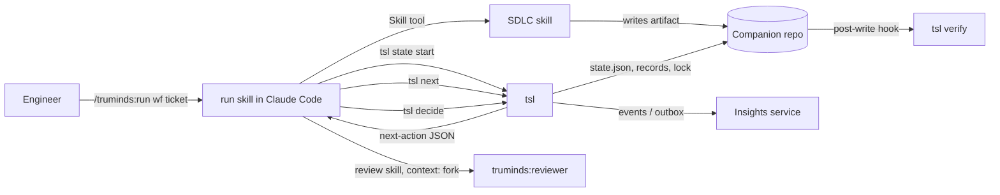
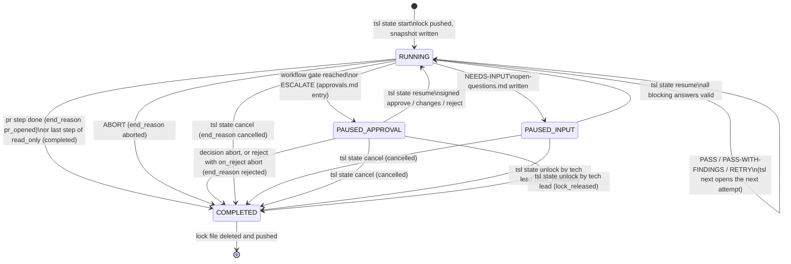
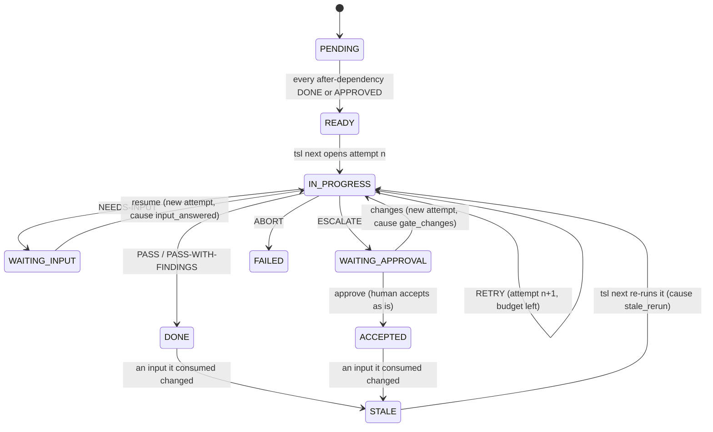
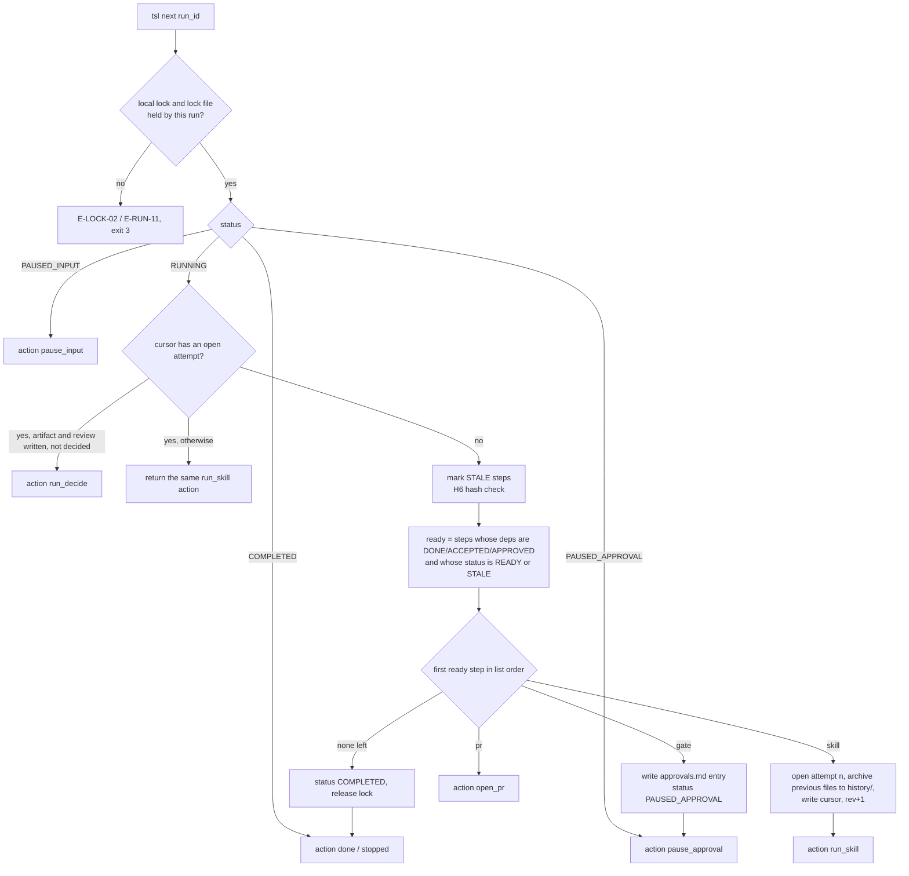
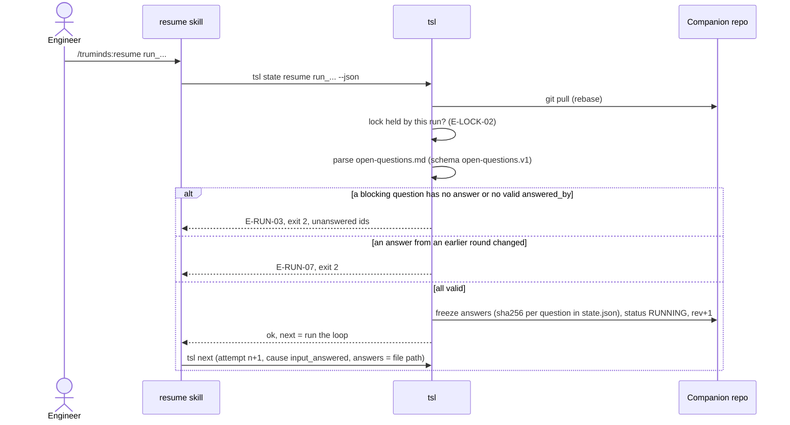
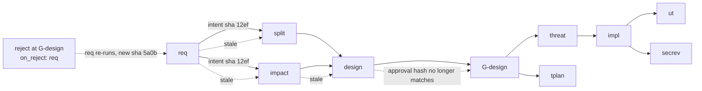
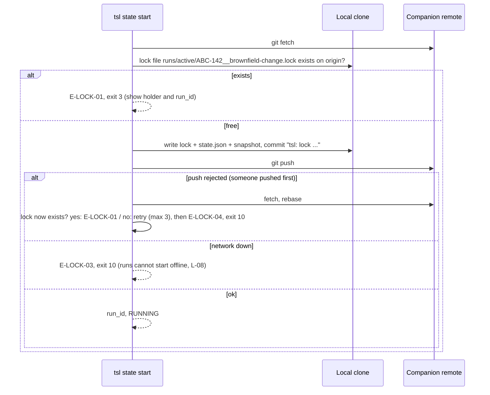

# SDD-02 · Workflow Orchestration and Chaining

| Field | Value |
| --- | --- |
| Status | Draft for owner review |
| Owner | Abhishek Verma, Ekjot Singh (workflow definition); Shubham Bansal (runtime in Claude Code) |
| Approver | Puneet Singh Nanda |
| Related docs | [Doc 3 Architecture](../architecture/03-architecture.md) §3, §4, §5, §7.1 · [Doc 5 API and Rules](../architecture/05-api-and-rules.md) §2, §3.3–3.7, §7 · [Doc 4 Design and UX](../ux/04-design-and-ux.md) §3, §4.2, §5 · [SDD-05 Claude Code integration](SDD-05-claude-code-integration.md) §4 · [SDD-03 Harness](SDD-03-harness.md) · [SDD-04 `tsl`](SDD-04-tsl-cli.md) · [SDD-07 Identity and signing](SDD-07-identity-signing.md) · [SDD-11 Improvement loop](SDD-11-improvement-loop.md) · [Readiness tracker](../planning/readiness-tracker.md) Q3 |

## 1. Scope

### 1.1 What this document decides

This is feature spec F2. It closes tracker Q3 ("Is skill chaining in place?"). It decides:

- the full `workflow.v1` schema: steps, versioned skill references, input mapping, human gates, retry limits and outcome transitions;
- the run and step state machines, every `state.json` field and the lock-file protocol;
- the `tsl next` algorithm, and the loop in the `run` skill (SDD-05 §4.2) that drives it;
- retries with findings fed back, pause for input, human approval gates and resume;
- how the six outcomes move a step and a run;
- how artifacts chain and how hashes prove the chain;
- the full `brownfield-change` workflow file;
- concurrency and crash recovery.

### 1.2 What it does not decide

| Topic | Owner document |
| --- | --- |
| What `tsl verify` and `tsl decide` check, the band formula, the reviewer | [SDD-03](SDD-03-harness.md) |
| Flags, exit codes and output of every `tsl` command | [SDD-04](SDD-04-tsl-cli.md) (this document adds commands to it, §12) |
| Plugin, hooks, policy, the `review` skill | [SDD-05](SDD-05-claude-code-integration.md) |
| SKILL.md format and `skill-metadata.v1` | [SDD-01](SDD-01-skill-authoring.md) |
| Signing keys and signature format | [SDD-07](SDD-07-identity-signing.md) |
| Companion repo creation and migration | [SDD-12](SDD-12-companion-repo.md) |

### 1.3 Core decision: code orchestrates, Claude executes

The orchestrator is `tsl`, not a prompt and not a subagent. `tsl next` reads the workflow and the run state and names the single next action. Claude only carries it out: it runs the named skill, runs the review, and calls `tsl decide`. The chain order, retry counting, pauses and gates are all code. This follows the Doc 3 rule "code decides, the LLM proposes" (R-12) and the tracker Q3 recommendation.

## 2. Context



Rules this design must respect: one active run per ticket and workflow (R-11); runs pin versions (R-08); every attempt keeps its own records (R-03); only `tsl decide` sets outcomes (R-12); runs happen only in local desktop or CLI sessions (SDD-05 C-16, C-17).

## 3. `workflow.v1` schema

### 3.1 Where workflow files live

| File | Location | Written by |
| --- | --- | --- |
| `<id>.workflow.yaml` | `plugins/truminds/workflows/` in the skill-library repo | Workflow owner (by PR) |
| `<id>.lock.json` (`workflow-lock.v1`) | Same folder | `tsl validate` at release (FR-WFL-02); committed by CI |
| `workflow.snapshot.yaml` | `runs/<run_id>/` in the companion repo | `tsl state start` (copy of the resolved workflow, with the lock data merged in) |

The snapshot lets a run resume with exactly the workflow it started with, even after a plugin upgrade (R-08).

### 3.2 Fields

Doc 5 §3.3 shows the short form. This is the full form. All additions are additive, so the schema stays `workflow.v1`.

**Top level**

| Field | Type | Req | Meaning |
| --- | --- | --- | --- |
| `schema` | const `workflow.v1` | Yes | |
| `id` | kebab-case string | Yes | Unique across the library |
| `version` | SemVer | Yes | Bumped on any change; major when a step is removed or an input binding changes |
| `title`, `description` | string | Yes | Shown in the portal catalogue |
| `owner` | pseudonym | Yes | Workflow owner |
| `kind` | `delivery` \| `read_only` | Yes | `read_only` workflows may not contain a `pr` step or a code-editing skill |
| `requires_fresh_pack` | bool | No (default `true`) | If true and the pack is not fresh, `tsl state start` warns (E-CTX-02) and every band is capped at Medium |
| `inputs` | map | Yes | Run-level inputs. Release 1 supports `ticket: {required: true}` only |
| `defaults.retry` | object | No | `{checks: 2, review: 2, verifier: 3}`. These are the org maximums (R-01, R-02); a workflow may lower them, never raise them |
| `defaults.max_rework` | int | No (default 2) | Max human-requested reworks per step (gate `changes` or `reject`) before the gate allows only `approve` or `abort` |
| `status` | `draft` \| `pilot` \| `production` \| `deprecated` | Yes | Lifecycle, same words as skills (SDD-01 §7). `deprecated` makes `tsl state start` print an E-DEP-01 warning (OPS-03 §7) |
| `steps` | list | Yes | Ordered list. The order is the tie-break for `tsl next` (§6.2) |

**Step: common fields**

| Field | Type | Req | Meaning |
| --- | --- | --- | --- |
| `id` | `^[a-z][a-z0-9-]{1,30}$` | Yes for skill steps | Unique in the workflow. Also the artifact base name |
| `after` | list of step or gate ids | No | Dependencies. Empty means "first" |
| exactly one of `skill`, `gate`, `pr` | | Yes | Step kind |

**Skill step**

| Field | Type | Req | Meaning |
| --- | --- | --- | --- |
| `skill` | `<skill-id>@<range>` | Yes | SemVer range, for example `design@^1.4`. Resolved to one exact version in the lock file |
| `inputs` | map `name → binding` | Yes if the skill declares required inputs | See §3.3 |
| `retry` | object | No | Per-step override of `defaults.retry` (lower only) |
| `on` | map outcome → transition | No | Overrides for §8. Release 1 allows only `ESCALATE: {gate_role: <role>}` |

**Gate step**

| Field | Type | Req | Meaning |
| --- | --- | --- | --- |
| `gate` | `^G-[a-z0-9-]+$` | Yes | Gate id. Also its id in `after` lists and in `approvals.md` |
| `role` | role from Doc 2 §2 | Yes | Role the approver must hold on the system (usually `tech_lead`) |
| `artifacts` | list of step ids | No (default: all steps in `after`) | Artifacts under approval; their hashes are signed into the approval |
| `on_reject` | step id upstream of the gate, or `abort` | Yes | Where the run goes on `reject` (US-07 AC3) |
| `on_changes` | step id | No (default: last step in `artifacts`) | Which step re-runs on `changes` |
| `self_approval` | bool | No | May only tighten `tsl.yaml` `gates.self_approval` |

**PR step**

| Field | Type | Req | Meaning |
| --- | --- | --- | --- |
| `pr` | `true` | Yes | Calls `tsl pr` |
| `draft_when_band` | `Medium` | No (default `Medium`) | PR opens as draft when the lowest band in the run is Medium (Doc 3 §5.5). A Low band never reaches here: it escalates first |
| `repos` | `changed` | No | One PR per product repo with changes (Doc 3 §3.1) |

### 3.3 Input bindings

How an output binds to a later input was the main gap in Q3. **Decision: bind by step id and output name.** Never by path and never by schema name alone. The schema is checked, not used to find the file.

| Binding | Example | Resolves to |
| --- | --- | --- |
| `<step>.<output>` | `impact: impact.impact` | The latest attempt of step `impact` with outcome PASS or PASS-WITH-FINDINGS, or accepted at a gate. Its output `impact` (from its `skill-metadata.v1`) |
| `run.ticket` | `ticket: run.ticket` | The ticket reference. The skill reads it through the Jira MCP read tools |
| `context.<section>` | `intent_baseline: context.intent-baseline` | A context-pack section (SDD-06) |
| `answers` | (implicit) | `open-questions.md` of the run, when the step was paused for input (§9) |
| `feedback` | (implicit) | The feedback file of the previous attempt, on a retry (§8.2) |

`tsl validate` checks every binding (rules in §3.5). The input check that runs as code at the start of every SDLC skill (`` !`tsl verify --inputs` ``, SDD-05 §5.1) resolves the same bindings again at run time and fails with E-IN-01 (missing) or E-IN-02 (stale).

### 3.4 JSON Schema (excerpt; full file `schemas/workflow.v1.json`)

```yaml
$schema: https://json-schema.org/draft/2020-12/schema
$id: workflow.v1
type: object
required: [schema, id, version, title, description, owner, kind, status, inputs, steps]
additionalProperties: false
properties:
  schema: {const: workflow.v1}
  id: {type: string, pattern: '^[a-z][a-z0-9-]{2,40}$'}
  version: {type: string, pattern: '^\d+\.\d+\.\d+$'}
  kind: {enum: [delivery, read_only]}
  status: {enum: [draft, pilot, production, deprecated]}
  requires_fresh_pack: {type: boolean, default: true}
  inputs: {type: object, properties: {ticket: {type: object, properties: {required: {const: true}}}}}
  defaults:
    type: object
    properties:
      retry: {$ref: '#/$defs/retry'}
      max_rework: {type: integer, minimum: 0, maximum: 5}
  steps: {type: array, minItems: 1, items: {oneOf: [{$ref: '#/$defs/skillStep'}, {$ref: '#/$defs/gateStep'}, {$ref: '#/$defs/prStep'}]}}
$defs:
  retry:
    type: object
    additionalProperties: false
    properties:
      checks: {type: integer, minimum: 0, maximum: 2}
      review: {type: integer, minimum: 0, maximum: 2}
      verifier: {type: integer, minimum: 0, maximum: 3}
  after: {type: array, items: {type: string}, uniqueItems: true}
  skillStep:
    type: object
    required: [id, skill]
    additionalProperties: false
    properties:
      id: {type: string, pattern: '^[a-z][a-z0-9-]{1,30}$'}
      skill: {type: string, pattern: '^[a-z][a-z0-9-]+@[\^~]?\d+(\.\d+){0,2}$'}
      after: {$ref: '#/$defs/after'}
      inputs: {type: object, additionalProperties: {type: string, pattern: '^(run\.ticket|context\.[a-z0-9-#/.]+|[a-z][a-z0-9-]*\.[a-z][a-z0-9-]*)$'}}
      retry: {$ref: '#/$defs/retry'}
      on: {type: object, properties: {ESCALATE: {type: object, properties: {gate_role: {type: string}}}}}
  gateStep:
    type: object
    required: [gate, role, after, on_reject]
    additionalProperties: false
    properties:
      gate: {type: string, pattern: '^G-[a-z0-9-]+$'}
      role: {enum: [tech_lead, eng_lead, stage_approver]}
      after: {$ref: '#/$defs/after'}
      artifacts: {type: array, items: {type: string}}
      on_reject: {type: string}
      on_changes: {type: string}
      self_approval: {const: false}
  prStep:
    type: object
    required: [pr, after]
    additionalProperties: false
    properties:
      pr: {const: true}
      after: {$ref: '#/$defs/after'}
      draft_when_band: {const: Medium}
      repos: {const: changed}
```

### 3.5 Validation rules (`tsl validate <workflow>`)

| Rule | Error | Exit |
| --- | --- | --- |
| File matches `workflow.v1` | E-WFL-01 | 2 |
| Ids unique; every `after`, `on_reject`, `on_changes` and binding names an existing step; the graph has no cycle | E-WFL-02 | 2 |
| Every required input of every skill has a binding, and the bound output's schema equals the input's schema in `skill-metadata.v1` | E-WFL-03 | 2 |
| Every skill range resolves to a version present in the plugin; result written to `<id>.lock.json` | E-WFL-04 | 2 |
| Retry limits do not exceed the org maximums (R-01, R-02) | E-WFL-05 | 2 |
| `on_reject` is upstream of the gate (or `abort`); `pr` has no step after it; `read_only` has no `pr` and no code-editing skill | E-WFL-02 | 2 |
| Every step is reachable from a step with no `after` | E-WFL-02 | 2 |

Marketplace CI runs `tsl validate` on every workflow (SDD-05 §3.4).

## 4. The worked example: `brownfield-change`

The steps and order match the run-detail prototype ([RunDetail.dc.html](../ux/prototype/RunDetail.dc.html)) and Doc 3 §7.1: requirement review, story split, impact analysis, design, design approval, threat model, implement, unit tests, secure review, test plan, pull request.

```yaml
schema: workflow.v1
id: brownfield-change
version: 1.3.0
title: Brownfield change
description: Take a ticket on an existing system from requirement to a reviewed pull request.
owner: wf-owner-2b                       # pseudonym; TBD by Puneet
kind: delivery
requires_fresh_pack: true
inputs:
  ticket: {required: true}
defaults:
  retry: {checks: 2, review: 2, verifier: 3}
  max_rework: 2
steps:
  - id: req
    skill: requirement-review@^1.0
    inputs: {ticket: run.ticket, intent_baseline: context.intent-baseline}
  - id: split
    skill: story-split@^1.0
    after: [req]
    inputs: {intent: req.intent}
  - id: impact
    skill: impact-analysis@^1.1
    after: [req]
    inputs: {intent: req.intent}
  - id: design
    skill: design@^1.4
    after: [split, impact]
    inputs: {impact: impact.impact, stories: split.stories}
  - gate: G-design
    role: tech_lead
    after: [design]
    artifacts: [design]
    on_reject: req                      # requirement was wrong: start again from req
    on_changes: design                  # design needs rework: re-run design with the comment
  - id: threat
    skill: threat-model@^1.0
    after: [G-design]
    inputs: {design: design.design}
  - id: impl
    skill: implement@^1.0
    after: [threat]
    inputs: {design: design.design, stories: split.stories}
  - id: ut
    skill: unit-test@^1.0
    after: [impl]
    inputs: {change: impl.change, stories: split.stories}
  - id: secrev
    skill: secure-code-review@^1.0
    after: [impl]
    inputs: {change: impl.change}
  - id: tplan
    skill: test-plan@^1.0
    after: [G-design]
    inputs: {stories: split.stories, design: design.design}
  - pr: true
    after: [ut, secrev, tplan]
    draft_when_band: Medium
    repos: changed
```

**Execution order.** `tsl next` runs ready steps one at a time, in list order (§6.2). The resulting order is `req → split → impact → design → G-design → threat → impl → ut → secrev → tplan → pr`, the same as the prototype.

**Change from Doc 5 §3.3:** `tplan` now waits for `G-design` instead of `design`. A test plan for a design the tech lead has not approved is wasted work. The gate step also gains `artifacts`, `on_reject` and `on_changes`.

**Resulting artifacts** in `artifacts/ABC-142/<run_id>/`: `req.md` (`intent.v1`), `split.md` (`stories.v1`), `impact.md` (`impact.v1`), `design.md` (`design.v1`), `threat.md` (`threat-model.v1`), `impl.md` (`change.v1` + code on the run branch), `ut.md` (`ut-result.v1`), `secrev.md` (`secure-review.v1`), `tplan.md` (`test-plan.v1`). Each has its `.checks.json`, `.review.json` and `.verification.json`.

## 5. State machines and `state.json`

### 5.1 Run states

The run status values are exactly those in Doc 3 §4.1 and the `run` table: `RUNNING`, `PAUSED_INPUT`, `PAUSED_APPROVAL`, `COMPLETED`. `end_reason` says why a run completed.



`end_reason` values: `pr_opened`, `completed`, `aborted`, `rejected`, `cancelled`, `lock_released`. A stale lock (DEF-06) can be released while the run is in any status; the run is then closed with `lock_released` the next time any `tsl` command touches it (§11.3).

### 5.2 Step states



Gate steps use `PENDING → WAITING_APPROVAL → APPROVED` (or back to `PENDING` when their artifacts change). The PR step uses `PENDING → READY → DONE`. `ACCEPTED` counts as done for dependencies. It is reported as a human override (SDD-11).

### 5.3 `state.json` (`run-state.v1`, full field list)

New fields are additive to Doc 5 §3.4.

| Field | Type | Meaning |
| --- | --- | --- |
| `schema` | `run-state.v1` | |
| `run_id` | `run_<ULID>` | |
| `rev` | int | Increases by 1 on every write. Used for optimistic concurrency (§11) |
| `workflow` | `<id>@<version>` | |
| `workflow_sha256` | hex | Hash of `workflow.snapshot.yaml` |
| `ticket`, `system` | string | Ticket ref and system code |
| `owner` | `key_<ULID>` | Key of the engineer who started the run (as in Doc 5) |
| `owner_pseudonym` | string | For messages; never a name |
| `status` | enum §5.1 | |
| `end_reason` | enum §5.1 or null | |
| `pinned` | object | `plugin`, `tsl`, `skills{id: version}` (R-08) |
| `pack` | object | `signed_at`, `fresh`, `source_sha{repo: sha}` at start |
| `branch` | map repo → object | `{name, base_sha, head_sha}` per product repo the run edits (§10.3) |
| `active_session` | object | `{session_id, host_hash, since}`; see §11.2 |
| `cursor` | object | `{step, attempt}` of the open attempt, or null |
| `steps[]` | list | One entry per workflow step, in workflow order |
| `steps[].id`, `.kind`, `.status` | | Kind `skill`, `gate` or `pr`; status from §5.2 |
| `steps[].budget_used` | object | `{checks, review, verifier, rework}` counters |
| `steps[].attempts[]` | list | `n`, `cause`, `skill` (`id@version`), `started_at`, `decided_at`, `outcome`, `band`, `artifact`, `artifact_sha256`, `record`, `inputs[{name, step, sha256}]`, `feedback` (path or null), `answers_sha256` (or null) |
| `gates[]` | list | `{id, kind (workflow \| escalate), step, status, artifacts[{step, sha256}], decision, approver_key, decided_at}` |
| `questions` | object | `{round, open_blocking, open_non_blocking, answered_sha256{Q-id: sha}}` |
| `prs[]` | list | `{repo, number, url, draft}` |
| `created_at`, `updated_at`, `heartbeat_at` | ISO 8601 UTC | |

`cause` values: `first`, `retry_checks`, `retry_review`, `retry_verifier`, `input_answered`, `gate_changes`, `gate_reject`, `stale_rerun`, `repin`. The `cause` is also sent in `step.decided` (§12). SDD-11 needs it to tell a first try from a retry.

```json
{
  "schema": "run-state.v1",
  "run_id": "run_01J9ZK2M4Q8X7T3B5N6R0VWYCD",
  "rev": 27,
  "workflow": "brownfield-change@1.3.0",
  "workflow_sha256": "b41c...",
  "ticket": "ABC-142",
  "system": "SYS-ORD",
  "owner": "key_01J9QW...",
  "owner_pseudonym": "eng-4f2a",
  "status": "PAUSED_INPUT",
  "end_reason": null,
  "pinned": {"plugin": "1.6.0", "tsl": "1.6.0", "skills": {"requirement-review": "1.2.3", "design": "1.4.0"}},
  "pack": {"signed_at": "2026-10-01T09:00:00Z", "fresh": true, "source_sha": {"orders-api": "4c1e...", "orders-web": "a77d..."}},
  "branch": {},
  "active_session": {"session_id": "6b0e...", "host_hash": "h_93f1", "since": "2026-10-06T09:58:00Z"},
  "cursor": null,
  "steps": [
    {"id": "impact", "kind": "skill", "status": "DONE", "budget_used": {"checks": 1, "review": 0, "verifier": 0, "rework": 0},
     "attempts": [
       {"n": 1, "cause": "first", "skill": "impact-analysis@1.1.2", "outcome": "RETRY", "band": null,
        "artifact": "artifacts/ABC-142/run_01J9ZK2M4Q8X7T3B5N6R0VWYCD/history/impact/a1/impact.md", "artifact_sha256": "77aa...",
        "record": "artifacts/ABC-142/run_01J9ZK2M4Q8X7T3B5N6R0VWYCD/history/impact/a1/impact.verification.json",
        "inputs": [{"name": "intent", "step": "req", "sha256": "12ef..."}], "feedback": null, "answers_sha256": null},
       {"n": 2, "cause": "retry_checks", "skill": "impact-analysis@1.1.2", "outcome": "PASS", "band": "High",
        "artifact": "artifacts/ABC-142/run_01J9ZK2M4Q8X7T3B5N6R0VWYCD/impact.md", "artifact_sha256": "9be1...",
        "record": "artifacts/ABC-142/run_01J9ZK2M4Q8X7T3B5N6R0VWYCD/impact.verification.json",
        "inputs": [{"name": "intent", "step": "req", "sha256": "12ef..."}],
        "feedback": "runs/run_01J9ZK2M4Q8X7T3B5N6R0VWYCD/feedback/impact.a1.json", "answers_sha256": null}]},
    {"id": "design", "kind": "skill", "status": "WAITING_INPUT", "budget_used": {"checks": 0, "review": 0, "verifier": 0, "rework": 0},
     "attempts": [{"n": 1, "cause": "first", "skill": "design@1.4.0", "outcome": "NEEDS-INPUT", "band": null,
       "artifact": "artifacts/ABC-142/run_01J9ZK2M4Q8X7T3B5N6R0VWYCD/design.md", "artifact_sha256": "3f9a...",
       "record": "artifacts/ABC-142/run_01J9ZK2M4Q8X7T3B5N6R0VWYCD/design.verification.json",
       "inputs": [{"name": "impact", "step": "impact", "sha256": "9be1..."}, {"name": "stories", "step": "split", "sha256": "c0d4..."}],
       "feedback": null, "answers_sha256": null}]},
    {"id": "G-design", "kind": "gate", "status": "PENDING", "attempts": []}
  ],
  "gates": [],
  "questions": {"round": 1, "open_blocking": 1, "open_non_blocking": 1, "answered_sha256": {}},
  "prs": [],
  "created_at": "2026-10-06T09:58:00Z",
  "updated_at": "2026-10-06T10:20:00Z",
  "heartbeat_at": "2026-10-06T10:20:00Z"
}
```

(The step list is shortened here. The real file lists every step.)

### 5.4 Companion repo additions

```text
runs/<run_id>/
├─ state.json
├─ workflow.snapshot.yaml        # new: resolved workflow at start
├─ open-questions.md
├─ approvals.md
├─ feedback/<step>.a<n>.json     # new: feedback.v1, input to attempt n+1
└─ .local.lock                   # new: machine-local, listed in .gitignore
artifacts/<ticket>/<run_id>/
├─ <step>.md + .checks.json + .review.json + .verification.json   # latest attempt
└─ history/<step>/a<n>/...       # new: earlier attempts, moved here by tsl verify, never edited (R-03; folder form from SDD-03 §2.1)
```

## 6. `tsl next`

### 6.1 Contract

`tsl next <run_id> [--json]`. It reads `state.json`, the snapshot and the records. It returns one action. It is **idempotent**: calling it twice without a `tsl decide` in between returns the same open attempt. It never opens a second attempt.

Output (`next-action.v1`, inside the standard `--json` envelope of Doc 5 §2.3, in `data`):

| Field | Meaning |
| --- | --- |
| `action` | `run_skill`, `run_decide`, `pause_input`, `pause_approval`, `open_pr`, `done`, `stopped` |
| `step`, `attempt`, `cause` | The step and the attempt number to work on |
| `skill` | `id@version` (pinned) |
| `artifact_path` | Where the skill must write its artifact |
| `inputs[]` | `{name, path, sha256, schema}` for every binding |
| `feedback` | Path to `feedback.v1` on a retry, else null |
| `answers` | Path to `open-questions.md` when the attempt follows a pause for input, else null |
| `context_sections[]` | From `skill-metadata.v1` (DEF-04 size budget) |
| `budget` | `{checks: "1/2", review: "0/2", verifier: "0/3"}` |
| `progress` | `{index: 5, total: 11}` for messages like "Step design (5/11)" |

The text after the `--json` envelope's `next` field is always a literal instruction for the `run` skill, for example `run skill design@1.4.0`.

### 6.2 Algorithm



```python
def next_action(run_id):
    st = load_state(run_id); wf = load_snapshot(run_id)
    assert_lock_held(st)                      # §11.1, E-LOCK-02
    assert_session(st)                        # §11.2, E-RUN-11
    if st.status == "COMPLETED": return done_or_stopped(st)
    if st.status == "PAUSED_INPUT": return pause_input(st)
    if st.status == "PAUSED_APPROVAL": return pause_approval(st)
    if st.cursor:                             # an attempt is open
        a = open_attempt(st)
        if exists(a.artifact) and exists(review_path(a)) and not exists(record_path(a)):
            return action("run_decide", a)
        return action("run_skill", a)         # idempotent: same attempt again
    mark_stale(st, wf)                        # §10.2
    for step in wf.steps:                     # list order is the tie-break
        if not deps_done(step, st) or status(st, step) not in ("READY", "STALE", "PENDING"):
            continue
        if step.kind == "skill":
            cause = "stale_rerun" if status(st, step) == "STALE" else pending_cause(st, step)
            a = open_new_attempt(st, step, cause)   # archives files of attempt n-1
            return action("run_skill", a, inputs=resolve_bindings(step, st))
        if step.kind == "gate":
            write_gate_entry(st, step)        # §9.2
            set_status(st, "PAUSED_APPROVAL"); return pause_approval(st)
        if step.kind == "pr":
            return action("open_pr")
    set_status(st, "COMPLETED", end_reason=final_reason(wf)); release_lock(st)
    return action("done")
```

`pending_cause` is `first` unless the step is being re-run after a gate decision (`gate_changes`, `gate_reject`) or after `repin`.

### 6.3 Parallel steps

Claude Code runs one step at a time in one session. Steps that are independent in the graph, such as `ut`, `secrev` and `tplan`, run one after another in list order. Running them in parallel subagents is not designed for Release 1. The graph keeps the door open: a later `tsl next --all-ready` could return several actions.

## 7. The `run` skill loop

This refines SDD-05 §4.2. The skill body is plain instructions; every decision comes from `tsl`.

```markdown
---
name: run
description: Start a Truminds workflow on a ticket. Only when the user types /truminds:run.
argument-hint: <workflow> <ticket>
disable-model-invocation: true
allowed-tools: Bash(tsl *), Read, Grep, Glob, Write, Edit
---
Run state from tsl (do not edit):
!`tsl state start $0 $1 --json`

If "ok" is false, show "message" and "next" to the user and stop.

Loop:
1. Run `tsl next <run_id> --json` and read "data.action".
2. run_skill: use the skill named in "data.skill". Give it "data.inputs",
   "data.feedback" and "data.answers". It must write exactly "data.artifact_path".
   If the post-write hook blocks the write, fix what it says and write again.
3. Run the `review` skill on "data.artifact_path".
4. Run `tsl decide <artifact_path> --json`. Show its status line to the user.
   Then go back to step 1, whatever the outcome.
5. run_decide: go straight to step 4.
6. open_pr: run `tsl pr <run_id> --json`, then go back to step 1.
7. pause_input, pause_approval, done, stopped: show "message" and "next" and stop.
Never decide pass or fail yourself. Never edit state.json, records or approvals.
```

`/truminds:resume` uses the same loop. Its first line is `` !`tsl state resume $0 --json` `` instead of `state start`.

**Mapping from `tsl decide` to the loop.** `tsl decide` writes the record and updates `state.json` itself. The loop always goes back to `tsl next`, which reads the new state. The `next` field and exit code of `decide` are for the user message only:

| Outcome | `decide` exit | `decide` `next` text | What `tsl next` then returns |
| --- | --- | --- | --- |
| PASS | 0 | `continue` | Next ready step |
| PASS-WITH-FINDINGS | 0 | `continue` | Next ready step |
| RETRY | 2 | `retry with feedback` | `run_skill`, same step, attempt n+1 |
| NEEDS-INPUT | 4 | `/truminds:resume <run_id> after answering` | `pause_input` |
| ESCALATE | 4 | `approver runs tsl approve <run_id> <gate>` | `pause_approval` |
| ABORT | 5 | `stopped` | `stopped` |

**Unverified.** Whether Claude reliably invokes the named SDLC skill from inside the `run` skill, and keeps the loop going over many steps, is model behaviour. It is not a documented platform fact. Spike S-09 (SDD-05 §8.1) tests it end to end. Safety does not depend on it: if the loop stops early, the run stays in a valid state and `/truminds:resume` continues it.

## 8. Outcomes, retries and feedback

### 8.1 How each outcome moves the step and the run

| Outcome | Step status | Run status | Budget | Files written by `tsl decide` | Events |
| --- | --- | --- | --- | --- | --- |
| PASS | DONE | RUNNING | — | verification record | `step.decided` |
| PASS-WITH-FINDINGS | DONE | RUNNING | — | record; minor findings kept for the PR body | `step.decided` |
| RETRY | IN_PROGRESS (next attempt opened by `tsl next`) | RUNNING | +1 on `checks`, `review` or `verifier` | record, `feedback/<step>.a<n>.json` | `step.decided` |
| NEEDS-INPUT | WAITING_INPUT | PAUSED_INPUT | none | record, `open-questions.md` (new round) | `step.decided`, `question.created` per question, `run.status_changed` |
| ESCALATE | WAITING_APPROVAL | PAUSED_APPROVAL | none | record, `approvals.md` entry `G-escalate-<step>-a<n>` | `step.decided`, `run.status_changed` |
| ABORT | FAILED | COMPLETED (`aborted`) | — | record; lock released | `step.decided`, `security.abort` when caused by E-SEC/E-POL, `run.status_changed` |

**Budget exhausted.** When a retry would exceed the budget for its kind (Doc 5 R-01, R-02), `tsl decide` returns ESCALATE instead (Doc 3 §5.4 `gate_outcome`). The approvals entry gives the reason `retry budget exhausted (<kind>)`.

**Which budget a RETRY uses.** H3 failures use `verifier`. Other hard-gate failures (H1, H2, H4 invented values, H5 trace) use `checks`. Major findings use `review`. A post-write hook block inside an open attempt also counts: each blocked write adds 1 to `checks` (or `verifier` for H3), as Doc 5 §4.2 says. When the budget is used up, `tsl verify` tells Claude to run `tsl decide` now. Decide then escalates.

### 8.2 Feedback on retry (`feedback.v1`)

`tsl decide` writes `runs/<run_id>/feedback/<step>.a<n>.json` on every RETRY. `tsl next` passes it to attempt n+1 as `data.feedback`.

```json
{
  "schema": "feedback.v1",
  "run_id": "run_01J9ZK2M4Q8X7T3B5N6R0VWYCD", "step": "impact", "from_attempt": 1,
  "kind": "checks",
  "gate_failures": [{"id": "H5", "detail": "Claim C4 has no trace to a REQ item"}],
  "findings": [{"id": "F-2", "severity": "major", "text": "Retention job not listed as impacted", "cites": ["orders-api:src/jobs/retention.js#L12"]}],
  "dropped": ["F-5"],
  "must_resolve": ["H5", "F-2"]
}
```

Rules:

- Only **verified** findings go into feedback. Dropped findings (no valid citation, R-13) are listed by id only, so the skill does not chase them.
- The next artifact's envelope must list `resolves: [{id: F-2, how: "..."}]` for every id in `must_resolve` (additive envelope field). Missing entries fail H2.
- `tsl review prepare` gives the reviewer the previous findings, so it can check they are fixed.
- If the same finding id (same severity and the same citation) comes back on the next attempt, `tsl decide` escalates at once instead of spending the remaining budget.

## 9. Pauses: input and approval

### 9.1 Pause for input

**Where questions come from.** `tsl decide` collects two sources:

1. verified blocker findings from the reviewer;
2. questions the skill raised in its envelope: `questions: [{id, text, blocking, ask, evidence, options, default}]` (additive envelope field).

A question whose `evidence` citation does not verify is dropped (Doc 4 §3). S4 counts the rest.

**The file.** `tsl decide` writes `runs/<run_id>/open-questions.md` in the `open-questions.v1` template (Doc 4 §3). A second pause in the same run adds a new round below the first, with new ids (`Q-03`, `Q-04`) and `round: 2` in each heading. Earlier rounds are never rewritten.

**Who answers.** Anyone with write access to the companion repo edits the `answer`, `answered_by` and `decision` fields and pushes. Whether client people may do this is OQ-14.

**Resume (`tsl state resume <run_id>`):**



- `answered_by` must hold a name and an email address (US-04 AC1). See open item 6 for the conflict with Doc 4.
- A non-blocking question left empty takes its proposed default. The record of the re-run step stores `accepted_default: true` (US-04 AC2).
- After resume, an answered block cannot change. A change is a new block `## Q-01 · revision 2` with a `reason:` line (US-04 AC3). `tsl` detects edits by the frozen hashes.
- An input pause does not use retry budget.

### 9.2 Human approval gates

There are two kinds of gate entries in `runs/<run_id>/approvals.md` (`approvals.v1`, Doc 4 §4.2):

| Kind | Id | Written when | Role |
| --- | --- | --- | --- |
| Workflow gate | Gate id, for example `G-design` | `tsl next` reaches a gate step | `role` in the workflow |
| Escalation | `G-escalate-<step>-a<n>` | `tsl decide` returns ESCALATE | `tech_lead`, or `on.ESCALATE.gate_role` |

Each entry lists the artifacts under approval with their sha256, the reason, and empty `decision` and `comment` fields.

**Decisions:**

| Decision | Workflow gate | Escalation |
| --- | --- | --- |
| `approve` | Gate APPROVED; run continues | Step ACCEPTED as is (human override, SDD-11) |
| `changes` | Step `on_changes` re-runs; comment becomes feedback; cause `gate_changes`; +1 `rework` | Same step re-runs with the comment; +1 `rework`; retry budgets reset once |
| `reject` | Run goes back to `on_reject`; that step and everything after it become STALE; cause `gate_reject`; or the run ends `rejected` if `on_reject: abort` | Run ends `rejected` |
| `abort` | Run ends `rejected` | Run ends `rejected` |

When `rework` reaches `max_rework`, only `approve` or `abort` are accepted.

**Signing (`tsl approve <run_id> <gate>`).** The approver fills `decision` and `comment` and runs `tsl approve`. `tsl`:

1. pulls the companion repo;
2. checks the approver holds `role` on the system at this moment (`/v1/me`, cached for 24 hours offline, Doc 2 §2), else E-AUTH-05;
3. refuses self-approval when the approver's key or user generated any attempt of a gated step, unless allowed by `tsl.yaml`, else E-AUTH-06; an allowed self-approval is recorded with `self_approved: true`;
4. checks each listed artifact's sha256 still matches the file, else E-RUN-08;
5. signs, with Ed25519 (SDD-07), the canonical JSON of `{run_id, gate, artifacts[{step, sha256}], decision, comment_sha256, role, key_id, approved_at}`;
6. appends the signature block below the entry (Doc 4 §4.2), commits and pushes;
7. sends `approval.recorded`.

`tsl state resume` then verifies the signature, the key status and the hashes again before it sets the run to RUNNING. If a gated artifact changes later (a re-run after a reject upstream), the approval no longer matches and the gate returns to PENDING.

**MCP write approvals.** An approval for an external write (R-14, policy.v2 `write_tools_need_approval`) uses the same file and signing, with id `W-<n>` and an `action:` line naming the tool and target. The pre-mcp hook checks it (SDD-05 §5.3).

## 10. Artifact chaining and hashing

### 10.1 Hashes

- **Artifact hash:** SHA-256 of the file bytes after normalising line endings to LF (Doc 5 §1.1).
- **Input hashes:** every artifact envelope lists `inputs: [{path, sha256}]` (Doc 5 §3.6). `tsl next` fills them; the skill copies them in; H1 fails if they differ from what `tsl next` gave.
- **Record chain:** the verification record gains `inputs: [{step, attempt, sha256}]` (additive to `verification.v1`, owned by SDD-03). `tsl ci-verify` checks that every consumed hash equals the final artifact hash of the producing step. A PR whose records do not chain fails with E-CI-02.
- **Code:** `change.v1` and `ut-result.v1` envelopes carry `code: [{repo, base_sha, head_sha, diff_sha256, files[]}]`. `diff_sha256` is over `git diff --no-color --no-ext-diff <base_sha> <head_sha>` with LF line endings.

### 10.2 Staleness and downstream re-runs

On every call, `tsl next` compares each DONE or ACCEPTED step's recorded input hashes with the current final artifact hash of the producing step. Any mismatch marks the step STALE (H6, DEF-02), then everything downstream of it too. It sends `step.invalidated {step, cause_step, reason}`. The reason is one of `stale_input`, `gate_reject` or `repin`.



A re-run step whose new artifact is byte-identical to the old one gets the same hash, so nothing downstream goes stale.

### 10.3 Code on the run branch

- At the first code-editing step, `tsl next` creates a local branch `tsl/<ticket>/<run_id>` in each product repo the step may edit, from the default-branch head. It records `base_sha`.
- Claude edits files. Policy blocks `git push` and `git commit --amend` inside a run (SDD-05 §6.4).
- On PASS of a code step, `tsl decide` makes a local checkpoint commit `tsl: <run_id> <step> a<n>` and records `head_sha`. Nothing is pushed until `tsl pr`.
- On RETRY, the working tree keeps the attempt's edits; the next attempt changes them.
- `tsl pr` pushes the branch and opens one PR per changed repo, all with the same run id marker (Doc 4 §4.1). This also covers multi-repo runs.

## 11. Concurrency and crash recovery

### 11.1 Lock-file protocol (`run-lock.v1`, Doc 5 §3.5)



- **Heartbeat:** every `tsl` call on the run updates `heartbeat_at` in the lock and `state.json`. They are pushed at the sync points below. DEF-06 stale = no state change for `gates.lock_timeout_hours` (default 24).
- **Release:** at COMPLETED, `tsl` deletes the lock, commits and pushes. If offline, the release is pushed by the next `tsl` call that has network; `tsl state show` displays "lock release pending".
- **Forced release:** `tsl state unlock <ticket> <workflow>` (tech lead, stale locks only). It deletes the lock and pushes, and writes `run.status_changed` with reason `lock_released`. When the original owner's `tsl` next touches that run, it finds the lock gone or held by another run, closes the run with `end_reason: lock_released` and fails with E-LOCK-02.

**Sync points** (commit, then push when online):

| Point | Push required? |
| --- | --- |
| `tsl state start` | Yes (it takes the lock) |
| `tsl decide` | Best effort |
| Pause (input or approval) | Best effort, with a warning when offline, because others need the files |
| `tsl approve`, `tsl state resume` | Pull first. Push required for approve |
| COMPLETED | Best effort; lock release retried |

Per-run folders mean the only shared file is the lock (Doc 3 §3), so a rebase never conflicts on run data.

**One lock file (registry decision).** The lock is the single file `runs/active/<ticket>__<workflow>.lock` (`run-lock.v1`). Its fixed path is what makes a second laptop's `git push` fail, so it gives multi-laptop safety on its own. SDD-12's separate `.claim` file and `runs/<run_id>/lock` body are not used. From SDD-12 §3.3 this protocol keeps: fetch and rebase before writing, up to 3 push retries, dropping the local start commit when another run won, and E-LOCK-04 when pushes keep failing with the network up ([registry](../architecture/registry.md) §10, row 9).

### 11.2 Two sessions on one run

- **Same machine:** `runs/<run_id>/.local.lock` is created with exclusive-create (`O_CREAT|O_EXCL`) and holds the pid. A second `tsl` process on the same run waits up to 5 s, then fails with E-RUN-11. A lock whose pid is dead is removed.
- **Same run, two Claude sessions:** `state.json` `active_session` holds the session id from `TSL_SESSION_ID` (SDD-05 §5.5). If another session calls `tsl next` and the holder's heartbeat is newer than 15 minutes, `tsl` fails with E-RUN-11. `tsl state resume --take-over` moves the run to the new session. Passing the session id to `tsl` is unverified (U-06, spike S-08); without it, only the machine-local lock applies.
- **Optimistic writes:** every write re-reads `rev`, applies the change and writes `rev+1`. Writes are atomic: temp file, fsync, rename. A `rev` mismatch means another writer won; `tsl` re-reads and re-applies once, then fails with E-RUN-11.

### 11.3 Crash cases

| Crash point | What is on disk | Recovery |
| --- | --- | --- |
| Session closes mid-skill, no artifact | Cursor open, no artifact | `/truminds:resume` → `tsl next` returns the same `run_skill` |
| Artifact half-written | Invalid artifact | Hook or `tsl verify` fails H1; Claude rewrites (counts as a checks round) |
| After review, before decide | `.review.json` exists, no record | `tsl next` returns `run_decide` |
| During `tsl decide` | Temp files only (atomic rename) | Decide runs again; records are keyed by `run_id + step + attempt` (R-05), so a repeat is a no-op |
| `state.json` damaged or lost | Records intact | `tsl state repair <run_id>` rebuilds `state.json` from the snapshot, the signed records and `approvals.md`. Records are the source of truth |
| Laptop lost mid-run | Last pushed state | Owner runs `tsl login` on a new device (new key) and `/truminds:resume`. Unpushed work since the last sync is lost and re-run |
| Plugin upgraded mid-run | Snapshot and pins | See §11.4 |
| Seat usage limit reached mid-run (Q38) | Like a closed session | Resume later; nothing special |

### 11.4 Plugin upgrade during a run

The workflow is pinned through the snapshot. Skills are a gap: the plugin holds only one version of each skill, so a run cannot always use its pinned skill version after an upgrade (R-08). Proposed rule:

- `tsl state resume` and `tsl next` compare `pinned.skills` with the installed versions.
- **Same major:** `tsl next` fails with E-RUN-10 and offers `tsl state repin <run_id>`. Repin records the new versions; steps already decided keep their records; open and future steps use the new version (cause `repin`).
- **Different major:** repin also marks every step that used that skill STALE, because its output schema may differ (R-10).

This needs Puneet's decision (open item 1).

## 12. Interfaces added or changed

| Kind | Item | Owner doc to update |
| --- | --- | --- |
| Command | `tsl next <run_id>` (contract §6.1) | SDD-04 |
| Command | `tsl state cancel <run_id> --reason <text>` (run owner or tech lead) | SDD-04, Doc 5 §2.2 |
| Command | `tsl state repair <run_id>` | SDD-04 |
| Command | `tsl state repin <run_id>` | SDD-04 |
| Flag | `tsl state resume --take-over` | SDD-04 |
| Schema | `workflow.v1` full form (§3); `workflow-lock.v1`; `next-action.v1`; `feedback.v1` | Doc 5 §3, `schemas/` |
| Schema (additive) | `run-state.v1` fields (§5.3); envelope `questions[]`, `resolves[]`, `code[]`; `verification.v1` `inputs[]` | Doc 5 §3.4, §3.6, §3.7; SDD-03 |
| Event | `step.invalidated {step, cause_step, reason}` | Doc 5 §5.3, SDD-08 |
| Event field (additive) | `step.decided.cause`; `run.status_changed.reason_code` values = `end_reason` values plus `paused_input`, `paused_approval`, `resumed` | Doc 5 §5.3, SDD-08 |
| Error codes | E-WFL-01 to E-WFL-05 (exit 2); E-RUN-09 step is not the open step (3); E-RUN-10 pinned skill version not installed (3); E-RUN-11 run busy in another process or session (3); E-RUN-04 to E-RUN-06 keep their SDD-04 §5 meanings (registry §2); E-RUN-07 answers changed after resume (2); E-RUN-08 approval does not match artifact (3); E-LOCK-02 lock lost or released (3); E-LOCK-03 cannot take lock offline (10); E-LOCK-04 lock push still rejected after 3 retries with the network up (10) | Doc 4 §5.2 |
| Workflow example | `tplan` after `G-design`; gate fields | Doc 5 §3.3 |

E-RUN-09 is how FR-RUN-02 is enforced now: the skill's `` !`tsl verify --inputs` `` check fails when the skill is not the open attempt of the active run.

## 13. Error handling and security

- Every `tsl` failure uses the Doc 5 §2.3 envelope. The `run` skill reads `code`, `exit` and `next` only.
- `tsl next` and `tsl decide` never trust the model: the step, attempt and artifact path come from `state.json`, not from Claude.
- `approvals.md` and `open-questions.md` are free-text files that others edit. `tsl` parses only the defined fields. Text in them is passed to skills as data, inside the `answers` or `feedback` input, never as instructions. Prompt-injection handling is in SEC-01.
- Gate entries and answers are bound by hash; an edit after approval or resume is detected (E-RUN-07, E-RUN-08).
- Events carry ids, counts and outcomes only. No question text, comment text or artifact text (Doc 5 §5.3).

## 14. Test plan

| Layer | Tests |
| --- | --- |
| Unit | Binding resolution; topological order with list tie-break; every transition in §5.1 and §5.2; budget counting per kind; `max_rework`; `cause` values |
| Golden-file | `tsl next` on stored state + snapshot fixtures gives the stored action, one fixture per action |
| Contract | `workflow.v1`, `next-action.v1`, `feedback.v1`, `run-state.v1` validate against samples; invalid samples fail with the right E-WFL code |
| Lock | Two clones race `tsl state start` against a local bare remote: exactly one wins; offline start fails E-LOCK-03; stale unlock then owner touch gives E-LOCK-02 |
| Crash | Kill `tsl decide` between temp write and rename; corrupt `state.json` then `tsl state repair`; second process gets E-RUN-11 |
| Pause | Resume refused with an empty blocking answer (E-RUN-03); refused after editing a frozen answer (E-RUN-07); non-blocking default recorded |
| Gate | Approve, changes, reject (to `req` and to `abort`), self-approval refused, role missing, artifact changed after approval (E-RUN-08) |
| Chain | Reject at G-design marks `split`, `impact`, `design` STALE; identical re-run output marks nothing stale; CI rejects a broken record chain |
| End-to-end | `brownfield-change` on the sample system (ADR 0004) with seeded failures: one RETRY, one NEEDS-INPUT, the design gate, a PR |

All fixtures use the invented order-tracking ticket ABC-142. No client data (T-01).

## 15. Done criteria

- `schemas/workflow.v1.json`, `workflow-lock.v1.json`, `next-action.v1.json`, `feedback.v1.json` and the updated `run-state.v1.json` merged, with valid and invalid samples.
- `brownfield-change.workflow.yaml` and its lock file pass `tsl validate`; the other Release-1 workflows in Doc 3 §7.1 are written in the same form.
- `tsl next`, `tsl state start|resume|show|unlock|cancel|repair|repin` and `tsl approve` implemented with the tests in §14 passing.
- `run` and `resume` skills written as in §7 and proven in spike S-09.
- The end-to-end run on the sample system reaches a PR, and the run-detail screen data (Doc 4 §2.0.4) can be built from `state.json` alone.
- New error codes added to Doc 4 §5.2, new commands to SDD-04, new event and fields to SDD-08.

## 16. Open items

| # | Item | Ref | Owner |
| --- | --- | --- | --- |
| 1 | Skill pinning after a plugin upgrade: accept `tsl state repin` (§11.4), or keep older skill versions available to running runs | new (R-08) | TBD by Puneet |
| 2 | Workflow names differ: PRD FR-WFL-03 and US-01 use `brownfield-feature`, `defect-triage`, `greenfield-architecture`, `greenfield-bootstrap`; Doc 3 §7.1 uses `brownfield-change`, `greenfield-feature`, `defect-fix`, `ux-review`, `estimate`. This document uses Doc 3 names | new | Puneet |
| 3 | Run handover to another engineer (owner away): today only a stale-lock release and a new run | new | TBD by Puneet |
| 4 | Parallel steps in subagents (`tsl next --all-ready`) | Q3 | Abhishek Verma, Ekjot Singh; Shubham Bansal (Phase 2+) |
| 5 | May client people answer `open-questions.md` directly? | OQ-14 | Puneet |
| 6 | `answered_by` format: US-04 says name and email; Doc 4 §3 says name or pseudonym. This document follows US-04 | new | Puneet |
| 7 | Session takeover window (15 minutes) and local wait (5 s) are proposals | new | Shubham Bansal |
| 8 | Pilot workflows | OQ-04 | Puneet |
| 9 | Event names in PRD §5 and US-02/US-03 (`run_started`, `skill_finished`, `run_paused`, `answers_recorded`) differ from Doc 5 §5.3 (`run.started`, `step.decided`, `run.status_changed`, `question.answered`). This document uses Doc 5 names | new | Gaurav Saini |
