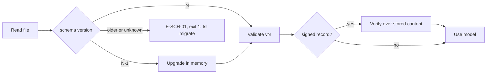
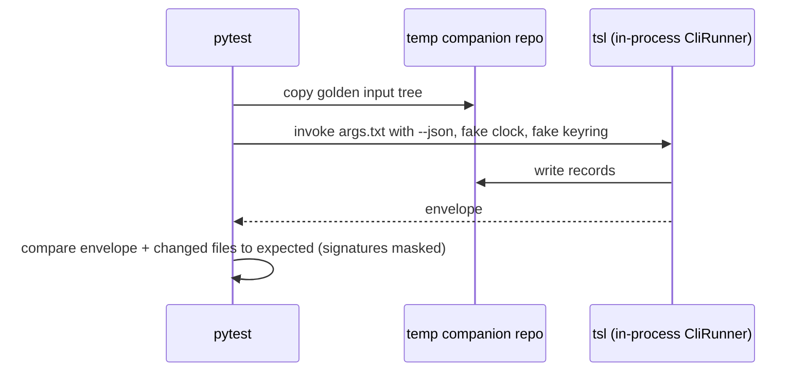

# SDD-04 · `tsl` command-line tool

| Field | Value |
| --- | --- |
| Status | Draft for owner review |
| Owner | Japman Singh, Yash Khorwal |
| Approver | Puneet Singh Nanda |
| Related docs | [Doc 3 Architecture](../architecture/03-architecture.md) · [Doc 5 API and Rules](../architecture/05-api-and-rules.md) · [Doc 4 Design and UX](../ux/04-design-and-ux.md) §5 · [SDD-05 Claude Code integration](SDD-05-claude-code-integration.md) · [SDD-07 Identity, signing and keys](SDD-07-identity-signing.md) · [SDD-02 Workflow orchestration](SDD-02-workflow-orchestration.md) · [SDD-03 Harness](SDD-03-harness.md) · [SDD-06 Context pack](SDD-06-context-pack.md) · [SDD-08 Telemetry](SDD-08-telemetry-insights.md) · [Readiness tracker](../planning/readiness-tracker.md) Q1 (F5) |

## 1. Scope

### 1.1 What this document decides

- The package layout and module tree of `truminds-tsl`.
- The full command reference: arguments, options, `--json` output, exit codes and error codes for every command.
- The JSON output envelope and the error catalogue additions.
- The two config files: `~/.truminds/config.toml` (per user) and `tsl.yaml` (per companion repo).
- The local outbox format.
- Logging, versioning and N/N-1 schema compatibility.
- Performance budgets for NFR-01 and NFR-02, and the test approach.

### 1.2 What it does not decide

| Topic | Owner document |
| --- | --- |
| Check logic (H1–H7, signals S1–S6, band, outcome) | [SDD-03](SDD-03-harness.md) |
| Which step runs next, retries, gates, parallel steps | [SDD-02](SDD-02-workflow-orchestration.md) |
| Hook wiring, `hooks.json`, `policy.v2`, managed settings | [SDD-05](SDD-05-claude-code-integration.md) |
| Login, tokens, keys, signing, canonical JSON | [SDD-07](SDD-07-identity-signing.md) |
| Extractors and drift | [SDD-06](SDD-06-context-pack.md) |
| Event body schemas and the ingest API | [SDD-08](SDD-08-telemetry-insights.md) |
| Companion repo creation on GitHub and migrations | [SDD-12](SDD-12-companion-repo.md) |

`tsl` is the only place where these pieces meet, so this document fixes the command surface and leaves the logic behind each command to its owner.

### 1.3 Ground rules

- `tsl` never calls an LLM and never calls the Claude API (C-01, C-02). It runs the same in CI and on the laptop.
- Code decides; the model proposes. Only `tsl decide` sets an outcome and band (R-12).
- `tsl` writes to Jira, Confluence or a client system never. It writes only to the companion repo, to product-repo branches through `tsl pr`, and to the insights service.
- No hidden commands, no debug flags that skip checks, no environment variable that disables signing or policy.

## 2. Package layout

### 2.1 Distribution

| Item | Decision |
| --- | --- |
| Package name | `truminds-tsl`, entry point `tsl = "tsl.cli.app:main"` |
| Python | 3.12 only (`requires-python = ">=3.12,<3.13"`) |
| Install | `uv tool install "truminds-tsl @ <release-wheel-URL>"` (SDD-05 §7.1) |
| Version | SemVer; equals the plugin version (SDD-05 §3.2). Single source: `tsl/src/tsl/__init__.py:__version__` |
| Source | `tsl/` in the skill-library repo |

### 2.2 Runtime dependencies

| Library | Use | Notes |
| --- | --- | --- |
| `typer` | Command tree, help, completion | Fixed by the stack |
| `pydantic` v2 | Typed models for every file and payload | Fixed by the stack |
| `jsonschema` | Validation against the published JSON Schemas (draft 2020-12) | Fixed by the stack |
| `cryptography` | Ed25519 sign and verify | Fixed by the stack |
| `python-ulid` | `run_`, `evt_`, `dev_` ids | Doc 3 §11 |
| `msal`, `msal-extensions` | Entra ID device-code login, token cache | SDD-07 §4 |
| `keyring` | OS keychain access | SDD-07 §4.3 |
| `rfc8785` | RFC 8785 canonical JSON (JCS) | SDD-07 §6.2 |
| `httpx` | HTTP to the insights service and GitHub REST | Timeouts, HTTP/1.1 |
| `truststore` | Use the OS certificate store (corporate TLS inspection) | New; see open items |
| `PyYAML` | `tsl.yaml`, `policy.yaml`, front matter | Safe loader only |
| `tomli-w` | Writes `config.toml` (`tomllib` reads it) | Small |

**Git access** uses a thin wrapper over the `git` command line (`subprocess`), not GitPython. GitPython also shells out to `git`, and its import cost (about 100 ms) eats into the hook budget (NFR-02). This changes Doc 3 §11; see §13.

### 2.3 Module tree

```text
tsl/
├─ pyproject.toml
├─ src/tsl/
│  ├─ __init__.py              # __version__
│  ├─ __main__.py              # python -m tsl
│  ├─ cli/                     # Typer layer only: parse args, call a service, print envelope
│  │  ├─ app.py                # root app, global options, lazy sub-app loading
│  │  ├─ auth.py               # login, logout, whoami
│  │  ├─ keys.py               # keys list | rotate | revoke   (SDD-07)
│  │  ├─ doctor.py
│  │  ├─ init.py
│  │  ├─ validate.py
│  │  ├─ verify.py
│  │  ├─ state.py              # state start | resume | show | unlock
│  │  ├─ next.py
│  │  ├─ review.py             # review prepare | record
│  │  ├─ decide.py
│  │  ├─ approve.py
│  │  ├─ pr.py
│  │  ├─ ci_verify.py
│  │  ├─ eval.py               # eval plan | run
│  │  ├─ improve.py            # improve plan
│  │  ├─ hook.py               # hook <event>
│  │  ├─ context.py            # context build | sign
│  │  ├─ events.py             # events flush
│  │  └─ migrate.py
│  ├─ core/
│  │  ├─ envelope.py           # Result, TslError, JSON and human rendering
│  │  ├─ errors.py             # error catalogue (code -> exit, message template, next template)
│  │  ├─ config.py             # user config + tsl.yaml loading and merging
│  │  ├─ repo.py               # companion repo discovery (--repo or walk up to tsl.yaml)
│  │  ├─ paths.py              # ~/.truminds layout, artifact and run paths
│  │  ├─ ids.py, clock.py      # ULIDs; injectable clock (tests pass a fake through DI)
│  │  ├─ hashing.py            # SHA-256 over LF-normalised bytes (Doc 5 §1.1)
│  │  └─ log.py                # structured logging, redaction
│  ├─ models/                  # Pydantic models, one module per schema family
│  ├─ schemas/
│  │  ├─ bundled/              # copy of repo schemas/ at build time (package data)
│  │  ├─ registry.py           # name -> current N, validator cache
│  │  └─ compat/               # pure upgrade functions vN-1 -> vN
│  ├─ gitops/                  # git wrapper, lock push, commit, branch
│  ├─ github/                  # PR create, check-run summary (REST via httpx)
│  ├─ identity/                # SDD-07: entra.py, tokens.py, keys.py, signing.py, registry.py
│  ├─ state/                   # run state, locks, session index
│  ├─ orchestrator/            # SDD-02: next-step resolution
│  ├─ harness/                 # SDD-03: checks/, citations.py, signals.py, band.py, decide.py
│  ├─ review/                  # review package build, review.v1 intake
│  ├─ approvals/               # approvals.md parse and signature block
│  ├─ context/                 # SDD-06: build.py, extractors/, sign.py
│  ├─ evals/                   # plan.py, run.py
│  ├─ improve/                 # plan.py
│  ├─ ci/                      # ci-verify pipeline
│  ├─ hooks/                   # session_start.py, pre_tool.py, pre_mcp.py, post_write.py, session_end.py
│  └─ telemetry/               # outbox.py (SQLite), sender.py, builders.py
└─ tests/
   ├─ unit/  contract/  golden/  perf/  e2e/
   └─ fixtures/                # invented data only (T-01)
```

**Layering rule:** `cli/` imports services; services never import `cli/` or Typer. Each service function takes plain arguments and returns a Pydantic result or raises `TslError`. This keeps logic testable without a terminal and lets `hook.py` reuse services without Typer start-up cost.

## 3. Global behaviour

### 3.1 Global options

| Option | Default | Meaning |
| --- | --- | --- |
| `--json` | off | Envelope (§4) on stdout; human text on stderr |
| `--repo PATH` | walk up from cwd to the first folder with `tsl.yaml` | Companion repo root |
| `-v`, `-vv` | warning | Log level info / debug on stderr and in the log file |
| `--no-color` | auto | Also honoured: `NO_COLOR` env var |
| `--version` | — | Prints `tsl <version>` and exits 0 |

Environment variables read: `TSL_SESSION_ID` (written by the session-start hook, SDD-05 §5.5), `NO_COLOR`, `GITHUB_*` (only in `ci-verify`). No other variable changes behaviour.

### 3.2 Exit codes

From Doc 4 §5.2, unchanged:

| Exit | Meaning |
| --- | --- |
| 0 | OK (also warnings such as E-CTX-02, E-NET-01) |
| 1 | Usage, config or schema error; internal error |
| 2 | Check failed or retry needed (fed back to Claude) |
| 3 | Blocked: role, lock, consent, precondition |
| 4 | Paused: needs input or approval |
| 5 | Abort: security or policy |
| 10 | Auth or network: log in again, or retry later |

## 4. JSON output envelope

Schema `tsl-output.v1`. Every command except `tsl hook` prints exactly one envelope on stdout when `--json` is set.

```json
{
  "schema": "tsl-output.v1",
  "ok": false,
  "code": "E-LOCK-01",
  "exit": 3,
  "message": "ABC-142 / brownfield-change is locked by eng-4f2a in run_01J9ZK2M...",
  "next": "/truminds:resume run_01J9ZK2M...",
  "data": { "run_id": "run_01J9ZK2M...", "holder": "eng-4f2a" },
  "warnings": [],
  "tsl_version": "0.1.0"
}
```

| Field | Type | Rule |
| --- | --- | --- |
| `ok` | bool | `true` only when `exit` is 0 |
| `code` | string | `OK` on success, else an `E-*` code |
| `exit` | int | Same as the process exit code |
| `message` | string | Human text, ≤ 300 chars. Skills never parse it |
| `next` | string or null | The single next action for a person or the skill |
| `data` | object | Command-specific payload (§6); `{}` when empty |
| `warnings` | array | `[{code, message}]`, for example E-CTX-02, E-NET-01 |

Skills and hooks read only `ok`, `code`, `exit`, `next` and `data.action` (Doc 5 §2.3). Human mode prints the Doc 4 §5.1 pattern: status line, reason, next action.

An unexpected exception prints `E-INT-01` (exit 1) with a log reference (`log_id`), never a stack trace on stdout.

## 5. Error codes

Doc 4 §5.2 is the catalogue. This document keeps every existing code and adds the codes below. Doc 4 §5.2 must add them (§13).

| Code | Exit | Message | Next | Raised by |
| --- | --- | --- | --- | --- |
| E-USE-01 | 1 | Invalid arguments: `<detail>` | `tsl <cmd> --help` | Any |
| E-CFG-01 | 1 | `<file>` is invalid: `<pointer>` `<reason>` | Fix the file; `tsl validate <file>` | Any reading config |
| E-REPO-01 | 1 | Not inside a companion repo (no `tsl.yaml` found) | `cd` into the companion repo or pass `--repo` | Repo-bound commands |
| E-INT-01 | 1 | Internal error `<log_id>` | Report `<log_id>` with `~/.truminds/logs/tsl.log` | Any |
| E-ENV-01 | 3 | Prerequisite missing: `<item>` | Fix hint from `tsl doctor` | `doctor`, `state start` |
| E-VER-01 | 3 | `tsl <a>` does not match `<plugin or run pin> <b>` | `uv tool install "truminds-tsl @ <url for b>"` | `hook`, `state *` |
| E-RUN-04 | 3 | Run `<run_id>` not found | `tsl state show` | Run-bound commands |
| E-RUN-05 | 3 | Run is `<status>`; `<command>` needs `<status>` | Shown per case | `approve`, `pr`, `next` |
| E-RUN-06 | 3 | Run `<run_id>` belongs to `<pseudonym>` | Ask the owner, or a tech lead to unlock | `state resume` |
| E-REV-01 | 2 | Reviewer output is not valid review.v1: `<pointer>` | Re-run the review skill | `review record` |
| E-EVAL-01 | 2 | Eval pass rate `<r>` below `<min>` or fewer than `<n>` cases | Fix the skill or add cases | `eval run` |
| E-GIT-01 | 10 | Git `<op>` failed: `<detail>` | Check network and access, then repeat | `state`, `approve`, `pr` |
| E-NET-02 | 10 | Insights service unreachable | Retry; offline-safe commands still work | Online-only commands |
| E-KEY-01 | 10 | No usable OS keychain backend | See `tsl doctor` | `login`, signing |
| E-AUTH-07 | 10 | Role cache older than 24 h and service unreachable | Reconnect, then repeat | Role-checked commands offline |
| E-CI-04 | 2 | Key registry unreachable; cannot verify signers | Re-run the CI job | `ci-verify` |

## 6. Command reference

Notation: `<arg>` required, `[arg]` optional. "Network" says whether the command needs the insights service (S), GitHub (G) or neither (—). All commands that change the companion repo commit their own files; pushes happen at the points listed in §6.20.

### 6.1 Identity: `login`, `logout`, `whoami`

| Command | Args / options | Network | Exit codes |
| --- | --- | --- | --- |
| `tsl login` | `[--rotate-key]` | S | 0; 10 (E-AUTH-01, E-NET-02, E-KEY-01) |
| `tsl logout` | `[--revoke-key]` | S only with `--revoke-key` | 0; 10 |
| `tsl whoami` | `[--refresh]` | S if `--refresh` or cache stale | 0; 10 (E-AUTH-01) |

`login` runs the Entra device-code flow, creates or reuses this device's Ed25519 key, registers it with `POST /v1/keys`, then caches `GET /v1/me` (SDD-07 §4–5). The device-code instruction always goes to stderr, so it shows even with `--json`. The Doc 5 `--idp-url` option is removed: the identity provider is fixed in the packaged config (§7.1).

```json
"data": {"pseudonym": "eng-4f2a", "upn": "user@truminds.example", "app_roles": ["engineer"],
         "grants": [{"role": "engineer", "scope": "system:SYS-ORD"}],
         "key_id": "key_01J9...", "key_new": true, "device_id": "dev_01J9...",
         "token_expires_at": "2026-01-01T10:00:00Z", "grants_cached_at": "2026-01-01T09:00:00Z"}
```

`logout` deletes the token cache. With `--revoke-key` it also revokes this device's key (reason `user_request`) and deletes the private key. `whoami` returns the same `data` shape as `login`, without `key_new`, plus `key_status` (`active`, `revoked`, `unknown`).

### 6.2 `tsl keys list | rotate | revoke`

Defined in SDD-07 §5.5. `list` → `data.keys[{key_id, device_id, device_label, created_at, revoked_at, reason}]`. `rotate` → new `key_id`, old key revoked as `superseded`. `revoke <key_id> [--compromised-since <ts>]` → own keys only; admins revoke others in the portal. Exit 0 or 10.

### 6.3 `tsl doctor`

`tsl doctor [--plugin-version X.Y.Z]`. Network: S (optional, reported as a check).

| Check id | Pass condition |
| --- | --- |
| `python` | Running on 3.12 |
| `uv` | `uv` or `pipx` on PATH |
| `git` | `git --version` ≥ 2.40 |
| `docker` | `docker info` succeeds within 3 s |
| `version` | `tsl` version equals `--plugin-version`, or the version in `$CLAUDE_PLUGIN_ROOT/.claude-plugin/plugin.json` |
| `keychain` | An allowed keyring backend (SDD-07 §4.3) |
| `login` | Silent token acquisition succeeds |
| `key` | This device's key is registered and active; warns 14 days before max age |
| `service` | `GET /v1/health` returns 200 within 3 s |
| `outbox` | No pending events older than 24 h; no dead events |
| `repo` | If inside a companion repo: `tsl.yaml` valid; pack present and fresh |

`data.checks[{id, status: pass|warn|fail, detail, fix}]`. Exit 0 if no `fail`; else 3 with `E-ENV-01` naming the first failed check.

### 6.4 `tsl init`

`tsl init --system <code> --project <code> --client <code> --companion <org/repo> [--product-repo <name>=<git-url>[@<profile>]]... [--dir PATH]`

- **Who:** tech lead on the system (grant `tech_lead@system`), else `E-AUTH-04`.
- **Network:** S (role and consent).
- **Pre-checks:** `GET /v1/systems/{code}` returns `consent: true`, else `E-CONS-01`. `--dir` (default cwd) must be an empty git clone, else `E-USE-01`.
- **Writes:** `tsl.yaml` (§7.2), `policy.yaml` (empty additions), `.gitattributes` (`* text=auto eol=lf`), `context/system-baseline.md`, `context/intent-baseline.md`, `context/glossary.md` (templates), `runs/active/.gitkeep`, `artifacts/.gitkeep`, `README.md`. It commits locally and does not push.
- **Does not:** create the GitHub repo (SDD-12) or run extractors (`tsl context build`).
- **Data:** `{"files": ["tsl.yaml", "..."], "commit": "<sha>"}`.
- **Exits:** 0; 1 (E-USE-01); 3 (E-AUTH-04, E-CONS-01); 10.

This replaces Doc 5 `tsl init-context`, which is split into `init` and `context build`.

### 6.5 `tsl validate`

`tsl validate <path>... [--lock]`. Network: none.

Detects the schema from the file's `schema:` field, or from the folder (a skill folder has `skill-metadata.yaml`). Checks are:

- JSON Schema validity;
- skill folder completeness (SDD-01);
- workflow type checks: every step input matches an earlier output (FR-WFL-02);
- `policy.yaml` only adds denies (SDD-05 §6.4);
- `tsl.yaml` limits only tighten the org defaults (§7.2).

`--lock` writes `<workflow>.lock.json` with the exact skill versions resolved.

`data.results[{path, schema, ok, errors[{pointer, message}]}]`. Exit 0 if all ok, else 2 (`E-SCH-01` for an unknown schema version, `E-CFG-01` otherwise).

### 6.6 `tsl verify`

| Form | Purpose |
| --- | --- |
| `tsl verify <artifact>` | Code checks H1–H7 and soft checks (SDD-03) on one artifact; writes `<artifact>.checks.json` |
| `tsl verify --inputs [--run <run_id>] [--step <step_id>]` | Pre-step input check, called from each skill via `` !`tsl verify --inputs` `` (SDD-05 §5.1). Defaults: the run bound to `TSL_SESSION_ID` and its current step |

Network: none (the verifier containers run in local Docker).

Artifact form:

```json
"data": {"artifact": "artifacts/ABC-142/run_01J9.../design.md", "artifact_sha256": "3f9a...",
         "checks_path": "artifacts/ABC-142/run_01J9.../design.checks.json", "attempt": 2,
         "gates": [{"id": "H1", "pass": true, "detail": ""}, {"id": "H2", "pass": false, "detail": "section 'Unknown' missing"}],
         "soft": [{"id": "S-lint-01", "pass": true}], "hard_failed": ["H2"], "duration_ms": 840}
```

Exit 0 when every hard gate passes. Exit 2 with `E-CHK-01` when a gate fails with outcome RETRY. Exit 5 with `E-SEC-01` (H4 secret or PII) or `E-POL-01` (H5 write out of scope).

Inputs form: `data.inputs[{name, path, sha256, present, stale}]`. Exit 0, or 2 with `E-IN-01` (missing) or `E-IN-02` (stale), or 3 with `E-CTX-01` (no pack).

### 6.7 `tsl state start | resume | show | unlock`

| Command | Args | Network | Data | Exit codes |
| --- | --- | --- | --- | --- |
| `state start` | `<workflow> <ticket> [--system <code>]` | S, G (lock push) | `{run_id, status, lock_path, pinned{plugin,tsl,workflow,skills{}}, pack{fresh, signed_at}, first_step}` | 0; 3 (E-LOCK-01, E-AUTH-03, E-CONS-01, E-CTX-01, E-VER-01, E-ENV-01); 10 (E-GIT-01, E-AUTH-07) |
| `state resume` | `<run_id>` | G | `{run_id, status, next_step, answered[], approvals[]}` | 0; 2 (E-RUN-03); 3 (E-RUN-04, E-RUN-06, E-AUTH-05, E-VER-01) |
| `state show` | `[run_id] [--all]` | — | `{runs[{run_id, ticket, workflow, status, step, attempt, updated_at, waiting_on}]}` | 0; 3 (E-RUN-04) |
| `state unlock` | `<ticket> <workflow> --reason <text>` | S, G | `{released_lock, run_id, previous_holder}` | 0; 3 (E-AUTH-04 if not tech lead; E-RUN-05 if the lock is not stale under DEF-06) |

`state start` steps, in order:

1. Load and validate `tsl.yaml` and the workflow.
2. Check the role (`engineer@system`, from the 24 h grant cache, or online).
3. Check consent and pack freshness. A stale pack is a warning (E-CTX-02); a missing pack is E-CTX-01.
4. Create a ULID `run_id`.
5. Write `runs/<run_id>/state.json` and the lock file. Commit and push; a rejected push means E-LOCK-01 (Doc 5 §3.5).
6. Write the session index `~/.truminds/sessions/<TSL_SESSION_ID>.json`, so the hooks know a run is active (§6.14).
7. Queue `run.started` with `session_id`.

### 6.8 `tsl next`

`tsl next <run_id>`. Network: none. The logic belongs to SDD-02; this is the contract.

```json
"data": {"action": "run_skill", "run_id": "run_01J9...", "step": {"id": "design", "skill": "design", "version": "1.4.0",
          "attempt": 1, "artifact_path": "artifacts/ABC-142/run_01J9.../design.md",
          "inputs": [{"name": "impact", "path": "artifacts/ABC-142/run_01J9.../impact.md"}],
          "retry_input": null}}
```

`action` is one of `run_skill`, `await_approval`, `await_input`, `open_pr`, `done`. Exit 0, or 4 for the `await_*` actions (E-RUN-01 or E-RUN-02), or 3 (E-RUN-04, E-RUN-05).

### 6.9 `tsl review prepare | record`

| Command | Args | Data | Exit codes |
| --- | --- | --- | --- |
| `review prepare` | `<artifact>` | `{artifact_path, artifact_sha256, rubric_path, rubric_sha256, context_sections[{path, anchor, sha256}], output_schema: "review.v1", instructions}` | 0; 2 (E-CHK-01 if `checks.json` is missing or failing); 3 (E-RUN-04) |
| `review record` | `<artifact> [--file PATH \| --unavailable <reason>]` (default: stdin) | `{review_path, findings: {blocker, major, minor}, rubric_score}` | 0; 2 (E-REV-01) |

`prepare` prints the package that the forked reviewer reads (SDD-05 §4.4). It lists section paths and anchors, not file contents, so the reviewer reads them itself with Read, Grep and Glob.

`record` checks four things before it writes `<artifact>.review.json`:

- the input is valid review.v1 JSON;
- `artifact_sha256` equals the current file hash;
- every finding has at least one citation in `path#anchor` form;
- `reviewer` is `{skill: "review", version: <plugin version>}`.

The citations are checked later, by `decide`.

### 6.10 `tsl decide`

`tsl decide <artifact>`. Network: none (events go to the outbox).

It runs citation verification and the signals, band and outcome logic (SDD-03). It then signs and writes `<artifact>.verification.json` (verification.v1, SDD-07 §6). It updates `state.json`, writes `open-questions.md` or `approvals.md` when the outcome needs them, and queues `step.decided`, plus `security.abort` on an ABORT.

```json
"data": {"outcome": "RETRY", "band": null, "action": "retry", "attempt": 1, "retries_left": 1,
         "signals": {"S1": 0.71, "S2": 1.0, "S3": 3.4, "S4": 0, "S5": "fresh", "S6": {"lines": 0, "files": 0, "sensitive": false}},
         "caps": [], "findings_dropped": ["F-3"], "retry_input": "artifacts/ABC-142/run_01J9.../design.findings.json",
         "verification_path": "artifacts/ABC-142/run_01J9.../design.verification.json", "key_id": "key_01J9..."}
```

| Outcome | `data.action` | Exit | Code |
| --- | --- | --- | --- |
| PASS, PASS-WITH-FINDINGS | `continue` | 0 | OK |
| RETRY | `retry` | 2 | E-CHK-01 |
| NEEDS-INPUT | `pause_input` | 4 | E-RUN-01 |
| ESCALATE | `pause_approval` | 4 | E-RUN-02 |
| ABORT | `stop` | 5 | E-SEC-01 or E-POL-0x |

Missing `checks.json` or `review.json` gives exit 3 (E-RUN-05). When the reviewer could not run (tool error), the skill records that with `tsl review record <artifact> --unavailable <reason>`. That writes a review.json with `status: unavailable`, S3 is absent and `decide` caps the band at Low (Doc 3 §5.3). `decide` itself has no flag to skip the review.

If no usable key exists, the result is exit 10 (E-AUTH-02 or E-KEY-01) and nothing is written.

### 6.11 `tsl approve`

`tsl approve <run_id> <gate>`. Network: G (push); S optional.

It reads `decision` and `comment` for `<gate>` from `runs/<run_id>/approvals.md` (Doc 4 §4.2), then runs these checks in order:

1. The gate is pending and `decision` is one of `approve`, `reject` or `changes` (else E-RUN-05).
2. The approver holds the gate's role on the system at this moment (E-AUTH-05).
3. Self-approval is refused unless `gates.self_approval: true` (E-AUTH-06).

It then appends the signed `approval-signature.v1` block (SDD-07 §6.4), commits, pushes, and queues `approval.recorded`.

`data: {gate, decision, approver_role, signature_block_sha256, run_status}`. Exits: 0; 3 (E-AUTH-05, E-AUTH-06, E-RUN-04, E-RUN-05); 10 (E-GIT-01, E-AUTH-07).

### 6.12 `tsl pr`

`tsl pr <run_id> [--draft] [--repo <name>]`. Network: G, S.

Preconditions: every step's latest attempt is PASS or PASS-WITH-FINDINGS, or an approved ESCALATE (E-RUN-05). For each product repo with changes it:

- creates branch `<pr.branch_prefix><ticket>-<run_id short>`;
- commits and pushes;
- opens a PR whose body follows the Doc 4 §4.1 template and carries the `<!-- tsl:run_id=... -->` marker.

The PR is a draft when `--draft` is set or the lowest band is Medium (Doc 3 §5.5). It then marks the run COMPLETED, releases the lock, and queues `pr.opened`.

GitHub authentication uses the engineer's existing git credential (`git credential fill` for the host). `tsl` stores no GitHub token. The SSH-only case is open (OI-04).

`data.prs[{repo, number, url, draft, branch, head_sha}]`. Exits: 0; 3 (E-RUN-05); 10 (E-GIT-01).

### 6.13 `tsl ci-verify`

`tsl ci-verify --pr <n> --repo <owner/name> --companion <path> [--head <sha>]`. Network: G (read), S (key registry). No LLM.

1. Read the PR body. If there is no `tsl:run_id` marker and the diff changes code, fail with E-CI-01.
2. Load every `*.verification.json` and `approvals.md` signature block for the run, plus `context/pack.signature.json`, from the companion checkout.
3. Verify each signature. Call `POST /v1/signatures/verify` for key status, role at signing time and anchoring (SDD-07 §7.2). If the registry cannot be reached, fail with E-CI-04 (fail closed).
4. Recompute artifact hashes, which must match the records (E-CI-02).
5. Re-run the code checks and the verifier profile at `--head`. They must give the same pass/fail (E-CI-03, NFR-14).
6. Write a markdown summary to `$GITHUB_STEP_SUMMARY` and queue `ci.verified` when a telemetry token is present.

`data: {result: "pass"|"fail", run_id, codes[], steps[{step, attempt, outcome, band, signature: "ok"|"bad"|"unanchored", hash: "ok"|"bad", recheck: "same"|"differs"}]}`. Exit 0 on pass, else 2.

### 6.14 `tsl hook <event>`

`<event>` ∈ `session-start`, `pre-tool`, `pre-mcp`, `post-write`, `session-end`. Called only by `bin/tsl-hook` (SDD-05 §5.2).

**I/O differs from every other command:** it reads Claude Code hook JSON on stdin and writes Claude Code hook JSON on stdout (SDD-05 §5.3, Doc 5 §4.2). It never prints the tsl envelope, and it ignores `--json`.

| Event | Fast path | Output | Exit |
| --- | --- | --- | --- |
| `session-start` | — | `{"hookSpecificOutput": {"hookEventName": "SessionStart", "additionalContext": "..."}}` and/or `systemMessage` | 0 always |
| `pre-tool` | No session index file for `session_id` → exit 0, no output, no further imports | `permissionDecision: "deny"` + reason with E-POL-01, E-POL-02 or E-HOOK-01 | 0 |
| `pre-mcp` | Tool name in `read_tools` and no run → exit 0 | `deny` + E-POL-03 unless a signed approval exists for the action | 0 |
| `post-write` | Path not under `artifacts/**/*.md` → exit 0 | `{"decision": "block", "reason": "E-CHK-01 ..."}` on failure | 0 |
| `session-end` | — | none | 0 always |

**Session index** (`~/.truminds/sessions/<session_id>.json`):

```json
{"schema": "session-index.v1", "session_id": "…", "run_id": "run_…", "companion": "/abs/path", "lock": "runs/active/ABC-142__brownfield-change.lock", "bound_at": "…Z"}
```

`state start` writes this file. If `TSL_SESSION_ID` is not visible to `state start` (U-06), `pre-tool` binds the run on its first call: it finds a lock that `state start` created in the last 10 minutes, held by this user, with no session bound yet. `state` closes the binding when the run pauses or completes.

**Failure rules** follow SDD-05 §5.4. Inside `tsl`, an exception in `pre-tool` or `pre-mcp` returns `deny` with E-HOOK-01 while a run is active. In `post-write` and the session hooks it logs the error and exits 0. Every invocation appends one line to `~/.truminds/logs/hook.log` and queues one `hook.decision` event.

**Version check:** if the run's pinned `tsl` major differs from the installed one, `pre-tool` denies with E-VER-01.

### 6.15 `tsl context build | sign`

| Command | Args | Who | Network | Data | Exit codes |
| --- | --- | --- | --- | --- | --- |
| `context build` | `[--check] [--product-repo <name>]` | Engineer, tech lead | S (consent) | `{generated[{path, sha256}], source_shas{repo: sha}, drift{files, critical_changed[], over_limit}}` | 0 (E-CTX-02 as a warning); 2 (`--check` and drift over limit); 3 (E-CONS-01) |
| `context sign` | — | Tech lead | S (role, optional when the cache is fresh) | `{signature_path, signed_at, source_shas, files: <n>, key_id}` | 0; 3 (E-AUTH-04, E-CTX-01); 10 |

`build` runs the SDD-06 extractors into `context/generated/`; `--check` writes nothing. `sign` writes `context/pack.signature.json` (pack-signature.v1, SDD-07 §6.5), commits, and queues `context.signed`. `build --check` queues `context.drift`.

These replace Doc 5 `init-context`, `context-refresh` and `sign-context`.

### 6.16 `tsl eval plan | run`

| Command | Args | Data | Exit codes |
| --- | --- | --- | --- |
| `eval plan` | `<skill> [--version X.Y.Z]` | `{skill, version, workdir, cases[{id, input_dir, expected_path, output_path}], min_cases, min_pass_rate}` | 0; 1 (E-CFG-01 if there are fewer than `min_cases` case folders) |
| `eval run` | `<skill> [--version X.Y.Z]` | `{skill, version, cases, passed, pass_rate, result_path, key_id, per_case[{id, pass, failed_checks[]}]}` | 0; 2 (E-EVAL-01) |

The flow (`/truminds:eval`, SDD-05 §4.1) works in three parts:

1. `plan` lays out a work folder.
2. Claude runs the skill once per case on the seat and writes each output to its `output_path`.
3. `run` scores each output with code only: the H1–H7 checks plus the case's expected checks (SDD-01). It then signs `eval-result.v1` and writes it to `skills/<skill>/evals/results/<version>.json`.

`run` queues `eval.recorded`. It replaces Doc 5 `tsl eval record`.

### 6.17 `tsl improve plan`

`tsl improve plan <skill> [--report PATH]`. Network: S unless `--report` is given.

It fetches the skill's latest improvement report (SDD-11 owns the endpoint and format) and prints a plan:

```json
"data": {"skill": "design", "version": "1.4.0", "report_ref": "…", "top_issues": [{"signal": "S1", "count": 14, "example_runs": ["run_…"]}],
         "first_step": "add_failing_eval_case", "eval_case_template": "skills/design/evals/_template/"}
```

The `/truminds:improve` skill must add a failing eval case before it proposes a change (US-16, X-11). Exits: 0; 3 (E-AUTH-03); 10.

### 6.18 `tsl events flush`

`tsl events flush [--max-seconds N] [--retry-dead]`. Network: S.

`data: {sent, duplicates, rejected, pending, dead, oldest_pending_at}`. Exit 0 also when events stay queued, with an E-NET-01 warning. Exit 10 with E-AUTH-01 when the token cannot be refreshed; the events stay queued. This replaces Doc 5 `tsl outbox flush`.

### 6.19 `tsl migrate`

`tsl migrate --to v<N> [--dry-run]` (Doc 5 §2.2, R-09). It rewrites unsigned files to schema N on a branch and opens a PR on the companion repo. Signed records are never rewritten (Doc 3 §9.2). SDD-12 owns the details. Exits: 0; 2.

### 6.20 When `tsl` pushes the companion repo

| Moment | Command | Push failure |
| --- | --- | --- |
| Run start (lock) | `state start` | Exit 10 with E-GIT-01; no run |
| Pause (NEEDS-INPUT, ESCALATE), resume | `decide`, `state resume` | Warning; commits stay local; the next push retries |
| Approval | `approve` | Exit 10; the signature stays committed locally |
| Completion, unlock | `pr`, `state unlock` | Exit 10 |
| Session end | `hook session-end` | Silent; retried next time |

## 7. Configuration files

### 7.1 `~/.truminds/config.toml` (user-config.v1)

`~` is `%USERPROFILE%` on Windows. `tsl login` creates the file; users rarely edit it.

```toml
schema = "user-config.v1"

[device]
device_id = "dev_01J9ZK2M4Q8X7T3B5N6R0VWYCD"   # set at first login, never edited
label = "laptop-4f2a"                           # shown in key lists

[service]
timeout_s = 5                                   # 1..30

[telemetry]
outbox_max_mb = 50                              # 10..500
retain_sent_days = 7                            # 1..30

[logging]
level = "warning"                               # debug | info | warning | error
max_mb = 10
backups = 3

[ui]
color = "auto"                                  # auto | always | never
```

| Key | Type | Required | Default |
| --- | --- | --- | --- |
| `schema` | const `user-config.v1` | yes | — |
| `device.device_id` | `^dev_[0-9A-HJKMNP-TV-Z]{26}$` | yes after login | generated |
| `device.label` | string ≤ 40 | no | host-name hash, never the real host name |
| `service.timeout_s` | int 1–30 | no | 5 |
| `telemetry.outbox_max_mb` | int 10–500 | no | 50 |
| `telemetry.retain_sent_days` | int 1–30 | no | 7 |
| `logging.level`, `max_mb`, `backups` | enum, int, int | no | warning, 10, 3 |
| `ui.color` | enum | no | auto |

**Identity and endpoint values are not in this file.** These are the tenant id, the client ids, the API scope, the authority and the service URL. They ship inside the wheel as `tsl/_org.toml`, set at release build time. A user or a companion repo cannot point `tsl` at another identity provider or service, which blocks token theft through a changed endpoint (SDD-07 TM-17). A test build uses a different wheel with test-tenant values; there is no runtime switch.

### 7.2 `tsl.yaml` (tsl-config.v1, per companion repo)

Extends Doc 5 §3.1. Full JSON Schema at `schemas/tsl-config.v1.json`.

```yaml
schema: tsl-config.v1
system: {code: SYS-ORD, project: PRJ-07, client: CL-03}
companion: {repo: org/sys-ord-companion, default_branch: main}
product_repos:
  - {name: orders-api, url: "git@github.com:org/orders-api.git", path: ., default_branch: main, verifier_profile: node-20@1}
  - {name: orders-web, url: "git@github.com:org/orders-web.git", path: ., default_branch: main, verifier_profile: node-20@1}
read_only_repos: [{name: common-lib, url: "git@github.com:org/common-lib.git"}]
context: {max_age_days: 30, drift_files: 50, critical_paths: ["orders-api:src/billing/**"]}
change_limits: {lines: 400, files: 15, sensitive_paths: ["**/auth/**", "**/migrations/**", ".github/**"]}
policy: policy.yaml
gates: {self_approval: false, lock_timeout_hours: 24}
pr: {branch_prefix: "tsl/", labels: ["truminds"]}
telemetry: {enabled: true}
```

| Key | Type / rule | Req | Default |
| --- | --- | --- | --- |
| `schema` | const `tsl-config.v1` | yes | — |
| `system.code`, `.project`, `.client` | `^[A-Z][A-Z0-9-]{1,31}$`: codes, never names (C-09) | yes | — |
| `companion.repo` | `owner/name` | yes | — |
| `companion.default_branch` | string | no | `main` |
| `product_repos[]` | 1–10 items | yes | — |
| `.name` | kebab-case, unique | yes | — |
| `.url` | git URL (ssh or https) | yes | — |
| `.path` | relative path; monorepo scope (Doc 3 §3.1) | no | `.` |
| `.default_branch` | string | no | `main` |
| `.verifier_profile` | `<name>@<major>` | yes | — |
| `read_only_repos[]` | `{name, url, path?}` | no | `[]` |
| `context.max_age_days` | int 1–30 (may only tighten) | no | 30 |
| `context.drift_files` | int 1–50 | no | 50 |
| `context.critical_paths[]` | `repo:glob` | no | `[]` |
| `change_limits.lines`, `.files` | int ≤ 400, ≤ 15 | no | 400, 15 |
| `change_limits.sensitive_paths[]` | globs; added to the org list, never replacing it | no | org list |
| `policy` | path to a policy.v2 addition file | no | `policy.yaml` |
| `gates.self_approval` | bool | no | false |
| `gates.lock_timeout_hours` | int 1–24 | no | 24 |
| `pr.branch_prefix` | `^[a-z0-9/_-]{1,20}$` | no | `tsl/` |
| `pr.labels[]` | strings ≤ 30 | no | `[]` |
| `telemetry.enabled` | bool | no | true |
| `telemetry.endpoint` | **deprecated, ignored with a warning** | — | — |

Doc 3 §6 says defaults "can be tightened". `tsl validate` therefore rejects any value looser than the org default (E-CFG-01). `telemetry.endpoint` from Doc 5 is dropped for the reason in §7.1.

### 7.3 Local file layout

```text
~/.truminds/                 (0700 on macOS/Linux; user-only ACL on Windows)
├─ config.toml
├─ outbox.db                 # §8
├─ cache/me.json             # GET /v1/me result, 24 h validity
├─ cache/keys/<key_id>.json  # public keys fetched for local verification
├─ sessions/<session_id>.json
└─ logs/tsl.log, logs/hook.log
```

Tokens and the private key are not in this folder; they are in the OS keychain (SDD-07 §4.3).

## 8. Local outbox

### 8.1 Choice: SQLite

| Need | SQLite (`sqlite3`, standard library) | JSONL files |
| --- | --- | --- |
| Hooks run in parallel (V-13) and several sessions write at once | WAL mode, one writer at a time, safe across processes on all three OSes | Needs per-OS file locking (`fcntl` vs `msvcrt`); torn lines on crash |
| Mark sent, dead, retry time per event | `UPDATE` in a transaction | Rewrite files or keep side indexes |
| Count and age for `doctor`, E-NET-01 | One query | Scan every file |
| Dedupe by `event_id` | Primary key | Manual |
| Extra dependency | None | None |

**Decision:** SQLite. Doc 5 §5.2 mentions a `dead/` folder; with SQLite a dead event is a row with `status = 'dead'` (§13).

### 8.2 Schema (`outbox.db`, `PRAGMA user_version = 1`)

```sql
PRAGMA journal_mode = WAL;
PRAGMA busy_timeout = 2000;
CREATE TABLE event (
  event_id        TEXT PRIMARY KEY,               -- evt_<ULID>
  type            TEXT NOT NULL,
  schema_version  INTEGER NOT NULL,
  run_id          TEXT,
  occurred_at     TEXT NOT NULL,                  -- ISO 8601 Z
  body            TEXT NOT NULL,                  -- JSON, validated before insert
  status          TEXT NOT NULL CHECK (status IN ('pending','sending','sent','dead')),
  attempts        INTEGER NOT NULL DEFAULT 0,
  next_attempt_at TEXT NOT NULL,
  lease_until     TEXT,
  last_error      TEXT,                           -- code only, e.g. 'HTTP-503', 'E-SCH'
  created_at      TEXT NOT NULL,
  sent_at         TEXT
);
CREATE INDEX event_due ON event (status, next_attempt_at);
```

### 8.3 Algorithms

**Enqueue** (any command): build the body, validate it against its event schema, and check the free-text rules (Doc 5 §5.3: ≤ 200 chars, deny list). Then `INSERT`. An invalid body raises E-INT-01 in tests. In production it logs and drops that single event with a `hook.log` line, because sending bad data is worse than losing one metric.

**Flush:**

```text
deadline = now + max_seconds (session hooks: 1.5 s; CLI: 30 s)
loop while now < deadline:
  BEGIN IMMEDIATE
    rows = up to 500 with status='pending' AND next_attempt_at <= now
           OR status='sending' AND lease_until < now        # crashed sender
    mark rows status='sending', lease_until = now + 60 s
  COMMIT
  if no rows: break
  token = silent token (SDD-07 §4.4); none -> release rows, return E-AUTH-01
  POST /v1/events {events: rows}
  202 -> accepted and duplicates -> 'sent'; rejected -> 'dead' with code
  401 -> one silent refresh and retry once; else release, return E-AUTH-01
  413 -> split the batch in half and retry
  429/5xx/timeout -> attempts+1; next_attempt_at = now + min(2^attempts s, 300 s) or Retry-After
```

**Housekeeping:** delete `sent` rows older than `retain_sent_days`. `pending` rows are never deleted (NFR-03 needs at least 7 days). When the file passes `outbox_max_mb`, `doctor` warns, and so does every `decide` (E-NET-01); nothing is dropped. The outbox holds metadata only (NFR-10), and laptop disk encryption protects it at rest (open item OI-06).

## 9. Logging

| Log | Format | Content | Never contains |
| --- | --- | --- | --- |
| `logs/tsl.log` | JSON lines, rotating (`max_mb` × `backups`) | `ts, level, log_id, cmd, run_id, code, duration_ms, msg` | Tokens, private keys, file contents, prompts, artifact text, absolute paths outside the companion repo |
| `logs/hook.log` | One JSON line per hook call | `ts, event, session_id, tool_name, decision, code, duration_ms` | `tool_input` values except the companion-relative path |
| stderr | Human text (`-v` adds info, `-vv` debug) | Same rules | Same rules |

A redaction filter on every handler masks JWT-shaped strings (`eyJ…`), PEM blocks and any value of a key named `token`, `secret`, `password` or `key`. The log level cannot be set so high that redaction turns off.

## 10. Versioning and N/N-1 compatibility

| Rule | Implementation |
| --- | --- |
| `tsl` = plugin version | `bin/tsl-hook` and `session-start` compare the versions; E-VER-01 with the install command |
| Runs pin versions (R-08) | `state.json.pinned.tsl` records the version at start. A run continues if the installed `tsl` has the **same major** version; otherwise E-VER-01. See OI-03 |
| Read N and N-1 (R-09) | `schemas/registry.py` maps each schema name to its current N. A file at N-1 is upgraded in memory by `compat/<name>_v<N-1>_to_v<N>.py` before validation. Older versions give E-SCH-01 → `tsl migrate` |
| Write N only | Every writer emits the current N |
| Signed records | Verified over their **stored** content at their own version. Never re-serialised after an upgrade, so signatures stay valid |
| Events | `schema_version` per event; the service accepts N and N-1 (Doc 3 §9.2) |
| `tsl-output.v1` | Additive changes only within v1; skills rely on `ok`, `code`, `exit`, `next`, `data.action` |



## 11. Performance budgets

| Path | Budget (p95, standard laptop) | Source | How it is met |
| --- | --- | --- | --- |
| `tsl hook pre-tool`, no active run | ≤ 150 ms | NFR-02 | Fast path: stdlib only (`json`, `os`); one `stat` of the session index; Typer not imported |
| `tsl hook pre-tool`, active run | ≤ 500 ms | NFR-02 | Load the compiled policy from `sessions/<id>.policy.json`, cached at `state start`; glob match only |
| `tsl hook pre-mcp` | ≤ 500 ms | NFR-02 | Same cache; approvals parsed only for write tools |
| `tsl hook post-write`, non-artifact | ≤ 150 ms | NFR-02 | Path test before any import |
| `tsl verify` + `tsl decide` (code only) | ≤ 5 s | NFR-01 | Compiled validators cached per process; citation lookups use `generated/` indexes; verifier containers excluded |
| `tsl hook session-start` | ≤ 2 s | SDD-05 §5.3 | Silent token from cache; flush capped at 1.5 s |
| `tsl --version` | ≤ 150 ms | — | Lazy sub-app loading in `cli/app.py` |

**Rules:**

- Heavy modules (`jsonschema`, `cryptography`, `msal`, `httpx`) are imported inside the functions that use them.
- No network call on the hook path except the session-start and session-end flush.

`tests/perf/` measures each path 50 times on the CI runners for Windows, macOS and Linux. It fails the build if p95 is over budget × 1.5 (CI runners are slower), and the full budgets are checked on a laptop in the release checklist.

## 12. Test approach

| Layer | Tooling | What |
| --- | --- | --- |
| Unit | `pytest`, `hypothesis` for parsers | Every service function; error-catalogue completeness (every code has exit, message, next); config tighten-only rules |
| Contract | `pytest` + `jsonschema` | Every bundled schema against `schemas/` valid and invalid samples; `tsl-output.v1` for every command; hook stdin and stdout fixtures from SDD-05 (allow, deny, fail-closed, fail-open) |
| Golden | `tests/golden/<command>/<case>/` | Input repo tree + `args.txt` → `expected.json` (envelope) + `expected_files/` |
| Outbox | `pytest`, `pytest-httpserver` | Concurrency (4 processes enqueue and flush), lease expiry, 401/413/429/5xx paths, never-drop rule |
| Identity | Fake MSAL and an in-memory keyring backend, injected in tests | Login, refresh, revoked key; never a real tenant in CI |
| Perf | `tests/perf/` | §11 budgets |
| E2E | Sample system (ADR 0004), companion repo in a temp folder, local bare git remote | `state start` → `next` → `verify` → `review record` → `decide` → `approve` → `pr` against a local fake GitHub API |

**Golden-file rules:**

- The clock is injected as `2026-01-01T00:00:00Z` through dependency injection in test code, not through an environment variable.
- Ids come from a seeded ULID factory.
- `signature` values are masked in golden files. Signature correctness is tested separately, by verifying with the generated test key and against the RFC 8785 vectors (SDD-07 §11).
- `pytest --update-golden` rewrites the expected files; a reviewer must approve the diff.
- Test keys are generated per test session; no key material is committed.
- Fixtures use invented order-tracking data only (T-01).



## 13. Changes this document makes to other documents

| Document | Change |
| --- | --- |
| Doc 5 §2.2 | Command table replaced by §6. Renamed: `init-context` → `init` + `context build`; `context-refresh` → `context build`; `sign-context` → `context sign`; `outbox flush` → `events flush`; `eval record` → `eval plan` / `eval run`. Added: `logout`, `whoami`, `keys`, `doctor`, `next`, `review prepare/record`, `hook`. `login --idp-url` removed |
| Doc 5 §2.3 | Envelope gains `schema`, `warnings`, `tsl_version`; `data.action` for `decide` and `next` |
| Doc 5 §3.1 | `tsl.yaml` gains `companion`, `default_branch`, `pr`; `telemetry.endpoint` deprecated; tighten-only rule |
| Doc 5 §5.2 | Outbox `dead/` folder becomes `status='dead'` rows in SQLite |
| Doc 4 §5.2 | Add the §5 codes; update the next actions of E-AUTH-04, E-CTX-01/02/03 to the new command names |
| Doc 3 §11 | GitPython replaced by a `git` CLI wrapper; add `msal`, `msal-extensions`, `keyring`, `rfc8785`, `httpx`, `truststore` |
| Doc 3 §3 | `generated/` is produced by `tsl context build` |

## 14. Done criteria

- Every command in §6 is implemented with `--help`, human output and `--json` output that validates against `tsl-output.v1`.
- Every error code in Doc 4 §5.2 and §5 here has at least one golden case that produces it.
- Hook contract tests pass for all five events, including fail-closed and fail-open.
- The §11 budgets are met on Windows (native), macOS and Linux.
- Outbox concurrency and never-drop tests pass; the 7-day offline test passes (NFR-03).
- N-1 upgrade tests exist for every schema that has a v2.
- `uv tool install` from the release wheel works on clean macOS and Windows machines; `tsl doctor` is green there.
- The Doc 3, Doc 4 and Doc 5 changes in §13 are merged.

## 15. Open items

| Id | Item | Owner | Ref |
| --- | --- | --- | --- |
| OI-01 | Confirm SQLite outbox and the `dead` status change with SDD-08 | Gaurav Saini | new |
| OI-02 | Confirm the rename of Doc 5 commands (no aliases, since nothing is released yet) | Puneet Singh Nanda | new |
| OI-03 | R-08 says runs use pinned versions after an upgrade, but only one `tsl` is installed per laptop. Proposed: same major continues, a different major blocks with E-VER-01. This is a rule conflict, flagged rather than worked around | Puneet Singh Nanda | R-08 |
| OI-04 | `tsl pr` GitHub auth for engineers who use SSH only (no credential helper token) | Japman Singh, Yash Khorwal | new |
| OI-05 | Add `truststore`: confirm whether Truminds laptops use TLS inspection | TBD by Puneet | new |
| OI-06 | Outbox and logs rely on full-disk encryption for "encrypt at rest". Confirm that FileVault or BitLocker is mandatory on engineer laptops | TBD by Puneet | new |
| OI-07 | `GET /v1/systems/{code}` (consent and codes) and `POST /v1/signatures/verify` are new endpoints for SDD-08 | Gaurav Saini | new |
| OI-08 | The improvement-report endpoint used by `improve plan` is owned by SDD-11 | Abhishek Verma, Ekjot Singh | SDD-11 |
| OI-09 | Defaults in §7.2 are proposals until OQ-12 closes | Puneet Singh Nanda | OQ-12 |
| OI-10 | Validator for this document (tracker says Japman Singh, Yash Khorwal); sign-off pending | Japman Singh, Yash Khorwal | Q1 |
