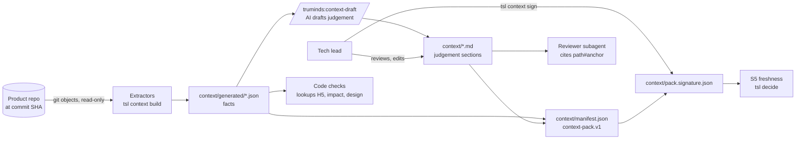

# SDD-06 · Context Pack and Extractors

| Field | Value |
| --- | --- |
| Status | Draft for owner review |
| Owner | TBD by Puneet |
| Approver | Puneet Singh Nanda |
| Related docs | [Doc 3 Architecture](../architecture/03-architecture.md) §3, §5.2, §6, §8.1 · [Doc 5 API and Rules](../architecture/05-api-and-rules.md) §2.2, §3.1, §5.3 · [SDD-03 Harness](SDD-03-harness.md) · [SDD-04 `tsl` CLI](SDD-04-tsl-cli.md) · [SDD-05 Claude Code integration](SDD-05-claude-code-integration.md) · [SDD-07 Identity and signing](SDD-07-identity-signing.md) · [SDD-12 Companion repo](SDD-12-companion-repo.md) · [SEC-01 Threat model](../security/SEC-01-threat-model.md) · [Readiness tracker](../planning/readiness-tracker.md) Q1 (F4) |

## 1. Scope

### 1.1 What this document decides

The context pack is one of the seven objects (skill, workflow, pod, context pack, run, artifact, check record). It holds the facts and the judgement about one client system. Skills read it. The reviewer subagent cites it. Code checks look things up in it. This document decides:

- what files a pack holds, and how each section is anchored so that citations can point at it;
- the pack manifest schema, `context-pack.v1`, and the signature file, `pack-signature.v1`;
- the deterministic extractors that scan the product repo: repo tree, dependency manifests, API routes, DB migrations and test layout;
- the AI-assisted drafting of judgement sections, and the rule that a tech lead must review every drafted section;
- the commands `tsl context build` and `tsl context sign`, plus `tsl context status`;
- the freshness rule behind signal S5, measured in product repo commits, not in days;
- size limits;
- redaction of secrets and personal data (PII);
- a worked example on the React + Node.js sample system (ADR 0004).

### 1.2 What it does not decide

| Topic | Where |
| --- | --- |
| How the harness uses S5 and the band cap | [SDD-03](SDD-03-harness.md), [Doc 3 §5](../architecture/03-architecture.md) |
| The citation matcher (string or code-structure match) | [SDD-03](SDD-03-harness.md); this document only defines the anchor targets |
| Key generation, key registry, signature format | [SDD-07](SDD-07-identity-signing.md); this document only names the payload |
| Companion repo creation, branches, access | [SDD-12](SDD-12-companion-repo.md) |
| The secret and PII detector product choice | [SEC-01](../security/SEC-01-threat-model.md) (tracker Q12); this document defines the interface and the minimum rules |
| Extractors for Java, Python and C | Later phases. Release 1 targets JavaScript and TypeScript first (tracker §10 decision on the sample system) |

## 2. Context and dependencies

### 2.1 Where the pack sits



### 2.2 Dependencies

| Depends on | For |
| --- | --- |
| `tsl.yaml` (`tsl-config.v1`, Doc 5 §3.1) | Product repos, scoped paths, critical paths, limits |
| Git (GitPython, plus the `git` binary) | Reading files at a fixed commit, commit distance, changed files |
| SDD-07 signing | Ed25519 signature over the manifest, role check `tech_lead` |
| Insights service `GET /v1/me` (Doc 5 §5.1) | Role grants for `tsl context sign` (cached for offline use per Doc 2 §2) |
| Consent record (LEG-01, C-04) | `tsl context build` refuses without it (E-CONS-01) |
| SDD-05 plugin | The `/truminds:context-draft` command skill |

### 2.3 Ground rules

- Code builds facts. The AI only drafts judgement, and a person signs it.
- Extractors read from a git commit, never from the working tree. The same commit and the same extractor version give the same bytes.
- No section of the pack may hold a secret, a credential, customer data or a client name (C-09, R-15).
- The pack lives only in the companion repo. Nothing from it goes to telemetry except counts and statuses (NFR-10).

## 3. Pack contents

### 3.1 File layout

This refines the `context/` folder of [Doc 3 §3](../architecture/03-architecture.md). The full companion repo layout is in [SDD-12](SDD-12-companion-repo.md).

```text
context/
├─ manifest.json                # context-pack.v1: sources, sections, anchors, hashes (written by tsl)
├─ pack.signature.json          # pack-signature.v1: tech lead signature over manifest (tsl context sign)
├─ system-baseline.md           # judgement: purpose, scope, modules in plain words, key flows
├─ architecture.md              # judgement: components, boundaries, integrations, deployment shape
├─ data-model.md                # judgement: entities, ownership, retention, invariants
├─ glossary.md                  # judgement: domain terms and their meaning in this system
├─ conventions.md               # judgement: coding, naming, error handling, branching conventions
├─ test-strategy.md             # judgement: test layers, where tests live, how to run them, gaps
├─ intent-baseline.md           # optional judgement: goals, NFRs, constraints (used by requirement-review)
└─ generated/                   # facts: written only by extractors, never edited by hand
   ├─ module-map.json           # repo tree and modules
   ├─ dependency-graph.json     # dependency manifests and internal imports
   ├─ api-inventory.json        # HTTP routes, UI routes, client calls
   ├─ db-schema.json            # tables, columns, keys, indexes from migrations
   └─ test-layout.json          # test files, frameworks, scripts
```

### 3.2 Sections

| Section id | File | Kind | Required | Main readers | Drafted by |
| --- | --- | --- | --- | --- | --- |
| `system-baseline` | `system-baseline.md` | Judgement | Yes | All skills | AI draft from `module-map`, reviewed by tech lead |
| `architecture` | `architecture.md` | Judgement | Yes | impact-analysis, design, threat-model | AI draft from `module-map`, `dependency-graph`, `api-inventory` |
| `data-model` | `data-model.md` | Judgement | Yes | impact-analysis, design, defect-triage | AI draft from `db-schema` |
| `glossary` | `glossary.md` | Judgement | Yes | requirement-review, story-split | Human first; AI may propose terms found in code |
| `conventions` | `conventions.md` | Judgement | Yes | implement, unit-test, secure-code-review | AI draft from lint config and code samples |
| `test-strategy` | `test-strategy.md` | Judgement | Yes | unit-test, test-plan, test-automation | AI draft from `test-layout` |
| `intent-baseline` | `intent-baseline.md` | Judgement | No (brownfield); Yes (greenfield) | requirement-review, design | Human |
| `module-map` | `generated/module-map.json` | Fact | Yes | All code checks | Extractor |
| `dependency-graph` | `generated/dependency-graph.json` | Fact | Yes | impact-analysis, secure-code-review | Extractor |
| `api-inventory` | `generated/api-inventory.json` | Fact | Yes if the system has routes | design (endpoint clash check), impact-analysis | Extractor |
| `db-schema` | `generated/db-schema.json` | Fact | Yes if the system has migrations | design, impact-analysis | Extractor |
| `test-layout` | `generated/test-layout.json` | Fact | Yes | unit-test, test-plan | Extractor |

A required fact section with nothing to extract is still written, with an empty `facts` list and `"empty_reason"`. That way a skill can tell "no routes" from "extractor did not run".

### 3.3 Judgement section format

Every judgement file starts with front matter. The body uses headings with explicit anchors.

```markdown
---
schema: context-section.v1
section: data-model
owner: tl-7a1c                 # pseudonym of the accountable tech lead
origin: ai-draft               # human | ai-draft
status: reviewed               # drafted | reviewed   (tsl context sign needs reviewed)
verified_at:                   # product repo commit the reviewer checked against
  sample-system: 4c1e9a2b7d3f...
---

# Data model {#data-model}

## Orders {#orders}
An order is created by `POST /api/orders` and owned by the api module.
Sources: context/generated/db-schema.json#table:orders, context/generated/api-inventory.json#http:POST:/api/orders

## Data retention {#data-retention}
Order events are deleted after 24 hours by a scheduled purge job.
Sources: sample-system:api/src/jobs/purge-events.js#L12
```

| Rule | Detail |
| --- | --- |
| Anchor syntax | `{#id}` at the end of an H1, H2 or H3 heading. `id` is kebab-case, `[a-z0-9-]{1,64}` |
| Uniqueness | Unique within the file. Duplicate anchors fail the build (E-CTX-07) |
| Stability | An anchor is a public address. Renaming one breaks citations in artifacts; `tsl context build --check` lists anchors that existed in the last signed manifest and are now gone |
| Sources line | Each H2 or H3 block that states a fact about the system ends with a `Sources:` line of one or more citations. A block with no `Sources:` line is opinion and is marked as such by the reviewer, never by code |
| Draft marker | Every AI-written block starts with `<!-- tsl:draft id=D-<n> -->`. The tech lead deletes the marker when they accept the block. `tsl context sign` refuses while any marker remains (E-CTX-04) |
| Status | `drafted` is written by the drafting skill. Only a human sets `reviewed`. The signature is the control: by signing, the tech lead attests that every section was read |

### 3.4 Citation addresses into the pack

Citations follow DEF-08: `path#anchor` must exist at the recorded commit, and the cited text must contain the named element.

| Target | Address form | Example |
| --- | --- | --- |
| Judgement heading | `context/<file>.md#<anchor>` | `context/data-model.md#data-retention` |
| Generated fact | `context/generated/<file>.json#<fact id>` | `context/generated/db-schema.json#table:order_events` |
| Product file line | `<repo>:<path>#L<n>` or `#L<n>-L<m>` (Doc 5 §1.1) | `sample-system:api/src/routes/orders.js#L18` |

Fact ids are stable strings built from the fact itself, never from position or order:

| Fact kind | Id pattern | Example |
| --- | --- | --- |
| Module | `module:<repo>:<path>` | `module:sample-system:api/src/orders` |
| Dependency | `dep:<repo>:<manifest path>:<name>` | `dep:sample-system:api/package.json:express` |
| Internal import edge | `import:<from module>-><to module>` | `import:web/src/orders->web/src/api` |
| HTTP route | `http:<METHOD>:<path>` | `http:GET:/api/orders/:id` |
| UI route | `ui:<path>` | `ui:/orders/:id` |
| Client call | `call:<METHOD>:<path>` | `call:GET:/api/orders` |
| Table | `table:<schema.>name` | `table:order_events` |
| Column | `column:<table>.<column>` | `column:order_events.created_at` |
| Index | `index:<name>` | `index:order_events_created_at_idx` |
| Migration | `migration:<file stem>` | `migration:004_add_order_events` |
| Test file | `test:<repo>:<path>` | `test:sample-system:api/test/orders.test.js` |

If the same route id appears twice (for example two handlers for one path), the second gets a suffix `#2` and both are reported as a soft finding in the build report.

## 4. Manifest and signature schemas

### 4.1 `context/manifest.json` (`context-pack.v1`)

Written by `tsl context build`. It is the pack index of DEF-04: a skill over its size budget loads sections one at a time using the `anchors` and `tokens_est` here, never the whole pack.

```json
{
  "schema": "context-pack.v1",
  "system": "SYS-SMP",
  "built_by": "tsl@0.3.0",
  "sources": [
    {"repo": "sample-system", "commit": "4c1e9a2b7d3f...", "default_branch": "main", "scope": ".",
     "files_scanned": 214, "files_excluded": 9}
  ],
  "extractors": [
    {"name": "repo-tree", "version": "1.0.0"},
    {"name": "npm-manifests", "version": "1.0.0"},
    {"name": "js-routes", "version": "1.0.0"},
    {"name": "sql-migrations", "version": "1.0.0"},
    {"name": "js-test-layout", "version": "1.0.0"}
  ],
  "sections": [
    {"id": "data-model", "path": "context/data-model.md", "kind": "judgement", "required": true,
     "origin": "ai-draft", "status": "reviewed", "owner": "tl-7a1c",
     "verified_at": {"sample-system": "4c1e9a2b7d3f..."},
     "sha256": "9be1...", "tokens_est": 2140,
     "anchors": ["data-model", "orders", "order-events", "data-retention"]},
    {"id": "db-schema", "path": "context/generated/db-schema.json", "kind": "fact", "required": true,
     "sha256": "77c0...", "tokens_est": 3900, "fact_count": 41, "empty_reason": null}
  ],
  "redaction": {"rules_version": "1", "values_masked": 3, "paths_excluded": 9, "blocking_hits": 0},
  "limits": {"section_tokens": 8000, "judgement_tokens": 40000, "generated_file_bytes": 2097152},
  "tokens_total_est": 18320
}
```

| Field | Req | Type | Rule |
| --- | --- | --- | --- |
| `schema` | Yes | const `context-pack.v1` | |
| `system` | Yes | string | System code from `tsl.yaml`, never a name |
| `built_by` | Yes | string | `tsl@<SemVer>` |
| `sources[]` | Yes | array, ≥ 1 | One per entry in `product_repos`. `commit` is a full 40-hex SHA |
| `sources[].scope` | Yes | string | The `path` from `tsl.yaml`; extractors look only inside it (Doc 3 §3.1) |
| `extractors[]` | Yes | array | Name and version of every extractor that ran, sorted by name |
| `sections[]` | Yes | array | Sorted by `id`. `sha256` is over the file bytes after LF normalisation (Doc 5 §1.1) |
| `sections[].anchors` | Yes for judgement | array of string | In file order |
| `sections[].fact_count` | Yes for fact | integer | |
| `redaction` | Yes | object | Counts only, no values |
| `limits` | Yes | object | Effective limits after `tsl.yaml` overrides |
| `tokens_total_est` | Yes | integer | Sum of `tokens_est` |

The manifest has no timestamps. That keeps it byte-identical for the same inputs, so CI and the laptop compute the same hash (NFR-14).

### 4.2 `context/pack.signature.json` (`pack-signature.v1`)

Written only by `tsl context sign`. The policy file denies writes to it from Claude (SDD-05 §6.4).

```json
{
  "schema": "pack-signature.v1",
  "system": "SYS-SMP",
  "manifest_sha256": "e41d...",
  "sources": {"sample-system": "4c1e9a2b7d3f..."},
  "signed_by": "tl-7a1c",
  "role": "tech_lead",
  "key_id": "key_01J9...",
  "signed_at": "<ISO 8601 UTC>",
  "tsl": "0.3.0",
  "signature": "base64url..."
}
```

The signature is Ed25519 over the RFC 8785 canonical JSON of the record without `signature` (Doc 5 §1.1, SDD-07). `signed_at` is kept for audit only. Freshness never uses it (§7).

### 4.3 Generated fact file envelope

Every file in `context/generated/` has the same envelope. Only `facts[]` differs per extractor.

```json
{
  "schema": "context-facts.v1",
  "section": "api-inventory",
  "extractor": {"name": "js-routes", "version": "1.0.0"},
  "sources": {"sample-system": "4c1e9a2b7d3f..."},
  "empty_reason": null,
  "facts": [
    {"id": "http:GET:/api/orders/:id", "kind": "http", "method": "GET", "path": "/api/orders/:id",
     "handler": "getOrder", "module": "module:sample-system:api/src/orders",
     "source": {"repo": "sample-system", "path": "api/src/routes/orders.js", "line": 18},
     "confidence": "resolved"}
  ],
  "unresolved": [
    {"source": {"repo": "sample-system", "path": "api/src/routes/admin.js", "line": 7},
     "reason": "dynamic path expression"}
  ]
}
```

Rules: `facts` sorted by `id`; keys sorted; no timestamps; `source.line` is 1-based. `unresolved` lists what an extractor saw but could not pin down. A check that needs a fact in `unresolved` reports "unknown", never "absent".

## 5. Extractors

### 5.1 Extractor contract

Extractors are Python classes inside `tsl` (package `tsl.context.extractors`). Each one is pure: same input, same output.

```python
class Extractor(Protocol):
    name: str                      # "js-routes"
    version: str                   # SemVer; bump on any output change
    section: str                   # "api-inventory"

    def applies(self, view: RepoView) -> bool: ...
    def extract(self, view: RepoView, cfg: ExtractorConfig) -> ExtractResult: ...

@dataclass(frozen=True)
class RepoView:                    # read-only view of one product repo at one commit
    repo: str                      # name from tsl.yaml
    commit: str                    # 40-hex SHA
    scope: str                     # sub-path; files outside are invisible
    def list_files(self, glob: str = "**") -> list[str]: ...   # from git ls-tree, sorted
    def read_text(self, path: str, max_bytes: int = 1_048_576) -> str | None: ...  # None if excluded or binary

@dataclass
class ExtractResult:
    facts: list[Fact]
    unresolved: list[Unresolved]
    empty_reason: str | None
```

| Rule | Why |
| --- | --- |
| `RepoView` reads blobs with `git ls-tree -r <commit>` and `git cat-file`, never the working tree | Uncommitted or untracked files never enter the pack; results are reproducible |
| `RepoView` refuses paths that match the exclusion list (§9.1) and returns `None` | Secrets never reach an extractor |
| No network, no subprocess other than `git`, no code execution from the product repo (no `npm install`, no `require`) | Prompt-injection and supply-chain safety (TM-06) |
| Max 1 MB read per file; larger files are listed in `module-map` but not parsed | Bounded run time |
| An extractor that raises is reported as E-CTX-08 for its section; other sections still build | One bad parser does not block the pack |

### 5.2 Release-1 extractors (JavaScript and TypeScript first)

| Extractor | Section | Reads | Produces | Method |
| --- | --- | --- | --- | --- |
| `repo-tree` | `module-map` | All tracked files in scope | Modules with path, kind, language counts, file counts, entry points; file count per top folder | Modules = npm workspaces, else each folder holding a `package.json`, else each first-level folder under `src/`. Language by file extension |
| `npm-manifests` | `dependency-graph` | `package.json`, `package-lock.json` (v2, v3), `yarn.lock`, `pnpm-lock.yaml` | Direct dependencies with declared range and locked version; `engines`; npm `scripts` names (not bodies); internal import edges between modules | JSON and YAML parsing; import edges from `import`/`require` statements via tree-sitter, resolved only for relative paths and workspace names |
| `js-routes` | `api-inventory` | `.js`, `.mjs`, `.cjs`, `.ts`, `.tsx`, `.jsx` | Express routes (`app.<verb>`, `router.<verb>`, `router.route().<verb>`) with `app.use('/prefix', router)` prefixes joined when the router is a static import; React Router routes (`<Route path>`, `createBrowserRouter` objects); client calls (`fetch('/api/...')`, `axios.<verb>('/api/...')`) | tree-sitter (JavaScript and TypeScript grammars). Template strings or variables in paths → `unresolved` |
| `sql-migrations` | `db-schema` | Globs from `tsl.yaml` `context.extractors.migrations`, default `**/migrations/**/*.sql` | Final schema after applying migrations in file-name order: tables, columns (type, nullable, default kind), primary keys, foreign keys, indexes; plus the migration list | SQL parsed with `sqlglot` (PostgreSQL dialect). Only DDL is read. DML (`INSERT`, `UPDATE`, `COPY`) is skipped and counted, never stored |
| `js-test-layout` | `test-layout` | Test globs (default `**/*.test.*`, `**/*.spec.*`, `**/__tests__/**`), `package.json` | Test files per module, framework (jest, vitest, mocha, playwright, cypress) from dependencies and config files, test script names, `describe`/`it` titles (after redaction scan) | Globs plus tree-sitter for titles |

Column defaults are stored as a kind (`literal`, `function`, `sequence`), not as the value, so that no data value enters the pack.

### 5.3 Adding an extractor for another stack

A new stack needs: one class per section it covers, a fixture repo under `tsl/tests/fixtures/extractors/<name>/` (Truminds-written code only, T-01), and golden output files. `tsl context build` picks every extractor whose `applies()` is true. Two extractors may write the same section; their facts are merged by `id`, and a duplicate `id` with different content is an E-CTX-08 error. Planned later: `java-spring-routes`, `maven-gradle`, `python-fastapi-routes`, `alembic-flyway-migrations`, `c-cmake`.

### 5.4 New dependencies for `tsl`

| Library | Use | Note |
| --- | --- | --- |
| `tree-sitter` with JavaScript and TypeScript grammar wheels | Route, import and test-title parsing | Prebuilt wheels for macOS, Windows and Linux to be confirmed in the SDD-04 install test |
| `sqlglot` | DDL parsing | Pure Python |

Both are additions to the Doc 3 §11 stack. They are listed in Open items for SDD-04 to accept.

## 6. Commands

These replace `tsl init-context`, `tsl context-refresh` and `tsl sign-context` in Doc 5 §2.2. The old names are not kept as aliases: SDD-04 §1.3 forbids hidden commands and nothing has been released yet ([registry](../architecture/registry.md) §3.3).

### 6.1 Signatures

| Command | Args and flags | Who | Output | Exit codes |
| --- | --- | --- | --- | --- |
| `tsl context build` | `[--repo-commit <name>=<sha> ...] [--sections <id,...>] [--check] [--json]` | Engineer or tech lead | Writes `context/generated/*`, creates missing judgement files from templates, writes `context/manifest.json`, prints a build report. `--check` writes nothing and reports differences and lint results | 0 · 2 (lint or limit failures) · 3 (E-CONS-01, E-AUTH-03, E-CTX-09) |
| `tsl context sign` | `[--json]` | Tech lead only | Verifies, then writes `context/pack.signature.json`, commits it with the manifest, sends `context.signed` | 0 · 2 (E-CTX-04/05/06/07) · 3 (E-AUTH-04) · 10 |
| `tsl context status` | `[--deep] [--json]` | Anyone with repo access; also called inside `tsl decide` and `tsl state start` | Freshness verdict per §7, with reasons. `--deep` also re-runs extractors at head and diffs cited facts | 0 (fresh) · 2 (stale, E-CTX-02 warning) · 3 (E-CTX-01, E-CTX-03) |
| `tsl context draft-prepare` | `<section> [--json]` | Called by `/truminds:context-draft` | JSON package: section template, relevant generated facts, size budget, anchor rules | 0 · 2 · 3 |

`--repo-commit` lets a tech lead build from a commit other than the remote default-branch head (for example a release tag). Without it, `build` fetches and uses `origin/<default_branch>` of each product repo.

### 6.2 `tsl context build` algorithm

```python
def context_build(cfg, args):
    require_consent(cfg.system)                         # E-CONS-01 (C-04, LEG-01)
    require_role(cfg.system, {"engineer", "tech_lead"}) # E-AUTH-03
    views = []
    for repo in cfg.product_repos:
        sha = args.repo_commit.get(repo.name) or fetch_head(repo)   # git fetch; offline -> last fetched ref + warning
        views.append(RepoView(repo.name, sha, repo.path))
    facts = {}
    for ex in registry.all():
        for v in views:
            if ex.applies(v):
                facts.setdefault(ex.section, []).append(run_with_timeout(ex, v, seconds=120))
    generated = {s: merge_and_sort(results) for s, results in facts.items()}
    generated = redact_generated(generated)             # §9.2: mask values, count hits
    ensure_judgement_files_from_templates(cfg)          # status: drafted, origin: human, empty body
    lint = lint_judgement_sections(cfg, generated)      # anchors, Sources lines, citations (DEF-08), redaction scan
    sizes = check_limits(generated, judgement_files)    # §8; shard large generated files
    manifest = build_manifest(views, registry, generated, judgement_files, lint, sizes)
    if args.check:
        return report_diff(current_manifest(), manifest, lint, sizes)   # writes nothing
    write_atomically(generated, manifest)
    emit("context.drift", drift_summary(previous_signature(), views))   # counts only
    return report(lint, sizes)                          # exit 2 if any lint or limit error
```

`build` never signs and never changes a judgement file that already exists. It only rewrites `generated/` and `manifest.json`. Because `generated/` changes, the manifest hash changes, and the old signature no longer matches: the pack is stale until a tech lead signs again (§7). That is intended (US-06 AC4).

Where `build` writes in git is set by SDD-12: context changes go on a branch `tsl/context/<short-sha>` and reach `main` by pull request, reviewed by the system's tech leads.

### 6.3 `tsl context sign` algorithm

```python
def context_sign(cfg):
    user = require_role(cfg.system, {"tech_lead"})          # E-AUTH-04
    manifest = rebuild_manifest_in_memory(cfg)              # same as build --check
    if manifest != read("context/manifest.json"):
        fail("E-CTX-09", "manifest out of date; run tsl context build")
    for s in manifest.sections:
        if s.kind == "judgement":
            if s.status != "reviewed" or has_draft_markers(s.path):
                fail("E-CTX-04", s.id)
            if not s.verified_at:
                fail("E-CTX-04", f"{s.id}: verified_at missing")
        if s.required and not exists(s.path):
            fail("E-CTX-01", s.id)
    if manifest.redaction.blocking_hits > 0:  fail("E-CTX-06")
    if size_errors(manifest):                 fail("E-CTX-05")
    if lint_errors(manifest):                 fail("E-CTX-07")
    record = {"schema": "pack-signature.v1", "system": cfg.system.code,
              "manifest_sha256": sha256(canonical(manifest)),
              "sources": {s.repo: s.commit for s in manifest.sources},
              "signed_by": user.pseudonym, "role": "tech_lead", "key_id": user.key_id,
              "signed_at": utc_now(), "tsl": TSL_VERSION}
    record["signature"] = sign_ed25519(jcs(record))         # SDD-07
    write("context/pack.signature.json", record)
    git_commit(["context/manifest.json", "context/pack.signature.json"], f"tsl: sign context pack {short(record['manifest_sha256'])}")
    emit("context.signed", {"system": cfg.system.code, "commits_behind": 0, "drift_files": 0,
                            "sections": len(manifest.sections)})
```

Self-review: the tech lead owns the pack and normally reviews the AI drafts, so a tech lead may sign a pack they reviewed or wrote. The self-approval rule (TM-13) applies to run gates only, not to pack signing.

### 6.4 AI-assisted drafting: `/truminds:context-draft`

A command skill in the plugin (SDD-05 §4.1 pattern, `disable-model-invocation: true`). It is not a workflow run. It never takes a run lock, so the harness does not run on it; the tech lead's review and signature replace the harness here.

```markdown
---
name: context-draft
description: Draft one judgement section of the context pack for tech lead review. Only when the user types /truminds:context-draft.
argument-hint: <section>
disable-model-invocation: true
allowed-tools: Bash(tsl *), Read, Grep, Glob, Write, Edit
---
Draft package from tsl (do not edit):
!`tsl context draft-prepare $0 --json`

If "ok" is false, show "message" and "next" and stop.
Write only the file named in data.path. Keep its front matter; set status: drafted, origin: ai-draft.
Start every block you write with <!-- tsl:draft id=D-<n> -->.
Every heading gets an anchor {#kebab-id}. Every block that states a fact ends with a Sources: line
citing data.facts ids or product files with line numbers. If you cannot cite it, write it as a question
under "## Open points {#open-points}" instead.
Never copy secrets, personal data, data values or client names. Stay within data.budget_tokens.
Then run `tsl context build --check --sections $0 --json` and fix every error it lists.
```

| Control | How |
| --- | --- |
| AI cannot sign | `pack.signature.json` is in the policy deny list; `tsl context sign` needs the `tech_lead` role and the user's key |
| AI cannot hide that it wrote something | Draft markers plus `origin: ai-draft`; `sign` refuses with markers left |
| AI cannot invent structure silently | `build --check` verifies every `Sources:` citation (DEF-08 matcher from SDD-03); unverifiable citations are lint errors |
| Reading secrets while drafting | Managed deny rules (SDD-05 §6.2) block `.env`, keys and similar for Claude |

Whether `$0` positional arguments and the `` !`...` `` injection behave inside this skill exactly as in the run skill is covered by SDD-05 V-16 and spike S-09; no extra spike is needed.

## 7. Freshness (signal S5)

### 7.1 Definition

Freshness is measured in product repo commits, never in days. A pack can sit untouched for months on a quiet system and stay fresh; a busy system goes stale after a few days.

A pack is **fresh** only if all of these hold. Otherwise it is **stale**, **missing** or **invalid**.

| # | Condition | Fails as | Reason code |
| --- | --- | --- | --- |
| F1 | `context/pack.signature.json` and `context/manifest.json` exist | missing (E-CTX-01) | `no_pack` |
| F2 | The signature verifies against a registered, non-revoked key whose holder had `tech_lead` on the system at signing (SDD-07) | invalid (E-CTX-03) | `bad_signature` |
| F3 | `sha256(canonical(manifest))` equals `manifest_sha256`, and every section file hash equals its manifest entry | stale | `edited_after_sign` |
| F4 | For each product repo, the signed source commit is an ancestor of the current default-branch head | stale | `history_rewritten` |
| F5 | For each product repo, **commits behind** ≤ `context.max_commits_behind` | stale | `commits_behind` |
| F6 | For each product repo, **drift files** ≤ `context.drift_files` | stale | `drift` |
| F7 | No changed file matches `context.critical_paths` | stale | `critical_change` |
| F8 | Only with `--deep`: re-running extractors at head changes no fact that a judgement section cites | stale | `cited_fact_changed` |

Measures, per product repo, with `src` = signed commit and `head` = `origin/<default_branch>`:

```text
commits_behind = git rev-list --count --first-parent src..head -- <scope>
drift_files    = git diff --name-only src head -- <scope>   (minus excluded paths, counted)
```

`--first-parent` counts a merged pull request as one commit, so the number tracks changes landed on the default branch, not the size of feature branches. Only commits that touch the scoped path count, so in a monorepo other systems' work does not age this pack.

### 7.2 Defaults in `tsl.yaml`

```yaml
context:
  max_commits_behind: 50          # replaces max_age_days
  drift_files: 50                 # DEF-03
  critical_paths: ["sample-system:db/migrations/**", "sample-system:api/src/auth/**"]
  limits: {section_tokens: 8000, judgement_tokens: 40000, generated_file_bytes: 2097152}
  extractors:
    migrations: ["db/migrations/*.sql"]
    tests: ["**/*.test.js", "**/*.test.ts", "**/*.test.tsx"]
  redaction:
    extra_exclude: []             # adds to the built-in exclusion list; cannot remove from it
    deny_term_hashes: []          # sha256 of lower-cased terms that must never appear (§9.4)
```

The 50 commits and 50 files are proposals until pilot data exists (OQ-12). A tech lead may tighten them per system; loosening them needs an ADR (GOV-01).

### 7.3 Where S5 is computed and what it does

```mermaid
sequenceDiagram
  participant E as Engineer
  participant T as tsl
  participant C as Companion repo
  participant P as Product repo (remote)
  E->>T: /truminds:run → tsl state start
  T->>P: git fetch default branch (each product repo)
  T->>C: read manifest + signature
  T->>T: F1–F7 → fresh | stale | missing | invalid
  alt missing or invalid
    T-->>E: E-CTX-01 / E-CTX-03, exit 3 (brownfield workflows only)
  else stale
    T-->>E: E-CTX-02 warning, exit 0; state.json pack.fresh=false + reasons
  else fresh
    T->>C: state.json pack.fresh=true, pack.manifest_sha256
  end
  Note over T: Each tsl decide re-reads state.json pack block (no git calls) → S5
```

| Point | Behaviour |
| --- | --- |
| `tsl state start` | Computes F1–F7 once and stores the result in `state.json` `pack` (Doc 5 §3.4) with `manifest_sha256`, `fresh`, `reasons[]`, `commits_behind{}`, `drift_files{}`. Brownfield workflows (`requires_fresh_pack: true` in `workflow.v1`) refuse to start on missing or invalid; they start on stale with the band cap |
| `tsl decide` | Reads S5 from `state.json` (no network, NFR-01). Stale → `S5 = "stale"`, band at most Medium, cap `pack_stale` recorded (FR-CTX-03, Doc 3 §5.3) |
| `tsl state resume` | Re-computes F1–F7. A pack that went stale while the run was paused caps the remaining steps; finished steps keep their records (R-03) |
| Greenfield workflows | No product code yet: F4–F8 are skipped; F1–F3 still apply to the intent baseline |
| Offline | Uses the last fetched remote ref and adds reason `checked_offline`. It does not mark the pack stale for being offline |

### 7.4 Status record in `state.json`

```json
"pack": {
  "manifest_sha256": "e41d...",
  "fresh": false,
  "reasons": ["critical_change"],
  "commits_behind": {"sample-system": 12},
  "drift_files": {"sample-system": 7},
  "checked_offline": false
}
```

This replaces the `signed_at` field in the Doc 5 §3.4 example. The verification record carries `S5` as `"fresh"` or `"stale"`, as today.

## 8. Size limits

| Item | Default limit | On breach |
| --- | --- | --- |
| One judgement section file | 8,000 tokens (estimate) | E-CTX-05; `build` exit 2; `sign` refuses |
| All judgement sections together | 40,000 tokens | E-CTX-05 |
| One generated file | 2 MB | Not an error: the file is split into shards `generated/<section>/<module-slug>.json`, and the manifest lists each shard as its own section entry with `parent` |
| One fact | 2 KB serialised | The fact is truncated to its id and source and marked `truncated: true` |
| One product file read by an extractor | 1 MB | Listed in `module-map` as `parsed: false` |
| Whole `context/` folder | 25 MB | E-CTX-05 |
| Extractor run time | 120 s per extractor per repo | E-CTX-08 for that section |

Token estimate = `ceil(utf8_bytes / 4)`. It is an approximation, used the same way in DEF-04 budgets, so pack sizes and skill budgets compare like for like. A skill whose `context_sections` (skill-metadata.v1) add up to more than its `size_budget_tokens` must load by anchor; `tsl validate` warns at publish time if a skill's declared sections cannot fit even by anchor.

## 9. Redaction of secrets and personal data

The pack is built by code from client repos, so it is the place where secrets or personal data could most easily leak into Truminds storage. Four layers apply, in order.

### 9.1 Layer 1: never read

`RepoView` refuses these paths. The list is built in and a system can only add to it (`context.redaction.extra_exclude`).

```text
**/.env  **/.env.*  **/*.pem  **/*.key  **/*.p12  **/*.pfx  **/id_rsa*  **/id_ed25519*
**/secrets/**  **/*.kdbx  **/*dump*.sql  **/*.sqlite*  **/*.db  **/fixtures/**/*.csv
**/seed*/**  **/*.har  **/*.log  **/node_modules/**
**/.answers  **/.answers/**  **/sample-system-key/**
```

The last line covers answer keys (TST-01 §4.3): the sample system's `.answers/` folder holds the seeded-defect key and canaries, and must never reach a pack, whatever `tsl.yaml` says. `tsl/tests/test_commands.py::test_context_build_never_reads_answer_keys` proves it.

The list matches the managed deny rules in SDD-05 §6.2 and the `read.deny` list of Doc 5 §4.3, plus data-file patterns that extractors have no need to read. Excluded files appear in the manifest only as a count.

### 9.2 Layer 2: capture structure, not values

| Extractor | Keeps | Never keeps |
| --- | --- | --- |
| `sql-migrations` | Table, column, type, key, index names | Default values, `CHECK` literals, any DML |
| `npm-manifests` | Package names, versions, script names | Script bodies, registry URLs with credentials, `.npmrc` |
| `js-routes` | Route paths, method, handler name | Request examples, string literals other than the path |
| `js-test-layout` | File paths, framework, `describe`/`it` titles | Test data, fixture contents |
| `repo-tree` | Paths, counts | File contents |

### 9.3 Layer 3: pattern scan on everything written

After extraction, every string in `generated/` and every judgement file is scanned.

| Detector | Pattern class | In generated files | In judgement files |
| --- | --- | --- | --- |
| Secret | Known token prefixes, private key headers, `password=`/`secret=` assignments, connection strings with credentials, high-entropy strings ≥ 32 chars | Value replaced by `[REDACTED:secret:<first 8 hex of sha256>]`; counted in `values_masked` | Blocking hit: `build` exit 2, `sign` refuses (E-CTX-06). Never auto-edited, because the tech lead must see and remove it |
| PII | Email addresses, phone numbers, payment card numbers (Luhn-checked), national id formats configured in SEC-01 | Masked the same way, kind `pii` | Blocking hit (E-CTX-06) |
| Deny term | Any token whose lower-case sha256 is in `deny_term_hashes` | Masked, kind `term` | Blocking hit (E-CTX-06) |

The redaction marker keeps a short hash so that two masked values can be told apart without being revealed. The concrete detector (for example an open-source secrets scanner) is chosen in SEC-01; `tsl` wraps it behind:

```python
class Detector(Protocol):
    kind: Literal["secret", "pii", "term"]
    def scan(self, text: str) -> list[Hit]: ...      # Hit(start, end, rule_id); never returns the matched text to logs
```

Allowed placeholders: example emails at `example.com`, `example.org` and `example.net`, and the documentation phone ranges listed in SEC-01, are not hits.

### 9.4 Layer 4: client names

Client names must not be stored in the companion repo config either (C-09). So a tech lead lists names to block as hashes only: `tsl context deny-term "<name>"` prints the line to paste into `deny_term_hashes`; the name is never written to disk. This is a new helper command (§12).

### 9.5 Limits of redaction

Pattern scanning misses things, and personal data inside normal source files can still be read by Claude during a run (L-01). Redaction lowers risk; it does not remove it. The residual risk is covered by client consent (LEG-01) and H4 on artifacts.

## 10. Worked example: the sample system

The sample system is the Truminds-written order-tracking app in `examples/sample-system` (ADR 0004, tentative): a React front end in `web/`, a Node.js 22 (Express, TypeScript) API in `api/`, PostgreSQL 16 with SQL migrations in `db/migrations/`. All data is invented.

### 10.1 Setup

```yaml
# tsl.yaml (extract)
schema: tsl-config.v1
system: {code: SYS-SMP, project: PRJ-SMP, client: CL-INT}
product_repos:
  - {name: sample-system, url: git@github.com:<companion-org>/sample-system.git, path: ., default_branch: main, verifier_profile: node-22@1}
context:
  max_commits_behind: 50
  drift_files: 50
  critical_paths: ["sample-system:db/migrations/**", "sample-system:api/src/auth/**"]
```

### 10.2 Build

```text
$ tsl context build
✔ Context build for SYS-SMP at sample-system@4c1e9a2           [built]
  module-map 6 modules · dependency-graph 31 deps, 9 edges · api-inventory 11 http, 5 ui, 8 calls
  db-schema 4 tables, 23 columns, 5 indexes, 6 migrations (DML skipped: 1 file)
  test-layout 14 test files (jest 12, playwright 2)
  Redaction: 9 paths excluded · 0 values masked · 0 blocking hits
  Judgement: 6 files created from templates (status: drafted)
  Next:   /truminds:context-draft data-model   (one section at a time), then review and sign
```

Excerpt of `context/generated/db-schema.json`:

```json
{"id": "table:order_events", "kind": "table", "name": "order_events",
 "columns": ["column:order_events.id", "column:order_events.order_id", "column:order_events.status", "column:order_events.created_at"],
 "primary_key": ["id"], "foreign_keys": [{"columns": ["order_id"], "references": "table:orders"}],
 "source": {"repo": "sample-system", "path": "db/migrations/004_add_order_events.sql", "line": 1}}
```

### 10.3 Draft, review, sign

1. The tech lead runs `/truminds:context-draft data-model`. Claude writes `context/data-model.md` with draft markers, anchors `orders`, `order-events`, `data-retention`, and `Sources:` lines citing `table:order_events` and `sample-system:api/src/jobs/purge-events.js#L12`.
2. `tsl context build --check --sections data-model` verifies each citation: the table id exists in `db-schema.json`; line 12 of the purge job contains `order_events`. One citation, to `#L40`, does not verify and is reported as E-CTX-07; Claude fixes it.
3. The tech lead reads the file, corrects one sentence, deletes the draft markers, sets `status: reviewed` and `verified_at: {sample-system: 4c1e9a2...}`.
4. Steps 1 to 3 repeat for each section. The tech lead opens the context pull request (SDD-12).
5. `tsl context sign` passes all checks and writes the signature. The event `context.signed` goes to the outbox.

### 10.4 Use in a run

Ticket ABC-142 asks for 30 days of order history. The `impact-analysis` skill claims "order events are kept 24 hours" and cites `context/data-model.md#data-retention`. Code verifies the anchor exists at the recorded manifest hash and that the cited block contains `24 hours`. The reviewer raises the clash with the ticket, and `tsl decide` writes the question shown in Doc 4 §3.

### 10.5 Freshness over time

| Product repo state since signing | commits_behind | drift_files | Critical path touched | Verdict |
| --- | --- | --- | --- | --- |
| 12 merged PRs in `web/` and `api/src/orders/` | 12 | 7 | No | Fresh |
| One more PR adds `db/migrations/007_add_order_notes.sql` | 13 | 8 | Yes | Stale: `critical_change`; band capped at Medium; E-CTX-02 shown |
| Tech lead runs `tsl context build`, reviews `data-model.md` (new table), signs | 0 | 0 | — | Fresh |
| 60 small PRs, none critical, no re-sign | 60 | 41 | No | Stale: `commits_behind` |

## 11. Error handling, security and tests

### 11.1 Error codes

E-CTX-01 to 03, E-AUTH-04 and E-CONS-01 exist in Doc 4 §5.2. E-CTX-04 to 09 are new.

| Code | Exit | Message | Next action |
| --- | --- | --- | --- |
| E-CTX-01 | 3 | Context pack missing (or required section `<id>` missing). | Tech lead runs `tsl context build`, drafts and reviews, then `tsl context sign` |
| E-CTX-02 | 0 (warn) | Context pack is stale (`<reason>`: `<n>` commits behind / `<m>` files drifted). Band capped at Medium. | `tsl context build`, review changed sections, re-sign |
| E-CTX-03 | 3 | Pack signature does not verify. | Tech lead re-signs with `tsl context sign` |
| E-CTX-04 | 2 | Section `<id>` is not reviewed (status drafted or draft markers left). | Tech lead reviews the section, removes markers, sets `status: reviewed` |
| E-CTX-05 | 2 | Size limit exceeded: `<item>` is `<n>` over `<limit>`. | Split or shorten the section |
| E-CTX-06 | 2 | Secret, personal data or denied term found in `<path>` line `<n>` (`<kind>`). | Remove it by hand; re-run `tsl context build --check` |
| E-CTX-07 | 2 | Pack lint failed: `<n>` broken anchors or citations. | Fix the listed anchors or `Sources:` lines |
| E-CTX-08 | 2 | Extractor `<name>` failed on `<repo>` (`<reason>`); section `<id>` not rebuilt. | Report to the extractor owner; other sections are built |
| E-CTX-09 | 3 | Manifest out of date, or product repo `<name>` cannot be read at `<sha>`. | Run `tsl context build`; check `.tsl/local.yaml` and access |

### 11.2 Security

| Threat | Control |
| --- | --- |
| Secrets or PII copied into the pack (TM-09) | §9 four layers; `sign` refuses on blocking hits |
| A forged or edited pack used to raise bands (TM-03) | F2 and F3: signature over the manifest hash, every file hash in the manifest; CI re-checks (`tsl ci-verify` computes S5 the same way) |
| AI marks its own draft as reviewed | Accepted limit: the front matter is editable text. The control is the tech lead's signature and the draft markers. Recorded as a residual risk for SEC-01 |
| Prompt injection inside product files reaches drafting (TM-06) | Extractors store structure only; drafting cites facts; the tech lead reviews every block |
| Malicious product code runs during extraction | No code execution, no package install, no network (§5.1) |
| Client name leaks | Codes only in `tsl.yaml`; deny-term hashes (§9.4) |

### 11.3 Test plan

| Layer | Test | Pass condition |
| --- | --- | --- |
| Unit | Each extractor on its fixture repo | Output equals the golden file byte for byte |
| Unit | Determinism | Two builds at the same commit on macOS, Windows and Linux give the same `manifest_sha256` |
| Unit | Fact ids | Reordering files or functions in a fixture does not change any id |
| Unit | Redaction | A fixture with planted secrets, emails, a card number and a deny term: generated files mask all of them; a judgement file with one gives E-CTX-06 |
| Unit | Exclusions | `.env` and `*.pem` in the fixture never reach an extractor (spy on `read_text`) |
| Unit | Freshness F1–F8 | One fixture git history per reason code, including a force-push (`history_rewritten`) and a monorepo commit outside scope (not counted) |
| Contract | Schemas | `context-pack.v1`, `pack-signature.v1`, `context-facts.v1`, `context-section.v1` validate valid samples and reject invalid ones |
| Integration | Sign | Non-tech-lead → E-AUTH-04; drafted section → E-CTX-04; edited file after sign → stale `edited_after_sign` |
| Integration | Run cap | Stale pack → `tsl decide` band at most Medium with cap `pack_stale` (golden file shared with SDD-03) |
| End to end | §10 on the sample system | Build, draft, sign, run ABC-142, add a migration, see the cap, rebuild and re-sign |
| NFR | Build time | Sample system builds in ≤ 30 s on a standard laptop (proposal) |

## 12. Changes this document makes to other documents

| Document | Change |
| --- | --- |
| Doc 5 §2.2 | Replace `tsl init-context`, `tsl context-refresh [--check]`, `tsl sign-context` with `tsl context build [--check]`, `tsl context sign`, `tsl context status [--deep]`, `tsl context draft-prepare`, `tsl context deny-term`. `tsl.yaml` skeleton creation moves to `tsl init` (SDD-12) |
| Doc 5 §3.1 | `context.max_age_days` removed; add `max_commits_behind`, `limits`, `extractors`, `redaction`; add `default_branch` per product repo |
| Doc 5 §3.4 | `state.json` `pack` block per §7.4 |
| Doc 5 §3.7 | Add schemas `context-pack.v1`, `context-facts.v1`, `context-section.v1`; define `pack-signature.v1` per §4.2 |
| Doc 5 §5.3 | `context.signed` and `context.drift` bodies: `system, commits_behind, drift_files, sections, reasons[]`; drop `age_days` |
| Doc 3 §6 | DEF-01 becomes F1–F7 (no age in days); DEF-03 drift counted on scoped paths with `--first-parent` commit count added |
| Doc 3 §8.1 | `pack.signature.json` signed by `tsl context sign` |
| Doc 1 FR-CTX-01, FR-CTX-02 | Command names; the 90-day judgement rule is replaced by commit-based freshness and per-section `verified_at` commits |
| Doc 2 US-06 | Command names; `manifest.json` is `context-pack.v1` |
| Doc 4 §5.2 | Add E-CTX-04 to E-CTX-09; reword E-CTX-02 (commits, not days); E-AUTH-04 next action says `tsl context sign` |
| SDD-04 | New commands above; new dependencies `tree-sitter`, `sqlglot` |
| SDD-05 / SDD-01 | New command skill `/truminds:context-draft` |
| SDD-03 | S5 read from `state.json`; citation targets per §3.4 |

## 13. Done criteria

- JSON Schemas for `context-pack.v1`, `context-facts.v1`, `context-section.v1` and `pack-signature.v1` are in `schemas/` with valid and invalid samples.
- The five JavaScript and TypeScript extractors produce golden-file output on the sample system and on two smaller fixture repos.
- Same commit gives the same `manifest_sha256` on macOS, Windows (native) and Linux.
- `tsl context build`, `sign`, `status` and `draft-prepare` behave as in §6, with every error code in §11.1 covered by a test.
- Freshness reason codes F1–F8 each have a git-history fixture.
- Redaction fixtures pass, and the detector choice is recorded in SEC-01.
- `/truminds:context-draft` drafts every judgement section of the sample system, and `build --check` passes after the tech lead's review.
- The §10 end-to-end scenario runs on the sample system.
- §12 changes are applied to the listed documents after the owner validates this one.

## 14. Open items

| Item | Ref | Owner |
| --- | --- | --- |
| Owner and validator of this document | new | TBD by Puneet |
| Confirm default freshness limits: 50 commits behind, 50 drift files | OQ-12 | Puneet |
| Confirm size limits in §8 and the build-time target | OQ-12 | TBD by Puneet |
| Accept `tree-sitter` and `sqlglot` as `tsl` dependencies; confirm wheels on Windows native | new | SDD-04 owners (Japman Singh, Yash Khorwal) |
| Secret and PII detector choice and national-id patterns | Q12, SEC-01 | Security reviewer TBD by Puneet |
| Should loosening a freshness limit need an ADR, or only the tech lead plus approver? | new | Puneet |
| Whether a client person may review a judgement section (signing stays with the Truminds tech lead) | OQ-14 | Puneet |
| Order of later-stack extractors (Java, Python, C) | new | TBD by Puneet, after pilot choice (OQ-04) |
| ADR 0004 is tentative; if the sample system changes stack, §5.2 order and §10 change | ADR 0004 | Puneet |
