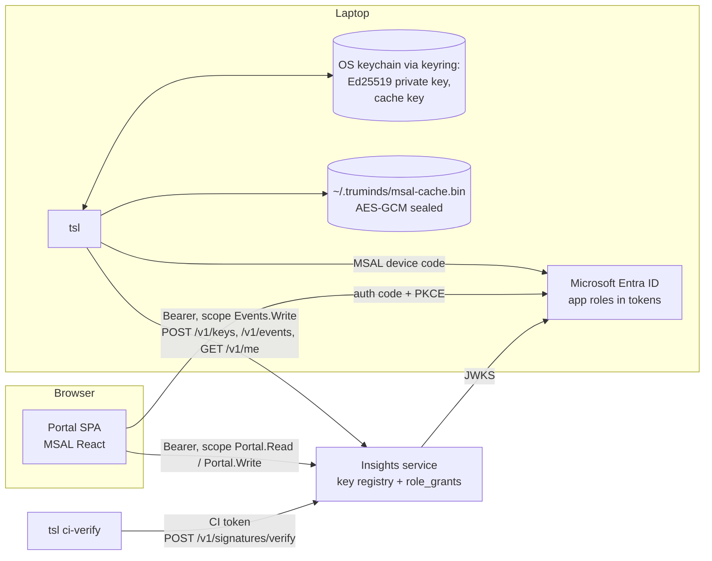
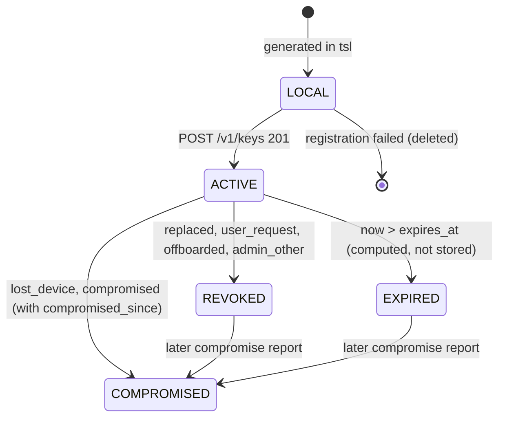

# SDD-07 · Identity, signing and keys

| Field | Value |
| --- | --- |
| Status | Draft for owner review |
| Owner | TBD by Puneet |
| Approver | Puneet Singh Nanda |
| Related docs | [ADR 0002 Identity is Entra ID](../adr/0002-identity-microsoft-entra-id.md) · [Doc 2 Personas](../product/02-personas-and-stories.md) §2 · [Doc 3 Architecture](../architecture/03-architecture.md) §8 · [Doc 5 API and Rules](../architecture/05-api-and-rules.md) §1.1, §5.1, R-06, R-07 · [SDD-02 Workflow orchestration](SDD-02-workflow-orchestration.md) §9.2 · [SDD-03 Harness](SDD-03-harness.md) §12, §13 · [SDD-04 `tsl` CLI](SDD-04-tsl-cli.md) §6.1–§6.3, §7 · [SDD-06 Context pack](SDD-06-context-pack.md) §4.2 · [SDD-08 Telemetry and insights](SDD-08-telemetry-insights.md) §6.2, §9, §10 · [SDD-12 Companion repo](SDD-12-companion-repo.md) · [SDD-13 Onboarding and admin](SDD-13-onboarding-admin.md) · [SEC-01 Threat model](../security/SEC-01-threat-model.md) §5.4, §5.12 · [Readiness tracker](../planning/readiness-tracker.md) Q5, Q28 (F7) |

## 1. Scope

### 1.1 What this document decides

- The three Entra ID app registrations, the app roles, and how Entra groups map to the roles in `role_grants` (Doc 2 §2).
- `tsl login`: the device-code flow with MSAL for Python, token storage through `keyring`, silent refresh, logout.
- Ed25519 signing keys: generation at `tsl login`, key ids, registration with `POST /v1/keys`, rotation, expiry, revocation, lost laptops.
- What is signed, the canonical JSON rule (RFC 8785 JCS) and the exact signed payloads.
- How signatures are verified by `tsl` on the laptop, by `tsl ci-verify`, and by the insights service, including time anchoring for compromised keys.
- The portal login: authorization code with PKCE using MSAL React.
- Threats and mitigations for identity and signing (TM-25 onwards; TM-01 to TM-24 are in Doc 3 §8.3 and SEC-01).

### 1.2 What it does not decide

| Topic | Owner document |
| --- | --- |
| Command surface, exit codes, `~/.truminds` layout | [SDD-04](SDD-04-tsl-cli.md) |
| `verification.v1` fields and the CI check list | [SDD-03](SDD-03-harness.md) §12, §13 |
| Approval gate logic | [SDD-02](SDD-02-workflow-orchestration.md) §9.2 |
| `pack-signature.v1` fields | [SDD-06](SDD-06-context-pack.md) §4.2 |
| Database DDL and ingest | [SDD-08](SDD-08-telemetry-insights.md); this document lists the additions it needs (§13) |
| Admin screens and people | [SDD-13](SDD-13-onboarding-admin.md), SDD-09 |

### 1.3 Ground rules

- Company SSO only, through Microsoft libraries (MSAL). No passwords, no custom auth (C-05, ADR 0002).
- Only `tsl` signs (R-06). Code verifies; nothing about a signature is decided by the model.
- No back doors: no flag, environment variable or endpoint that skips signing, verification or role checks.
- Identity and endpoint values ship inside the wheel (`tsl/_org.toml`, SDD-04 §7.1). Nothing at runtime can point `tsl` at another tenant or service.

## 2. Components and identities



| Identity | Issued by | Used for | Stored |
| --- | --- | --- | --- |
| Entra user (`tid` + `oid`) | Entra | Who the person is | Entra; `users.tenant_id`, `users.sso_subject` |
| Access token, `tsl` | Entra, device code | Calls from `tsl` | Sealed MSAL cache (§4.3) |
| Refresh token, `tsl` | Entra | Silent renewal | Sealed MSAL cache |
| Access token, portal | Entra, auth code + PKCE | Calls from the browser | Browser memory only (§8) |
| Signing key (`key_<ULID>`) | `tsl`, one per user per device | Signing records | Private key: OS keychain. Public key: `keys` table |
| Device id (`dev_<ULID>`) | `tsl` at first login | Binds a key to a laptop | `~/.truminds/config.toml` |
| CI ingest token | Platform operator (SDD-08 §9.3) | `tsl ci-verify` calls | GitHub secret `TSL_CI_TOKEN` |

## 3. Entra registrations and roles

### 3.1 App registrations

All three live in the Truminds tenant and are created by the Entra app admin (SDD-13 §5).

| Registration | Type | Key settings | Permissions |
| --- | --- | --- | --- |
| `truminds-insights-api` | Web API (resource) | App ID URI `api://truminds-insights`; `accessTokenAcceptedVersion: 2`; app roles in §3.2; **Assignment required = Yes** on its enterprise app | Exposes delegated scopes `Events.Write`, `Portal.Read`, `Portal.Write` (new) |
| `truminds-tsl` | Public client | "Allow public client flows" = Yes (needed for device code); no secret, no certificate; no redirect URI | `api://truminds-insights/Events.Write`; admin consent granted for the tenant |
| `truminds-portal` | Single-page application | SPA redirect URI `https://<portal-host>/auth/callback` (exact match); front-channel logout URL `https://<portal-host>/signed-out`; no secret | `api://truminds-insights/Portal.Read`, `Portal.Write`; admin consent granted |

MSAL adds `openid`, `profile` and `offline_access` itself; we request nothing else (SEC-01 §5.12). The Microsoft Graph is never called from `tsl` or the portal.

**Why app roles, not the `groups` claim:** app roles arrive as short fixed strings in the `roles` claim of the API's access token. The `groups` claim carries object ids, needs a lookup table, and is cut off when a user is in many groups ("overage"). Groups are still the way people get roles: the Entra admin assigns each group to an app role (§3.2).

### 3.2 App roles and group mapping

| App role (display) | Token value | Entra group (proposed name) | Who |
| --- | --- | --- | --- |
| Business | `Business` | `TSL-Business` | Sales, pre-sales, leadership, delivery managers using the Business view (P-09) |
| Engineer | `Engineer` | `TSL-Engineers` | P-01 to P-08, skill authors (P-11) |
| Tech lead | `TechLead` | `TSL-TechLeads` | P-10, engineering leads (P-12), stage approvers |
| Admin | `Admin` | `TSL-Admins` | Insights admins (P-13) |

Rules:

- `allowedMemberTypes: ["User"]` for all four. No app-only (daemon) roles.
- A person may be in several groups; the token then carries several values.
- Group assignment does not flow to nested groups, so the four groups hold users directly.
- Assigning a group (not a user) to an enterprise app needs a paid Entra ID tier (P1 or higher). **To confirm with the Entra app admin** (OI-07-03). Without it, users are assigned one by one.

### 3.3 From app roles to `role_grants`

The app role is a **ceiling**. The scoped grants in `role_grants` (SDD-08 §10.2) say *where* a person may act. A grant counts only when the user's current token carries an app role that allows it.

| `role_grants.role` | Scope | Allowed by app role | How it is created |
| --- | --- | --- | --- |
| `viewer` | org | any of the four | Automatic on first request (§3.4) |
| `engineer` | system | `Engineer`, `TechLead` | Insights admin in the portal (SDD-13 §7) |
| `tech_lead` | system | `TechLead` | Insights admin |
| `skill_owner` | skill | `Engineer`, `TechLead` | Insights admin |
| `stage_approver` | stage | `TechLead` | Insights admin |
| `eng_lead` | project or org | `TechLead`, `Admin` | Insights admin (proposal; OI-07-12) |
| `admin` | org | `Admin` | Automatic from the app role (§3.4) |

```python
# services/insights/app/auth/scope.py
CEILING = {"viewer": ANY, "engineer": {"Engineer", "TechLead"}, "tech_lead": {"TechLead"},
           "skill_owner": {"Engineer", "TechLead"}, "stage_approver": {"TechLead"},
           "eng_lead": {"TechLead", "Admin"}, "admin": {"Admin"}}

def effective_grants(user, token_roles: set[str], at: datetime) -> list[Grant]:
    if not user.active or not token_roles & {"Business", "Engineer", "TechLead", "Admin"}:
        raise Forbidden("E-AUTH-08")
    return [g for g in grants_active_at(user.id, at)
            if CEILING[g.role] is ANY or CEILING[g.role] & token_roles]
```

### 3.4 App-role sync on each request

On an authenticated request, at most once per 10 minutes per user (`users.roles_synced_at`, new), the service:

1. stores the token's app roles in `users.app_roles` (new, `text[]`);
2. creates `viewer@org` if missing; creates `admin@org` if the token has `Admin`, and revokes it if not;
3. revokes every scoped grant whose ceiling the token no longer meets (`revoked_at = now()`, `granted_by` = the seeded system user `svc-entra-sync`);
4. writes one `audit_log` row per change (`action` = `role_sync_grant` or `role_sync_revoke`).

This keeps `role_grants` history close to Entra, so `roles_at` (§7.2) is right for CI. A user who never calls the service again keeps stale rows; offboarding (SDD-13 §9) revokes them explicitly. A scheduled reconciliation through Microsoft Graph would close that gap but needs a Graph application permission (OI-07-11).

## 4. `tsl login`: device code with MSAL for Python

### 4.1 Sequence

```mermaid
sequenceDiagram
  autonumber
  actor U as Engineer (terminal)
  participant T as tsl login
  participant K as OS keychain (keyring)
  participant E as Entra ID
  participant S as Insights service
  U->>T: tsl login
  T->>T: TTY check; keyring backend allowed? (E-KEY-01)
  T->>E: initiate_device_flow(scope Events.Write)
  E-->>T: user_code, verification_uri, expires_in
  T-->>U: stderr: app name, publisher, code, URL
  U->>E: browser: enter code, sign in, MFA / Conditional Access
  T->>E: acquire_token_by_device_flow (polls)
  E-->>T: access token (roles), refresh token, ID token
  T->>K: seal MSAL cache (cache key in keychain)
  T->>S: GET /v1/me
  S-->>T: pseudonym, app_roles, grants
  alt no Engineer, TechLead or Admin app role
    T-->>U: E-AUTH-08, exit 3; no key created
  else allowed
    T->>K: load active key for this device
    opt none, revoked, expired, or --rotate-key
      T->>T: generate Ed25519 key, key_<ULID>
      T->>K: store private key
      T->>S: POST /v1/keys {key_id, public_key, device_id, device_label, iat, proof}
      S-->>T: 201 {key_id, pseudonym, roles}
    end
    T->>T: write cache/me.json; flush outbox (≤ 5 s)
    T-->>U: logged in as eng-4f2a, key key_01J9..., roles
  end
```

### 4.2 Algorithm and MSAL calls

```python
# tsl/identity/entra.py
ORG = load_org_toml()          # tenant_id, tsl_client_id, api_scope, service_url (SDD-04 §7.1)
SCOPES = [ORG.api_scope]       # "api://truminds-insights/Events.Write"

def app() -> msal.PublicClientApplication:
    return msal.PublicClientApplication(
        ORG.tsl_client_id,
        authority=f"https://login.microsoftonline.com/{ORG.tenant_id}",
        token_cache=sealed_cache())                     # §4.3

def login(rotate_key: bool = False) -> LoginResult:
    if not sys.stdin.isatty():
        raise TslError("E-USE-01", "tsl login must run in an interactive terminal")
    require_allowed_keyring()                           # §4.3, else E-KEY-01
    a = app()
    flow = a.initiate_device_flow(scopes=SCOPES)
    if "user_code" not in flow:
        raise TslError("E-AUTH-01", flow.get("error_description", "device flow failed"))
    eprint(BANNER.format(app="Truminds Skill Library (tsl)", publisher="Truminds"))
    eprint(flow["message"])                            # code and URL, always on stderr
    eprint("Only continue if you typed `tsl login` yourself just now.")
    res = a.acquire_token_by_device_flow(flow)          # blocks until done or flow expires
    if "access_token" not in res:
        raise TslError("E-AUTH-01", res.get("error", "login failed"))
    if res["id_token_claims"]["tid"] != ORG.tenant_id:
        clear_cache(); raise TslError("E-AUTH-01", "wrong tenant")
    me = api_get("/v1/me", res["access_token"])
    if not set(me["app_roles"]) & {"Engineer", "TechLead", "Admin"}:
        raise TslError("E-AUTH-08")
    key = ensure_key(force_new=rotate_key)              # §5
    cache_me(me); flush_outbox(max_seconds=5)
    return LoginResult(me=me, key=key)
```

- The flow expiry comes from Entra (`expires_in`, typically 15 minutes); `tsl` does not extend it.
- `tsl login` never runs from a hook. Hooks and other commands only use silent acquisition (§4.4).
- When a valid silent token already exists and the key is active, `tsl login` skips the device code and only refreshes `me.json` and checks the key. `--rotate-key` forces a new key (§5.4).

### 4.3 Token storage through `keyring`

The Windows Credential Manager limits a stored secret to 2,560 bytes. A full MSAL cache (access, refresh and ID tokens) is larger. So the keychain holds a **cache key**, and the MSAL cache is sealed with it in a file. Whether `keyring` on Windows rejects or splits larger values is **unverified**; test K-WIN-01 (§11) records it. The design does not depend on the answer.

| Keychain item (service `truminds-tsl`) | Value |
| --- | --- |
| `msal-cache-key` | 32 random bytes, base64url |
| `signing-key:<key_id>` | Ed25519 private key, 32-byte raw seed, base64url |
| `active-key:<device_id>` | The active `key_id` for this device |

| File | Content |
| --- | --- |
| `~/.truminds/msal-cache.bin` | `0x01` ‖ 12-byte nonce ‖ AES-256-GCM ciphertext of the MSAL `SerializableTokenCache` JSON. Associated data: `b"tsl-msal-cache-v1:" + device_id` |
| `~/.truminds/msal-cache.lock` | Cross-process lock (`msal_extensions.CrossPlatLock`) |
| `~/.truminds/keys/active.json` | Public information only: `{key_id, public_key, device_id, created_at, expires_at}` |

**Implementation.** A class `KeyringSealedPersistence` implements the `msal_extensions` persistence interface (`save`, `load`, `time_last_modified`, `get_location`), and `msal_extensions.PersistedTokenCache` wraps it. That gives MSAL's own locking, which matters because hooks run in parallel (SDD-05 V-13). The exact interface names are checked against the pinned `msal-extensions` version in test K-04. AES-GCM comes from `cryptography`; there is no other crypto code.

**Allowed `keyring` backends.** `tsl` sets the backend itself with `keyring.set_keyring()`, so `PYTHON_KEYRING_BACKEND` and `keyringrc.cfg` have no effect (SDD-04 §3.1: no environment variable changes behaviour).

| OS | Backend class | Otherwise |
| --- | --- | --- |
| macOS | `keyring.backends.macOS.Keyring` | E-KEY-01 |
| Windows (native) | `keyring.backends.Windows.WinVaultKeyring` | E-KEY-01 |
| Linux | `keyring.backends.SecretService.Keyring` (needs a running Secret Service, such as GNOME Keyring) | E-KEY-01 |

`keyrings.alt`, the `null` and `fail` backends, and any file or plaintext backend are refused. There is no fallback to a file. On a headless Linux CI runner `tsl ci-verify` needs no keychain, because it only verifies.

**Private key in memory.** The private key is at rest only in the keychain. `tsl` loads it into process memory for one signing call and drops the reference afterwards. It is never written to a file, a log or the network. Doc 5 R-06 says the key "never leaves the OS keychain"; this is the precise meaning (OI-07-14).

### 4.4 Silent acquisition and refresh

```python
def access_token(interactive_hint: bool = False) -> str:
    a = app()
    accounts = a.get_accounts()
    if not accounts:
        raise TslError("E-AUTH-01")
    res = a.acquire_token_silent(SCOPES, account=accounts[0])   # uses cached AT, else the refresh token
    if not res or "access_token" not in res:
        raise TslError("E-AUTH-01")      # invalid_grant, interaction_required, expired refresh token
    return res["access_token"]
```

| Item | Rule |
| --- | --- |
| Who calls it | Every command marked "S" in SDD-04 §6, `tsl events flush`, the session-start and session-end hooks |
| Access token lifetime | Set by Entra (by default about 60 to 90 minutes). MSAL refreshes shortly before expiry |
| Refresh token lifetime | Set by Entra and Conditional Access sign-in frequency. Expected up to 90 days of inactivity for a public client; **to confirm with the Entra app admin** (OI-07-04) |
| Network error | E-NET-02. Events stay queued; signing still works offline (it needs only the key) |
| Hook budget | session-start skips the refresh if it would exceed its 1.5 s flush budget (SDD-04 §8.3), and warns with `systemMessage` |
| Interaction needed (MFA, CA, password change, revoked sessions) | E-AUTH-01, `next: tsl login`. Hooks never start a login |
| `401` from the service | One forced refresh (`force_refresh=True`), then E-AUTH-01 (SDD-04 §8.3) |
| Role cache | `cache/me.json` is valid for 24 hours. Older and service unreachable → E-AUTH-07 for role-checked commands (SDD-04 §5) |

### 4.5 `tsl logout`

Deletes `msal-cache.bin`, the `msal-cache-key` item and `cache/me.json`. With `--revoke-key` it first calls `POST /v1/keys/{key_id}/revoke` with `reason: user_request` (§5.6), then deletes `signing-key:<key_id>` and `active-key:<device_id>`. If the revoke call fails, nothing is deleted and the command exits 10, so a key is never left registered and unusable without the user knowing.

## 5. Signing keys

### 5.1 Generation and ids

| Item | Rule |
| --- | --- |
| Algorithm | Ed25519 only (`cryptography.hazmat.primitives.asymmetric.ed25519`). No algorithm field is read from any record |
| Key id | `key_<ULID>`, made by `tsl` (Doc 5 §1.1). Pattern `^key_[0-9A-HJKMNP-TV-Z]{26}$` |
| Public key | 32 raw bytes; base64url without padding on the wire, `bytea` in `keys.public_key` |
| Device | `device_id` (`dev_<ULID>`) and `device_label` from `config.toml` (SDD-04 §7.1). The label is a host-name hash, never the real host name |
| One active key | Per user per device (R-06), enforced by `keys_one_active` (SDD-08 §10.2) |
| Several devices | Allowed. Each has its own key. `tsl keys list` and the portal show them all |
| Maximum age | 180 days (proposal, OI-07-09). `expires_at = created_at + 180 d` is stored with the key. `tsl doctor` warns 14 days before (SDD-04 §6.3); `tsl login` rotates an expired key automatically |

### 5.2 Registration: `POST /v1/keys`

Wire contract from SDD-08 §6.2, with two additions marked **new**:

```json
{
  "key_id": "key_01J9ZK2M4Q8X7T3B5N6R0VWYCD",
  "algorithm": "Ed25519",
  "public_key": "<base64url, 32 bytes>",
  "device_id": "dev_01J9ZK2M4Q8X7T3B5N6R0VWYCE",
  "device_label": "laptop-4f2a",
  "iat": "2026-01-01T09:00:00Z",
  "proof": "<base64url Ed25519 signature>"
}
```

- `device_label` (**new**, optional, ≤ 40 chars, asked for by SEC-01 §14) is not part of the proof.
- `iat` (**new** in the body; SDD-08 already signs it in the proof but does not list it as a field).
- `proof = Ed25519(JCS({"key_id", "public_key", "device_id", "sub": <token oid>, "iat"}))`. It proves the caller holds the private key and binds the key to the token's user.

**Server checks, in order:** token valid with scope `Events.Write` from the `truminds-tsl` client (§9); app role `Engineer`, `TechLead` or `Admin`, else `403 E-AUTH-08`; `iat` within 5 minutes of server time; proof verifies with `sub` = token `oid`, else `400 E-KEY-02`; same `key_id` with a different public key → `409 E-KEY-03` (renamed from SDD-08's E-KEY-01, see §12); same `key_id` and key → `200`; otherwise insert, set `expires_at`, revoke the earlier active key of the same user and device with reason `replaced`, write `audit_log` (`key_register`), return `201 {key_id, pseudonym, roles[], expires_at}`.

### 5.3 Key cache on the laptop

`~/.truminds/cache/keys/<key_id>.json` holds `{key_id, public_key, user_pseudonym, created_at, expires_at, revoked_at, revoked_reason, compromised_since, fetched_at}` from `GET /v1/keys/{key_id}`. The public key never changes, so it is cached for good. The status fields are trusted for 24 hours; after that `tsl` re-fetches, or, when offline, uses the cache and marks the check `cached` (local checks only; CI never uses a cache).

### 5.4 Rotation

```mermaid
sequenceDiagram
  participant T as tsl keys rotate / tsl login --rotate-key
  participant K as OS keychain
  participant S as Insights service
  T->>T: generate key B
  T->>K: store signing-key:B (A stays active locally)
  T->>S: POST /v1/keys (B)
  alt 201
    S->>S: A revoked_at=now, reason replaced
    T->>K: active-key:<device> = B; delete signing-key:A
    T-->>T: data {key_id: B, previous: A}
  else network or 4xx
    T->>K: delete signing-key:B
    T-->>T: E-NET-02 or E-KEY-0x; A unchanged
  end
```

Records signed by A before its `revoked_at` stay valid (reason `replaced` is not a compromise). A crash between steps leaves at most an unregistered key in the keychain; the next `tsl login` deletes any `signing-key:*` item whose id is not the active one and is unknown to the service.

### 5.5 `tsl keys list | rotate | revoke`

The command surface is SDD-04 §6.2. Behaviour:

| Command | Calls | Notes |
| --- | --- | --- |
| `tsl keys list` | `GET /v1/me/keys` (**new**) | `data.keys[{key_id, device_id, device_label, created_at, expires_at, revoked_at, reason}]`; marks the local active key |
| `tsl keys rotate` | §5.4 | Allowed while a run is active; later records simply carry the new `key_id` |
| `tsl keys revoke <key_id> [--compromised-since <ts>]` | `POST /v1/keys/{key_id}/revoke` (**new**) | Own keys only. Without `--compromised-since` the reason is `user_request`; with it, `compromised`. Revoking the local active key also deletes it from the keychain |

### 5.6 Revocation

`POST /v1/keys/{key_id}/revoke` (Bearer; scope `Events.Write` from `tsl` or `Portal.Write` from the portal):

```json
{"reason": "compromised", "compromised_since": "2026-01-01T08:00:00Z", "note": "laptop reported lost"}
```

| `reason` | Who may use it | `compromised_since` | Meaning for old records |
| --- | --- | --- | --- |
| `replaced` | Server only (on rotation) | — | Valid if signed before `revoked_at` |
| `user_request` | Key owner, Admin | — | Valid if signed before `revoked_at` |
| `offboarded` | Admin | — | Valid if signed before `revoked_at` (SDD-13 §9) |
| `admin_other` | Admin | — | Valid if signed before `revoked_at` |
| `lost_device` | Key owner, Admin | Required; defaults to the key's `created_at` | Compromise rule (§7.3) |
| `compromised` | Key owner, Admin | Required; defaults to the key's `created_at` | Compromise rule (§7.3) |

Rules:

- `revoked_at` is always the server time of the call. "Back-dating" (SEC-01 RR-08) is done only through `compromised_since`, never by changing `revoked_at`.
- `compromised_since` must lie between the key's `created_at` and now. A second call may move it **earlier**, never later.
- `note` ≤ 200 characters, checked with the ingest deny-list (SDD-08 §4.4).
- Each call writes `audit_log` (`key_revoke`, with before and after values).
- Responses: `200 {key_id, revoked_at, revoked_reason, compromised_since}`; `403 E-AUTH-08` (not owner and not Admin, or reason not allowed); `404 E-KEY-04`; `422 E-KEY-06` (bad `compromised_since`).

### 5.7 Lost or stolen laptop

```mermaid
sequenceDiagram
  autonumber
  actor En as Engineer
  actor Ad as Insights admin
  actor EA as Entra app admin / IT
  participant S as Insights service
  participant CI as tsl ci-verify
  En->>Ad: report: laptop lost, last in my control at T
  Ad->>S: POST /v1/keys/{key}/revoke reason lost_device, compromised_since T
  EA->>EA: revoke sign-in sessions; remote wipe (IT)
  Note over S: records signed at or after T, or not anchored before T, now fail
  CI->>S: POST /v1/signatures/verify
  S-->>CI: key compromised since T, anchors
  CI-->>CI: E-CI-02 for affected records
  En->>En: new laptop: tsl login (new device, new key)
  En->>En: /truminds:resume; affected steps re-run as new attempts
```

The full checklist (GitHub credentials, local clones, tech lead review) is SDD-13 §9.3.

### 5.8 Key states



## 6. What gets signed

### 6.1 Signed objects

Every signed object is one JSON object with top-level `key_id` and `signature`. The signature covers every other field, including `key_id`.

| Object | Schema | File | Signed by (`tsl` command) | Signing-time field | Role needed at that time (R-07) | Defined in |
| --- | --- | --- | --- | --- | --- | --- |
| Check record | `verification.v1` | `<artifact>.verification.json` | Run owner (`tsl decide`) | `decided_at` | `engineer` or `tech_lead` on the system | SDD-03 §12 |
| Approval | `approval-signature.v1` | Block in `runs/<run_id>/approvals.md` | Approver (`tsl approve`) | `approved_at` | The gate's `role` on the system | §6.4 |
| Context pack signature | `pack-signature.v1` | `context/pack.signature.json` | Tech lead (`tsl context sign`) | `signed_at` | `tech_lead` on the system | SDD-06 §4.2, §6.5 here |
| Eval result | `eval-result.v1` | `skills/<skill>/evals/results/<version>.eval-result.json` (SDD-01) | Skill author (`tsl eval run`) | `recorded_at` (SDD-01 must add it if missing) | None scoped; key must be valid | SDD-01 |
| Calibration audit | `audit.v1` | `audits/<run_id>/<step>.audit.json` | Tech lead | `audited_at` (SDD-03 must add it if missing) | `tech_lead` on the system | SDD-03 §16.3 |
| Companion archive | `companion-archive.v1` | `ARCHIVE.json` | Insights admin (`tsl companion archive`) | `archived_at` | `admin` (org) | SDD-12 §8.2 |

Not signed: `checks.json` and `review.json` (their hashes are inside the signed check record), lock files, `state.json`, events.

### 6.2 Canonical JSON: RFC 8785 (JCS)

**Decision:** sign `JCS(object without "signature")`, as Doc 5 §1.1 already states. Library: `rfc8785` (pure Python), approved here for the stack (closes SDD-03 OI-05).

| Option | Why not chosen |
| --- | --- |
| `json.dumps(sort_keys=True, separators=(",", ":"))` | Python-specific float and Unicode escaping; a future verifier in another language (portal, GitHub Action in JS) could not reproduce the bytes |
| Sign the stored file bytes | Records are pretty-printed for review and normalised by git line-ending rules; whitespace changes would break signatures |
| JWS / COSE envelopes | Adds base64 payload wrapping and an `alg` header that must be pinned anyway; files become unreadable in PR review |
| Deterministic CBOR | Binary; reviewers read records in GitHub |

JCS is an IETF standard with published test vectors, defines key order (UTF-16 code units), string escaping and number form (ECMAScript), and has implementations in several languages.

**Extra rules on top of JCS** (checked by `tsl` before signing and before verifying; failure is E-CFG-01 when signing and a bad signature when verifying):

| Rule | Why |
| --- | --- |
| Parse with a duplicate-key check (`object_pairs_hook` that raises) | Two parsers may keep different duplicates |
| No `NaN`, `Infinity`; integers within ±2^53−1 | JCS cannot represent them reliably |
| Floats rounded to 4 decimals before signing (SDD-03 §12.1) | Stable across platforms |
| Timestamps as `YYYY-MM-DDTHH:MM:SSZ` (UTC, seconds) | One spelling per instant |
| Strings are written as NFC; verifiers do not normalise | A changed string must fail |
| `signature` = base64url without padding of the 64-byte Ed25519 signature (86 characters) | SDD-03 §12.2 |
| `null` fields are kept, never dropped | Dropping changes the canonical form |

```python
# tsl/identity/signing.py
def sign(obj: dict) -> dict:
    if "signature" in obj: raise ValueError("already signed")
    body = {**obj, "key_id": active_key().key_id}
    check_signable(body)                         # rules above
    sig = load_private_key().sign(rfc8785.dumps(body))
    return {**body, "signature": b64url_nopad(sig)}

def signature_ok(obj: dict, public_key: bytes) -> bool:
    body = {k: v for k, v in obj.items() if k != "signature"}
    check_signable(body)
    try:
        Ed25519PublicKey.from_public_bytes(public_key).verify(b64url_decode(obj["signature"]), rfc8785.dumps(body))
        return True
    except (InvalidSignature, ValueError):
        return False
```

A record is always verified over its **stored** content at its own schema version, never after an in-memory upgrade (SDD-04 §10).

### 6.3 Check record

Fields and steps: SDD-03 §12.1 and §12.2. This document adds only: if no usable key exists (none, revoked, expired, keychain locked), `tsl decide` writes nothing and exits 10 with E-AUTH-02, E-KEY-05 or E-KEY-01 (SDD-04 §6.10).

### 6.4 Approval signature block (`approval-signature.v1`)

Extends the payload in SDD-02 §9.2 step 5 (additive: `schema`, `system`, `kind`, `artifacts[].attempt`, `action`, `approver`, `self_approved`).

```json
{
  "schema": "approval-signature.v1",
  "run_id": "run_01J9ZK2M4Q8X7T3B5N6R0VWYCD",
  "system": "SYS-ORD",
  "gate": "G-design",
  "kind": "workflow_gate",
  "artifacts": [{"step": "design", "attempt": 2, "sha256": "3f9a..."}],
  "action": null,
  "decision": "approve",
  "comment_sha256": "9c1d...",
  "role": "tech_lead",
  "approver": "tl-7a1c",
  "self_approved": false,
  "approved_at": "2026-01-01T11:02:00Z",
  "key_id": "key_01J9...",
  "signature": "<86 chars>"
}
```

| Field | Rule |
| --- | --- |
| `kind` | `workflow_gate` (`G-<id>`), `escalation` (`G-escalate-<step>-a<n>`), `external_write` (`W-<n>`) |
| `action` | Only for `external_write`: `{"tool": "mcp__<server>__<tool>", "target": "<ticket or page id>"}`; the pre-mcp hook matches it (SDD-05 §5.3) |
| `decision` | `approve`, `reject`, `changes`, `abort` (SDD-02 §9.2) |
| `comment_sha256` | SHA-256 of the comment text, UTF-8, LF line endings, trailing whitespace trimmed. Editing the comment after signing breaks the block |
| `approver` | Pseudonym, never a name |

In `approvals.md` the block sits under its entry, between fixed markers, so parsers never guess:

````markdown
<!-- tsl:signature-begin G-design -->
```json
{ ...approval-signature.v1, pretty-printed... }
```
<!-- tsl:signature-end G-design -->
````

`signature_block_sha256` (SDD-04 §6.11) = SHA-256 of `JCS(block including signature)`.

### 6.5 Context pack signature

`pack-signature.v1` as in SDD-06 §4.2; the generic rule in §6.2 applies unchanged. `signed_at` is used for key validity (§7.3) even though freshness ignores it (SDD-06 §7).

## 7. Verification

### 7.1 Where signatures are verified

| Where | What | Key status source | On failure |
| --- | --- | --- | --- |
| `tsl decide` (H6) | Upstream check records consumed as inputs | Laptop key cache (§5.3) | E-H6-03 (SDD-03) |
| `tsl state resume` | Approval blocks of the gate being passed | Key cache | E-AUTH-05 |
| `tsl hook pre-mcp` | `W-<n>` approval for the MCP write | Key cache, no network on the hook path | Deny E-POL-03 |
| `tsl verify --inputs`, S5 | `pack.signature.json` | Key cache | E-CTX-03; S5 `stale` |
| `tsl ci-verify` | Every record, approval and the pack signature of the run | `POST /v1/signatures/verify`, live only | E-CI-02; registry unreachable fails closed (§12) |
| Marketplace CI | Eval results in a skill PR | Same endpoint, CI token | Merge blocked |

Laptop checks protect the engineer from building on broken inputs. CI is the authority.

### 7.2 `POST /v1/signatures/verify` and anchoring

**New endpoint** (named in SDD-04 OI-07; to be implemented by SDD-08). Auth: CI ingest token or Entra bearer. It returns facts; the accept rule runs in `tsl` (§7.3), so one piece of code decides on laptop and in CI.

```json
// request (≤ 500 items)
{"system": "SYS-ORD",
 "items": [{"kind": "verification", "key_id": "key_01J9...", "signed_at": "2026-01-01T11:02:00Z",
            "roles_needed": ["engineer", "tech_lead"], "anchor_sha256": "5e0c..."}]}
// response
{"items": [{"key_id": "key_01J9...", "known": true, "public_key": "<base64url>",
            "user_pseudonym": "eng-4f2a", "created_at": "...", "expires_at": "...",
            "revoked_at": null, "revoked_reason": null, "compromised_since": null,
            "roles_at": ["engineer"], "anchored_at": "2026-01-01T11:02:40Z"}]}
```

**Anchoring** gives a server-side time for a signed object, so a stolen key cannot be used to back-date records. The worker fills a new table from events it already receives:

| Kind | Event | Anchor hash |
| --- | --- | --- |
| `verification` | `step.decided.verification_sha256` (exists) | SHA-256 of the `verification.json` file bytes (LF) |
| `approval` | `approval.recorded.signature_block_sha256` (**new field**) | §6.4 |
| `pack` | `context.signed.signature_sha256` (**new field**) | SHA-256 of `pack.signature.json` bytes (LF) |
| `eval` | `eval.recorded.result_sha256` (**new field**) | SHA-256 of the result file bytes (LF) |

```sql
CREATE TABLE signature_anchors (                      -- new, SDD-08 migration
  sha256      text PRIMARY KEY CHECK (sha256 ~ '^[0-9a-f]{64}$'),
  kind        text NOT NULL CHECK (kind IN ('verification','approval','pack','eval')),
  key_id      text NOT NULL REFERENCES keys,
  event_id    text NOT NULL,
  anchored_at timestamptz NOT NULL);                  -- received_at of the first event carrying it
```

An anchor is stored only when the event's `key_id` belongs to the user of the event's token; otherwise it is ignored and counted (metric `insights_anchor_mismatch_total`). `approval.recorded` and `context.signed` also gain `key_id` (**new field**).

`roles_at` comes from `role_grants` history at `signed_at` for the system (SDD-08 §6.2). SDD-03 §13.2 says "on the project"; this document follows SDD-08 and Doc 2 (engineer is granted at system scope) (OI-07-17).

### 7.3 Accept rule

```python
# tsl/identity/verify.py — same code on laptop and in CI
SKEW = timedelta(minutes=5)

def accept(obj, signed_at, roles_needed, f, require_anchor=False) -> tuple[str, str | None]:
    if not f.known:                                    return "bad", "unknown_key"
    if not signature_ok(obj, f.public_key):            return "bad", "bad_signature"
    if signed_at < f.created_at - SKEW:                return "bad", "signed_before_key"
    if signed_at > f.expires_at:                       return "bad", "key_expired"
    if f.revoked_reason in ("compromised", "lost_device"):
        if signed_at >= f.compromised_since:           return "bad", "compromised"
        if f.anchored_at is None or f.anchored_at >= f.compromised_since:
                                                       return "bad", "not_anchored_before_compromise"
    elif f.revoked_at and signed_at >= f.revoked_at:   return "bad", "revoked"
    if roles_needed and not set(roles_needed) & set(f.roles_at):
                                                       return "bad", "role_missing"
    if f.anchored_at is None:
        return ("bad", "not_anchored") if require_anchor else ("unanchored", None)
    return "ok", None
```

- `unanchored` is accepted and reported in the CI summary (SDD-04 §6.13 `signature: "unanchored"`). It is normal when the engineer's outbox has not flushed yet.
- `require_anchor` comes from `tsl.yaml` `ci.require_anchor` (**new**, default `false`, tighten-only). A tech lead may turn it on for a system.
- Any `bad` result fails CI with E-CI-02, with the reason in the step row.

### 7.4 `tsl ci-verify` signature step

```mermaid
sequenceDiagram
  participant A as tsl ci-verify
  participant C as Companion checkout
  participant S as POST /v1/signatures/verify
  A->>C: load verification records, approval blocks, pack.signature.json
  A->>A: parse with JCS rules (§6.2); compute anchor hashes
  A->>S: one batch per 500 items (CI token)
  alt unreachable or 5xx after 3 tries
    A-->>A: fail closed (registry unreachable)
  else 200
    S-->>A: facts per item
    A->>A: accept() per item (§7.3)
    A-->>A: steps[].signature = ok | unanchored | bad (+ reason)
  end
```

The remaining CI checks (hashes, chain, re-runs) are SDD-03 §13.

## 8. Portal login: authorization code + PKCE with MSAL React

### 8.1 Configuration

Libraries: `@azure/msal-browser` and `@azure/msal-react`, current major versions, pinned in `package-lock.json` (SEC-01 §8.3).

```ts
// portal/src/auth/msal.ts
export const msal = new PublicClientApplication({
  auth: {
    clientId: ORG.portalClientId,                         // from build-time config, not user input
    authority: `https://login.microsoftonline.com/${ORG.tenantId}`,
    redirectUri: `${window.location.origin}/auth/callback`,
    postLogoutRedirectUri: `${window.location.origin}/signed-out`,
    navigateToLoginRequestUrl: true,
  },
  cache: { cacheLocation: "memoryStorage" },              // SEC-01 §5.11: tokens in memory only
  system: { allowNativeBroker: false },
});
export const READ = { scopes: ["api://truminds-insights/Portal.Read"] };
export const WRITE = { scopes: ["api://truminds-insights/Portal.Write"] };
```

```tsx
// portal/src/main.tsx
<MsalProvider instance={msal}>
  <MsalAuthenticationTemplate interactionType={InteractionType.Redirect} authenticationRequest={READ}>
    <App />
  </MsalAuthenticationTemplate>
</MsalProvider>
```

`msalInstance.initialize()` and `handleRedirectPromise()` run before the first render. MSAL generates the PKCE verifier and challenge (S256), `state` and `nonce`; the portal code never handles them.

### 8.2 Calling the API

```ts
export async function api(path: string, init: RequestInit = {}, req = READ) {
  const account = msal.getActiveAccount() ?? msal.getAllAccounts()[0];
  let token: string;
  try {
    token = (await msal.acquireTokenSilent({ ...req, account })).accessToken;
  } catch (e) {
    if (e instanceof InteractionRequiredAuthError) { await msal.acquireTokenRedirect(req); throw e; }
    throw e;
  }
  return fetch(`/v1${path}`, { ...init, headers: { ...init.headers, Authorization: `Bearer ${token}` } });
}
```

- The portal never decodes access tokens. Roles, persona views and grants come from `GET /v1/me`. The API checks roles on every request (SEC-01 §5.11 "E").
- `Portal.Write` is requested only when the user first does a write (revoke own key, admin actions). Its consent is pre-granted by the admin, so no prompt appears.
- With `memoryStorage`, a page reload loses tokens. MSAL then signs in again by redirect using the Entra session cookie, normally without a prompt. This costs one redirect per reload; we accept it (OI-07-15).
- Logout: `msal.logoutRedirect()` clears memory and the Entra session for this app.
- CSP: `connect-src 'self' https://login.microsoftonline.com`; `frame-ancestors 'none'`; no inline scripts.

### 8.3 Sequence

```mermaid
sequenceDiagram
  autonumber
  actor B as Browser user
  participant P as Portal SPA (MSAL React)
  participant E as Entra ID
  participant S as Insights API
  B->>P: open portal
  P->>P: no account in memory
  P->>E: redirect /authorize (code_challenge S256, state, nonce, scope Portal.Read)
  E->>B: sign in, MFA, Conditional Access
  E-->>P: redirect /auth/callback?code&state
  P->>E: POST /token (code, code_verifier) [CORS, SPA platform]
  E-->>P: ID token, access token (roles), refresh token
  P->>S: GET /v1/me (Bearer)
  S->>S: validate token (§9); sync app roles (§3.4)
  S-->>P: pseudonym, app_roles, grants, views allowed
  P-->>B: Business or Engineer view
```

The refresh token issued to an SPA has a short life set by Entra (about 24 hours); after that a redirect sign-in happens.

## 9. Token validation in the insights service

`app/auth/entra.py` uses PyJWT with `PyJWKClient` on `https://login.microsoftonline.com/<tenant>/discovery/v2.0/keys` (keys cached, refreshed on unknown `kid`). No custom JWT parsing.

| Check | Rule |
| --- | --- |
| Algorithm | `RS256` only; `alg: none` and HS* refused (SEC-T-02) |
| Issuer | `https://login.microsoftonline.com/<tenant>/v2.0` |
| Audience | The `truminds-insights-api` application (client) id. With `accessTokenAcceptedVersion: 2`, Entra puts the client id GUID in `aud`, not the App ID URI. SDD-08 §4.1 and SDD-09 §5.1.1 now say the same. `api://truminds-insights/<scope>` is only the scope string clients request; it is never compared with `aud` (OI-07-16, closed) |
| Tenant | `tid` equals the Truminds tenant |
| Time | `exp`, `nbf` with 60 s leeway |
| Client and scope pairing | `azp` = `truminds-tsl` client id requires `scp` ∋ `Events.Write`; `azp` = `truminds-portal` client id requires `Portal.Read` or `Portal.Write`. Any other `azp` → 401 |
| Route scope | Ingest and key routes need `Events.Write`; read API needs `Portal.Read`; writes from the portal need `Portal.Write`. `GET /v1/me`, `GET /v1/me/keys`, `POST /v1/keys/{id}/revoke` accept either client |
| User | `users` row by (`tid`, `oid`); created on first sight (SDD-08 §8.1); `active = false` → 403 E-AUTH-08 |
| Roles | `roles` claim → §3.3, §3.4 |

Failures: 401 `E-ING-07` for token problems (SDD-08 §4.3), 403 `E-AUTH-08` for missing role or inactive user.

## 10. Threats and mitigations

New threats continue SEC-01's numbering. SDD-04 §7.1 refers to "SDD-07 TM-17" for endpoint tampering; TM-17 is already the seat-limit threat in SEC-01, so that threat is TM-26 here (OI-07-06).

| ID | STRIDE | Threat | Mitigation | Residual / test |
| --- | --- | --- | --- | --- |
| TM-01 | S | Records signed as another engineer | Key bound to Entra `oid` by proof (§5.2); one key per device; revocation | RR-08 |
| TM-23 | S | Device-code phishing | Banner with app and publisher; TTY-only `tsl login`; Conditional Access may limit device code to managed devices (SEC-OI-04) | RR-13 |
| TM-25 | I | Refresh token copied from disk | Cache sealed with AES-GCM; key in OS keychain; `~/.truminds` user-only (SDD-04 §7.3); full-disk encryption | Malware running as the user; K-01 |
| TM-26 | S, I | `tsl` pointed at a fake tenant or service to collect tokens | Tenant, client ids, scope and service URL fixed in the wheel (`_org.toml`); `tid` checked after login; no override flag or variable | K-02 |
| TM-27 | S | Stolen access token used to register an attacker key | Token life ≤ about 90 min; app-role check; `iat` within 5 min; every registration in `audit_log` and shown in `tsl keys list` and the portal | Short window; ID-T-07 |
| TM-28 | T | Valid record replayed onto another run, step or artifact | Signed content holds `run_id`, `step`, `attempt`, `artifact_sha256`, inputs chain; CI recomputes hashes (SDD-03 §13.2) | ID-T-08 |
| TM-29 | T, R | Stolen key used to back-date records before revocation | `compromised_since` plus server anchors; unanchored records before compromise are rejected | Records anchored before an unknown compromise time; RR-08 |
| TM-30 | T | Two parsers read one record differently (duplicate keys, number forms) | JCS plus the extra rules in §6.2; duplicate keys refused | ID-T-03 |
| TM-31 | S | Key substitution: verifier uses a key embedded in the record | Verifiers use only the registry's public key for `key_id`; algorithm fixed | ID-T-04 |
| TM-32 | E | Person keeps rights after leaving a group or the company | App-role ceiling (§3.3); request-time sync (§3.4); offboarding revokes grants and keys (SDD-13 §9) | Users who never call the service again (OI-07-11) |
| TM-33 | E | Engineer approves own gate | `self_approved` signed into the block; refused unless `gates.self_approval` (TM-13, SDD-02) | — |
| TM-34 | I | Portal tokens stolen through XSS | Memory-only cache; strict CSP; React escaping (SEC-01 §5.11) | ID-T-11 |
| TM-35 | R | Admin abuses revocation to invalidate honest work | Owner sees revocations in `tsl keys list`; `audit_log` before/after; `compromised_since` can only move earlier with a logged reason; at least two Admins (SDD-13 §5.2) | Insider risk |
| TM-36 | E | Removed user keeps acting offline for 24 h on the role cache | Laptop checks are advisory; CI uses live `roles_at` | — |
| TM-37 | D | Keychain unavailable blocks signing | `tsl doctor` check; clear E-KEY-01; no insecure fallback | Linux desktops without Secret Service |

## 11. Test plan

| Id | Layer | Test |
| --- | --- | --- |
| ID-T-01 | Unit | Ed25519 sign and verify with RFC 8032 test vectors |
| ID-T-02 | Unit | JCS output equals the RFC 8785 published vectors and the `rfc8785` package test cases; golden records give byte-identical canonical forms on macOS, Windows and Linux |
| ID-T-03 | Unit | Duplicate keys, `NaN`, out-of-range integers, non-NFC strings and dropped `null` fields are refused or fail verification |
| ID-T-04 | Unit | A record carrying a different embedded public key still verifies only against the registry key |
| ID-T-05 | Unit | `accept()` truth table: every branch of §7.3, including the 5-minute skew edges and `require_anchor` |
| ID-T-06 | Contract | `POST /v1/keys`: 201, idempotent 200, 409 E-KEY-03, proof with wrong `sub`, `iat` older than 5 min, Business-only token → 403 |
| ID-T-07 | Contract | Revoke: owner allowed reasons, admin reasons, `compromised_since` earlier-only, bounds, audit row |
| ID-T-08 | Integration | Record copied to another run fails CI on hash and chain |
| ID-T-09 | Integration | `roles_at` from grant history; grant revoked by app-role sync is absent at later times |
| ID-T-10 | Service | Token validation matrix: wrong `aud`, `iss`, `tid`, expired, `alg: none`, portal token on `/v1/events`, `tsl` token on a `Portal.Write` route |
| ID-T-11 | Portal | Playwright with a mocked MSAL: no token in `localStorage` or `sessionStorage`; CSP header present |
| K-01 | Unit | Sealed cache: wrong device id or tampered byte → load fails and forces `tsl login` |
| K-02 | Unit | `_org.toml` cannot be overridden by any environment variable, file in `~/.truminds` or flag |
| K-03 | Unit | Disallowed `keyring` backends refused, including when `PYTHON_KEYRING_BACKEND` names one |
| K-04 | Integration | `KeyringSealedPersistence` with `PersistedTokenCache`: 4 processes refreshing at once keep one valid cache |
| K-WIN-01 | Manual, Windows | Record whether `keyring` stores an 8 KB value in Credential Manager (informational) |
| E2E | Test tenant | Real device-code login, key registration, rotation, revoke with `compromised_since`, CI verify on the sample system. Runs only against the test tenant wheel (SDD-04 §7.1) |

Fakes: a fake MSAL client and an in-memory `keyring` backend injected in tests (SDD-04 §12). No real tenant in CI.

## 12. Error codes

| Code | Exit / HTTP | Message | Next | Status |
| --- | --- | --- | --- | --- |
| E-AUTH-01 | 10 | Not logged in to Truminds. | `tsl login` | Doc 4 |
| E-AUTH-02 | 10 | Your signing key is revoked or unknown. | `tsl login` | Doc 4 |
| E-AUTH-07 | 10 | Role cache older than 24 h and service unreachable. | Reconnect | SDD-04 |
| E-AUTH-08 | 3 / 403 | Your account has no Truminds app role, or it is deactivated. | Ask your manager to request access (SDD-13 §3.2) | **New** |
| E-KEY-01 | 10 | No usable OS keychain backend. | See `tsl doctor` | SDD-04 |
| E-KEY-02 | 400 | Key proof does not verify, or `iat` too old. | Repeat `tsl login`; check the laptop clock | SDD-08 |
| E-KEY-03 | 409 | Key id already registered with another public key. | Repeat `tsl login` (a new id is generated) | **New** (was SDD-08 E-KEY-01) |
| E-KEY-04 | 404 | Key not found, or not yours. | `tsl keys list` | **New** |
| E-KEY-05 | 10 | Your signing key expired. | `tsl keys rotate` | **New** |
| E-KEY-06 | 422 | `compromised_since` outside the key's life, or later than the stored value. | Correct the time | **New** |
| E-CI-02 | 2 | Record signature invalid or signer lacked role at signing time. | Re-run the step | Doc 4; reason codes from §7.3 |
| Registry unreachable in CI | 2 | Key registry unreachable; cannot verify signers. | Re-run the CI job | SDD-03 calls it E-CI-06, SDD-04 E-CI-04 (OI-07-07) |

## 13. Changes this document makes to other documents

| Document | Change |
| --- | --- |
| SDD-08 §6.2 | `POST /v1/keys` body gains `iat` and optional `device_label`; 409 code becomes E-KEY-03; response adds `expires_at`; `revoked_reason` vocabulary from §5.6 |
| SDD-08 §5.1 / Doc 5 §5.1 | New endpoints: `POST /v1/keys/{key_id}/revoke`, `GET /v1/me/keys`, `POST /v1/signatures/verify` (CI token allowed); `GET /v1/keys/{key_id}` adds `expires_at`, `revoked_reason`, `compromised_since` |
| SDD-08 §9.1 | New scope `Portal.Write`; client/scope pairing (§9); CI token may call `POST /v1/signatures/verify`; public ingress list adds it |
| SDD-08 §10.2 | `keys` gains `device_label`, `expires_at NOT NULL`, `compromised_since`, `revoked_by`, `revoke_note`, a `CHECK` on `revoked_reason`; `users` gains `app_roles text[]`, `roles_synced_at`; new table `signature_anchors`; seeded user `svc-entra-sync` |
| SDD-08 §4.5 | `approval.recorded` adds `signature_block_sha256`, `key_id`; `context.signed` adds `signature_sha256`, `key_id`; `eval.recorded` adds `result_sha256` |
| SDD-04 §6.2 | `rotate` relies on the server's `replaced` reason (not `superseded`); `keys list` uses `GET /v1/me/keys`; codes E-KEY-04, E-KEY-05, E-AUTH-08 |
| SDD-04 §7.1 | "SDD-07 TM-17" → TM-26 |
| SDD-04 §7.2 | `tsl.yaml` gains `ci.require_anchor` (bool, default false, tighten-only) |
| SDD-02 §9.2 | Approval payload is `approval-signature.v1` (§6.4) |
| SDD-03 OI-05 | Closed: `rfc8785` approved |
| SDD-01, SDD-03 §16.3 | `eval-result.v1` and `audit.v1` carry a signing-time field (`recorded_at`, `audited_at`) used by §7.3; SDD-04 §6.16 result path follows SDD-01 (`<version>.eval-result.json`) |
| Doc 4 §5.2 | Add E-AUTH-08, E-KEY-03 to E-KEY-06 |
| Doc 5 R-06 | Clarify: private key at rest only in the keychain; in process memory only while signing |
| SEC-01 §5.4, §14 | Compromise handled by `compromised_since` + anchors; device label on registration; TM-25 to TM-37 added |

## 14. Done criteria

- The three app registrations, four app roles and four groups exist in the Truminds tenant and in a test tenant, documented with ids in OPS-01 (ids are not secrets; nothing secret is created).
- `tsl login`, `logout`, `whoami`, `keys list|rotate|revoke` work on native Windows, macOS and Linux with the allowed keychains; tests in §11 pass.
- The insights service implements §5.2, §5.6, §7.2 and §9, with the SDD-08 changes in §13 merged.
- `tsl ci-verify` uses `accept()` and fails closed when the registry is unreachable; SEC-T-12 (revoked key) and a compromise-with-anchor case pass end to end.
- The portal signs in with MSAL React using auth code + PKCE, keeps tokens in memory only, and reads roles from `GET /v1/me`.
- The security reviewer (SEC-01 §12, R1) has reviewed this document with no open Critical or High finding.

## 15. Open items

| Id | Item | Ref | Owner |
| --- | --- | --- | --- |
| OI-07-01 | Name the owner and validator of SDD-07 | Tracker F7 | TBD by Puneet |
| OI-07-02 | Name the Entra app admin; create registrations in the Truminds tenant and a test tenant | ADR 0002 | TBD by Puneet |
| OI-07-03 | Confirm the Entra ID licence allows group assignment to enterprise apps (P1 or higher) | new | Entra app admin, TBD by Puneet |
| OI-07-04 | Confirm refresh-token lifetime and Conditional Access sign-in frequency for `truminds-tsl` | new | Entra app admin |
| OI-07-05 | Conditional Access policy for the device-code flow (block outside managed devices) | SEC-OI-04 | Entra app admin |
| OI-07-06 | Closed by the [registry](../architecture/registry.md) §10. Conflict: SDD-04 cites "SDD-07 TM-17"; SEC-01 uses TM-17 for seat limits. This document uses TM-26 | new | Japman Singh, Yash Khorwal |
| OI-07-07 | Closed by the [registry](../architecture/registry.md) §10. Conflict: registry-unreachable code is E-CI-06 in SDD-03 and E-CI-04 in SDD-04 (E-CI-04 is code binding in SDD-03) | new | Japman Singh, Yash Khorwal |
| OI-07-08 | Closed by the [registry](../architecture/registry.md) §10. Conflict: SDD-04 and SDD-08 both define E-KEY-01. Proposed: SDD-04 keeps it; SDD-08's 409 becomes E-KEY-03 | new | Gaurav Saini |
| OI-07-09 | Confirm key maximum age (180 days proposed) | new | Puneet Singh Nanda |
| OI-07-10 | SDD-08 adopts the endpoints, columns, table, scope and event fields in §13 | SDD-04 OI-07 | Gaurav Saini |
| OI-07-11 | Optional Graph reconciliation of app-role assignments (needs a Graph application permission) | new | TBD by Puneet |
| OI-07-12 | Confirm the ceiling for `eng_lead` (`TechLead` or `Admin`) | new | Puneet Singh Nanda |
| OI-07-13 | Closed by the [registry](../architecture/registry.md) §10. Device id format: SDD-04 uses `dev_<ULID>`, the SDD-08 example uses hex. This document follows SDD-04 | new | Gaurav Saini |
| OI-07-14 | Reword Doc 5 R-06 per §4.3 | new | Puneet Singh Nanda |
| OI-07-15 | Portal token cache: `memoryStorage` (one redirect per reload) or `sessionStorage` (survives reload, readable by same-origin script) | SEC-01 §5.11 | Security reviewer, TBD by Puneet |
| OI-07-16 | Closed by the [registry](../architecture/registry.md) §10. SDD-08 §4.1 audience text: configured value is the API client id GUID for v2 tokens | new | Gaurav Saini |
| OI-07-17 | Closed by the [registry](../architecture/registry.md) §10. System scope. Role scope for CI `roles_at`: system (SDD-08, Doc 2) vs project (SDD-03 §13.2) | new | Japman Singh, Yash Khorwal |
| OI-07-18 | Closed by the [registry](../architecture/registry.md) §10. Admin action log name: SDD-08 `audit_log` vs SEC-01 `admin_audit`. This document writes to `audit_log` | new | Gaurav Saini |
| OI-07-19 | Instruction was to store tokens in the keychain through `keyring`; the keychain holds the cache key, not the cache, because of the Windows size limit (§4.3). Confirm | new | Puneet Singh Nanda |
