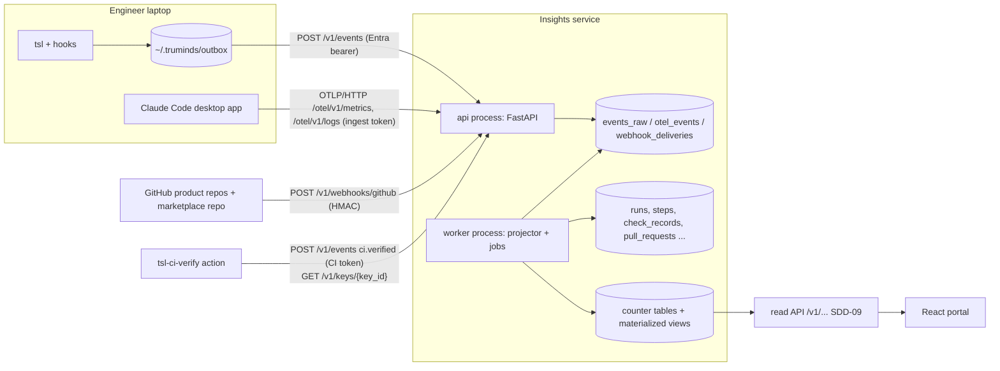
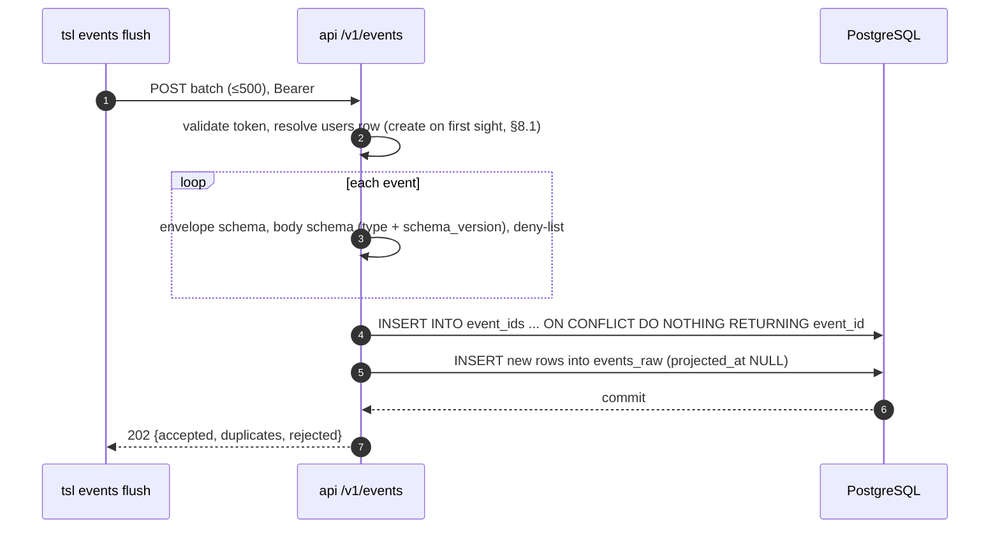
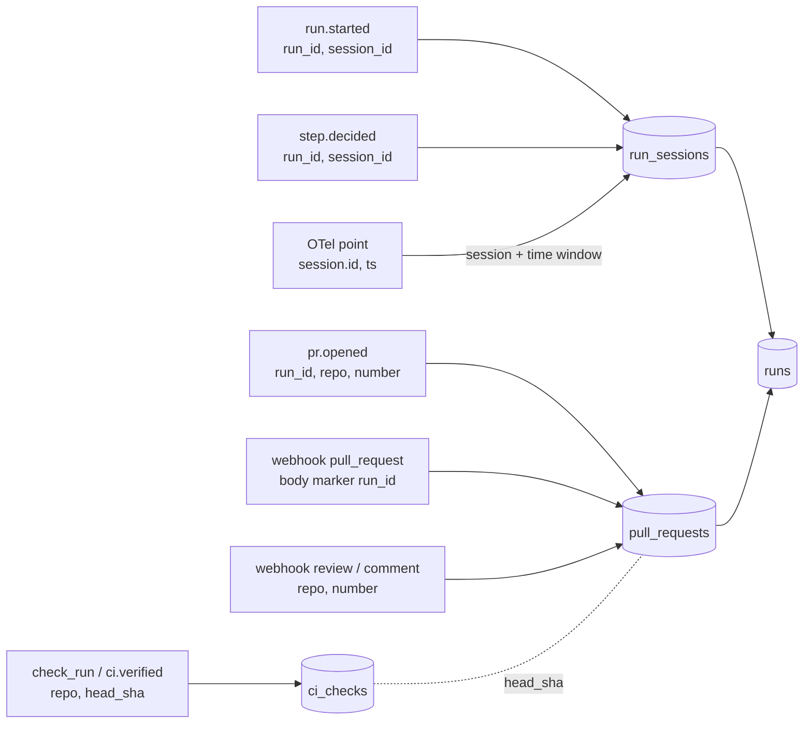
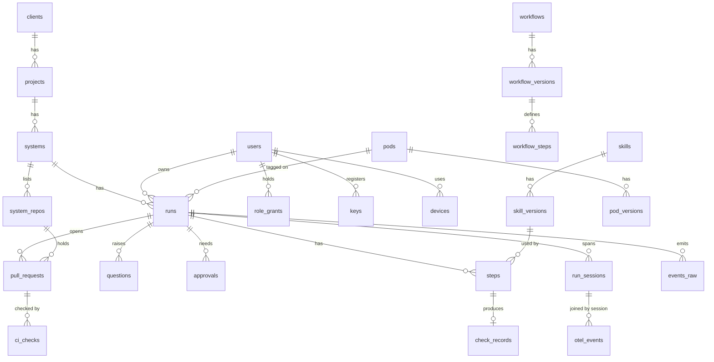

# SDD-08 · Telemetry, Insights Service and Database

| Field | Value |
| --- | --- |
| Status | Draft for owner review |
| Owner | Gaurav Saini |
| Approver | Puneet Singh Nanda |
| Related docs | [Doc 3 Architecture](../architecture/03-architecture.md) §8–§10 · [Doc 5 API and Rules](../architecture/05-api-and-rules.md) §5–§7 · [SDD-05 Claude Code integration](SDD-05-claude-code-integration.md) §5, §7.2 · [SDD-09 Web portal and read API](SDD-09-web-portal.md) · [OPS-02 Monitoring](../operations/OPS-02-monitoring-alerting.md) · [ADR 0001](../adr/0001-portal-custom-react-on-fastapi.md) · [ADR 0002](../adr/0002-identity-microsoft-entra-id.md) · [Readiness tracker](../planning/readiness-tracker.md) Q5, Q6, Q33 |

## 1. Scope

### 1.1 What this document decides

How telemetry reaches the Truminds cloud and how it is stored:

- the FastAPI insights service: code layout, processes and request flow;
- the write endpoints: `POST /v1/events`, the OTLP/HTTP receiver, the GitHub webhook and `POST /v1/keys`;
- the event-type catalogue with typed body fields;
- the full PostgreSQL 16 schema, as DDL, with indexes, counter tables and materialized views behind every portal number;
- idempotency, the `run_id` join logic, pseudonymisation, retention and encryption at rest;
- Alembic migrations, ingest tokens, seed data and load expectations.

### 1.2 What it does not decide

| Topic | Where |
| --- | --- |
| Read API, screens, persona filtering | [SDD-09](SDD-09-web-portal.md) |
| Alerts, SLOs, dashboards, paging | [OPS-02](../operations/OPS-02-monitoring-alerting.md) |
| Entra app registrations, device-code token refresh, key revocation flow | SDD-07 (identity, signing and keys) |
| Hosting, backup, region | OPS-01 (blocked on OQ-02, OQ-03) |
| Weekly improvement report queries and layout | SDD-11 (reads the views defined here) |
| What `tsl` puts in the outbox and when | SDD-04; this document fixes only the wire contract |

### 1.3 Ground rules

- Metadata only (NFR-10, X-06). No file content, prompts, artifact text, findings text or client names reach the service.
- The service never runs an LLM (C-02).
- The service is not on the engineer's critical path. Runs never wait for it (TM-11, NFR-03).
- Doc 5 §5 is the parent contract. Where this document adds a field, it says so in §13.

## 2. Context



## 3. Service structure

### 3.1 Code layout (`services/insights/`)

```text
services/insights/
├─ pyproject.toml                 # uv; Python 3.12; FastAPI, Uvicorn, SQLAlchemy 2 (asyncpg), Alembic,
│                                 # Pydantic v2, jsonschema, opentelemetry-proto, PyJWT[crypto], cryptography, prometheus-client
├─ Dockerfile                     # one image, two entrypoints: api, worker
├─ alembic.ini
├─ alembic/versions/              # forward-only migrations (§10)
├─ openapi/                       # generated openapi.json, committed, diffed in CI
├─ seed/                          # invented dev data (§10.3)
├─ app/
│  ├─ main.py                     # create_app(): routers, middleware, lifespan
│  ├─ config.py                   # pydantic-settings; every value from env or secret store
│  ├─ db.py                       # async engine, session factory, DB roles (§9.4)
│  ├─ auth/
│  │  ├─ entra.py                 # Entra access-token validation (JWKS, iss, aud, exp, tid)
│  │  ├─ ingest_tokens.py         # OTel and CI token check (hash compare)
│  │  ├─ github_hmac.py           # X-Hub-Signature-256 check
│  │  └─ scope.py                 # role grants -> visible systems (used by SDD-09)
│  ├─ api/v1/
│  │  ├─ events.py                # POST /v1/events
│  │  ├─ keys.py                  # POST /v1/keys, GET /v1/keys/{key_id}
│  │  ├─ me.py                    # GET /v1/me
│  │  ├─ webhooks_github.py       # POST /v1/webhooks/github
│  │  ├─ otel.py                  # POST /otel/v1/metrics, /otel/v1/logs
│  │  ├─ health.py                # GET /v1/health, /v1/health/ready
│  │  └─ read/                    # read API, specified in SDD-09
│  ├─ ingest/
│  │  ├─ envelope.py              # Pydantic Event model (Doc 5 §5.2)
│  │  ├─ bodies/                  # one JSON Schema per event type + version (copied from marketplace schemas/events/)
│  │  ├─ denylist.py              # free-text checks (§4.4)
│  │  └─ pseudonym.py             # §8.1
│  ├─ projector/
│  │  ├─ loop.py                  # claims unprojected events, applies handlers (§7)
│  │  └─ handlers/                # one module per event type
│  ├─ otel/
│  │  ├─ decode.py                # protobuf or JSON OTLP -> rows
│  │  └─ allowlist.yaml           # metric/event names and attributes kept (§5.3)
│  ├─ catalogue/sync.py           # marketplace release -> skills, workflows, pods (§6.4)
│  ├─ jobs/                       # refresh_views, rollup, retention, partitions, outbox_watch
│  └─ obs/                        # JSON logging, Prometheus metrics (OPS-02)
└─ tests/                         # unit, contract, idempotency, load (§12)
```

### 3.2 Processes

| Process | Command | Replicas | Does |
| --- | --- | --- | --- |
| `api` | `uvicorn app.main:app --workers 2` | 2 (stateless) | Validates and stores incoming data; serves the read API. Never projects |
| `worker` | `python -m app.worker` | 1 (leader lock via `pg_try_advisory_lock`) | Projector loop, view refresh, catalogue sync, rollups, retention, partition creation |
| `migrate` | `alembic upgrade head` | Job before each deploy | Schema changes only |

The api never blocks on projection. A request is done once the raw row is committed.

### 3.3 Endpoint list (complete)

This is the full list of routes the service serves. Write routes are specified in this document; other rows point to the owning document. The [registry](../architecture/registry.md) §4 is canonical. Token audience for every Entra route is the `truminds-insights-api` application (client) ID (v2 tokens, SDD-07 §9).

| Method | Path | Auth scope / credential | Roles | Spec |
| --- | --- | --- | --- | --- |
| POST | `/v1/events` | `Events.Write`; CI ingest token (`ci.verified` only) | App role Engineer, TechLead or Admin | §4 |
| POST | `/otel/v1/metrics`, `/otel/v1/logs` | OTel ingest token | — | §5 |
| POST | `/v1/webhooks/github` | GitHub HMAC | — | §6.1 |
| POST | `/v1/keys` | `Events.Write` | App role Engineer, TechLead or Admin | §6.2, SDD-07 §5.2 |
| GET | `/v1/keys/{key_id}?at=&system=` | `Events.Write` or CI ingest token | Any | §6.2 |
| POST | `/v1/keys/{key_id}/revoke` | `Events.Write` or `Portal.Write` | Key owner; `admin` | SDD-07 §5.6 |
| GET | `/v1/me/keys` | `Events.Write` or `Portal.Read` | Own keys | SDD-07 §5.5 |
| POST | `/v1/signatures/verify` | CI ingest token or `Events.Write` | Any | SDD-07 §7.2 |
| GET | `/v1/me` | `Events.Write` or `Portal.Read` | Any | §3.1; fields SDD-09 §5.6.1 |
| GET | `/v1/systems/{code}` | `Events.Write` | `engineer` or `tech_lead` on the system; `admin` | SDD-12 §5.3 |
| GET | `/v1/policy/denylist` | `Events.Write` or CI ingest token | Any | SEC-01 §7.4 |
| GET | `/v1/health`, `/v1/health/ready` | none | — | §11.1, OPS-02 §4 |
| GET | `/v1/status` | `Portal.Read` | Any | SDD-09 E02 |
| GET | `/v1/catalogue/summary`, `/v1/catalogue/skills`, `/v1/catalogue/skills/{skill_id}`, `/v1/catalogue/releases`, `/v1/catalogue/pods` | `Portal.Read` | Any (class A) | SDD-09 E03–E05, E07, E08 |
| GET | `/v1/catalogue/skills/{skill_id}/quality` | `Portal.Read` | Engineer family (scope); skill owners | SDD-09 E06 |
| GET | `/v1/pods/{pod_id}`, `/metrics`, `/one-pager` | `Portal.Read` | Any (fields by role) | SDD-09 E09, E10, E13 |
| GET | `/v1/pods/{pod_id}/runs`, `/v1/pods/{pod_id}/fit` | `Portal.Read` | Engineer family (scope) | SDD-09 E11, E12 |
| GET | `/v1/capability-map` | `Portal.Read` | Any (class A) | SDD-09 E14 |
| GET | `/v1/insights/business` | `Portal.Read` | Any (class A) | SDD-09 E15 |
| GET | `/v1/me/home` | `Portal.Read` | Engineer family (own) | SDD-09 E16 |
| GET | `/v1/insights/engineering/runs`, `/skills`, `/usage`, `/health` | `Portal.Read` | Engineer family (scope) | SDD-09 E17–E20 |
| GET | `/v1/runs`, `/v1/runs/{run_id}` | `Portal.Read` | Engineer family (scope) | SDD-09 E21, E22 |
| GET | `/v1/improvement/flags`, `/v1/improvement/skills/{skill_id}` | `Portal.Read` | `skill_owner` (own), `eng_lead`, `admin` | SDD-11 §5.4 |
| PATCH | `/v1/improvement/flags/{flag_id}` | `Portal.Write` | `skill_owner` of the skill | SDD-11 §5.4 |
| POST | `/v1/admin/clients`, `/v1/admin/clients/{code}/consent`, `/v1/admin/projects`, `/v1/admin/systems`, `/v1/admin/role-grants`, `/v1/admin/role-grants/{id}/revoke`, `/v1/admin/users/{pseudonym}/deactivate` | `Portal.Write` | `admin` | SDD-13 §7.2 |
| GET | `/v1/admin/clients`, `/v1/admin/projects`, `/v1/admin/systems`, `/v1/admin/role-grants`, `/v1/admin/users`, `/v1/admin/users/{pseudonym}/keys` (paginated, read API conventions SDD-09 §5.1) | `Portal.Read` | `admin`; names in `/v1/admin/users` only with `include=names` for roles in RD-1, audited | SDD-13 §7.2 |

## 4. `POST /v1/events`

### 4.1 Request and response

Envelope and response are exactly Doc 5 §5.2: up to 500 events, `202` with `BatchResult {accepted, duplicates[], rejected[]}`.

| Item | Rule |
| --- | --- |
| Auth | `Authorization: Bearer <Entra access token>` (from `tsl login`, ADR 0002), audience = the `truminds-insights-api` application (client) ID, because the API accepts v2 tokens (`api://truminds-insights/Events.Write` is only the scope string the client requests; SDD-07 §9), scope `Events.Write`; or a CI ingest token (§9.3) that may send only `ci.verified` |
| Size | Max 500 events and 1 MiB body, else `413` |
| Rate | 20 requests/s per user, burst 40; `429` with `Retry-After` |
| User | Set from the token's `oid`. A `user` key anywhere in the event is rejected (`E-ING-03`) |
| Order | Events may arrive in any order and days late (outbox). Nothing depends on arrival order (§7.3) |
| Clock | `occurred_at` more than 5 minutes after `received_at` is kept but flagged `clock_skew=true`; aggregations then use `received_at` |

### 4.2 Processing (api process, one transaction per batch)



A duplicate counts as success, so the client deletes it from the outbox (Doc 5 R-05). A rejected event goes to the outbox `dead/` folder, except `E-ING-02`, which stays queued because a newer server may accept it.

### 4.3 Ingest error codes (new; add to Doc 4 §5.2 and Doc 5)

| Code | HTTP / per event | Meaning | Client action |
| --- | --- | --- | --- |
| E-ING-01 | per event | Envelope or body fails its JSON Schema | Move to `dead/` |
| E-ING-02 | per event | Unknown `schema_version` for this type (Doc 3 §9.2: service reads N and N-1) | Keep queued; upgrade `tsl` |
| E-ING-03 | per event | Forbidden field (`user`, `email`, `name`) present | Move to `dead/`; bug in `tsl` |
| E-ING-04 | per event | Free-text field failed the deny-list (§4.4) | Move to `dead/`; raises alert AL-18 in OPS-02 |
| E-ING-05 | per event | Token kind not allowed to send this type (for example a CI token sending `run.started`) | Move to `dead/` |
| E-ING-06 | 400 | Batch is not JSON, or `events` missing | Client bug |
| E-ING-07 | 401 | Token invalid, expired, wrong audience or tenant | `tsl login` (E-AUTH-01 on the client) |

Doc 3 §9.2 says unknown versions get HTTP 422. This document uses a per-event `E-ING-02` inside the `202` instead, so one old event does not fail the whole batch. Doc 3 §9.2 should be updated (§13).

### 4.4 Content rules (TM-08)

| Check | Rule |
| --- | --- |
| Length | Every string ≤ 200 characters; `ticket_ref` ≤ 40; ids match their patterns |
| Paths | Only `evidence_ref` may hold a path, and it must start with `context/`, `artifacts/` or `runs/` (companion repo layout) |
| Deny-list | Rejects strings that look like an email, a URL other than `github.com/<org>/<repo>`, a PEM header, a JWT, a cloud access key, or a 40+ character high-entropy token. The pattern list lives in `app/ingest/denylist.py` and is shared with the CI test in the marketplace repo |
| Unknown keys | `additionalProperties: false` at every level |

### 4.5 Event-type catalogue (schema_version 1)

All bodies are closed objects. **New** marks a field or type that Doc 5 §5.3 does not have yet. `session_id` is the Claude Code session id that the SessionStart hook exports as `TSL_SESSION_ID` (SDD-05 §5.5); it is optional because U-06 is not yet verified.

| Type | Body fields (type; R = required) | Sent by |
| --- | --- | --- |
| `session.started` **new** | `session_id` str R · `device_id` str R (`dev_<ULID>`, created by `tsl` at first login and stored in `config.toml`, SDD-04 §7.1; never an OS machine id) · `plugin_version` semver R · `tsl_version` semver R · `os` enum `macos\|windows\|linux` R · `outbox_depth` int R · `outbox_oldest_at` date-time or null R | session-start hook |
| `session.ended` | `session_id` R · `device_id` R · `outbox_depth` int R · `outbox_oldest_at` R · `active_run` bool | session-end hook (SDD-05 §5.3) |
| `run.started` | `workflow` R · `workflow_version` R · `ticket_ref` R · `system` (code) R · `plugin_version` R · `pinned_skills` object `{skill: version}` R · `session_id` **new** · `pod` (pod id) **new** · `pack_fresh` bool **new** | `tsl state start` |
| `run.status_changed` | `from` R · `to` R (run states, Doc 3 §4.1) · `reason_code` R (`answered`, `approved`, `completed`, `aborted`, or an error code such as `E-SEC-01`) · `gate` **new** · `step` **new** · `session_id` **new** | `tsl state` |
| `step.started` **new** | `step` R · `skill` R · `skill_version` R · `attempt` int R · `seq` int R · `session_id` | `tsl next` |
| `step.decided` | Doc 5 fields: `step`, `skill`, `skill_version`, `attempt`, `outcome`, `band`, `signals`, `caps[]`, `gate_failures[]`, `findings_count{blocker,major,minor}`, `duration_ms`, `verification_sha256` (all R) · plus **new**: `seq` int R · `reasons[]` enum codes R (§6.3 cause codes) · `findings_dropped[]` finding ids only · `key_id` R · `decided_by` (`tsl@x.y.z`) R · `session_id` | `tsl decide` |
| `question.created` | `step` R · `question_id` R · `blocking` bool R · `ask_role` enum `product_owner\|tech_lead\|sme\|client` R · `evidence_ref` **new** | `tsl decide` |
| `question.answered` | `step` R · `question_id` R · `age_s` int R · `accepted_default` bool | `tsl state resume` |
| `approval.recorded` | `gate` R · `decision` enum `approve\|reject\|changes` R · `approver_role` R · `step` **new** · `signature_block_sha256` **new** R · `key_id` **new** R (SDD-07 §7.2) | `tsl approve` |
| `hook.decision` | `hook` enum `session-start\|pre-tool\|pre-mcp\|post-write\|session-end` R · `decision` enum `allow\|deny\|feedback` R · `code` (error code or null) R · `tool_kind` **new** enum `write\|edit\|bash\|mcp_read\|mcp_write\|other` · `session_id` | hooks |
| `pr.opened` | `repo` (tsl.yaml product repo name) R · `number` R · `draft` R · `lowest_band` R | `tsl pr` |
| `ci.verified` | `repo` R · `number` R · `result` enum `pass\|fail` R · `codes[]` R · `head_sha` **new** R | `tsl ci-verify` (CI token) |
| `context.signed` | `system` R · `age_days` R · `drift_files` R · `status` **new** enum `fresh\|stale` R · `signature_sha256` **new** R · `key_id` **new** R (SDD-07 §7.2) | `tsl context sign` |
| `context.drift` | `system` R · `age_days` R · `drift_files` R · `status` R | `tsl context build --check` |
| `eval.recorded` | `skill` R · `version` R · `cases` R · `pass_rate` R · `key_id` **new** R · `result_sha256` **new** R (SDD-07 §7.2) | `tsl eval run` |
| `security.abort` | `code` R · `step` R | `tsl decide`, hooks |
| `step.invalidated` **new** | `step` R · `cause_step` R · `reason` R | `tsl next` (SDD-02 §12) |
| `audit.recorded` **new** | `step` R · `verdict` enum `deserved\|miss` R · `reason_code` R | `tsl` calibration audit (SDD-03 §16.3) |
| `companion.lifecycle` **new** | `system` R · `from` R · `to` R · `reason_code` R | `tsl init`, `tsl companion archive` (SDD-12 §9) |
| `companion.policy_violation` **new** | `system` R · `code` R (E-COMP-*) | companion CI (SDD-12 §6.4) |
| `improvement.proposed` **new** | `improvement_id` R · `skill` R · `from_version` R · `to_version` R · `flag_ids[]` R · `before_pass_rate` R · `after_pass_rate` R · `cases_added` R | `tsl improve pr` (SDD-11 §10) |

`hook.decision` and `session.*` events may have no `run_id`. All others with a run carry it in the envelope.

## 5. OpenTelemetry receiver

### 5.1 Endpoints

| Method | Path | Content types | Auth |
| --- | --- | --- | --- |
| POST | `/otel/v1/metrics` | `application/x-protobuf`, `application/json` | `Authorization: Bearer <otel ingest token>` (§9.3) |
| POST | `/otel/v1/logs` | same | same |

These match the managed setting `OTEL_EXPORTER_OTLP_ENDPOINT=https://<insights-host>/otel` with protocol `http/protobuf` (SDD-05 §6.2): the exporter appends `/v1/metrics` and `/v1/logs`. Responses follow OTLP/HTTP: `200` with an empty `Export*ServiceResponse`; `400` for undecodable bodies; `429`/`503` with `Retry-After`. Gzip request bodies are accepted. Traces are not accepted (`404`).

The service decodes OTLP itself with `opentelemetry-proto`. No separate OpenTelemetry Collector runs in Release 1 (Doc 3 §11 listed one; see §13).

### 5.2 What is kept

| Rule | Detail |
| --- | --- |
| Allowlist | Only names listed in `otel/allowlist.yaml` are stored. Everything else is counted (`insights_otel_dropped_total`) and dropped |
| Attributes | Only `session.id` (verified, SDD-05 V-17) and the per-metric attributes listed in the allowlist. All other attributes are removed before storage |
| Content | Any attribute or log body holding prompt, response, tool input or file content is dropped, even if a seat turns on a content-logging variable by mistake |
| Shape | One row per data point (metrics) or per log record (events) in `otel_events` |

### 5.3 Allowlist (to confirm in spike S-10)

SDD-05 §7.2 fixes *which* signals we keep: session count, token usage, cost usage, active time, tool decisions, skill-activated and plugin-loaded events. The exact OTel metric and event names and their attribute keys are **unverified** in SDD-05 §2. They go into `allowlist.yaml` only after spike **S-10** (new): Shubham exports one real session to a local OTLP sink on a company seat and records every name and attribute. Until then the allowlist ships empty, and the receiver stores nothing except counts of what it dropped.

```yaml
# app/otel/allowlist.yaml  (shape; names filled from spike S-10)
metrics:
  - {name: "<token usage metric>",  keep_attrs: [session.id, "<token type attr>", "<model attr>"], unit: tokens}
  - {name: "<cost usage metric>",   keep_attrs: [session.id, "<model attr>"], unit: usd}
  - {name: "<active time metric>",  keep_attrs: [session.id], unit: s}
  - {name: "<session count metric>", keep_attrs: [session.id], unit: "1"}
logs:
  - {event: "<tool decision event>",  keep_attrs: [session.id, "<tool name attr>", "<decision attr>"]}
  - {event: "<skill activated event>", keep_attrs: [session.id, "<skill name attr>"]}
  - {event: "<plugin loaded event>",  keep_attrs: [session.id, "<plugin name attr>", "<plugin version attr>"]}
```

### 5.4 Joining OTel to runs

OTel carries no `run_id`. The join is `session.id` → `run_sessions` → run (§7.2). Token and cost totals per run land in `run_usage` and per step in `steps.tokens_in/out` when a step's time window holds the data point.

## 6. GitHub webhook, keys and catalogue sync

### 6.1 `POST /v1/webhooks/github`

| Step | Rule |
| --- | --- |
| 1. Signature | Compute HMAC-SHA256 of the raw body with the secret for this hook (`github_hooks` row looked up by `X-GitHub-Hook-ID`). Compare with `X-Hub-Signature-256` using `hmac.compare_digest`. No match, or unknown hook → `401`, counted in `insights_webhook_signature_failures_total` |
| 2. Idempotency | `INSERT INTO webhook_deliveries (delivery_id ...) ON CONFLICT DO NOTHING` on `X-GitHub-Delivery`. A repeat returns `200` and does nothing |
| 3. Filter | Keep only the events and actions in Doc 5 §6.1, plus `release` (published) from the marketplace repo (§6.4). Others → `204` |
| 4. Repo | Look up `repository.full_name` in `system_repos`. Unknown repo → `204`, nothing stored |
| 5. Join | `pull_request`: find `<!--\s*tsl:run_id=(run_[0-9A-HJKMNP-TV-Z]{26})\s*-->` in `pull_request.body`. The body itself is never stored. No marker → only increment `pr_unlinked_daily` (Doc 5 §6.1) |
| 6. Store | Upsert `pull_requests` / `ci_checks` in the same transaction; respond `200` within 10 s (GitHub's delivery timeout) |

| GitHub event | Columns updated |
| --- | --- |
| `pull_request` opened / reopened / ready_for_review | `state='open'`, `draft`, `opened_at`, `head_sha`, `run_id` |
| `pull_request` closed | `state='merged'` + `merged_at` if `merged=true`, else `state='closed'` + `closed_at` |
| `pull_request_review` submitted | `review_count+1`, `first_review_at` if null, `changes_requested=true` when state is `changes_requested` |
| `pull_request_review_comment` created | `review_comments+1` (no text) |
| `check_run` completed, name `tsl-ci-verify` | `ci_checks` row for (repo, head_sha): `result` from `conclusion`; join to PR by `head_sha` |

The webhook is installed on product repos only with client consent (E-CONS-01). GitHub must reach this endpoint from the internet, which conflicts with an intranet-only host; see Open items.

### 6.2 `POST /v1/keys` and `GET /v1/keys/{key_id}`

SDD-07 owns the key lifecycle. This is the wire contract the service implements.

```json
// POST /v1/keys   (Bearer Entra token, scope Events.Write)
{
  "key_id": "key_01J9ZK...",            // client-made ULID
  "algorithm": "Ed25519",
  "public_key": "base64url(32 bytes)",
  "device_id": "dev_01J9ZK2M4Q8X7T3B5N6R0VWYCE", // dev_<ULID> (SDD-04 §7.1)
  "device_label": "laptop-4f2a",         // optional, ≤ 40 chars, not in the proof (SDD-07 §5.2)
  "iat": "2026-01-01T09:00:00Z",         // signing time of the proof; must be within 5 minutes of server time
  "proof": "base64url(signature)"       // Ed25519 over JCS({key_id, public_key, device_id, sub: <token oid>, iat})
}
```

| Response | When |
| --- | --- |
| `201 {key_id, pseudonym, roles[], expires_at}` | New key. Any earlier active key of the same user and device gets `revoked_at=now()`, `revoked_reason='replaced'` (R-06) |
| `200` same body | Same `key_id` and same public key already stored (idempotent retry) |
| `409 E-KEY-03` | Same `key_id`, different public key (E-KEY-01 is the `tsl` keychain error, SDD-04 §5) |
| `400 E-KEY-02` | Proof does not verify, or `iat` older than 5 minutes |
| `403 E-AUTH-08` | No Truminds app role, or user inactive (SDD-07 §5.2) |

`GET /v1/keys/{key_id}?at=<date-time>&system=<code>` (Bearer or CI token) returns `{key_id, public_key, user_pseudonym, created_at, expires_at, revoked_at, revoked_reason, compromised_since, roles_at: [...]}`. `roles_at` lists the roles the key's user held on that system at `at`, read from `role_grants` history, so `tsl ci-verify` can apply Doc 5 R-07.

### 6.3 Failure-cause codes

`step.decided.reasons[]` uses this fixed enum. `tsl decide` emits it; the portal shows the label.

| Code | Label | Code | Label |
| --- | --- | --- | --- |
| H1 | Schema invalid | S1 | Evidence below threshold |
| H2 | Required section missing | S2 | Soft checks failed |
| H3 | Build or test failed | S3 | Reviewer score low |
| H4 | Forbidden content | S4 | Open blockers |
| H5 | Trace link or scope | S5 | Context pack stale |
| H6 | Stale input | S6 | Change risk over limit |
| H7 | Tool not permitted | REVIEW-MAJOR | Reviewer major finding |
| REVIEWER-ERROR | Reviewer could not run | CAP-PACK | Band capped: pack not fresh |

### 6.4 Catalogue sync

Tracker Q10 asked whether the portal reads the marketplace repo directly or syncs it. **Decision: sync into the database.** The read API then needs no GitHub token, and catalogue rows can be joined to run data.

- Trigger: `release` webhook (action `published`) from the marketplace repo, plus an hourly poll of the latest `vX.Y.Z` tag as a fallback.
- Source: the release tag's tree, read with a read-only token: `plugins/truminds/skills/*/skill.yaml` (schema `skill-metadata.v1`), `plugins/truminds/workflows/*.yaml`, `pods/*.yaml` (SDD-10) and `CHANGELOG.md`.
- Each file is validated against its schema. A bad file skips that item and raises alert AL-19 (OPS-02); the rest still sync.
- Writes `catalogue_releases`, `skills`, `skill_versions`, `workflows`, `workflow_versions`, `workflow_steps`, `pods`, `pod_versions` in one transaction. Old versions are kept.

The portal needs fields that `skill-metadata.v1` does not have yet: `title`, `summary`, `phase`, `domains[]`, and a `portal` block (`why_clients_care[]`, `client_receives[]`). SDD-01 must add them (§13).

## 7. Projection and the `run_id` join

### 7.1 Projector loop

```python
# app/projector/loop.py (worker process)
while True:
    async with db.begin() as tx:
        rows = await tx.execute(text("""
            SELECT event_id, received_at, type, schema_version, run_id, user_id, body, occurred_at
            FROM events_raw
            WHERE projected_at IS NULL AND (retry_after IS NULL OR retry_after < now())
            ORDER BY occurred_at
            LIMIT 500
            FOR UPDATE SKIP LOCKED"""))
        for ev in rows:
            try:
                await HANDLERS[(ev.type, ev.schema_version)](tx, ev)   # idempotent upserts only
                mark = {"projected_at": now(), "projection_error": None}
            except Parked as p:                                      # e.g. unknown system code
                mark = {"projection_error": p.code, "retry_after": now() + p.backoff}
            await mark_event(tx, ev, mark)
    await sleep(1 if rows else 5)
```

Raw insert and projection are separate transactions, so a slow projection never slows ingest. Each event's projection and its `projected_at` mark commit together, so counter increments happen exactly once.

### 7.2 Join keys

| Source | Join key | How |
| --- | --- | --- |
| `tsl` events | `run_id` in the envelope | Direct. If `run.started` has not arrived yet, the handler creates a placeholder `runs` row with `is_partial=true`; `run.started` fills it later |
| Claude Code OTel | `session.id` | Every event with `body.session_id` and a `run_id` upserts `run_sessions(run_id, session_id, first_seen_at, last_seen_at)`. An OTel point is attributed to the run whose `[first_seen_at, last_seen_at + 10 min]` window contains its timestamp. No match (or two matches) → stored with `run_id NULL`, session-level only |
| GitHub `pull_request` | `tsl:run_id` marker in the PR body | §6.1 step 5 |
| `pr.opened` event | `run_id` + `repo` + `number` | `repo` is the tsl.yaml name. It maps to `system_repos.github_full_name` through the run's system. Whichever of `pr.opened` or the webhook arrives first creates the `pull_requests` row |
| Reviews, review comments | `repo` + PR `number` | Unique key on `pull_requests (repo_id, number)` |
| `check_run`, `ci.verified` | `repo` + `head_sha` (+ `number` for `ci.verified`) | `ci_checks`, joined to `pull_requests.head_sha` |
| Approvals, questions | `run_id` + `gate` / `question_id` | `approvals`, `questions` |



### 7.3 Order independence

| Table | Rule when events arrive late or out of order |
| --- | --- |
| `runs.status` | Changed only if the event's `occurred_at` > `runs.status_changed_at` (tie: larger `event_id`) |
| `steps` | Primary key `(run_id, step_id, attempt)`; `step.started` and `step.decided` each fill their own columns, so either may come first |
| `runs.current_step_id` | Step with the highest `seq`, then highest `attempt`, among started steps |
| `runs.lowest_band` | Recomputed from the final attempt of each step |
| `questions` | `question.answered` before `question.created` creates the row with `created_at NULL` |
| Counter tables | Increment once per event (exactly-once by `event_ids`) |

### 7.4 Projection side effects per event type

| Event | Writes |
| --- | --- |
| `session.started`, `session.ended` | `devices` (latest by `occurred_at`), `run_sessions`, `ingest_daily` |
| `run.started` | `runs` (all header columns), `run_sessions`, `user_daily` |
| `run.status_changed` | `runs.status`, `end_reason`, `end_code`; `approvals` row (requested) when `to=PAUSED_APPROVAL` with a `gate` |
| `step.started` | `steps.started_at`, `runs.current_*` |
| `step.decided` | `steps` decision columns, `check_records`, `runs.lowest_band`, `runs.updated_at`, `user_daily` |
| `question.*` | `questions` |
| `approval.recorded` | `approvals` (decision, approver) |
| `hook.decision` | `hook_daily` counter (`system_id` through the run, if any) |
| `pr.opened` | `pull_requests` |
| `ci.verified` | `ci_checks` |
| `context.*` | `systems.pack_*` (latest by `occurred_at`); `pack_signed_by` from the event's user for `context.signed` |
| `eval.recorded` | `skill_versions.eval_*` |
| `security.abort` | `runs.end_code` |

## 8. Privacy

### 8.1 Pseudonymisation (`eng-xxxx`)

| Item | Rule |
| --- | --- |
| Created | On the first authenticated request of a new Entra user (`tid` + `oid`) |
| Value | `"eng-" + hex(HMAC-SHA256(pepper, tid + ":" + oid))[:4]`. On a clash, take 6 hex characters, then 8 |
| Stored | `users.pseudonym`, set once and never recomputed, so rotating the pepper does not change existing pseudonyms |
| Pepper | 32 random bytes in the secret store, never in git or the database |
| Real name and email | `users.display_name_enc`, `users.email_enc`: AES-256-GCM, key from the secret store (§9.2). `email_hmac` allows exact lookup by admins |
| Who sees names | Only through the read API's name rule (SDD-09 §5.3). Every reveal writes `audit_log` |
| Erasure (DPDP / GDPR request) | `users.display_name_enc`, `email_enc`, `email_hmac` set to NULL, `erased_at` set. The pseudonym stays, so aggregates still add up but nobody can map it back |

Events never carry a user id; the server takes it from the token.

### 8.2 Retention

Retention for events is OQ-08. The values below are the Doc 3 NFR-11 proposal (13 months) and are configurable.

| Data | Kept | Then |
| --- | --- | --- |
| `events_raw`, `event_ids` | 13 months (`RETENTION_EVENTS_MONTHS`) | Monthly partition dropped |
| `otel_events` | 90 days | Partition dropped; totals already in `run_usage` |
| `webhook_deliveries` | 30 days | Deleted |
| `runs`, `steps`, `check_records`, `questions`, `approvals`, `pull_requests`, `ci_checks`, `run_sessions`, `run_usage` | 13 months after `runs.updated_at` | `rollup` job writes `agg_monthly` and `agg_user_month` first, then deletes |
| `agg_monthly`, `agg_user_month`, counter tables | Life of the service | No user identity apart from the pseudonymous `user_id` |
| `audit_log` | 24 months | Deleted |
| `users` | While active; erased on request | §8.1 |

Retention of signed records in companion repos is NFR-16 and is not affected.

## 9. Security

### 9.1 Authentication summary

| Caller | Credential | Allowed |
| --- | --- | --- |
| `tsl` (engineer laptop) | Entra access token from the device-code flow (ADR 0002), scope `Events.Write` | `POST /v1/events`, `POST /v1/keys`, `GET /v1/keys/*`, `POST /v1/keys/{key_id}/revoke`, `GET /v1/me`, `GET /v1/me/keys`, `POST /v1/signatures/verify`, `GET /v1/systems/{code}`, `GET /v1/policy/denylist` |
| Portal (browser) | Entra access token from auth code + PKCE, scope `Portal.Read`; `Portal.Write` for the few write routes | Read API (SDD-09) and `GET /v1/me` with `Portal.Read`; `PATCH /v1/improvement/flags/{flag_id}`, `POST /v1/keys/{key_id}/revoke` and the `/v1/admin/*` writes with `Portal.Write`; the `GET /v1/admin/*` lists with `Portal.Read` (§3.3) |
| Claude Code OTel exporter | OTel ingest token | `/otel/v1/*` only |
| `tsl-ci-verify` action | CI ingest token | `POST /v1/events` with `ci.verified` only; `GET /v1/keys/*`; `POST /v1/signatures/verify`; `GET /v1/policy/denylist` |
| GitHub | HMAC secret per hook | `/v1/webhooks/github` only |

Token validation uses Microsoft's published OIDC metadata and JWKS through a maintained JWT library (PyJWT). No custom crypto and no local passwords (C-05, X-07). There are no admin, debug or bypass endpoints. Every endpoint is in the published OpenAPI file, apart from the OTLP paths (protocol-defined, listed in §5.1) and `/metrics` on the internal port (OPS-02 §4).

### 9.2 Encryption

| Layer | Rule |
| --- | --- |
| In transit | TLS 1.2+ at the ingress; `sslmode=verify-full` from the service to PostgreSQL (NFR-08) |
| At rest | Managed PostgreSQL storage encryption and encrypted backups, with keys in the cloud key service (OPS-01, after OQ-02) |
| Columns | `users.display_name_enc`, `users.email_enc`, `clients.display_name_enc`, `github_hooks.secret_enc`: AES-256-GCM with a data key wrapped by the cloud key service; key id stored with each value so keys can rotate |
| Secrets | Pepper, data key, GitHub hook secrets and the catalogue read token come from the secret store at start-up. None are in git or env files in the repo |

### 9.3 Ingest tokens

| Item | Rule |
| --- | --- |
| Kinds | `otel` (one shared token in managed settings, SDD-05 §6.2) and `ci` (one per client GitHub org, stored as the `TSL_CI_TOKEN` repo secret) |
| Format | `tsi_<kind>_<32 random bytes base64url>` |
| Storage | Only `sha256(token)` in `ingest_tokens`; compared in constant time |
| Issue and revoke | `python -m app.admin token create --kind otel --label <text>` and `token revoke <id>`, run by the platform admin inside the deployed container. It prints the token once. There is no HTTP endpoint for this |
| Rotation | Create the new token, update managed settings or the repo secret, revoke the old one after 7 days. `last_used_at` shows when it is safe |
| Risk | The OTel token is low privilege: it can only add metric rows. Abuse shows as a spike in `insights_otel_datapoints_total` (OPS-02) |

### 9.4 Database roles

| Role | Grants |
| --- | --- |
| `insights_owner` | DDL; used only by the `migrate` job |
| `insights_app` | DML on all tables; used by `api` ingest routes and `worker` |
| `insights_read` | `SELECT` on core tables, counter tables and views; **no** access to `events_raw`, `otel_events`, `ingest_tokens`, `github_hooks`, or the encrypted user columns. Used by read-API routes |
| `insights_reveal` | `SELECT (id, display_name_enc, enc_key_id, erased_at) ON users` only. Used for the audited name reveal (SDD-09 §5.3) |

`audit_log` is append-only: `insights_app` has `INSERT` and `SELECT` on it, never `UPDATE` or `DELETE` (SEC-01 §10, SEC-T-28).

## 10. Database (PostgreSQL 16)

### 10.1 Entity relationships



### 10.2 DDL (migration `0001_initial`)

This supersedes Doc 3 §9.1. Table names are plural and `verification` becomes `check_records` (§13).

```sql
-- ===== Organisation and people =====
CREATE TABLE users (
  id               uuid PRIMARY KEY DEFAULT gen_random_uuid(),
  tenant_id        uuid NOT NULL,                          -- Entra tid
  sso_subject      uuid NOT NULL,                          -- Entra oid
  pseudonym        text NOT NULL UNIQUE CHECK (pseudonym ~ '^eng-[0-9a-f]{4,8}$'),
  display_name_enc bytea, email_enc bytea, email_hmac bytea, enc_key_id text,
  agent_role       text,                                   -- e.g. developer; drives "Skills for your role"
  app_roles        text[] NOT NULL DEFAULT '{}',           -- Entra app roles from the last token (SDD-07 §3.4)
  roles_synced_at  timestamptz,                            -- last app-role sync, at most every 10 min (SDD-07 §3.4)
  github_login     text,                                   -- later phase: automated GitHub team sync (SDD-13 §7.3)
  active           boolean NOT NULL DEFAULT true,
  created_at       timestamptz NOT NULL DEFAULT now(),
  erased_at        timestamptz,
  UNIQUE (tenant_id, sso_subject));

CREATE TABLE clients (
  id uuid PRIMARY KEY DEFAULT gen_random_uuid(),
  code text NOT NULL UNIQUE CHECK (code ~ '^CL-[0-9A-Z]{2,8}$'),
  display_name_enc bytea NOT NULL,                         -- admin views only
  consent_ref text, consent_recorded_at timestamptz,
  consent_scope text[] NOT NULL DEFAULT '{}',              -- e.g. code_processing, companion_storage, product_prs, ci_webhook (SDD-12 §7)
  consent_withdrawn_at timestamptz,                        -- SDD-13 §7.2
  created_at timestamptz NOT NULL DEFAULT now());

CREATE TABLE projects (
  id uuid PRIMARY KEY DEFAULT gen_random_uuid(),
  client_id uuid NOT NULL REFERENCES clients,
  code text NOT NULL UNIQUE CHECK (code ~ '^PRJ-[0-9A-Z]{2,8}$'));

CREATE TABLE systems (
  id uuid PRIMARY KEY DEFAULT gen_random_uuid(),
  project_id uuid NOT NULL REFERENCES projects,
  code text NOT NULL UNIQUE CHECK (code ~ '^SYS-[0-9A-Z]{2,8}$'),
  domain text NOT NULL,                                    -- e.g. digital, embedded; for "systems across N domains"
  companion_repo text NOT NULL,                            -- org/repo
  pack_status text NOT NULL DEFAULT 'missing' CHECK (pack_status IN ('fresh','stale','missing')),
  pack_signed_at timestamptz, pack_signed_by uuid REFERENCES users,
  pack_drift_files int, pack_status_at timestamptz,
  lifecycle_state text NOT NULL DEFAULT 'PROVISIONED',    -- values owned by SDD-12 §9.1
  archived_at timestamptz,
  created_at timestamptz NOT NULL DEFAULT now());

CREATE TABLE system_repos (
  id uuid PRIMARY KEY DEFAULT gen_random_uuid(),
  system_id uuid NOT NULL REFERENCES systems,
  name text NOT NULL,                                      -- tsl.yaml product_repos[].name
  github_full_name text NOT NULL,                          -- org/repo (one repo may serve several systems)
  kind text NOT NULL CHECK (kind IN ('product','read_only')),
  UNIQUE (system_id, name), UNIQUE (system_id, github_full_name));
CREATE INDEX ON system_repos (github_full_name);

CREATE TABLE role_grants (
  id uuid PRIMARY KEY DEFAULT gen_random_uuid(),
  user_id uuid NOT NULL REFERENCES users,
  role text NOT NULL CHECK (role IN ('viewer','engineer','tech_lead','skill_owner','stage_approver','eng_lead','admin')),
  scope_type text NOT NULL CHECK (scope_type IN ('org','client','project','system','skill','stage')),
  scope_id text,                                           -- uuid or skill id; NULL for org
  granted_at timestamptz NOT NULL, revoked_at timestamptz, granted_by uuid REFERENCES users);
CREATE UNIQUE INDEX role_grants_active ON role_grants (user_id, role, scope_type, coalesce(scope_id,''))
  WHERE revoked_at IS NULL;

CREATE TABLE keys (
  key_id text PRIMARY KEY CHECK (key_id ~ '^key_[0-9A-HJKMNP-TV-Z]{26}$'),
  user_id uuid NOT NULL REFERENCES users,
  device_id text NOT NULL CHECK (device_id ~ '^dev_[0-9A-HJKMNP-TV-Z]{26}$'),
  device_label text CHECK (char_length(device_label) <= 40),          -- SDD-07 §5.2
  public_key bytea NOT NULL CHECK (octet_length(public_key) = 32),
  created_at timestamptz NOT NULL DEFAULT now(),
  expires_at timestamptz NOT NULL,                                     -- created_at + max age (SDD-07 §5.1)
  revoked_at timestamptz,
  revoked_reason text CHECK (revoked_reason IN ('replaced','user_request','offboarded','admin_other','lost_device','compromised')),
  compromised_since timestamptz,                                       -- may only move earlier (SDD-07 §5.6)
  revoked_by uuid REFERENCES users,
  revoke_note text CHECK (char_length(revoke_note) <= 200));
CREATE UNIQUE INDEX keys_one_active ON keys (user_id, device_id) WHERE revoked_at IS NULL;  -- R-06

CREATE TABLE signature_anchors (                           -- SDD-07 §7.2: server time for each signed object
  sha256      text PRIMARY KEY CHECK (sha256 ~ '^[0-9a-f]{64}$'),
  kind        text NOT NULL CHECK (kind IN ('verification','approval','pack','eval')),
  key_id      text NOT NULL REFERENCES keys,
  event_id    text NOT NULL,
  anchored_at timestamptz NOT NULL);                       -- received_at of the first event carrying it

CREATE TABLE devices (
  device_id text PRIMARY KEY, user_id uuid NOT NULL REFERENCES users,
  os text, plugin_version text, tsl_version text,
  outbox_depth int, outbox_oldest_at timestamptz,
  first_seen_at timestamptz NOT NULL, last_seen_at timestamptz NOT NULL, last_session_id text);

CREATE TABLE ingest_tokens (
  id uuid PRIMARY KEY DEFAULT gen_random_uuid(),
  kind text NOT NULL CHECK (kind IN ('otel','ci')),
  token_sha256 bytea NOT NULL UNIQUE, label text NOT NULL,
  created_at timestamptz NOT NULL DEFAULT now(), revoked_at timestamptz, last_used_at timestamptz);

CREATE TABLE github_hooks (
  hook_id bigint PRIMARY KEY,                              -- X-GitHub-Hook-ID
  target text NOT NULL,                                    -- org or org/repo
  secret_enc bytea NOT NULL, enc_key_id text NOT NULL,
  created_at timestamptz NOT NULL DEFAULT now(), revoked_at timestamptz);

-- ===== Catalogue (synced from the marketplace repo, §6.4) =====
CREATE TABLE catalogue_releases (
  tag text PRIMARY KEY, plugin_version text NOT NULL, tsl_version text NOT NULL,
  commit_sha text NOT NULL, released_at timestamptz NOT NULL, synced_at timestamptz NOT NULL,
  notes jsonb NOT NULL DEFAULT '[]');                       -- [{kind: skill|plugin, id, version, text}] for "What's new"

CREATE TABLE skills (
  id text PRIMARY KEY,                                     -- kebab-case skill id
  agent_role text NOT NULL CHECK (agent_role IN ('business-analyst','solution-architect','developer',
             'qa-engineer','devops','security','ux-designer','delivery-manager')),
  title text NOT NULL, summary text NOT NULL,
  phase text NOT NULL CHECK (phase IN ('requirements','design','build','test','operate')),
  domains text[] NOT NULL DEFAULT '{}',
  owner_pseudonym text, current_version text);

CREATE TABLE skill_versions (
  skill_id text NOT NULL REFERENCES skills, version text NOT NULL,
  status text NOT NULL CHECK (status IN ('draft','pilot','production','deprecated')),   -- SDD-01 §7 lifecycle words
  inputs jsonb NOT NULL, outputs jsonb NOT NULL, context_sections jsonb NOT NULL DEFAULT '[]',
  size_budget_tokens int, allowed_tools text[] NOT NULL DEFAULT '{}',
  portal jsonb NOT NULL DEFAULT '{}',                      -- why_clients_care[], client_receives[]
  changelog text, release_tag text REFERENCES catalogue_releases,
  eval_cases int, eval_pass_rate numeric(4,3), eval_key_id text REFERENCES keys, eval_recorded_at timestamptz,
  published_at timestamptz,
  PRIMARY KEY (skill_id, version));

CREATE TABLE workflows (id text PRIMARY KEY, title text NOT NULL, current_version text);
CREATE TABLE workflow_versions (
  workflow_id text NOT NULL REFERENCES workflows, version text NOT NULL,
  definition jsonb NOT NULL, step_count int NOT NULL, published_at timestamptz,
  PRIMARY KEY (workflow_id, version));
CREATE TABLE workflow_steps (
  workflow_id text NOT NULL, version text NOT NULL, seq int NOT NULL,
  step_id text NOT NULL, kind text NOT NULL CHECK (kind IN ('skill','gate','pr')),
  skill_id text REFERENCES skills, skill_range text, gate_role text,
  PRIMARY KEY (workflow_id, version, seq),
  FOREIGN KEY (workflow_id, version) REFERENCES workflow_versions);

CREATE TABLE pods (                                        -- table names: this document; values: SDD-10 §3
  id text PRIMARY KEY, title text NOT NULL,
  kind text NOT NULL CHECK (kind IN ('brownfield','greenfield','quality','ux')),
  status text NOT NULL CHECK (status IN ('draft','pilot','production','deprecated')),   -- status of current_version
  owner_pseudonym text,
  current_version text);
CREATE TABLE pod_versions (
  pod_id text NOT NULL REFERENCES pods, version text NOT NULL,
  status text NOT NULL CHECK (status IN ('draft','pilot','production','deprecated')),
  definition jsonb NOT NULL,      -- the validated pod.yaml (pod.v1, SDD-10 §3) plus one_pager_md (≤ 20 KB, SDD-09 §12)
  source_sha text NOT NULL,       -- skill-library commit of the release tag
  published_at timestamptz, PRIMARY KEY (pod_id, version));
CREATE TABLE pod_agents (
  pod_id text NOT NULL, version text NOT NULL, agent_key text NOT NULL,
  role text NOT NULL, display_name text NOT NULL, engineers int NOT NULL,
  PRIMARY KEY (pod_id, version, agent_key),
  FOREIGN KEY (pod_id, version) REFERENCES pod_versions);
CREATE TABLE pod_agent_skills (
  pod_id text NOT NULL, version text NOT NULL, agent_key text NOT NULL, skill_id text NOT NULL REFERENCES skills,
  skill_range text NOT NULL, cross_role boolean NOT NULL DEFAULT false,
  PRIMARY KEY (pod_id, version, agent_key, skill_id),
  FOREIGN KEY (pod_id, version, agent_key) REFERENCES pod_agents);
CREATE TABLE pod_workflows (
  pod_id text NOT NULL, version text NOT NULL, workflow_id text NOT NULL, workflow_range text NOT NULL,
  PRIMARY KEY (pod_id, version, workflow_id),
  FOREIGN KEY (pod_id, version) REFERENCES pod_versions);

-- ===== Runs (projected from events) =====
CREATE TABLE runs (
  id text PRIMARY KEY CHECK (id ~ '^run_[0-9A-HJKMNP-TV-Z]{26}$'),
  system_id uuid REFERENCES systems, project_id uuid REFERENCES projects,   -- project denormalised for filters
  workflow_id text, workflow_version text, pod_id text REFERENCES pods, pod_version text,   -- pod pinned at start (SDD-10 §5)
  ticket_ref text, user_id uuid REFERENCES users,
  status text CHECK (status IN ('RUNNING','PAUSED_INPUT','PAUSED_APPROVAL','COMPLETED')),
  end_reason text CHECK (end_reason IN ('pr_opened','completed','aborted','rejected','cancelled','lock_released','archived')),  -- SDD-02 §5.1, SDD-12 §8.2
  end_code text,
  current_step_id text, current_seq int, lowest_band text CHECK (lowest_band IN ('High','Medium','Low')),
  plugin_version text, pack_fresh boolean,
  started_at timestamptz, status_changed_at timestamptz, completed_at timestamptz, updated_at timestamptz,
  is_partial boolean NOT NULL DEFAULT false);
CREATE INDEX ON runs (system_id, updated_at DESC);
CREATE INDEX ON runs (user_id, status);
CREATE INDEX ON runs (pod_id, started_at);
CREATE INDEX runs_open ON runs (project_id, status) WHERE status <> 'COMPLETED';

CREATE TABLE run_sessions (
  run_id text NOT NULL REFERENCES runs, session_id text NOT NULL,
  first_seen_at timestamptz NOT NULL, last_seen_at timestamptz NOT NULL,
  PRIMARY KEY (run_id, session_id));
CREATE INDEX ON run_sessions (session_id);

CREATE TABLE steps (
  run_id text NOT NULL REFERENCES runs, step_id text NOT NULL, attempt int NOT NULL CHECK (attempt >= 1),
  seq int, skill_id text, skill_version text,
  attempt_cause text,                                      -- from step.decided.cause (SDD-02 §5.3; used by SDD-11)
  started_at timestamptz, decided_at timestamptz,
  outcome text CHECK (outcome IN ('PASS','PASS-WITH-FINDINGS','RETRY','NEEDS-INPUT','ESCALATE','ABORT')),
  band text CHECK (band IN ('High','Medium','Low')),
  signals jsonb, reasons text[] NOT NULL DEFAULT '{}', caps text[] NOT NULL DEFAULT '{}',
  gate_failures text[] NOT NULL DEFAULT '{}',
  findings_blocker int, findings_major int, findings_minor int,
  duration_ms int, tokens_in bigint, tokens_out bigint, cost_usd numeric(10,4),
  PRIMARY KEY (run_id, step_id, attempt),
  FOREIGN KEY (skill_id, skill_version) REFERENCES skill_versions);
CREATE INDEX ON steps (skill_id, skill_version, decided_at);
CREATE INDEX steps_first ON steps (decided_at) WHERE attempt = 1;

CREATE TABLE check_records (                               -- metadata of <artifact>.verification.json
  run_id text NOT NULL, step_id text NOT NULL, attempt int NOT NULL,
  verification_sha256 text NOT NULL, key_id text REFERENCES keys,
  decided_by text NOT NULL, decided_at timestamptz NOT NULL,
  findings_dropped text[] NOT NULL DEFAULT '{}',
  ci_verified boolean,                                     -- set when ci_checks for the run's PR pass
  PRIMARY KEY (run_id, step_id, attempt),
  FOREIGN KEY (run_id, step_id, attempt) REFERENCES steps);

CREATE TABLE questions (
  run_id text NOT NULL REFERENCES runs, question_id text NOT NULL, step_id text,
  blocking boolean, ask_role text, evidence_ref text,
  created_at timestamptz, answered_at timestamptz, accepted_default boolean,
  PRIMARY KEY (run_id, question_id));
CREATE INDEX questions_open ON questions (run_id) WHERE answered_at IS NULL;

CREATE TABLE approvals (
  run_id text NOT NULL REFERENCES runs, gate text NOT NULL, step_id text,
  reason_code text, requested_at timestamptz,
  decision text CHECK (decision IN ('approve','reject','changes')),
  approver_user_id uuid REFERENCES users, approver_role text, recorded_at timestamptz,
  PRIMARY KEY (run_id, gate));
CREATE INDEX approvals_open ON approvals (run_id) WHERE recorded_at IS NULL;

CREATE TABLE pull_requests (
  id uuid PRIMARY KEY DEFAULT gen_random_uuid(),
  repo_id uuid NOT NULL REFERENCES system_repos, number int NOT NULL, run_id text REFERENCES runs,
  state text NOT NULL CHECK (state IN ('open','closed','merged')), draft boolean,
  head_sha text, lowest_band text,
  opened_at timestamptz, merged_at timestamptz, closed_at timestamptz,
  review_count int NOT NULL DEFAULT 0, first_review_at timestamptz,
  changes_requested boolean NOT NULL DEFAULT false, review_comments int NOT NULL DEFAULT 0,
  UNIQUE (repo_id, number));
CREATE INDEX ON pull_requests (run_id);
CREATE INDEX ON pull_requests (merged_at);
CREATE INDEX ON pull_requests (head_sha);

CREATE TABLE ci_checks (
  repo_id uuid NOT NULL REFERENCES system_repos, head_sha text NOT NULL, number int,
  result text NOT NULL CHECK (result IN ('pass','fail')), codes text[] NOT NULL DEFAULT '{}',
  source text NOT NULL CHECK (source IN ('event','webhook')), checked_at timestamptz NOT NULL,
  PRIMARY KEY (repo_id, head_sha, source));

CREATE TABLE run_usage (                                   -- from OTel, attributed per §7.2
  run_id text PRIMARY KEY REFERENCES runs,
  tokens_in bigint NOT NULL DEFAULT 0, tokens_out bigint NOT NULL DEFAULT 0,
  cost_usd numeric(12,4) NOT NULL DEFAULT 0, active_s bigint NOT NULL DEFAULT 0);

-- ===== Raw intake =====
CREATE TABLE event_ids (event_id text PRIMARY KEY, received_at timestamptz NOT NULL);  -- idempotency key (R-05)
CREATE INDEX ON event_ids (received_at);                   -- "last event received" for GET /v1/status (SDD-09 §5.6.2)

CREATE TABLE events_raw (
  event_id text NOT NULL, received_at timestamptz NOT NULL DEFAULT now(),
  occurred_at timestamptz NOT NULL, clock_skew boolean NOT NULL DEFAULT false,
  type text NOT NULL, schema_version int NOT NULL, run_id text,
  user_id uuid, source text NOT NULL CHECK (source IN ('tsl','ci')),
  body jsonb NOT NULL,
  projected_at timestamptz, projection_error text, retry_after timestamptz,
  PRIMARY KEY (event_id, received_at)
) PARTITION BY RANGE (received_at);                        -- monthly partitions, created by jobs/partitions
CREATE INDEX events_unprojected ON events_raw (occurred_at) WHERE projected_at IS NULL;
CREATE INDEX ON events_raw (run_id, occurred_at);
CREATE INDEX ON events_raw (type, received_at);

CREATE TABLE otel_events (
  id bigint GENERATED ALWAYS AS IDENTITY, received_at timestamptz NOT NULL DEFAULT now(),
  signal text NOT NULL CHECK (signal IN ('metric','log')), name text NOT NULL,
  ts timestamptz NOT NULL, session_id text, run_id text,
  value double precision, attributes jsonb NOT NULL DEFAULT '{}',
  PRIMARY KEY (id, received_at)
) PARTITION BY RANGE (received_at);
CREATE INDEX ON otel_events (session_id, ts);

CREATE TABLE webhook_deliveries (
  delivery_id text PRIMARY KEY, event text NOT NULL, action text,
  repo_full_name text, received_at timestamptz NOT NULL DEFAULT now(), result text NOT NULL);

-- ===== Counters maintained by the projector (incremented once per event) =====
CREATE TABLE user_daily (day date, user_id uuid, system_id uuid, runs_started int DEFAULT 0, steps_decided int DEFAULT 0,
  PRIMARY KEY (day, user_id, system_id));
CREATE TABLE hook_daily (day date, system_id uuid, hook text, decision text, code text, n int DEFAULT 0,
  PRIMARY KEY (day, system_id, hook, decision, code));      -- system_id uuid '00000000-...' when no run
CREATE TABLE ingest_daily (day date, type text, source text, n int DEFAULT 0, PRIMARY KEY (day, type, source));
CREATE TABLE pr_unlinked_daily (day date, github_full_name text, opened int DEFAULT 0, PRIMARY KEY (day, github_full_name));

-- ===== Long-term rollups (written before retention deletes base rows) =====
CREATE TABLE agg_monthly (
  month date, project_id uuid, system_id uuid, skill_id text, skill_version text, workflow_id text, pod_id text,
  metric text, value numeric NOT NULL,
  PRIMARY KEY (month, project_id, system_id, skill_id, skill_version, workflow_id, pod_id, metric));
CREATE TABLE agg_user_month (month date, user_id uuid, PRIMARY KEY (month, user_id));

-- ===== Support =====
CREATE TABLE cause_labels (code text PRIMARY KEY, label text NOT NULL);   -- seeded from §6.3
CREATE TABLE view_refresh_log (view_name text PRIMARY KEY, refreshed_at timestamptz NOT NULL, duration_ms int NOT NULL);
CREATE TABLE audit_log (                                   -- the one admin and security action log (SEC-01 §10 calls it audit_log too)
  id bigint GENERATED ALWAYS AS IDENTITY PRIMARY KEY, at timestamptz NOT NULL DEFAULT now(),
  actor_user_id uuid NOT NULL, action text NOT NULL,       -- values: registry §7 (reveal_names, key_revoke, role_grant, ...)
  target_type text, target text,                           -- e.g. 'key', 'key_01J9...'
  before jsonb, after jsonb, reason text,                  -- SEC-01 §10, SDD-07 §5.6
  detail jsonb NOT NULL DEFAULT '{}');
```

Composite primary keys that include nullable columns (`agg_monthly`, `hook_daily`) use the sentinel `''` (text) or the nil UUID instead of NULL.

### 10.3 Materialized views (migration `0002_views`)

Refreshed by `jobs/refresh_views` every 5 minutes with `REFRESH MATERIALIZED VIEW CONCURRENTLY` (each has a unique index). Each refresh writes `view_refresh_log`. Real-time streaming is out of scope (X-15).

```sql
-- Step decisions by day, project, system and skill version.
CREATE MATERIALIZED VIEW mv_skill_daily AS
SELECT s.decided_at::date AS day, r.project_id, r.system_id, coalesce(r.pod_id,'') AS pod_id, s.skill_id, s.skill_version,
  count(*)                                                     AS decisions,
  count(*) FILTER (WHERE s.attempt = 1)                        AS first_attempts,
  count(*) FILTER (WHERE s.attempt = 1 AND s.outcome IN ('PASS','PASS-WITH-FINDINGS')) AS first_try_pass,
  count(*) FILTER (WHERE s.outcome = 'PASS')                   AS o_pass,
  count(*) FILTER (WHERE s.outcome = 'PASS-WITH-FINDINGS')     AS o_findings,
  count(*) FILTER (WHERE s.outcome = 'RETRY')                  AS o_retry,
  count(*) FILTER (WHERE s.outcome = 'NEEDS-INPUT')            AS o_input,
  count(*) FILTER (WHERE s.outcome = 'ESCALATE')               AS o_escalate,
  count(*) FILTER (WHERE s.outcome = 'ABORT')                  AS o_abort,
  count(*) FILTER (WHERE s.band = 'High')                      AS b_high,
  count(*) FILTER (WHERE s.band = 'Medium')                    AS b_medium,
  count(*) FILTER (WHERE s.band = 'Low')                       AS b_low,
  count(DISTINCT (s.run_id, s.step_id))                        AS step_instances
FROM steps s JOIN runs r ON r.id = s.run_id
WHERE s.decided_at IS NOT NULL AND s.skill_id IS NOT NULL
GROUP BY 1,2,3,4,5,6;
CREATE UNIQUE INDEX ON mv_skill_daily (day, project_id, system_id, pod_id, skill_id, skill_version);   -- pod_id: SDD-09 §12

-- First-attempt failure causes (Quality tab, top failure cause).
CREATE MATERIALIZED VIEW mv_cause_daily AS
SELECT s.decided_at::date AS day, r.project_id, r.system_id, s.skill_id, s.skill_version, c.code, count(*) AS n
FROM steps s JOIN runs r ON r.id = s.run_id CROSS JOIN LATERAL unnest(s.reasons) AS c(code)
WHERE s.attempt = 1 AND s.outcome NOT IN ('PASS','PASS-WITH-FINDINGS')
GROUP BY 1,2,3,4,5,6;
CREATE UNIQUE INDEX ON mv_cause_daily (day, project_id, system_id, skill_id, skill_version, code);

-- Human overrides: a person changed the harness result.
CREATE MATERIALIZED VIEW mv_override_daily AS
SELECT a.recorded_at::date AS day, r.project_id, r.system_id, s.skill_id, s.skill_version, count(*) AS overrides
FROM approvals a JOIN runs r ON r.id = a.run_id
JOIN LATERAL (SELECT * FROM steps x WHERE x.run_id = a.run_id AND x.step_id = a.step_id
              ORDER BY x.attempt DESC LIMIT 1) s ON true
WHERE a.recorded_at IS NOT NULL
  AND ((s.outcome = 'ESCALATE' AND a.decision = 'approve')
    OR (s.outcome IN ('PASS','PASS-WITH-FINDINGS') AND a.decision IN ('reject','changes')))
GROUP BY 1,2,3,4,5;
CREATE UNIQUE INDEX ON mv_override_daily (day, project_id, system_id, skill_id, skill_version);

-- Runs by day, system, workflow, pod.
CREATE MATERIALIZED VIEW mv_run_daily AS
SELECT r.started_at::date AS day, r.project_id, r.system_id, r.workflow_id,
  coalesce(r.pod_id,'') AS pod_id, count(*) AS runs_started,
  count(*) FILTER (WHERE r.end_reason IN ('pr_opened','completed')) AS runs_completed,
  count(*) FILTER (WHERE r.end_reason = 'aborted')   AS runs_aborted
FROM runs r WHERE r.started_at IS NOT NULL
GROUP BY 1,2,3,4,5;
CREATE UNIQUE INDEX ON mv_run_daily (day, project_id, system_id, workflow_id, pod_id);

-- Pull requests by day of each transition.
CREATE MATERIALIZED VIEW mv_pr_daily AS
WITH t AS (
  SELECT p.opened_at::date AS day, p.run_id, 'opened' AS kind, p.changes_requested FROM pull_requests p WHERE p.opened_at IS NOT NULL
  UNION ALL SELECT p.merged_at::date, p.run_id, 'merged', p.changes_requested FROM pull_requests p WHERE p.merged_at IS NOT NULL
  UNION ALL SELECT p.closed_at::date, p.run_id, 'closed', p.changes_requested FROM pull_requests p WHERE p.closed_at IS NOT NULL)
SELECT t.day, r.project_id, r.system_id, coalesce(r.pod_id,'') AS pod_id,
  count(*) FILTER (WHERE kind = 'opened') AS opened,
  count(*) FILTER (WHERE kind = 'merged') AS merged,
  count(*) FILTER (WHERE kind = 'closed') AS closed_unmerged,
  count(*) FILTER (WHERE kind = 'opened' AND changes_requested) AS opened_with_changes_requested
FROM t JOIN runs r ON r.id = t.run_id
GROUP BY 1,2,3,4;
CREATE UNIQUE INDEX ON mv_pr_daily (day, project_id, system_id, pod_id);

-- CI verification results (latest per PR head).
CREATE MATERIALIZED VIEW mv_ci_daily AS
SELECT c.checked_at::date AS day, sr.system_id,
  count(*) FILTER (WHERE c.result = 'pass')            AS verified,
  count(*) FILTER (WHERE 'E-CI-01' = ANY (c.codes))   AS e_ci_01,
  count(*) FILTER (WHERE 'E-CI-02' = ANY (c.codes))   AS e_ci_02,
  count(*) FILTER (WHERE 'E-CI-03' = ANY (c.codes))   AS e_ci_03
FROM ci_checks c JOIN system_repos sr ON sr.id = c.repo_id
WHERE c.source = 'event' OR NOT EXISTS (SELECT 1 FROM ci_checks e WHERE e.repo_id = c.repo_id
                                        AND e.head_sha = c.head_sha AND e.source = 'event')
GROUP BY 1,2;
CREATE UNIQUE INDEX ON mv_ci_daily (day, system_id);

-- Pod engagements: a pod in use on a system.
CREATE MATERIALIZED VIEW mv_pod_engagement AS
SELECT r.pod_id, r.system_id, r.project_id, min(r.started_at) AS first_run_at, max(r.updated_at) AS last_activity_at,
       count(*) AS runs
FROM runs r WHERE r.pod_id IS NOT NULL GROUP BY 1,2,3;
CREATE UNIQUE INDEX ON mv_pod_engagement (pod_id, system_id);

-- Plain views (always current, cheap).
CREATE VIEW v_capability_map AS
SELECT k.agent_role, k.phase, k.id AS skill_id, k.title, v.status
FROM skills k JOIN skill_versions v ON v.skill_id = k.id AND v.version = k.current_version
WHERE v.status IN ('production','pilot');

CREATE VIEW v_run_waiting AS                               -- "Waiting on me", "oldest waiting"
SELECT r.id AS run_id, r.system_id, r.user_id, 'question' AS kind, q.question_id AS item, q.created_at AS since, q.ask_role AS needs_role
FROM runs r JOIN questions q ON q.run_id = r.id
WHERE r.status = 'PAUSED_INPUT' AND q.answered_at IS NULL AND q.blocking
UNION ALL
SELECT r.id, r.system_id, r.user_id, 'approval', a.gate, a.requested_at, 'tech_lead'
FROM runs r JOIN approvals a ON a.run_id = r.id
WHERE r.status = 'PAUSED_APPROVAL' AND a.recorded_at IS NULL;
```

### 10.4 Metric catalogue (every number on the portal)

SDD-09 refers to these ids. "Period" is the filter the screen applies. Every ratio returns `null` (shown as "No data yet", Doc 4 §2.0.5) when its denominator is 0.

| Id | Metric | Definition | Source |
| --- | --- | --- | --- |
| M-01 | Skills in production | Skills whose current version has `status='production'` | `skills`, `skill_versions` |
| M-02 | Roles / phases covered | Distinct `agent_role` / `phase` over M-01 | `v_capability_map` |
| M-03 | First-try pass rate | Σ`first_try_pass` ÷ Σ`first_attempts` | `mv_skill_daily` |
| M-04 | PRs delivered | Σ`merged` (PRs with a run marker, merged by a person) | `mv_pr_daily` |
| M-05 | PRs delivered, change | M-04 for the period minus M-04 for the previous period of equal length | `mv_pr_daily` |
| M-06 | PRs per month | Σ`merged` grouped by month | `mv_pr_daily`, `agg_monthly` |
| M-07 | Client systems served | Distinct `system_id` with ≥ 1 run started in period; "across N domains" = distinct `systems.domain` | `mv_run_daily`, `systems` |
| M-08 | Engineers using the library | Distinct `user_id` with `runs_started > 0` | `user_daily`, `agg_user_month` |
| M-09 | Active pods | Distinct `(pod_id, system_id)` with `last_activity_at` in period | `mv_pod_engagement` |
| M-10 | Most-used pods | M-09 grouped by `pod_id` | `mv_pod_engagement` |
| M-11 | Ready-made pods | Pods with `status IN ('production','pilot')` | `pods` |
| M-12 | Runs by status | Count of runs per `status`; aborted = `end_reason='aborted'`, broken down by `end_code` label | `runs` |
| M-13 | Oldest wait | `now() - min(since)` over `v_run_waiting` where kind = question | `v_run_waiting` |
| M-14 | Step outcomes | Σ `o_*` ÷ Σ`decisions`; total = Σ`decisions` ("harness decisions") | `mv_skill_daily` |
| M-15 | Band mix | Σ`b_high`, `b_medium`, `b_low` ÷ their sum | `mv_skill_daily` |
| M-16 | Retries per step | Σ`o_retry` ÷ Σ`step_instances` | `mv_skill_daily` |
| M-17 | Human overrides | Σ`overrides` ÷ Σ`step_instances` | `mv_override_daily` |
| M-18 | Top failure cause | `code` with the largest Σ`n`, labelled from `cause_labels` | `mv_cause_daily` |
| M-19 | Runs started | Σ`runs_started` | `mv_run_daily` |
| M-20 | PR merge rate | Σ`merged` ÷ (Σ`merged` + Σ`closed_unmerged`) | `mv_pr_daily` |
| M-21 | PRs without a run record | Σ`opened` | `pr_unlinked_daily` |
| M-22 | Runs by workflow | Σ`runs_started` by `workflow_id` | `mv_run_daily` |
| M-23 | Context pack status | `pack_status`, days since `pack_signed_at`, `pack_drift_files` | `systems` |
| M-24 | CI verification | Σ`verified`, `e_ci_01`, `e_ci_02`, `e_ci_03` | `mv_ci_daily` |
| M-25 | Events received today | Σ`n` for today (UTC) | `ingest_daily` |
| M-26 | Devices with queued events | Devices seen in the last 14 days with `outbox_depth > 0` | `devices` |
| M-27 | Plugin version spread | Active engineers (M-08, period) whose latest device `plugin_version` = latest `catalogue_releases.plugin_version`, out of M-08 | `devices`, `catalogue_releases` |
| M-28 | Policy blocks | Σ`n` where `decision='deny'` | `hook_daily` |
| M-29 | Signed eval pass rate | `eval_pass_rate`, `eval_cases` of the version | `skill_versions` |
| M-30 | My first-try pass | M-03 over my last 30 first attempts (by `decided_at`) | `steps` |
| M-31 | My PRs this month | Merged PRs of my runs in the current calendar month (viewer's time zone) | `pull_requests` |
| M-32 | Tokens and cost per run | `run_usage` per run; average per workflow | `run_usage` |

### 10.5 Tables specified in other documents

These use the names below, which this document owns, and are created in the same Alembic chain. The owning document specifies the columns.

| Name | Kind | Columns specified in | Migration |
| --- | --- | --- | --- |
| `skill_flags`, `improvement_reports`, `improvements` | Tables | SDD-11 §4.5 (written there with singular names; use these) | `0004_improvement` |
| `skill_window_stats` | Materialized view | SDD-11 §4.5 | `0004_improvement` |
| `client_denylist` (`version int PRIMARY KEY, salt bytea NOT NULL, hashes text[] NOT NULL, created_at timestamptz NOT NULL`) | Table | SEC-01 §7.4; served by `GET /v1/policy/denylist` | `0005_denylist` |

Seed data adds the system user `svc-entra-sync` (used as `role_grants.granted_by` for automatic sync, SDD-07 §3.4).

## 11. Migrations, seed data and load

### 11.1 Alembic

| Rule | Detail |
| --- | --- |
| Direction | Forward-only (Doc 3 §9.2). `downgrade()` raises. A bad migration is fixed by a new one |
| Naming | `NNNN_<slug>.py`: `0001_initial`, `0002_views`, `0003_seed_reference` (cause labels, roles) |
| Order | `migrate` job runs `alembic upgrade head` before the new `api`/`worker` start; the old version must work with the new schema (expand, then contract in a later release) |
| Views | A change to a materialized view is `DROP` + `CREATE` + first `REFRESH` in the migration |
| Partitions | Not in migrations. `jobs/partitions` keeps the current and next 2 months of `events_raw` and `otel_events`; alert AL-20 if missing |
| CI | Every PR: migrate an empty DB to head, then run the test suite; diff `openapi.json`; `alembic check` for model drift |
| Readiness | `/v1/health/ready` fails if the DB revision is not head |

### 11.2 Ingest token and webhook setup

Admin steps, in order: create `otel` token (§9.3) → put it in managed settings (SDD-05 §6.2) → create one `ci` token per client GitHub org → register the webhook on each consented product repo and on the marketplace repo, with a new secret per hook stored in `github_hooks`.

### 11.3 Seed data (development only)

`seed/` loads invented data: client `CL-DEMO`, project `PRJ-DEMO`, systems `SYS-ORD` (order tracking) and `SYS-TKT` (ticket desk), 6 pseudonymous users, the Release-1 catalogue, and about 200 runs generated by `seed/generate.py` with a fixed random seed so the views have numbers. No client names or code (C-09, T-01). The seed command refuses to run when `ENV=prod`.

### 11.4 Load expectations

| Source | Assumption (pilot: 3 teams, ~40 engineers) | Rate |
| --- | --- | --- |
| `hook.decision` | ~100 tool calls per step × 10 steps × 6 runs per engineer per week | ~240k/week, average < 1 event/s |
| Other `tsl` events | ~40 per run | ~10k/week |
| OTel | One export per active session per interval (interval unverified, S-10) | < 5 requests/s |
| Webhook | ~3 deliveries per PR | < 1/min |
| Bursts | An engineer back online flushes up to 7 days of outbox in 500-event batches | ≤ 50 events/s for a few minutes |

| Target | Value |
| --- | --- |
| Sustained ingest | 50 events/s (NFR-06), tested at 5× = 250 events/s |
| `POST /v1/events` latency, 500-event batch | p95 ≤ 1 s |
| Projection lag | p95 ≤ 60 s from receipt |
| Storage | ~1.2 KB per raw event with indexes → ~15 GB per 13 months at pilot volume; size the DB at 50 GB |
| Read API | p95 ≤ 800 ms per call, so NFR-07 (page ≤ 3 s p95) holds |

## 12. Test plan

| Layer | Cases |
| --- | --- |
| Contract | Every event type: one valid fixture, one invalid per required field; OpenAPI diff; OTLP protobuf and JSON fixtures; signed GitHub fixtures for each event and action |
| Idempotency | Same batch twice → one row each, second response lists all as duplicates (Doc 3 §12.2); same `X-GitHub-Delivery` twice → one update |
| Order | Shuffle a run's events 100 times → identical `runs`/`steps` rows |
| Join | Two runs in one session → OTel attributed by window; PR via webhook before `pr.opened` and the reverse |
| Privacy | Deny-list fixtures (email, URL, PEM, key) rejected; `user` field rejected; OTel content attributes dropped; read role cannot select `events_raw` |
| Auth | Expired, wrong audience, wrong tenant, CI token sending `run.started`, bad HMAC, unknown hook id |
| Retention | Rollup then delete on a fixture month; all-time M-04 and M-08 unchanged |
| Views | Each M-id has a golden SQL test on the seed data |
| Load | Locust: 250 events/s for 15 minutes; projection lag stays under target |

## 13. Changes this document makes to other documents

| Document | Change |
| --- | --- |
| Doc 3 §2, §11 | Insight plane: no Backstage, no separate OTel Collector in Release 1; the service receives OTLP itself |
| Doc 3 §9.1 | Replaced by §10 here (plural table names; `verification` → `check_records`; new tables) |
| Doc 3 §9.2 | Unknown event version is a per-event `E-ING-02` in a `202`, not HTTP 422 |
| Doc 5 §5.1 | Add `/otel/v1/metrics`, `/otel/v1/logs`, `GET /v1/health/ready`; `GET /v1/keys/{key_id}` gains `?at=&system=`; remove "Portal reads through a Backstage backend plugin" (ADR 0001) |
| Doc 5 §5.3 | New types `session.started`, `step.started`; new fields listed in §4.5 |
| Doc 4 §5.2 | Add E-ING-01..07, E-KEY-02, E-KEY-03 (the 409 is E-KEY-03; E-KEY-01 is SDD-04's keychain error) |
| SDD-01 | Add `title`, `summary`, `phase`, `domains[]`, `portal{}` to `skill-metadata.v1` |
| SDD-04 | `tsl` sends `session.*`, `step.started`, new fields; keeps E-ING-02 events queued; derives `device_id` |
| SDD-05 | New spike S-10 (OTel names and attributes) |
| SDD-10 | `pod.v1` fields listed in `pod_versions.definition`; `run.started.pod` (from `tsl.yaml` or a run flag) |

## 14. Done criteria

- `services/insights` builds one image; `api` and `worker` start; `/v1/health/ready` is green against a migrated database.
- Every endpoint in §4–§6 is implemented and in the committed `openapi.json`.
- All tests in §12 pass in CI, including the idempotency test and the 250 events/s load test.
- Every M-id in §10.4 has a golden test and is served by an SDD-09 endpoint.
- Spike S-10 recorded and `otel/allowlist.yaml` filled from it.
- Seed data loads on a clean database and the portal shows numbers for every tile.
- Gaurav Saini has reviewed and accepted this document; Puneet approved it.

## 15. Open items

| Item | Ref | Owner |
| --- | --- | --- |
| Event retention period (13 months is a proposal) | OQ-08 | TBD by Puneet |
| Hosting, region, managed PostgreSQL, key service | OQ-02, OQ-03 | TBD by Puneet |
| GitHub webhooks and the CI action call the service from the internet, but the portal is intranet-only. Needs a public ingress that exposes only `/v1/webhooks/github`, `GET /v1/keys/*` and CI `POST /v1/events`, or a relay | new (OPS-01) | TBD by Puneet |
| OTel metric and event names and attributes (unverified) | new, spike S-10 | Shubham Bansal |
| Whether `session_id` reaches `tsl` (U-06) | SDD-05 S-08 | Shubham Bansal |
| PRD §5 "first-pass acceptance" uses `artifact_edited.changed_ratio`, which no event carries; PRD and stories use event names (`run_started`, `skill_finished`) that differ from Doc 5 (`run.started`, `step.decided`) | new | TBD by Puneet |
| Closed by the [registry](../architecture/registry.md) §10: skill and pod status use SDD-01 / SDD-10 words `draft/pilot/production/deprecated`; pod tables use this document's names | new | Abhishek Verma, Ekjot Singh |
| How a run is tagged with a pod (`tsl.yaml` default or a run flag) | OQ-16 | Abhishek Verma, Ekjot Singh |
| Who creates `systems`, `system_repos` and role grants (admin flow) | Q30 | TBD by Puneet (SDD-13) |
| Postgres row-level security as a second guard behind app-level scope filtering | new | Gaurav Saini |
