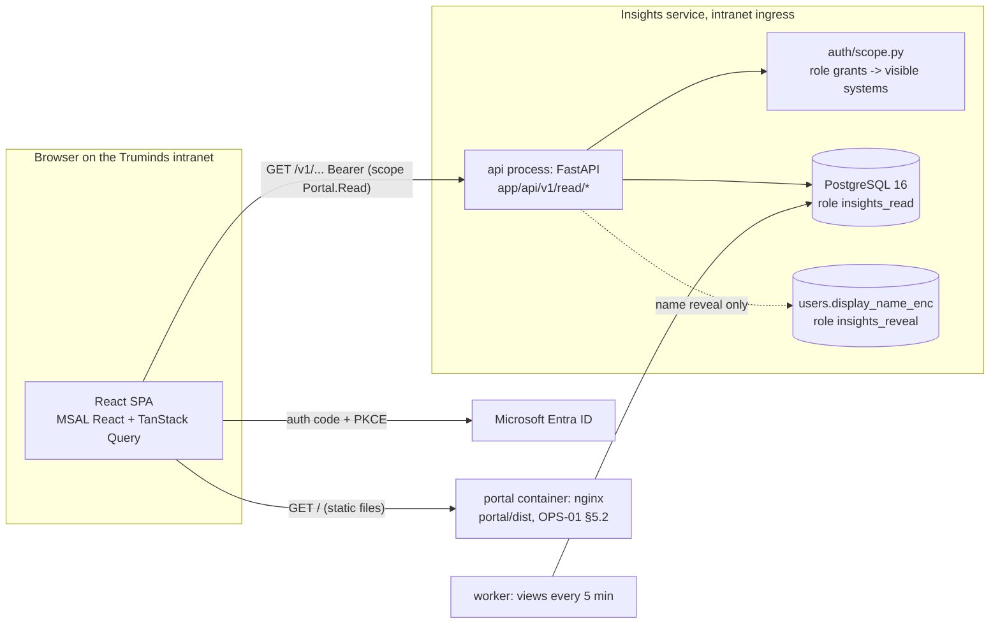
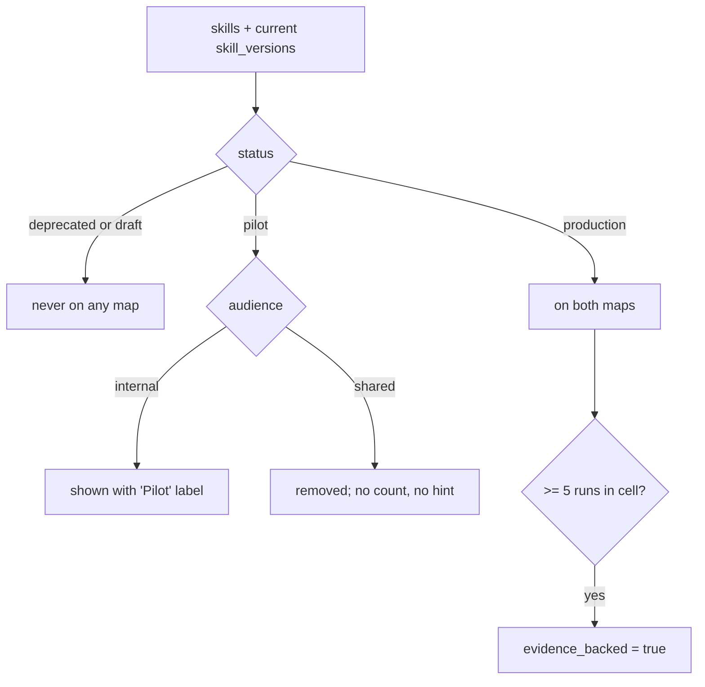

# SDD-09 · Web Portal and Read API

| Field | Value |
| --- | --- |
| Status | Draft for owner review |
| Owner | Gaurav Saini (read API, Insights, Home: Engineer, Run detail); UI owner TBD by Puneet |
| Approver | Puneet Singh Nanda |
| Related docs | [Doc 4 Design and UX](../ux/04-design-and-ux.md) §2.0, §6 · [Prototype](../ux/prototype/README.md) · [Doc 2 Personas](../product/02-personas-and-stories.md) §2, US-13, US-17, US-19 · [Doc 3 Architecture](../architecture/03-architecture.md) §10 · [Doc 5 API and Rules](../architecture/05-api-and-rules.md) §5 · [SDD-08 Telemetry and insights](SDD-08-telemetry-insights.md) · [SDD-10 Pods](SDD-10-pods.md) §6 · [SDD-11 Improvement loop](SDD-11-improvement-loop.md) §5.4 · [SDD-01 Skill authoring](SDD-01-skill-authoring.md) §7 · [SEC-01](../security/SEC-01-threat-model.md) §5.11 · [TST-01](../testing/TST-01-master-test-plan.md) §2.5 · [OPS-02 Monitoring](../operations/OPS-02-monitoring-alerting.md) · [ADR 0001](../adr/0001-portal-custom-react-on-fastapi.md) · [ADR 0002](../adr/0002-identity-microsoft-entra-id.md) · [Readiness tracker](../planning/readiness-tracker.md) Q10, Q11, Q35 |

## 1. Scope

### 1.1 What this document decides

- The React single-page app (SPA) in `portal/`: stack, code layout, routing, sign-in, data fetching, states.
- A spec for each of the 15 prototype boards: route, who sees it, every data element, and the API call behind it.
- The full read API (`GET /v1/...`) served by the FastAPI insights service: response schemas, role filtering, the name rule, pagination and errors.
- The capability map and how pilot skills are hidden from shared material.
- How the portal shows the adoption and value measures (tracker Q35).
- Accessibility to WCAG 2.2 AA, the brand-token swap and intranet hosting.

### 1.2 What it does not decide

| Topic | Where |
| --- | --- |
| Tables, views, metric definitions (M-01 to M-32), write endpoints | [SDD-08](SDD-08-telemetry-insights.md) |
| Pod fields and pod metrics rules | [SDD-10](SDD-10-pods.md) §6 (this document implements its endpoints) |
| Improvement report content | [SDD-11](SDD-11-improvement-loop.md) §4.4, §5.4 |
| Admin operations, their checks and audit actions (users, roles, clients, consent) | [SDD-13](SDD-13-onboarding-admin.md) §7.2. The admin **screens** are specified here, §4.16 |
| Hosting platform, region, ingress | OPS-01 (blocked on OQ-02) |
| Alerts, SLOs, dashboards | [OPS-02](../operations/OPS-02-monitoring-alerting.md) |

### 1.3 Ground rules

- The portal is read-only, except the admin screens (§4.16), which call the SDD-13 §7.2 admin API of the insights service. It never starts a run (X-01, Doc 4 principle 5). It writes to no external system (C-08).
- Every number comes from an SDD-08 table or view through the read API. The SPA never computes a metric; it only formats one.
- No sample numbers in production. A missing value shows "No data yet" (Doc 4 §2.0.5, C-09). The "Illustrative data" tag exists only in the prototype.
- The persona switch changes the layout only. Access is decided by the server from role grants on every request (SEC-01 §5.11 "E").
- Business never sees run ids, tickets, repos, system codes, engineer or client names (Doc 4 §2.0, X-13).

## 2. Context



```mermaid
sequenceDiagram
  autonumber
  actor U as User
  participant S as SPA
  participant E as Entra ID
  participant A as Read API
  U->>S: open https://<portal-host>/
  S->>E: loginRedirect (auth code + PKCE)
  E-->>S: code -> tokens (in memory)
  S->>A: GET /v1/me (Bearer)
  A-->>S: pseudonym, roles, scope, default_view
  S->>A: GET screen endpoints in parallel
  A->>A: validate token, resolve scope, query views
  A-->>S: {data, meta, page}
  S-->>U: render; "No data yet" for nulls
```

## 3. SPA architecture

### 3.1 Stack

| Concern | Choice | Version rule |
| --- | --- | --- |
| Build | Vite | 5.x, pinned in `package-lock.json` |
| Language | TypeScript, `strict: true` | 5.x |
| UI | React | 18.x |
| Routing | React Router, data router (`createBrowserRouter`) | 6.x |
| Server state | TanStack Query | 5.x |
| Sign-in | MSAL React + MSAL Browser | `@azure/msal-react` 2.x, `@azure/msal-browser` 3.x |
| API types | `openapi-typescript`, generated from `services/insights/openapi/openapi.json` | 7.x |
| Fonts | IBM Plex Sans and Mono, self-hosted (`@fontsource/*`), so no third-party font host | Placeholder until OQ-13 |
| Charts | Own SVG components with a table view; no chart library | — |
| Tests | Vitest, Testing Library, Playwright, `@axe-core/playwright` | As TST-01 §2.5 |
| Runtime | Node 20 LTS for build only (DEV-01) | `.nvmrc` |

No state library besides TanStack Query and one React context for the view. No CSS framework; CSS variables from `theme/tokens.css` (§10).

### 3.2 Code layout (`portal/`)

```text
portal/
├─ index.html, vite.config.ts, tsconfig.json, eslint.config.js, playwright.config.ts
├─ .env.example                 # VITE_ENTRA_TENANT_ID, VITE_ENTRA_CLIENT_ID, VITE_API_SCOPE,
│                               # VITE_MARKETPLACE_REPO_URL, VITE_PILOT_MAILTO, VITE_ENV_NAME
├─ public/brand/                # logo.svg, favicon.svg (placeholders, OQ-13)
└─ src/
   ├─ main.tsx                  # MsalProvider > QueryClientProvider > RouterProvider
   ├─ auth/msal.ts              # PublicClientApplication; cacheLocation "memoryStorage" (SEC-01 §5.11)
   ├─ auth/RequireAuth.tsx      # MsalAuthenticationTemplate, redirect flow
   ├─ api/client.ts             # fetch wrapper: token, X-Request-ID, problem+json -> ApiError
   ├─ api/schema.d.ts           # generated; committed; CI fails on drift
   ├─ api/queries.ts            # query-key factory and one hook per endpoint
   ├─ app/AppShell.tsx          # board Main
   ├─ app/TopBar.tsx            # board Nav
   ├─ app/ViewContext.tsx       # Business | Engineer view
   ├─ app/StatusBanner.tsx      # "Insights are behind" (§3.6)
   ├─ app/routes.tsx            # §3.3
   ├─ screens/                  # one file per screen in §4
   ├─ components/               # StatTile, StatusBadge, Card, DataTable, Tabs, FilterChips, CodeChip,
   │                            # WorkflowStrip, BarChart, HBarChart, EmptyState, ErrorState, Skeleton
   ├─ content/                  # static copy: how-it-works.ts, get-started.ts, labels.ts
   ├─ theme/tokens.css          # the one brand file (§10)
   ├─ theme/base.css, print.css
   └─ lib/format.ts             # shortRunId, percent, localTime, relativeTime, daysAgo
```

### 3.3 Routes

| Route | Screen (board) | View | Role needed (server) |
| --- | --- | --- | --- |
| `/` | Home: Business or Home: Engineer | by view | any grant |
| `/how-it-works` | How it works | both | any grant |
| `/skills`, `/skills?q=&role=` | Skills | both | any grant |
| `/skills/:skillId` | Skill detail | both | any grant; Quality tab needs engineer-family (§5.4) |
| `/get-started` | Get started | both | any grant |
| `/pods` | Pods | both | any grant |
| `/pods/builder` | Pod builder (static Phase 3 notice) | both | any grant |
| `/pods/:podId` | Pod detail | both | any grant |
| `/pods/:podId/one-pager` | Pod one-pager print view | Business | any grant |
| `/insights` | Insights: Business or Engineering (Runs tab) | by view | any grant / engineer-family |
| `/insights/engineering/:tab` | Engineering monitoring tab `runs`, `skills`, `usage`, `health` | Engineer | engineer-family |
| `/insights/capability-map/share` | Shared capability map print view | both | any grant |
| `/insights/skills/:skillId/improvement` | Improvement report (SDD-11) | Engineer | SDD-11 §5.4 roles |
| `/runs/:runId` | Run detail | Engineer | engineer-family, run in scope |
| `/admin`, `/admin/clients`, `/admin/projects`, `/admin/roles`, `/admin/users` | Admin screens (§4.16) | both | app role `Admin`; others get Not found |
| `/auth/callback` | MSAL redirect target | — | — |
| `*` | Not found | both | — |

`/pods/builder` is matched before `/pods/:podId`. Pod ids may not be `builder` (add to SDD-10 POD-V rules). "Any grant" means at least one active `role_grants` row. A signed-in user with no grant sees a page "You do not have access yet. Ask an admin." and nothing else.

### 3.4 Sign-in

| Item | Rule |
| --- | --- |
| Flow | Authorization code with PKCE through MSAL (ADR 0002). Redirect flow, not popup |
| App registrations | SPA app `truminds-portal` (redirect URI `https://<portal-host>/auth/callback`); API app `truminds-insights` exposes scope `Portal.Read` (SDD-08 §9.1). Created by the Entra admin (TBD by Puneet) |
| Token store | `memoryStorage`. Tokens are never in `localStorage` or `sessionStorage` (SEC-01 §5.11). A page reload re-acquires a token silently through the Entra session |
| Token use | `acquireTokenSilent({scopes:[VITE_API_SCOPE]})` before each request; on `InteractionRequiredAuthError` → `acquireTokenRedirect`. `Portal.Write` (`VITE_API_WRITE_SCOPE`) is requested incrementally, only when an admin submits an admin action (§4.16, SDD-07 §9) |
| 401 from API | One silent retry with `forceRefresh: true`, then redirect to sign-in |
| Sign-out | `logoutRedirect`; clears the query cache |
| Test sign-in | Playwright only, through a test token-cache fixture (TST-01 §2.5, TC-POR-010). No bypass in any build |

### 3.5 Data fetching

| Rule | Value |
| --- | --- |
| Query keys | `['me']`, `['catalogue','skills',params]`, `['runs',params]`, ... one factory in `api/queries.ts` |
| `staleTime` | Catalogue and pods 5 min; insights and runs 60 s; `/v1/me` 10 min; `/v1/status` 60 s |
| Refetch | On window focus for insights and runs; never polling faster than 60 s (views refresh every 5 min, SDD-08 §10.3; X-15) |
| Retry | Network errors and 5xx: 2 retries with backoff; 4xx: none |
| Paging | `useInfiniteQuery` with `next_cursor` (§5.1.5) |
| Request id | Each request sends `X-Request-ID` (UUID v4); errors show it so support can find the log line (OPS-02 §6) |
| Prefetch | Route loaders prefetch the screen's queries, so a screen renders once |

### 3.6 Views, states and the "behind" banner

| Item | Rule |
| --- | --- |
| Default view | From `GET /v1/me` `default_view`: `engineer` if the user holds any engineer-family role (§5.2), else `business` |
| Switch | Shown only when `can_switch_view` is true (user has an engineer-family role). The choice is kept in `localStorage` key `tm.view` (a convenience only; wrapped in try/catch) |
| Loading | Skeleton blocks with the final layout size; no spinners on whole pages |
| Empty list | Says what to do next, for example "No skills match. Try another word, or clear the role filter." |
| Null number | "No data yet" (SDD-08 §10.4: ratio with denominator 0) or "Not enough data" (`reason: "low_volume"`, §5.1.6) |
| Error | Card with plain words, the error code and the request id; the rest of the page still renders |
| Behind banner | When `GET /v1/status` returns `behind: true`: "Insights are behind; last event received at <local time>." The page keeps showing the last data (Doc 4 §2.0.5, TC-POR-005) |
| Times | Shown in the viewer's local time; ISO in tooltips (Doc 4 §6.3) |

## 4. Screens

Each screen below lists its route, who sees it, each data element, and its source. "M-nn" is the SDD-08 §10.4 metric; M-33 to M-38 are added by this document (§7.2). "Static" means copy from `src/content/`, reviewed like code.

### 4.1 Shell (board Main)

| Item | Detail |
| --- | --- |
| Route | All routes |
| Who | Everyone signed in |
| Content | Top bar (§4.2), status banner (§3.6), routed screen, footer with build version (`import.meta.env` build id) |
| API | `GET /v1/me`, `GET /v1/status` |
| Rules | Business view on `/runs/:runId` redirects to `/insights` (Doc 4 §2.0.1, TC-POR-003). Active tab: Skill detail → Skills; Pod detail and builder → Pods; Run detail → Insights |

### 4.2 Top bar (board Nav)

| Element | Source |
| --- | --- |
| Logo button → `/` | `public/brand/logo.svg` |
| Nav: Home, How it works, Skills, Pods, Insights, Get started | Static |
| Search box "Search skills, roles, pods" | Client-side filter over `GET /v1/catalogue/skills?limit=100` and `GET /v1/catalogue/pods` (cached); Enter goes to `/skills?q=` |
| Business / Engineer switch | `me.can_switch_view`; `aria-pressed` |
| User chip: initials, role label | `me.display_name` (own name only) or pseudonym; `me.role_label` |

### 4.3 Home: Business (board HomeBusiness)

Route `/`, Business view. Calls `GET /v1/catalogue/summary`, `GET /v1/insights/business?period=90d`, `GET /v1/catalogue/pods?limit=3&sort=featured`.

| Element | Field | Metric |
| --- | --- | --- |
| Hero text, sample checked-step card | Static (labelled "Example") | — |
| Skills in production, "across N roles and M phases" | `summary.skills_in_production`, `roles_covered`, `phases_covered` | M-01, M-02 |
| Ready-made pods | `summary.pods_ready` | M-11 |
| First-try pass rate | `business.first_try_pass.value` | M-03 |
| Pull requests delivered, last 90 days | `business.prs_delivered.value` | M-04 |
| Four building blocks | Static | — |
| Search skills input | Navigates to `/skills?q=` | — |
| 8 role tiles: code, role, "N skills" | `summary.roles[]{code,label,skills_production,skills_pilot}` | — |
| Domain chips | `summary.domains[]` (union of production skills' `domains`); row hidden if empty | — |
| 3 featured pods: title, status, summary, agents | `pods.items[]` | — |
| Open capability map, Request a pilot | `/insights`; `mailto:` from `VITE_PILOT_MAILTO` (SDD-10 §6.4) | — |

### 4.4 Home: Engineer (board HomeEngineer)

Route `/`, Engineer view. Calls `GET /v1/me/home`, `GET /v1/runs?owner=me&limit=5`, `GET /v1/catalogue/skills?role=<me.agent_role>&limit=3`, `GET /v1/catalogue/releases?limit=1`.

| Element | Field | Metric |
| --- | --- | --- |
| Install plugin, Open GitHub repo | `/get-started`; `VITE_MARKETPLACE_REPO_URL` | — |
| Run command chip `/truminds:run <workflow> <ticket>` | Static template | — |
| My active runs | `home.tiles.active_runs` | M-34 |
| Waiting on me, "N question · N approval" | `home.tiles.waiting_on_me` | M-35 |
| First-try pass, "my last 30 steps" | `home.tiles.my_first_try_pass{value,n}` | M-30 |
| PRs this month | `home.tiles.my_prs_this_month` (sends `tz`) | M-31 |
| My runs table: run, ticket, workflow · step, status, next action | `runs.items[]{run_id, ticket_ref, workflow, current_step, status_label, next_action.text}` | — |
| Skills for your role: id, version, summary, first-try | `skills.items[]{id, current_version, summary, first_try_pass}` | M-03 |
| Waiting on me list | `home.waiting[]` (kind, run, ticket, item id, blocking, ask role, since) | — |
| What's new | `releases.items[0].notes[]` | — |
| My systems: code, pack status, days, drift | `home.systems[]` | M-23 |

The prototype shows question text ("Keep history 24 hours or 30 days?"). Question text is not stored in the cloud (X-06, SDD-08 §1.3). The card shows id, ticket, ask role, age and a link to `runs/<run_id>/open-questions.md` in the companion repo.

### 4.5 How it works (board HowItWorks)

Route `/how-it-works`, both views. No data API besides `/v1/me`. Content is static in `content/how-it-works.ts`: the 7-step flow strip, 7 step cards (Business shows "For the client" text, Engineer shows the command), six outcomes with their status tokens, three "where things live" cards. Commands must match Doc 5 §2; a Vitest test checks each command string against a list exported from the plugin manifest.

### 4.6 Skills (board Skills)

Route `/skills`, both views. Calls `GET /v1/catalogue/skills?q=&role=&period=90d&limit=100`.

| Element | Field | Who |
| --- | --- | --- |
| Search box (live) | `q` (debounced 250 ms, also kept in URL) | Both |
| Role chips (9 incl. "All roles"), `aria-pressed` | `role`; labels from `summary.roles` | Both |
| Count line "N skills · production and pilot" | `page` length; status filter | Both |
| Card: role, status badge, title, summary, phase | `items[]{agent_role_label, status, title, summary, phase}` | Both |
| Output | `items[].outputs[]` schema names | Business |
| Skill id, version, first-try pass | `items[]{id, current_version, first_try_pass}` | Engineer |
| View source on GitHub | `VITE_MARKETPLACE_REPO_URL` | Engineer |
| Empty state | `items` empty | Both |

`draft` skills appear only for engineer-family roles, with a "Draft" badge (SDD-01 §7). Deprecated skills are hidden unless `status=deprecated` is asked for.

### 4.7 Skill detail (board SkillDetail)

Route `/skills/:skillId`. Calls `GET /v1/catalogue/skills/{id}`; the Quality tab calls `GET /v1/catalogue/skills/{id}/quality?period=90d`.

| Element | Field | Metric | Who |
| --- | --- | --- | --- |
| Role, phase, status badges; title; summary | `skill.*` | — | Both |
| Runs, last 90 days | `skill.quality.runs` | M-33 | Both |
| First-try pass | `skill.quality.first_try_pass` | M-03 | Both |
| High confidence | `skill.quality.band_mix.high` | M-15 | Both |
| Signed eval pass rate, version, cases | `skill.eval{pass_rate, cases, version}` | M-29 | Both |
| Why clients care; What the client receives | `skill.portal.why_clients_care[]`, `client_receives[]` | — | Business |
| Offer it: pods that include it, See the pod | `skill.pods[]{id,title}` | — | Business |
| Download one-pager | Print view of this page (`print.css`) | — | Business |
| Run command, SKILL.md on GitHub, Install plugin | Static template; `VITE_MARKETPLACE_REPO_URL` + `release_tag` | — | Engineer |
| Tab Inputs and outputs | `skill.current.inputs[]`, `outputs[]`, `context_sections[]`, `size_budget_tokens`, `allowed_tools[]` | — | Engineer |
| Tab Quality: top reasons not passed first time | `quality.causes[]{code,label,n}` (top 5) | M-18 | Engineer |
| Tab Versions: version, status, eval pass, change | `skill.versions[]` | M-29 | Engineer |
| Tab Used in workflows: workflow, step N of M, after gate | `skill.workflows[]{workflow_id, position, step_count, after_gate}` | — | Engineer |

Headline quality numbers are org-wide aggregates (class A, §5.4). The Quality tab is class B, scoped.

### 4.8 Get started (board GetStarted)

Route `/get-started`, both views. Calls `GET /v1/catalogue/releases?limit=1` to show the current plugin version next to the install step. Everything else is static in `content/get-started.ts`: repository card, 5 engineer steps with commands (Doc 5 §2, SDD-05 §3), "Before you start" checklist (C-03, C-16 to C-18, consent), and the 4 Business steps with links to `/insights` and `/pods`. `[TRUMINDS-ORG]` placeholders are replaced from `VITE_MARKETPLACE_REPO_URL` (OQ-10).

### 4.9 Pods (board Pods)

Route `/pods`, both views. Calls `GET /v1/catalogue/pods`.

| Element | Field | Who |
| --- | --- | --- |
| Persona explainer strip | Static | Both |
| Card: title, status badge, summary, agents | `items[]{title,status,summary,agents[]}` | Both |
| Best for, first-try pass | `items[].best_for`, `items[].metrics.first_try_pass` (SDD-10 §6.2 minimum: 5 completed runs) | Business |
| Workflows, skill count | `items[].workflows[]`, `skill_count` | Engineer |
| People accountable | `items[].people[]` | Both |
| "Build your own pod" card → `/pods/builder` | Static | Both |

### 4.10 Pod detail (board PodDetail)

Route `/pods/:podId`. Calls `GET /v1/pods/{id}`, `GET /v1/pods/{id}/metrics?period=all`; Engineer view adds `GET /v1/pods/{id}/runs?status=open`.

| Element | Field | Who |
| --- | --- | --- |
| Kind, status, title, summary | `pod.*` | Both |
| Download one-pager → `/pods/:podId/one-pager`; Request a pilot (`mailto:`) | `GET /v1/pods/{id}/one-pager` | Business |
| Run command | `/truminds:run <pod.workflows[0]> <ticket>` | Engineer |
| Who is in the pod: agent code, role, job | `pod.agents[]{code,role,job}` | Both |
| Skills per agent | `pod.agents[].skills[]` | Engineer |
| People accountable and what they decide | `pod.people_accountable[]{role,decides}` | Both |
| Workflow strip (skills white, gates dashed) | `pod.flow[]{label, kind, who, step_id}`; ids Engineer only | Both |
| What the client gets, Good fit when | `pod.client_gets[]`, `pod.good_fit[]` | Business |
| Track record: first-try pass, systems served, PRs merged | `metrics.{first_try_pass, systems_served, prs_merged}` or `status:"no_data"` | Business |
| Active runs: run, system, ticket, step "N of M", status | `runs.items[]` | Engineer |
| Fit check for a chosen system | `GET /v1/pods/{id}/fit?system=` (SDD-10 §6.3) | Engineer |

The one-pager print view renders the pod's `one-pager.md` text with the current metrics. A pilot pod prints the label "Pilot · internal only" (SDD-10 §6.4).

### 4.11 Pod builder (board PodBuilder)

Route `/pods/builder`. Release 1 ships a static page only: the banner "Phase 3 preview, not in Release 1", one paragraph, and a link back to Pods. The interactive Add/Remove builder stays in the prototype. Reason: X-04 forbids building the pod builder UI in Release 1 (SDD-10 O-05). No API call.

### 4.12 Insights: Business impact (board InsightsBusiness)

Route `/insights`, Business view. Calls `GET /v1/insights/business?period=` and `GET /v1/capability-map?audience=internal`.

| Element | Field | Metric |
| --- | --- | --- |
| Period select: Last 90 days, Last 12 months, All time | `period=90d\|12m\|all` | — |
| Pull requests delivered, "+N vs previous period" | `prs_delivered{value,change}` | M-04, M-05 |
| First-try pass rate | `first_try_pass.value` | M-03 |
| Client systems served, "across N domains" | `systems_served{value,domains}` | M-07 |
| Engineers using the library | `engineers_using.value` | M-08 |
| Active pods | `active_pods.value` | M-09 |
| Bar chart: PRs per month (with table view) | `prs_by_month[]{month,merged}` | M-06 |
| Most-used pods (bars) | `most_used_pods[]{title,engagements}` | M-10 |
| Capability map (internal: pilot marked) | §6 | M-02, M-38 |
| Share capability map → `/insights/capability-map/share` | `GET /v1/capability-map?audience=shared` | — |

### 4.13 Insights: Engineering monitoring (board InsightsEngineer)

Route `/insights/engineering/:tab`, Engineer view. Filters (all tabs): Project (`All my projects` or a code from `me.scope.projects`), System, Period (`30d` default, `90d`). Filters live in the URL.

| Tab | Element | Field | Metric | API |
| --- | --- | --- | --- | --- |
| Runs | Running; Paused for input + oldest wait; Waiting for approval; Completed; Aborted + reasons | `status_counts`, `oldest_input_wait_s`, `aborted_by_code[]` | M-12, M-13 | `GET /v1/insights/engineering/runs` |
| Runs | Step outcomes bar, "N harness decisions" | `step_outcomes{total, shares}` | M-14 | same |
| Runs | Runs table: run, system, ticket, workflow, step, status, lowest band, engineer, updated | `items[]` | — | `GET /v1/runs` |
| Skill performance | Skill, version, runs, first-try pass (amber < 80%), H/M/L bar, retries per step, overrides, top cause, open flags | `items[]` | M-33, M-03, M-15, M-16, M-17, M-18 | `GET /v1/insights/engineering/skills` |
| Usage | Active engineers, runs started, PR merge rate, PRs without a run record, PRs with changes requested | tiles | M-08, M-19, M-20, M-21, M-36 | `GET /v1/insights/engineering/usage` |
| Usage | Runs by workflow; weekly active engineers and runs (G1) | `runs_by_workflow[]`, `weekly[]` | M-22, M-08, M-19 | same |
| Usage | Average tokens and cost per run, by workflow | `cost_by_workflow[]` | M-32 | same |
| Health | Context packs: system, fresh or stale, days, drift | `packs[]` | M-23, M-37 | `GET /v1/insights/engineering/health` |
| Health | CI verification: verified, E-CI-01, E-CI-02, E-CI-03 | `ci{}` | M-24 | same |
| Health | Telemetry and plugin: events today, devices with queued events, plugin version spread, policy blocks | `telemetry{}` (null unless tech_lead, eng_lead or admin) | M-25 to M-28 | same |

The Usage tab note reads "Engineers are shown by pseudonym. Names are visible only to tech leads and engineering leads of that team" (§5.3).

### 4.14 Run detail (board RunDetail)

Route `/runs/:runId`, Engineer view only. Calls `GET /v1/runs/{run_id}`.

| Element | Field |
| --- | --- |
| Full run id (copy), status badge | `run.run_id`, `status_label` |
| Ticket, workflow + version, system, engineer, pack status and signer | `ticket_ref`, `workflow`, `workflow_version`, `system`, `engineer`, `pack{status, signed_by}` |
| Companion repo link | `links.companion_runs_url` (`https://github.com/<companion_repo>/tree/main/runs/<run_id>`) |
| Next action box with command | `next_action{text, command}` (§5.6.12) |
| Step table: #, step, skill, outcome, confidence, attempts, View | `steps[]` (planned steps from `workflow_steps`, merged with `steps` rows; "Not started" when no row) |
| Check record panel for the chosen step | `steps[i].attempts[last].record{decided_by, key_id, verification_sha256, signals S1–S6, gate_failures, caps, reasons, findings, findings_dropped, ci_verified}` |
| Open question card | `questions[]{question_id, step, blocking, ask_role, evidence_ref, age_s, file_url}`; no question text (X-06) |
| Approvals | `approvals[]{gate, reason_code, requested_at, decision, approver, recorded_at}` |
| Pull requests | `pull_requests[]{repo, number, state, url, ci_result}` |
| Tokens and cost | `usage{tokens_in, tokens_out, cost_usd}` (M-32) |

### 4.15 Persona map (board PersonaMap)

Not shipped as a route. It is a design reference. Its rules are implemented by §3.6 (views), §5.2 (scope), §5.3 (names) and §5.4 (access matrix), and tested by TC-POR-002 and TC-INS-009.

### 4.16 Admin screens

Owner: UI owner TBD by Puneet (OI-13-04). Status: draft for owner review. There is no prototype board; the screens reuse the shell, cards, buttons and tokens of the other screens.

| Item | Rule |
| --- | --- |
| Routes | `/admin` (overview), `/admin/clients`, `/admin/projects`, `/admin/roles`, `/admin/users` (§3.3). Lazy-loaded like every screen |
| Who sees them | Entra app role `Admin` only (`/v1/me` `app_roles`, SDD-07 §3.2). The top-bar entry "Admin" is rendered only for that role. Anyone else who opens an `/admin/*` URL gets the ordinary Not found page, so the routes do not reveal themselves. The server checks `Portal.Write` and the `admin` grant on every call (`403 E-API-03` otherwise); the UI check is a convenience, not the control |
| Scope | `Portal.Write` is requested incrementally (`acquireTokenSilent` with the write scope, `acquireTokenRedirect` if interaction is needed), only at the moment an admin submits an action on these screens. Reads, on these screens too, use `Portal.Read`. Admin consent for `Portal.Write` is pre-granted (SDD-07 §9), so no prompt appears |
| Calls | The SDD-13 §7.2 routes, with the request bodies of the published OpenAPI: `POST /v1/admin/clients`, `/v1/admin/clients/{code}/consent`, `/v1/admin/projects`, `/v1/admin/systems`, `/v1/admin/role-grants`, `/v1/admin/role-grants/{grant_id}/revoke`, `/v1/admin/users/{pseudonym}/deactivate`, and `POST /v1/keys/{key_id}/revoke` with an admin reason (SDD-07 §5.6). No other write route; no automatic retry of a write. Reads: the `GET /v1/admin/...` list routes of SDD-13 §7.2 |
| Screens | Clients and consent: create client (code, display name, other names for the deny-list), record consent (reference, scopes), withdraw consent. Projects and systems: create project, create system with companion repo and product repos. Role grants: grant (user pseudonym, role, scope type limited to the role's allowed scopes, scope), revoke with reason. Users and keys: deactivate user with reason, revoke one key with reason, optional compromised-since and note |
| Validation | Each form checks the API's patterns before sending (codes, pseudonym, repo `org/repo`, grant id, key id, required reason) and refuses a self-grant. Errors appear next to the field, the field is marked `aria-invalid`, and focus moves to the first error. The server checks again; its refusal shows the error code, its words and the request id |
| Destructive actions | Withdraw consent, revoke grant, deactivate user and revoke key open a confirmation dialog (`alertdialog`, focus on Cancel, Escape cancels, focus returns) that says what will happen. Nothing is sent until the admin confirms |
| Audit | Every action is written to `audit_log` by the server, never by the SPA (SEC-01; actions `client_create`, `denylist_change`, `consent_record`, `consent_withdraw`, `project_create`, `system_create`, `role_grant`, `role_revoke`, `user_deactivate`, `key_revoke`). The screens say so on every page and in every result |
| Layout | The shell of §4.1, an eyebrow "Admin", one h1, a sub-navigation between the five screens, and one card per action. Results appear in a status panel under the form; codes only, never a client name outside the client form |
| Lists | Each screen shows its lists as tables from the SDD-13 §7.2 list routes, with `Portal.Read`: clients with consent status; projects; systems with product repos; role grants, active and revoked (filter by status); users with pseudonym, roles and active; and, for one user, their keys (key id, device label, status, expiry). Rows carry the per-row actions revoke grant, revoke key and deactivate user, which open the same confirmation dialogs as the forms. Tables page with "Show more" (`next_cursor`) and refresh after every action. Codes and pseudonyms only; no names on these screens |
| Tests | Unit: non-admins never see the entry or the routes; forms validate; dialogs appear before any request; the write token is sent only on admin POSTs. vitest-axe on each screen, with errors and the dialog shown. Lists render as tables, and each row action confirms before sending and refreshes the list. Playwright in demo mode: grant a role, then revoke it from its row after confirming |

## 5. Read API

### 5.1 Conventions

#### 5.1.1 Base, auth, transport

| Item | Rule |
| --- | --- |
| Base | `https://<portal-host>/v1` (same origin as the SPA; no CORS) |
| Auth | `Authorization: Bearer <Entra access token>`, audience = the `truminds-insights-api` application (client) ID (v2 tokens; the SPA requests the scope `api://truminds-insights/Portal.Read`, SDD-07 §9), scope `Portal.Read` (SDD-08 §9.1). Validation in `app/auth/entra.py` |
| Methods | `GET` only for the read API. Every route is in the committed `openapi.json`. No hidden or debug routes. The admin routes (`/v1/admin/*`, §4.16) are documented, need the admin app role and `Portal.Write`, and are audited |
| Rate limit | 10 requests/s per user, burst 30; `429` + `Retry-After` |
| Caching | `Cache-Control: private, max-age=60`; catalogue routes add `ETag` (release tag + filters) and honour `If-None-Match` |
| DB role | `insights_read` (SDD-08 §9.4); statement timeout 5 s |
| Code | `app/api/v1/read/<area>.py`; queries in `app/read/queries/`, SQLAlchemy Core with bound parameters only |

#### 5.1.2 Envelope

```json
{
  "data": {},
  "meta": {
    "generated_at": "2026-10-13T09:30:12Z",
    "data_as_of": "2026-10-13T09:25:00Z",
    "period": {"key": "90d", "from": "2026-07-16", "to": "2026-10-13", "prev_from": "2026-04-17", "prev_to": "2026-07-15"},
    "scope": {"level": "systems", "projects": ["PRJ-07"], "systems": ["SYS-ORD", "SYS-GW"]}
  },
  "page": {"limit": 25, "next_cursor": "eyJrIjpbIjIwMjYtMTAtMTNUMDk6MjA6MDBaIiwicnVuXzAxSjkuLi4iXX0"}
}
```

`data_as_of` is the oldest `view_refresh_log.refreshed_at` among the views the route read. `page` is present only on list routes. For class A routes (§5.4), `meta.scope` is `{"level": "org"}` with no codes.

#### 5.1.3 Period

`period` ∈ `30d`, `90d`, `12m`, `all`; default `90d` (engineering routes default `30d`). Windows are whole UTC days ending today. The previous period has the same length and ends the day before `from`. `all` has no previous period, so every `change` is `null`.

#### 5.1.4 Errors (new codes)

Errors use `application/problem+json` (RFC 9457):

```json
{"type": "https://<portal-host>/errors/E-API-04", "title": "Not found", "status": 404,
 "code": "E-API-04", "detail": "Run not found.", "request_id": "6f1c2b0e-..."}
```

| Code | HTTP | Meaning | SPA behaviour |
| --- | --- | --- | --- |
| E-API-01 | 400 | Invalid parameter, or a cursor used with other filters | Error card; reset filters |
| E-API-02 | 401 | Token missing, invalid, expired, wrong audience or tenant | Silent refresh, then sign-in |
| E-API-03 | 403 | Role does not allow this route (for example `viewer` on `/v1/runs`) | "You do not have access to this view" |
| E-API-04 | 404 | Not found **or** outside the caller's scope (never reveals existence) | Not found page |
| E-API-05 | 429 | Rate limited | Retry after `Retry-After` |
| E-API-06 | 503 | Database unavailable or statement timeout | Error card with request id; banner |

#### 5.1.5 Pagination

| Item | Rule |
| --- | --- |
| Style | Keyset (cursor). No offset paging |
| Params | `limit` 1–100, default 25; `cursor` opaque |
| Cursor | base64url of `{"k": [<sort key values>], "f": <sha256 of the normalised filters, first 8 bytes hex>}`. A cursor whose `f` does not match the current filters → `E-API-01` |
| Order | Fixed per route and always ends with the primary key, so order is total |
| End | `next_cursor: null` |
| Totals | Not returned on lists. Counts come from the summary routes |

| List route | Sort |
| --- | --- |
| `/v1/runs`, `/v1/pods/{id}/runs` | `updated_at DESC, id DESC` |
| `/v1/catalogue/skills` | `agent_role, title, id` (or `first_try_pass DESC NULLS LAST, id` with `sort=first_try`) |
| `/v1/catalogue/pods` | `status rank, title, id` (`sort=featured`: status rank, M-10 desc, id) |
| `/v1/catalogue/releases` | `released_at DESC, tag` |
| `/v1/insights/engineering/skills` | `skill_id, version DESC` |

#### 5.1.6 Nulls

A ratio with denominator 0 is `null` with `"reason": "no_data"` (SDD-08 §10.4). Pod metrics below 5 completed runs return `{"status": "no_data"}` (SDD-10 §6.2). Numbers are JSON numbers; rates are fractions 0–1 (the SPA formats percent).

### 5.2 Scope resolution (`app/auth/scope.py`)

**Engineer-family roles:** `engineer`, `tech_lead`, `eng_lead`, `admin`. `skill_owner` and `stage_approver` get only their skill rows (below). `viewer` gets class A only.

```python
def resolve_scope(user_id) -> Scope:
    g = active_grants(user_id)                       # role_grants WHERE revoked_at IS NULL
    s = Scope()
    if any(x.role == 'admin' or (x.role == 'eng_lead' and x.scope_type == 'org') for x in g):
        s.systems = ALL_SYSTEMS; s.name_systems = ALL_SYSTEMS
    for x in g:
        if x.role in ('engineer', 'tech_lead') and x.scope_type == 'system':
            s.systems |= systems_in_project_of(x.scope_id)   # "own projects" rule (brief); see Open items
        if x.role == 'tech_lead' and x.scope_type == 'system':
            s.name_systems |= {x.scope_id}
            s.tech_lead = True
        if x.role == 'eng_lead' and x.scope_type in ('client', 'project'):
            under = systems_under(x.scope_type, x.scope_id)
            s.systems |= under; s.name_systems |= under
        if x.role == 'skill_owner' and x.scope_type == 'skill':
            s.owned_skills |= {x.scope_id}
        if x.role == 'stage_approver' and x.scope_type == 'stage':
            s.owned_skills |= skills_in_phase(x.scope_id)
    s.engineer_family = any(x.role in ('engineer', 'tech_lead', 'eng_lead', 'admin') for x in g)
    s.any_grant = bool(g)
    return s
```

The scope is cached per request only. Every run-level query adds `system_id = ANY(:systems)`. A `project` or `system` filter outside the scope returns `E-API-04`.

### 5.3 Name rule

| Viewer | Engineers shown as |
| --- | --- |
| Business view, any role | Never shown (no engineer field in class A responses) |
| Engineer-family, run not in `name_systems` | Pseudonym only (`eng-4f2a`) |
| `tech_lead` of the run's system; `eng_lead` over it; `admin` | Pseudonym, plus `display_name` **only** when the request has `include=names` |

| Rule | Detail |
| --- | --- |
| Opt-in | The SPA shows a "Show names" toggle to eligible users; it is off by default and not remembered |
| Audit | Each request with `include=names` that returns at least one name writes one `audit_log` row: `action='reveal_names'`, `target=<route>`, `detail={"count": n, "systems": [codes]}` (SDD-08 §8.1) |
| Data path | Names are read through a new DB role `insights_reveal` that may `SELECT id, display_name_enc, enc_key_id, erased_at FROM users` only, then decrypted in the api process (SDD-08 §9.2). Erased users show the pseudonym |
| Routes | `GET /v1/runs`, `GET /v1/runs/{id}`, `GET /v1/pods/{id}/runs` |
| Not allowed | Email is never returned by the read API |

### 5.4 Access matrix

Class A = org-wide aggregates and catalogue: no run ids, tickets, repos, system codes or people. Class B = scoped monitoring data.

| Route | Class | viewer | engineer | tech_lead | skill_owner / stage_approver | eng_lead | admin |
| --- | --- | --- | --- | --- | --- | --- | --- |
| `/v1/me`, `/v1/status` | — | Yes | Yes | Yes | Yes | Yes | Yes |
| `/v1/catalogue/*`, `/v1/capability-map` | A | Yes | Yes | Yes | Yes | Yes | Yes |
| `/v1/catalogue/pods`, `/v1/pods/{id}`, `/metrics`, `/one-pager` | A | Yes (fields per SDD-10 §6.1) | Yes | Yes | Yes | Yes | Yes |
| `/v1/insights/business` | A | Yes | Yes | Yes | Yes | Yes | Yes |
| `/v1/catalogue/skills/{id}/quality` | B | 403 | Scope | Scope | Own skills org-wide | Scope | All |
| `/v1/me/home` | B | 403 | Own | Own | 403 unless engineer-family | Own | Own |
| `/v1/insights/engineering/runs`, `/usage`, `/v1/runs*`, `/v1/pods/{id}/runs` | B | 403 | Scope | Scope | 403 | Scope | All |
| `/v1/insights/engineering/skills` | B | 403 | Scope | Scope | Own skills org-wide | Scope | All |
| `/v1/insights/engineering/health` | B | 403 | Scope; `telemetry: null` | Scope + telemetry | 403 | Scope + telemetry | All |
| `/v1/pods/{id}/fit` | B | 403 | Systems in scope | Same | 403 | Same | All |
| `/v1/improvement/*` | B | SDD-11 §5.4 | | | | | |

Field filtering for pods follows SDD-10 §6.1 by role: `viewer`-only callers do not receive `agents[].skills`, `workflows` or `skill_count`.

### 5.5 Endpoint catalogue

| # | Method and path | Status | Screens |
| --- | --- | --- | --- |
| E01 | `GET /v1/me` | SDD-08 (extended here) | All |
| E02 | `GET /v1/status` | **New** | Shell |
| E03 | `GET /v1/catalogue/summary` | **New** | Home: Business, Skills |
| E04 | `GET /v1/catalogue/skills` | **New** (tracker Q10) | Skills, Home: Engineer, search |
| E05 | `GET /v1/catalogue/skills/{skill_id}` | **New** | Skill detail |
| E06 | `GET /v1/catalogue/skills/{skill_id}/quality` | **New** | Skill detail (Quality tab) |
| E07 | `GET /v1/catalogue/releases` | **New** | Home: Engineer, Get started |
| E08 | `GET /v1/catalogue/pods` | SDD-10 §6.6 | Pods, Home: Business |
| E09 | `GET /v1/pods/{pod_id}` | SDD-10 §6.6 | Pod detail |
| E10 | `GET /v1/pods/{pod_id}/metrics` | SDD-10 §6.6 | Pod detail, Pods |
| E11 | `GET /v1/pods/{pod_id}/runs` | SDD-10 §6.6 | Pod detail (Engineer) |
| E12 | `GET /v1/pods/{pod_id}/fit` | SDD-10 §6.6 | Pod detail (Engineer) |
| E13 | `GET /v1/pods/{pod_id}/one-pager` | **New** | One-pager print view |
| E14 | `GET /v1/capability-map` | **New** | Insights: Business, share view |
| E15 | `GET /v1/insights/business` | **New** (tracker Q10) | Insights: Business, Home: Business |
| E16 | `GET /v1/me/home` | **New** | Home: Engineer |
| E17 | `GET /v1/insights/engineering/runs` | **New** (tracker Q10) | Engineering: Runs |
| E18 | `GET /v1/insights/engineering/skills` | **New** | Engineering: Skill performance |
| E19 | `GET /v1/insights/engineering/usage` | **New** | Engineering: Usage |
| E20 | `GET /v1/insights/engineering/health` | **New** | Engineering: Health |
| E21 | `GET /v1/runs` | **New** | Runs table, My runs |
| E22 | `GET /v1/runs/{run_id}` | **New** (tracker Q10) | Run detail |
| E23 | `GET /v1/improvement/flags`, `GET /v1/improvement/skills/{skill_id}` | SDD-11 §5.4 | Improvement report |

SDD-11 §5.4 also defines `PATCH /v1/improvement/flags/{flag_id}`. It is the only non-GET route behind the portal. It changes a flag's status; it starts nothing. It stays owned by SDD-11.

### 5.6 Response schemas

Field types follow the generated OpenAPI. `?` marks a nullable field. Every object is closed (`additionalProperties: false`).

#### 5.6.1 E01 `GET /v1/me` (fields added to SDD-08)

```json
{"data": {
  "pseudonym": "eng-4f2a", "display_name": "own name or null", "role_label": "Engineer · Tech lead",
  "roles": [{"role": "tech_lead", "scope_type": "system", "scope": "SYS-ORD"}],
  "agent_role": "developer?", "default_view": "engineer", "can_switch_view": true,
  "can_reveal_names": true,
  "scope": {"projects": [{"code": "PRJ-07", "systems": [{"code": "SYS-ORD", "domain": "digital"}]}]}
}}
```

#### 5.6.2 E02 `GET /v1/status`

```json
{"data": {"last_event_received_at": "2026-10-13T09:29:58Z?", "views_refreshed_at": "2026-10-13T09:25:00Z",
  "catalogue_release": "v1.6.0?", "service_version": "1.6.0", "behind": false}}
```

`behind` is true when the oldest view is more than 20 minutes old, or no event arrived for 2 hours while devices were active (same thresholds as OPS-02 AL-09 and AL-11). `last_event_received_at` reads `max(received_at)` from `event_ids` through a new index `event_ids (received_at)`.

#### 5.6.3 E03 `GET /v1/catalogue/summary`

```json
{"data": {"skills_in_production": 18, "roles_covered": 8, "phases_covered": 5, "pods_ready": 4,
  "roles": [{"id": "business-analyst", "code": "BA", "label": "Business Analyst", "skills_production": 2, "skills_pilot": 0}],
  "phases": [{"id": "requirements", "label": "Requirements"}],
  "domains": ["digital", "embedded"],
  "latest_release": {"tag": "v1.6.0", "plugin_version": "1.6.0", "released_at": "2026-10-01T08:00:00Z"}}}
```

Role codes and labels come from SDD-01 §11 (`app/read/labels.py`).

#### 5.6.4 E04 `GET /v1/catalogue/skills`

Params: `q` (≤ 60 chars; matches id, title, summary, role label, phase, output schema), `role`, `phase`, `domain`, `status` (comma list of `draft,pilot,production,deprecated`; default `pilot,production`, plus `draft` for engineer-family), `period` (for `first_try_pass`), `sort` (`role` default, `first_try`), `limit`, `cursor`.

```json
{"data": {"items": [{
  "id": "threat-model", "title": "Threat model", "summary": "Builds a STRIDE threat model from the approved design.",
  "agent_role": "security", "agent_role_label": "Security", "phase": "design", "domains": [],
  "status": "production", "current_version": "1.0.0", "outputs": ["threat-model.v1"],
  "first_try_pass": 0.83, "first_try_n": 64}]}}
```

`status` uses the SDD-01 §7 words, which SDD-08 also stores; no mapping is needed (registry §10).

#### 5.6.5 E05 `GET /v1/catalogue/skills/{skill_id}`

```json
{"data": {
  "id": "threat-model", "title": "Threat model", "summary": "...", "agent_role": "security", "phase": "design",
  "status": "production", "owner_pseudonym": "skill-owner-9c", "release_tag": "v1.6.0",
  "portal": {"why_clients_care": ["..."], "client_receives": ["..."]},
  "current": {"version": "1.0.0", "inputs": [{"name": "design", "schema": "design.v1", "required": true}],
              "outputs": [{"name": "threat-model", "schema": "threat-model.v1"}],
              "context_sections": ["system-baseline#architecture"], "size_budget_tokens": 60000,
              "allowed_tools": ["Read", "Grep", "Glob", "Write"]},
  "quality": {"period": "90d", "runs": 64, "first_try_pass": 0.83, "band_mix": {"high": 0.71, "medium": 0.22, "low": 0.07}},
  "eval": {"version": "1.0.0", "pass_rate": 0.94, "cases": 18, "recorded_at": "..."},
  "versions": [{"version": "1.0.0", "status": "production", "eval_pass_rate": 0.94, "changelog": "First production release", "published_at": "..."}],
  "pods": [{"id": "quality-security-pod", "title": "Quality and Security Pod"}],
  "workflows": [{"workflow_id": "brownfield-change", "version": "1.3.0", "position": 6, "step_count": 11, "after_gate": "G-design"}]}}
```

Sources: `skills`, `skill_versions`, `mv_skill_daily` (org-wide), `pod_versions.definition`, `workflow_steps` of each workflow's `current_version` (`position` = rank by `seq`; `after_gate` = nearest earlier step with `kind='gate'`). Unknown id or `draft` skill for a `viewer` → `E-API-04`.

#### 5.6.6 E06 `GET /v1/catalogue/skills/{skill_id}/quality`

Params: `period`, `version` (default current), `project`, `system`.

```json
{"data": {"skill_id": "threat-model", "version": "1.0.0", "scope_level": "systems",
  "first_attempts": 52, "causes": [{"code": "S1", "label": "Evidence below threshold", "n": 9}]}}
```

Source `mv_cause_daily`, top 5 by `n`, labels from `cause_labels`. `scope_level` is `org` for an owned skill (§5.2), else `systems`.

#### 5.6.7 E07 `GET /v1/catalogue/releases`

```json
{"data": {"items": [{"tag": "v1.6.0", "plugin_version": "1.6.0", "tsl_version": "1.6.0", "released_at": "...",
  "notes": [{"kind": "skill", "id": "design", "version": "1.4.0", "text": "Checks data-retention rules from the context pack."}]}]}}
```

#### 5.6.8 E08–E13 Pods

E08, E09, E10, E11 and E12 return the shapes in SDD-10 §6.6 with these additions: E08 items carry `code` (two-letter agent codes per agent) and E09 carries `flow[]`:

```json
{"flow": [{"seq": 5, "kind": "gate", "step_id": "G-design", "label": "Design approval", "who": "Tech lead"},
          {"seq": 6, "kind": "skill", "step_id": "threat", "label": "Threat model", "who": "Security skill"}]}
```

`label` for a skill step is `skills.title`; `who` is the pod agent whose `skills[]` holds the skill, else "<role> skill". `step_id` is omitted for `viewer`-only callers. E11 items use the E21 item shape. E13 returns `{"data": {"pod_id": "...", "status": "pilot", "markdown": "<one-pager.md text>", "metrics": {...E10...}, "internal_only": true}}`; the markdown is rendered with a safe renderer (no raw HTML, SEC-01 §5.11). The text comes from `pod_versions.definition.one_pager_md`, which the catalogue sync must store (≤ 20 KB; change to SDD-08 §6.4).

Pod status vocabulary follows SDD-10 (`draft|pilot|production|deprecated`), which SDD-08 also stores in `pods` and `pod_versions`; no mapping is needed (registry §10).

#### 5.6.9 E14 `GET /v1/capability-map` — see §6.

#### 5.6.10 E15 `GET /v1/insights/business`

Params: `period` (`90d`, `12m`, `all`).

```json
{"data": {
  "prs_delivered": {"value": 126, "change": 38},
  "first_try_pass": {"value": 0.82},
  "systems_served": {"value": 7, "domains": 4},
  "engineers_using": {"value": 48},
  "active_pods": {"value": 9},
  "prs_by_month": [{"month": "2026-04", "merged": 9}],
  "most_used_pods": [{"pod_id": "brownfield-change-pod", "title": "Brownfield Change Pod", "engagements": 5}]}}
```

`prs_by_month` covers the last 6 calendar months for `90d`, 12 for `12m`, and every month with data (max 36) for `all`; older months come from `agg_monthly`. No client, project, system, run, ticket or person identifiers appear in this response; pod ids are catalogue ids (TC-POR-002).

#### 5.6.11 E16 `GET /v1/me/home`

Params: `tz` (IANA name, default `UTC`).

```json
{"data": {
  "tiles": {"active_runs": 3, "waiting_on_me": {"total": 2, "questions": 1, "approvals": 1},
            "my_first_try_pass": {"value": 0.78, "n": 30}, "my_prs_this_month": 5},
  "waiting": [
    {"kind": "question", "run_id": "run_01J9...", "ticket_ref": "ABC-142", "item": "Q-01", "blocking": true,
     "ask_role": "product_owner", "since": "...", "file_url": "https://github.com/<companion>/blob/main/runs/<run_id>/open-questions.md"},
    {"kind": "approval", "run_id": "run_01J8...", "ticket_ref": "ABC-127", "item": "G-design", "reason_code": "S6", "since": "..."}],
  "systems": [{"system": "SYS-ORD", "pack_status": "fresh", "pack_signed_at": "...", "days_since_signed": 5, "drift_files": 0}],
  "agent_role": "developer"}}
```

Questions: `v_run_waiting` rows of kind `question` on runs the caller owns. Approvals: rows of kind `approval` on systems where the caller holds `tech_lead`, excluding runs the caller owns (TM-13). `systems`: systems where the caller holds `engineer` or `tech_lead`.

#### 5.6.12 E21 `GET /v1/runs`

Params: `project`, `system`, `status` (`open`, `RUNNING`, `PAUSED_INPUT`, `PAUSED_APPROVAL`, `completed`, `aborted`), `workflow`, `pod`, `owner=me`, `period` (on `updated_at`), `include=names`, `limit`, `cursor`.

```json
{"data": {"items": [{
  "run_id": "run_01J9ZK2M4Q8X7T3B5N6R0VWYCD", "project": "PRJ-07", "system": "SYS-ORD", "ticket_ref": "ABC-142",
  "workflow": "brownfield-change", "workflow_version": "1.3.0", "pod": "brownfield-change-pod?",
  "current_step": {"step_id": "design", "position": 4, "step_count": 11},
  "status": "PAUSED_INPUT", "end_reason": null, "end_code": null, "status_label": "Needs input",
  "lowest_band": null, "engineer": {"pseudonym": "eng-4f2a", "display_name": null}, "is_mine": true,
  "updated_at": "2026-10-11T10:20:00Z", "is_partial": false,
  "next_action": {"kind": "answer_questions", "text": "Answer open-questions.md, then resume in Claude Code",
                  "command": "/truminds:resume run_01J9ZK2M4Q8X7T3B5N6R0VWYCD"}}]},
 "page": {"limit": 25, "next_cursor": null}}
```

| Status | `status_label` | `next_action` |
| --- | --- | --- |
| `RUNNING` | Running | "None, Claude is working"; no command |
| `PAUSED_INPUT` | Needs input | Answer `runs/<run_id>/open-questions.md`; `/truminds:resume <run_id>` |
| `PAUSED_APPROVAL` | Needs approval | "Tech lead approves <gate>"; `tsl approve <run_id> <gate>` |
| `COMPLETED`, `completed` | Completed | "PR #<n> in review" or "PR #<n> merged" from `pull_requests` |
| `COMPLETED`, `aborted` | Aborted | "Run aborted: <end_code>"; no command |

The SPA shortens ids for display (`run_01J9..CD`) and copies the full id (Doc 4 §6.3).

#### 5.6.13 E22 `GET /v1/runs/{run_id}`

Run outside scope or unknown → `E-API-04`. `is_partial` runs show "Some events have not arrived yet".

```json
{"data": {
  "run": {"run_id": "run_01J9ZK2M4Q8X7T3B5N6R0VWYCD", "status": "PAUSED_INPUT", "next_action": {}},
  "pack": {"status": "fresh", "signed_at": "...", "signed_by": "eng-7a1c"},
  "links": {"companion_runs_url": "https://github.com/<org>/<companion>/tree/main/runs/run_01J9..."},
  "steps": [{"seq": 4, "step_id": "design", "kind": "skill", "skill_id": "design", "skill_version": "1.4.0",
     "outcome": "NEEDS-INPUT", "band": null, "attempt_count": 1,
     "attempts": [{"attempt": 1, "started_at": "...", "decided_at": "...", "duration_ms": 41000,
        "record": {"decided_by": "tsl@1.6.0", "key_id": "key_01J9...", "verification_sha256": "3f9a...",
                   "signals": {"S1": 0.91, "S2": 1.0, "S3": 4.0, "S4": 1, "S5": "fresh", "S6": {"lines": 0, "files": 0, "sensitive": false}},
                   "gate_failures": [], "caps": [], "reasons": [{"code": "S4", "label": "Open blockers"}],
                   "findings": {"blocker": 1, "major": 0, "minor": 0}, "findings_dropped": ["F-3"], "ci_verified": null}}]},
     {"seq": 5, "step_id": "G-design", "kind": "gate", "outcome": null, "attempt_count": 0, "attempts": []}],
  "questions": [{"question_id": "Q-01", "step_id": "design", "blocking": true, "ask_role": "product_owner",
     "evidence_ref": "context/system-baseline.md#data-retention", "created_at": "...", "answered_at": null, "age_s": 172800,
     "file_url": "https://github.com/.../runs/run_01J9.../open-questions.md"}],
  "approvals": [{"gate": "G-design", "reason_code": null, "requested_at": null, "decision": null,
     "approver": null, "recorded_at": null}],
  "pull_requests": [{"repo": "orders-api", "number": 482, "state": "open", "draft": false,
     "url": "https://github.com/<org>/<repo>/pull/482", "ci_result": "pass?"}],
  "usage": {"tokens_in": 812000, "tokens_out": 96000, "cost_usd": 4.21}}}
```

`approver` is a pseudonym (or name under §5.3). The step list is the run's pinned `workflow_steps`, merged with `steps` rows; gates take outcome from `approvals`.

#### 5.6.14 E17–E20 Engineering insights

All take `project`, `system`, `period`.

```json
// E17 /v1/insights/engineering/runs
{"data": {"status_counts": {"running": 12, "paused_input": 5, "paused_approval": 3, "completed": 58, "aborted": 2},
  "oldest_input_wait_s": 172800,
  "aborted_by_code": [{"code": "E-SEC-01", "n": 1}, {"code": "E-POL-01", "n": 1}],
  "step_outcomes": {"total": 412, "PASS": 0.58, "PASS-WITH-FINDINGS": 0.20, "RETRY": 0.12,
                    "NEEDS-INPUT": 0.06, "ESCALATE": 0.03, "ABORT": 0.01}}}
// E18 /v1/insights/engineering/skills  (paged)
{"data": {"items": [{"skill_id": "design", "version": "1.4.0", "scope_level": "systems", "runs": 61,
  "first_try_pass": 0.79, "below_target": true, "band_mix": {"high": 0.52, "medium": 0.33, "low": 0.15},
  "retries_per_step": 0.5, "override_rate": 0.09, "top_cause": {"code": "REVIEW-MAJOR", "label": "Reviewer major finding"},
  "open_flags": 1, "high_band_precision": null}]}}
// E19 /v1/insights/engineering/usage
{"data": {"active_engineers": 31, "runs_started": 80, "pr_merge_rate": 0.91, "prs_without_run": 4,
  "changes_requested_share": 0.18,
  "runs_by_workflow": [{"workflow_id": "brownfield-change", "runs": 44}],
  "weekly": [{"week": "2026-W40", "active_engineers": 22, "runs_started": 19}],
  "cost_by_workflow": [{"workflow_id": "brownfield-change", "avg_tokens": 905000, "avg_cost_usd": 4.6}]}}
// E20 /v1/insights/engineering/health
{"data": {"packs": [{"system": "SYS-GW", "status": "stale", "days_since_signed": 41, "drift_files": 63}],
  "fresh_systems": 2,
  "ci": {"verified": 62, "e_ci_01": 4, "e_ci_02": 0, "e_ci_03": 1},
  "telemetry": {"events_today": 3214, "devices_with_queue": 2,
                "plugin_spread": {"latest": "1.6.0", "on_latest": 27, "active": 31}, "policy_blocks": 9}}}
```

Status counts (M-12): `running`, `paused_*` are the current state of runs in scope; `completed` and `aborted` count runs with `completed_at` in the period. `below_target` uses 0.80 (Doc 4 §2.0.4). `high_band_precision` stays `null` until SDD-08 adds the `audit.recorded` event (TST-01 §3). `prs_without_run` (M-21) counts `pr_unlinked_daily` rows whose `github_full_name` belongs to a system in scope, each repo once.

### 5.7 Performance

| Target | Value |
| --- | --- |
| Each read route | p95 ≤ 800 ms on 13 months of pilot data (SDD-08 §11.4) |
| Page | ≤ 3 s p95 for 90 days (NFR-07, TC-POR-008) |
| How | Class A routes read materialized views only. `/v1/runs` uses `runs (system_id, updated_at DESC)`. E22 reads one run by primary key. Route bundles are split per screen; the shell is ≤ 200 KB gzip |

## 6. Capability map and pilot hiding

`GET /v1/capability-map?audience=internal|shared&domain=`. Source `v_capability_map` (SDD-08 §10.3) plus `mv_skill_daily` for evidence.

```json
{"data": {"audience": "shared",
  "phases": [{"id": "requirements", "label": "Requirements"}],
  "rows": [{"role": "business-analyst", "label": "Business Analyst",
            "cells": {"requirements": [{"skill_id": "requirement-review", "title": "Requirement review",
                                        "status": "production", "evidence_backed": true}]}}],
  "totals": {"production_skills": 12, "cells_with_skills": 11, "evidence_backed_cells": 7,
             "runs": 412, "first_try_pass": 0.82, "systems_served": 7}}}
```



| Rule | Detail |
| --- | --- |
| Filtering is server-side | `audience=shared` never returns pilot skills or their count. The SPA does not filter |
| Shared rows | Roles with no production skill are left out of the shared map, so gaps are not advertised |
| Evidence | `evidence_backed` = the cell's production skills have ≥ 5 step instances over all time (PRD G5; M-38) |
| Totals | Class A aggregates only; no codes or names (US-17, X-13) |
| Share | `/insights/capability-map/share` renders the shared response with `print.css` ("Production skills only · aggregates only · <date>"). Users print or save as PDF. There is no public link; the portal stays on the intranet |
| Test | Playwright and an API test assert the shared response holds no `pilot` status, no `SYS-`, `PRJ-`, `CL-`, `run_`, `eng-` strings (TC-POR-002) |

## 7. Adoption and value measures (Q35)

### 7.1 PRD §5 measures

| PRD goal and metric | Shown where | Metric | Status |
| --- | --- | --- | --- |
| G1 Weekly active engineers | Usage tab, weekly series | M-08 weekly | Available |
| G1 Runs per week | Usage tab, weekly series | M-19 weekly | Available |
| G2 First-pass acceptance | — | — | Not measurable: no `artifact_edited` event (SDD-08 open item). M-03 shown as the nearest proxy, labelled as such |
| G2 Changes requested | Usage tab | M-36 | Available |
| G2 Escaped defects | — | — | Needs Jira data; not read by the service in Release 1; baseline sheet only |
| G3 Systems onboarded | Health tab | M-37 | Available |
| G4 Root-caused rework | — | — | No cause code for "Foundation change" yet; open item |
| G5 Evidence-backed cells | Capability map totals | M-38 | Available |
| G6 Promoted versions | Skill detail Versions tab; SDD-11 report | `skill_versions` | Available per skill |
| Cost per run | Run detail, Usage tab | M-32 | Depends on spike S-10 (SDD-08 §5.3) |

Baselines and targets are TBD by Puneet (tracker Q35, PLN-01 R1-10). The portal shows no target lines or "uplift" claims until targets are approved and added to this document. The baseline itself is recorded outside the portal (PLN-01 baseline sheet).

### 7.2 Metrics added by this document (for SDD-08 §10.4)

| Id | Metric | Definition | Source |
| --- | --- | --- | --- |
| M-33 | Skill runs | Σ`step_instances` for the skill (and version) in period | `mv_skill_daily` |
| M-34 | My active runs | Runs with `user_id` = caller and `status <> 'COMPLETED'` | `runs` |
| M-35 | Waiting on me | Count of E16 `waiting` rows, split by kind | `v_run_waiting`, `role_grants` |
| M-36 | Changes-requested share | Σ`opened_with_changes_requested` ÷ Σ`opened` | `mv_pr_daily` |
| M-37 | Systems with a fresh pack | Systems in scope with `pack_status='fresh'` | `systems` |
| M-38 | Evidence-backed cells | Capability cells whose production skills have Σ`step_instances` ≥ 5, all time | `v_capability_map`, `mv_skill_daily` |

Pod first-try pass (SDD-10 §6.2) needs `pod_id` in `mv_skill_daily`'s grouping (`coalesce(r.pod_id,'')`, added to the unique index). This is a change to SDD-08 §10.3.

## 8. Accessibility (WCAG 2.2 AA)

Target is WCAG 2.2 AA. It includes 2.1 AA, so NFR-15 (2.1 AA) is met and should be raised to 2.2 (§12).

| Area | Rule | Check |
| --- | --- | --- |
| Structure | One `h1` per screen; landmarks `header`, `nav[aria-label=Main]`, `main`, `aside`; skip link to `main` | axe, manual |
| Controls | Real `button` and `a`; whole-card buttons have one accessible name; filters use `aria-pressed`; tabs use `role=tablist/tab/tabpanel` with arrow keys | Vitest + axe |
| Focus | Visible 2 px focus ring with 3:1 contrast; on route change, focus moves to the `h1`; focus never hidden by the sticky top bar (2.4.11) | Playwright keyboard test |
| Targets | 44 px minimum (exceeds 2.5.8's 24 px) | Visual review |
| Contrast | Text ≥ 4.5:1, large text and UI parts ≥ 3:1; teal text uses `--tm-accent-ink` | axe; token check in CI (§9) |
| Colour | Status always icon + word (Doc 4 §6.1, TC-POR-007) | Vitest |
| Charts | `role="img"` with an `aria-label` listing the values, plus a "Show as table" toggle | Vitest |
| Tables | `th scope`, caption, sortable columns announce sort state; wide tables scroll inside a focusable region with a label | axe |
| Motion | No auto-playing motion; respects `prefers-reduced-motion` | Review |
| Reflow | Works at 320 CSS px and 400% zoom; cards stack (Doc 4 §2.0.1) | Playwright at 320 px |
| Dragging | No drag-only actions (2.5.7) | Review |
| Help | "Need help?" link in the same place on every page footer (3.2.6) | Review |
| Authentication | Sign-in is Entra ID; the portal adds no cognitive test (3.3.8) | — |
| Live updates | Status banner uses `role="status"` | axe |

Gates: `@axe-core/playwright` on every screen in both views with zero serious or critical issues (TC-POR-006); `eslint-plugin-jsx-a11y` at zero errors; a manual keyboard and screen-reader pass (NVDA on Windows, VoiceOver on macOS) before each release.

## 9. Brand-token swap

| Item | Rule |
| --- | --- |
| One file | `portal/src/theme/tokens.css` holds every colour, font and radius as CSS variables with the same names as the prototype `brand.css` (`--tm-primary`, `--tm-accent-ink`, `--tm-pass`, ...) |
| No literals | Stylelint rule bans hex colours outside `tokens.css`; components use `var(--tm-*)` only |
| Semantic tokens | Status tokens (`--tm-pass`, `--tm-findings`, `--tm-input`, `--tm-escalate`, `--tm-abort`, `--tm-retry` and `-soft` pairs) map to Doc 4 §6.1 outcomes; a brand swap changes values, not names |
| Logo | `public/brand/logo.svg` and `favicon.svg`; the top bar reads only these paths |
| Fonts | Font family in `--tm-font`, `--tm-mono`; files self-hosted under `src/theme/fonts/` |
| Contrast gate | `npm run check:tokens` computes contrast for each text/background pair listed in `tokens.pairs.json` and fails below 4.5:1 (3:1 for large text and UI parts) |
| Swap procedure | Replace values in `tokens.css` and the two SVGs, run `check:tokens`, axe and visual review; one PR. Blocked on official brand assets (OQ-13) |

## 10. Intranet hosting

| Item | Rule |
| --- | --- |
| Serving | `npm run build` produces `portal/dist`. A separate image `truminds/portal` (`portal/Dockerfile`: Node build stage, unprivileged nginx run stage, `portal/nginx.conf`) serves it with an SPA fallback to `index.html`. The edge routes `/` to the portal container and `/v1`, `/otel` to `api` on one intranet host name, so the SPA and the read API stay same-origin (OPS-01 §3, §5.2). The `api` process serves no static files. ADR 0001's "one stack" means one technology stack, not one image |
| Network | Portal and read API are reachable only through the intranet ingress. The public ingress (if OPS-01 adds one for GitHub and CI) exposes only the SDD-08 §15 paths and never `/` or read routes |
| TLS | TLS 1.2+; HSTS `max-age=31536000` (SEC-01) |
| Headers | `Content-Security-Policy: default-src 'self'; script-src 'self'; style-src 'self'; img-src 'self' data:; font-src 'self'; connect-src 'self' https://login.microsoftonline.com; frame-src https://login.microsoftonline.com; frame-ancestors 'none'; base-uri 'self'; form-action 'self'`; `X-Content-Type-Options: nosniff`; `Referrer-Policy: no-referrer`; `Permissions-Policy: camera=(), microphone=(), geolocation=()` |
| Caching | `index.html`: `no-cache`; hashed assets: `public, max-age=31536000, immutable` |
| Config | Build-time `VITE_*` values per environment (DEV-01). None are secrets; the SPA holds no secret |
| Environments | dev (local Vite on port 5173, proxy `/v1` to 8000, dev Entra app; DEV-01), staging, prod; each has its own Entra SPA registration and redirect URI |
| Health | Covered by OPS-02 §4 (synthetic check of `/`, a hashed asset and `/v1/status`); alert AL-25 |
| Release | Portal and service ship as two images from tags `portal-vX.Y.Z` and `insights-vX.Y.Z` (OPS-01 §5.2, OPS-03). A read-API change that breaks the SPA is a breaking change (Doc 5 §1.1); the portal's `check:api` gate fails on OpenAPI drift |

## 11. Test plan

| Layer | Cases | TST-01 id |
| --- | --- | --- |
| API contract | Every E-route: fixture responses validate against `openapi.json`; schema closed | TC-POR-009 |
| Scope | For each role in §5.4: allowed routes 200, others 403; out-of-scope run → 404; filter outside scope → 404; cursor with changed filters → 400 | TC-INS-009 |
| Name rule | Engineer gets pseudonyms; tech lead with `include=names` gets names and one `audit_log` row; erased user stays pseudonym; email never present | TC-INS-009 |
| Business safety | Every class A response scanned for `run_`, `SYS-`, `PRJ-`, `CL-`, `eng-`, ticket patterns → none | TC-POR-002 |
| Capability map | Shared hides pilot skills and roles without production skills; internal shows "Pilot" | new TC-POR-011 |
| Metrics | Each route's numbers equal the SDD-08 golden SQL for M-ids on seed data | SDD-08 §12 |
| Pagination | 120 seeded runs page through with `limit=25` with no duplicates or gaps while new runs arrive | new TC-INS-011 |
| SPA | Routes and active tab; Business redirect from Run detail; "No data yet"; behind banner; status words | TC-POR-001, 003, 004, 005, 007 |
| Accessibility | axe on all screens, both views; keyboard path through Skills filters, tabs and Run detail | TC-POR-006 |
| Performance | Page ≤ 3 s p95 on 90 days of seed data | TC-POR-008 |
| Build | No test-auth marker in production bundle; no hex literals outside `tokens.css`; token contrast | TC-POR-010, new TC-POR-012 |
| Admin screens | Visibility for app role Admin only; validation; confirmation before destructive actions; `Portal.Write` only on admin actions; axe; one e2e admin flow (§4.16) | TC-POR-001, 006 (admin rows) |

## 12. Changes this document makes to other documents

| Document | Change |
| --- | --- |
| SDD-08 §3.1, §10.2 | Read routes under `app/api/v1/read/`; new index `event_ids (received_at)`; new DB role `insights_reveal` (§5.3) |
| SDD-08 §6.4 | Catalogue sync stores each pod's `one-pager.md` text as `pod_versions.definition.one_pager_md` (≤ 20 KB) |
| SDD-08 §10.3 | Add `pod_id` to `mv_skill_daily` grouping and unique index |
| SDD-08 §10.4 | Add M-33 to M-38 (§7.2) |
| SDD-08 `GET /v1/me` | Response gains `display_name` (own), `role_label`, `agent_role`, `default_view`, `can_switch_view`, `can_reveal_names`, `scope` |
| Doc 5 §5.1 | Add the read routes E02–E22 and error codes E-API-01..06; remove the Backstage sentence (ADR 0001) |
| Doc 4 §1.1, §6.1, §6.2 | Portal is the custom React app, not Backstage; tokens in `tokens.css`; WCAG 2.2 AA |
| Doc 3 §10 NFR-15 | WCAG 2.1 AA → 2.2 AA |
| SDD-10 | Pod ids may not be `builder`; API returns SDD-10 status vocabulary |
| TST-01 | Add TC-POR-011, TC-POR-012, TC-INS-011 |

## 13. Done criteria

- `portal/` builds with Vite; `tsc --noEmit`, ESLint (incl. `jsx-a11y`) and Stylelint clean.
- Every screen in §4 renders from the read API against seed data in both views, with no sample numbers.
- E02–E22 implemented, in the committed `openapi.json`, and `api/schema.d.ts` regenerated with no diff in CI.
- Every test in §11 passes in CI; axe shows zero serious or critical issues on every screen.
- Name reveals write `audit_log` rows; class A responses pass the Business safety scan.
- Shared capability map contains production skills only.
- Brand swap procedure tried once with a dummy palette in a throwaway branch: only `tokens.css` and two SVGs changed.
- Gaurav Saini and the UI owner (TBD by Puneet) have reviewed this document; Puneet approved it.

## 14. Open items

| Item | Ref | Owner |
| --- | --- | --- |
| Visibility scope: the brief says engineers see their own **projects**; Doc 2 §2 permission matrix says "own system" for run status and "own runs" for usage. This document implements projects. Confirm (registry §11, RD-2) | new | Puneet |
| Name rule: the brief says tech leads see names; Doc 4 §1.2, §6.3 and US-19 say only the team's `eng_lead` (and admin). This document lets `tech_lead` of the system see names, opt-in and audited. Confirm and update Doc 4 / Doc 2 (registry §11, RD-1) | new | Puneet |
| Closed (registry §10): SDD-08 stores the SDD-01 skill status words | SDD-01 O-04 | Gaurav Saini, Abhishek Verma, Ekjot Singh |
| Closed (registry §10): SDD-08 table names (`pods`, `pod_versions`, …) with SDD-10 status values and `kind` | new | Gaurav Saini, Abhishek Verma, Ekjot Singh |
| Question text is not in the cloud (X-06), but the prototype shows it on Home: Engineer and Run detail. The portal links to the companion-repo file instead. Confirm prototype change (registry §11, RD-3) | new | UI owner TBD by Puneet |
| Pod builder ships as a static notice only (X-04) | SDD-10 O-05 | Puneet |
| Official brand colours, logo and fonts | OQ-13 | TBD by Puneet |
| Entra app registrations (SPA, API scope `Portal.Read`) and group-to-role mapping | ADR 0002, Q30 | Entra admin, TBD by Puneet |
| Who receives `viewer` by default (all Truminds staff, or named Business unit groups) | Q30 | Puneet |
| Delivery inbox for "Request a pilot" (`VITE_PILOT_MAILTO`) | SDD-10 O-06 | TBD by Puneet |
| Baseline and numeric targets for the PRD §5 measures | Q35 | Puneet |
| High-band precision column needs the `audit.recorded` event in SDD-08 | TST-01 §3 | Gaurav Saini |
| Hosting platform and intranet ingress | OQ-02, OPS-01 | TBD by Puneet |
| Prototype sign-off and brand sign-off. Empty and error states and the admin screens (§4.16) are built (draft for owner review); the admin screens have no prototype board | Q11, OI-13-04 | Puneet; UI owner TBD by Puneet |
