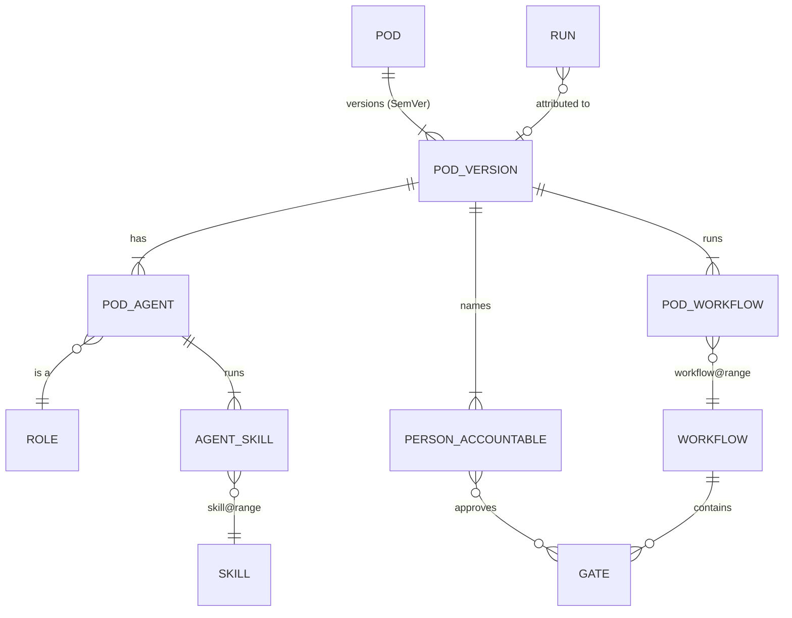
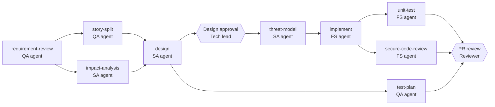
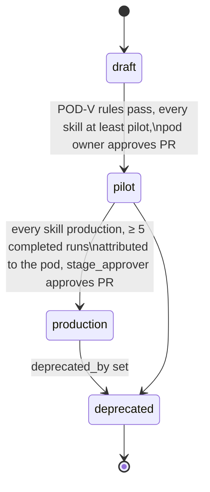
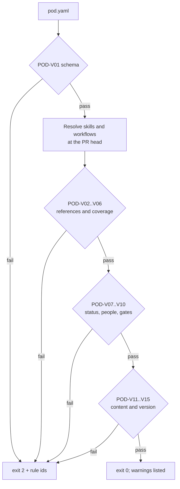

# SDD-10 · Pods

| Field | Value |
| --- | --- |
| ID | SDD-10 |
| Status | Draft for owner review |
| Owner | Abhishek Verma, Ekjot Singh |
| Approver | Puneet Singh Nanda |
| Related docs | [Doc 1 PRD](../product/01-prd.md) §6, D-04, OQ-16 · [Doc 2 Personas and Stories](../product/02-personas-and-stories.md) §2, US-22 · [Doc 3 Architecture](../architecture/03-architecture.md) §7, §9 · [Doc 4 Design and UX](../ux/04-design-and-ux.md) §2.0.3 · [Doc 5 API and Rules](../architecture/05-api-and-rules.md) §3.3, §5.3 · [Doc 6 Constraints](../product/06-constraints.md) X-04, X-13 · [SDD-01 Skill authoring](SDD-01-skill-authoring.md) · [Prototype: Pods](../ux/prototype/Pods.dc.html), [Pod detail](../ux/prototype/PodDetail.dc.html), [Pod builder](../ux/prototype/PodBuilder.dc.html) · [Readiness tracker](../planning/readiness-tracker.md) Q6, Q8 (feature F11) |

## 1. Scope

### 1.1 What this document decides

- What a pod is, as a versioned file (`pod.v1`): agents and their roles, the skills each agent runs, the workflows, the people accountable and the best-fit criteria.
- Where pod files live and how they are validated, released and versioned.
- The Release-1 pod catalogue: Brownfield Change, Greenfield Feature, Quality and Security, UX Review.
- How runs are attributed to a pod, so the portal can show pod metrics.
- What each persona sees about pods in the portal.
- The pod builder, as a Phase 3 preview only.

### 1.2 What it does not decide

| Topic | Owner document |
| --- | --- |
| Skill format and catalogue | [SDD-01](SDD-01-skill-authoring.md) |
| Workflow files and the run loop | SDD-02 |
| Database tables and catalogue sync job (this document proposes the pod tables) | SDD-08 |
| Read API and screens (this document proposes the pod endpoints and field visibility) | SDD-09 |
| `tsl.yaml` and companion repo lifecycle | SDD-12 |

### 1.3 Ground rules

- A pod is a **packaging and reporting** object. It never runs anything. Runs start from workflows, locally, with `/truminds:run` (C-01, X-01).
- Truminds sells AI-augmented pods: people plus AI, never AI headcount (D-04). Every pod names the people who stay accountable.
- The pod builder UI is not built in Release 1 (X-04, US-22).
- Pod files and pod pages hold no client names, ticket ids or repository names (C-09, X-13). Pod metrics are computed from telemetry, never written by hand.

## 2. Concepts

A **pod** is a ready-made delivery team for one kind of engagement. It has:

- **agents**: AI roles from the [SDD-01 §11](SDD-01-skill-authoring.md) taxonomy, each with the skills it runs and a suggested number of Truminds engineers driving it;
- **workflows**: the `workflow.v1` chains the pod runs;
- **people accountable**: humans who answer questions, approve gates and merge;
- **best-fit criteria**: when to propose the pod and what the client system must have.



## 3. Pod definition schema (`pod.v1`)

### 3.1 Location

Pods live at the root of the skill-library repository, outside the plugin, because Claude Code never needs them at run time:

```text
AI-Skill-Library/
└─ pods/
   └─ brownfield-change-pod/
      ├─ pod.yaml          # schema pod.v1
      ├─ one-pager.md      # sales one-pager text (no numbers; metrics are injected by the portal)
      └─ CHANGELOG.md
```

The JSON Schema is `schemas/pod.v1.json`. CODEOWNERS lists the pod owner for `pods/<id>/`.

### 3.2 Annotated example

```yaml
schema: pod.v1
id: brownfield-change-pod                 # req; kebab-case, ends in -pod
version: 1.0.0                            # req; SemVer
status: draft                             # req; draft | pilot | production | deprecated
title: Brownfield Change Pod              # req; ≤ 40 chars
kind: brownfield                          # req; brownfield | greenfield | quality | ux
owner: skill-owner-3b7e                   # req; pseudonym, listed in CODEOWNERS
summary: >-                               # req; ≤ 200 chars; shown to all personas
  Change requests on an existing client system, from ticket to a reviewed pull request.
client_gets:                              # req; 1-5 items, business view
  - Reviewed pull requests with tests and an audit trail
  - Design and threat model for every change
  - Clear questions instead of guesses
agents:                                   # req; 1-8 items
  - key: sa                               # unique in the pod
    role: solution-architect              # req; role id (SDD-01 §11)
    display_name: Solution Architect
    engineers: 1                          # suggested Truminds engineers driving this agent
    job: Analyses the impact on the existing system and designs the change to fit its architecture and rules.
    skills: [impact-analysis@^1.0, design@^1.0, threat-model@^1.0]
    cross_role_skills:                    # skills owned by another role (§3.4)
      - {skill: threat-model, reason: "No Security agent in this pod; the architect runs the threat model on their own design"}
  - key: fs
    role: developer
    display_name: Full-stack Developer
    engineers: 1
    job: Implements the approved design and its unit tests, inside the change limits set by the tech lead.
    skills: [implement@^1.0, unit-test@^1.0, secure-code-review@^1.0, defect-triage@^1.0]
    cross_role_skills:
      - {skill: secure-code-review, reason: "Runs on the developer's own diff before PR; Security reviews findings"}
  - key: qa
    role: qa-engineer
    display_name: QA Engineer
    engineers: 1
    job: Clarifies requirements and plans tests so every acceptance criterion is covered.
    skills: [requirement-review@^1.0, story-split@^1.0, test-plan@^1.0]
    cross_role_skills:
      - {skill: requirement-review, reason: "No Business Analyst in this pod"}
      - {skill: story-split, reason: "No Business Analyst in this pod"}
workflows:                                # req; 1-5 items
  - brownfield-change@^1.3
  - defect-fix@^1.0
people:                                   # req; ≥ 1 with platform_role tech_lead
  - {title: Tech lead, kind: platform, platform_role: tech_lead,
     duties: [Signs the context pack, Approves the design gate, Decides escalations], gates: [G-design, escalate]}
  - {title: Product owner, kind: external,
     duties: [Answers business questions through the engineer]}
  - {title: Reviewer, kind: external,
     duties: [Reviews and merges the pull request]}
best_fit:
  good_fit_when:                          # req; 1-5 items
    - The client has an existing codebase on GitHub
    - There is a steady stream of change tickets
    - A client tech lead can approve designs
  not_a_fit_when:
    - The system has no maintained source repository
    - Changes need mobile builds (verifiers arrive in Phase 2)
  requires:                               # machine-checkable (§6.3)
    product_repo_host: github             # A-03
    context_pack: signed                  # signed | fresh | none
    docker: true                          # verifier containers (A-04)
    figma_mcp: false
one_pager: one-pager.md                   # req
deprecated_by: null                       # req when status = deprecated
```

### 3.3 Field reference

| Field | Type | Rule |
| --- | --- | --- |
| `id` | string | `^[a-z][a-z0-9-]{2,35}-pod$`, unique |
| `version` | string | SemVer 2.0.0 (§7) |
| `status` | enum | Same four states as skills ([SDD-01 §7](SDD-01-skill-authoring.md)); limited by its skills (POD-V07) |
| `kind` | enum | Drives the badge on the pod card |
| `agents[].role` | enum | One of the eight role ids |
| `agents[].engineers` | int | 1–5; used for sizing text in the business view only |
| `agents[].skills[]` | `id@range` | SemVer range, as in `workflow.v1` |
| `agents[].cross_role_skills[]` | list | Every skill whose `skill.yaml` `agent` differs from `role` must appear here with a reason |
| `workflows[]` | `id@range` | Must resolve to `workflow.v1` files in `plugins/truminds/workflows/` |
| `people[].kind` | enum | `platform` (holds a platform role, Doc 2 §2) or `external` (no platform account, e.g. a client product owner) |
| `people[].platform_role` | enum | Required when `kind: platform`; one of `tech_lead`, `engineer`, `eng_lead` |
| `people[].gates` | list | Gate ids from the pod's workflows, plus `escalate` for ESCALATE approvals |
| `best_fit.requires` | object | Keys fixed in §6.3; unknown keys fail validation |

### 3.4 Agents and roles

An agent is built from one role. Normally it runs that role's skills. A pod may give an agent a skill from another role when the pod has no agent for that role, as the prototype does (the QA agent runs `requirement-review`). Every such skill is listed in `cross_role_skills` with a reason, so a reviewer sees the choice. The catalogue and capability map always show a skill under its own role; only the pod page shows it under the pod agent.

## 4. Release-1 pod catalogue

Composition follows the prototype ([Pods.dc.html](../ux/prototype/Pods.dc.html), [PodDetail.dc.html](../ux/prototype/PodDetail.dc.html)). The list and composition still need Puneet's sign-off (OQ-16). Every pod starts at `draft`; "R1 target status" is what the prototype shows.

| Pod | Kind | Agents (role · engineers) | Skills per agent | Workflows | People accountable | R1 target status |
| --- | --- | --- | --- | --- | --- | --- |
| **Brownfield Change Pod** | brownfield | Solution Architect · 1; Full-stack Developer · 1; QA Engineer · 1 | SA: impact-analysis, design, threat-model*. FS: implement, unit-test, secure-code-review*, defect-triage. QA: requirement-review*, story-split*, test-plan | `brownfield-change`, `defect-fix` | Tech lead, product owner, reviewer | Production (prototype: "Available") |
| **Greenfield Feature Pod** | greenfield | Business Analyst · 1; Solution Architect · 1; Developer · 2; QA Engineer · 1 | BA: requirement-review, story-split. SA: design, threat-model*. DEV: implement, unit-test, secure-code-review*. QA: test-plan | `greenfield-feature` | Tech lead, product owner, architect | Production (prototype: "Available") |
| **Quality and Security Pod** | quality | QA Engineer · 1; Security · 1; DevOps · 1 | QA: test-plan, test-automation. SEC: threat-model, secure-code-review. DEVOPS: pipeline-review, deployment-failure-analysis | `quality-uplift`, `security-review`, `pipeline-check` (proposed, §4.2) | QA lead, security lead, tech lead | Pilot |
| **UX Review Pod** | ux | UX Designer · 1 | UX: ux-flow-review, accessibility-review | `ux-review` | UX lead, product owner | Pilot |

\* cross-role skill (§3.4).

### 4.1 Status reasoning

| Pod | Why this target status |
| --- | --- |
| Brownfield Change | All 10 skills target production in [SDD-01 §12](SDD-01-skill-authoring.md) |
| Greenfield Feature | All 8 skills target production |
| Quality and Security | `test-automation`, `pipeline-review` and `deployment-failure-analysis` target pilot, so the pod can be at most pilot (POD-V07) |
| UX Review | Both UX skills target pilot |

### 4.2 Differences from the prototype, resolved here

| Prototype shows | This document | Why |
| --- | --- | --- |
| Brownfield: 9 skills | 10 skills (adds `defect-triage` to the Full-stack agent) | `defect-fix` starts with `defect-triage`; every workflow skill must belong to a pod agent (POD-V05) |
| Greenfield: 10 skills | 8 skills | `greenfield-feature` uses 8 skills (Doc 3 §7.1). `test-automation` would force the pod to pilot. Prototype count to be updated |
| Quality and Security workflows "test-plan run", "threat-model run" | Proposed workflows `quality-uplift` (test-plan → test-automation), `security-review` (threat-model → secure-code-review), `pipeline-check` (pipeline-review); `deployment-failure-analysis` runs as a single-step workflow `deploy-failure` listed in `pipeline-check`'s pod entry once SDD-02 confirms | No such workflow ids exist in Doc 3 §7.1. SDD-02 owns workflow definitions; see O-03 |
| People: "QA lead, security lead" | QA lead and security lead are `external` or `engineer`; a `tech_lead` is added | Workflow gates and ESCALATE need a `tech_lead` (POD-V09) |

### 4.3 Brownfield Change Pod workflow (from `brownfield-change`)



The pod detail page draws this strip from the workflow file, not from the pod file: skills as boxes, gates as dashed amber boxes (Doc 4 §2.0.5), and the owning pod agent under each skill.

## 5. Run attribution

Pod metrics ("Active pods", "Most-used pods", "Track record", "Active runs of this pod") need each run tied to a pod.

| Item | Design |
| --- | --- |
| Assignment | The tech lead lists the pods engaged on a system in `tsl.yaml`: `pods: [brownfield-change-pod@^1.0]` (new key; SDD-12 owns `tsl-config.v1`) |
| At run start | `tsl state start` finds the pods in `tsl.yaml` whose `workflows` include the run's workflow. Exactly one match: the run is attributed to it. Zero: no pod. More than one: the engineer must pass `--pod <id>` to `/truminds:run`, else E-POD-01 |
| Recorded where | `state.json` `pinned.pod: "brownfield-change-pod@1.0.0"`; `run.started` event body gains an optional `pod` field (SDD-08) |
| Database | `run.pod_id`, `run.pod_version` columns (§8.1) |

New error code for SDD-04 and Doc 4 §5.2:

| Code | Exit | Message | Next action |
| --- | --- | --- | --- |
| E-POD-01 | 3 | Workflow `<workflow>` belongs to more than one pod on system `<code>`: `<pods>`. | Re-run with `--pod <id>` |

A pod that is not in `tsl.yaml` never blocks a run. Attribution is for reporting only.

## 6. How pods surface to each persona

```mermaid
flowchart LR
  F[pods/id/pod.yaml in repo] --> V[CI: tsl validate pods/id]
  V --> T[Release tag vX.Y.Z]
  T --> S[Catalogue sync job\nSDD-08]
  S --> DB[(pod, pod_version,\npod_agent, ...)]
  R[run.started with pod] --> DB
  DB --> API[Read API\nSDD-09]
  API --> BU[Business view:\nPods, Pod detail]
  API --> EN[Engineer view:\nPods, Pod detail,\nactive runs]
  T -. one-pager.md .-> API
```

### 6.1 Field visibility

| Field or block | Business unit | Engineers | Source |
| --- | --- | --- | --- |
| Title, kind badge, status badge, summary | Yes | Yes | `pod.yaml` |
| Agents (display names) | Yes | Yes | `pod.yaml` |
| Agent job text | Yes | Yes | `pod.yaml` |
| Skills per agent (ids) | No | Yes | `pod.yaml` |
| Workflows (ids) and skill count | No | Yes | `pod.yaml` |
| Best for, good fit when, client gets | Yes | Yes (collapsed) | `pod.yaml` |
| Workflow strip with gates | Yes (titles only) | Yes (titles + ids) | workflow file |
| People accountable | Yes | Yes | `pod.yaml` |
| Track record: first-try pass, systems served (count), PRs merged | Yes | Yes | Aggregates (§6.2) |
| Run command `/truminds:run <workflow> <ticket>` | No | Yes | Computed |
| Active runs table (run id, system code, ticket, step, status) | No | Yes, own projects only; others' runs hidden | `run`, `step` |
| Download one-pager, Request a pilot | Yes | No | §6.4 |
| Client names, repo names | Never | Never (codes only) | C-09, X-13 |

The persona rules of Doc 4 §2.0 apply: Business never sees run ids, tickets, repos, engineer or client names; Engineers see only their projects; other engineers appear as pseudonyms.

### 6.2 Pod metrics

| Metric | Definition | Minimum data |
| --- | --- | --- |
| First-try pass | Steps with `attempt = 1` and outcome PASS or PASS-WITH-FINDINGS ÷ all first attempts, over runs with `pod_id` = pod, in the period | 5 completed runs, else "No data yet" (G5 rule, Doc 4 §2.0.5) |
| Systems served | Distinct `system_id` over those runs | Same |
| PRs merged | `pull_request.merged_at` not null, joined by `run_id` | Same |
| Active pods (Insights: Business) | Pods with ≥ 1 run started in the period | — |
| Most-used pods | Runs started per pod in the period | — |

Numbers are never stored in `pod.yaml` or `one-pager.md` (POD-V12).

### 6.3 Fit check (Engineer view)

For a system the viewer can see, the read API compares `best_fit.requires` with system facts and shows a checklist on Pod detail. It never blocks anything.

| `requires` key | Values | System fact used |
| --- | --- | --- |
| `product_repo_host` | `github` | All `product_repos` URLs in the system record are GitHub (A-03) |
| `context_pack` | `signed`, `fresh`, `none` | `system.pack_signed_at`, latest `context.drift` event (DEF-01) |
| `docker` | `true`, `false` | Not checkable from the server; shown as "confirm locally" (`tsl doctor`) |
| `figma_mcp` | `true`, `false` | Not checkable from the server; shown as "confirm locally" |

### 6.4 Business actions

| Action | Behaviour | Rule |
| --- | --- | --- |
| Download one-pager | Portal renders `one-pager.md` with the current aggregates (§6.2) and a "Pilot" label when the pod is pilot | Production pods only may be shared outside Truminds |
| Request a pilot | Opens a pre-filled email to a delivery inbox set in portal configuration (`mailto:`); the portal stores nothing and writes to no external system | Portal is read-only (Doc 4 principle 5); no Jira writes (C-08) |

### 6.5 Who sees which pods

| Status | Pods catalogue | Shared material (one-pager outside Truminds, capability map) |
| --- | --- | --- |
| draft | Engineers only, "Draft" badge | No |
| pilot | All internal viewers, "Pilot" badge | No |
| production | All, "Available" badge | Yes |
| deprecated | Hidden; reachable by direct link with "Deprecated, use <replacement>" | No |

### 6.6 Proposed read API (for SDD-09)

| Method | Path | Who | Returns |
| --- | --- | --- | --- |
| GET | `/v1/catalogue/pods?status=&kind=` | viewer+ | Pod cards; fields filtered by persona (§6.1) |
| GET | `/v1/pods/{pod_id}?version=` | viewer+ | Pod detail; latest non-deprecated version by default |
| GET | `/v1/pods/{pod_id}/metrics?period=90d\|12m\|all` | viewer+ | §6.2 aggregates or `{"status": "no_data"}` |
| GET | `/v1/pods/{pod_id}/runs?status=` | engineer (own systems) | Active runs table rows |
| GET | `/v1/pods/{pod_id}/fit?system=<code>` | engineer on that system | §6.3 checklist |

Example card (Business persona):

```json
{
  "id": "brownfield-change-pod", "version": "1.0.0", "status": "production", "kind": "brownfield",
  "title": "Brownfield Change Pod",
  "summary": "Change requests on an existing client system, from ticket to a reviewed pull request.",
  "agents": ["Solution Architect", "Full-stack Developer", "QA Engineer"],
  "best_for": "Ongoing maintenance and change work",
  "people": ["Tech lead", "Product owner", "Reviewer"],
  "metrics": {"status": "no_data"}
}
```

The Engineer card replaces `best_for` and `metrics` with `"workflows": ["brownfield-change", "defect-fix"], "skill_count": 10` (prototype layout).

## 7. Versioning and lifecycle

| Bump | When |
| --- | --- |
| MAJOR | An agent or workflow is removed; a workflow range moves to a new major |
| MINOR | An agent, skill or workflow is added; `best_fit.requires` changes; people or gates change |
| PATCH | Text only: summary, job, client_gets, good_fit_when, one-pager wording |



A pod version is published only through a tagged release of the skill-library repository, the same as skills ([SDD-05 §3.4](SDD-05-claude-code-integration.md)). A run pins the pod version it started with, like skills (R-08).

## 8. Data model (proposal for SDD-08)

### 8.1 Tables

```sql
CREATE TABLE pod (
  id text PRIMARY KEY,                         -- brownfield-change-pod
  title text NOT NULL,
  kind text NOT NULL CHECK (kind IN ('brownfield','greenfield','quality','ux')),
  owner_id uuid REFERENCES app_user);
CREATE TABLE pod_version (
  pod_id text REFERENCES pod, version text NOT NULL,
  status text NOT NULL CHECK (status IN ('draft','pilot','production','deprecated')),
  definition jsonb NOT NULL,                   -- the validated pod.yaml
  source_sha text NOT NULL,                    -- skill-library commit of the release tag
  published_at timestamptz NOT NULL,
  PRIMARY KEY (pod_id, version));
CREATE TABLE pod_agent (
  pod_id text, version text, agent_key text,
  role text NOT NULL, display_name text NOT NULL, engineers int NOT NULL,
  PRIMARY KEY (pod_id, version, agent_key),
  FOREIGN KEY (pod_id, version) REFERENCES pod_version);
CREATE TABLE pod_agent_skill (
  pod_id text, version text, agent_key text, skill_id text REFERENCES skill,
  skill_range text NOT NULL, cross_role boolean NOT NULL DEFAULT false,
  PRIMARY KEY (pod_id, version, agent_key, skill_id),
  FOREIGN KEY (pod_id, version, agent_key) REFERENCES pod_agent);
CREATE TABLE pod_workflow (
  pod_id text, version text, workflow text NOT NULL, workflow_range text NOT NULL,
  PRIMARY KEY (pod_id, version, workflow),
  FOREIGN KEY (pod_id, version) REFERENCES pod_version);
ALTER TABLE run ADD COLUMN pod_id text, ADD COLUMN pod_version text,
  ADD FOREIGN KEY (pod_id, pod_version) REFERENCES pod_version;
CREATE INDEX ON run (pod_id, started_at);
```

### 8.2 Sync

The catalogue sync job (SDD-08) reads `pods/*/pod.yaml` at each release tag, re-validates, and inserts a `pod_version` row per new version. It never edits an existing row. It writes no file content other than the validated definition, which holds no client data by POD-V12.

## 9. Validation rules (`tsl validate pods/<id>`)

`tsl validate` gains pod paths (Doc 5 §2.2 lists skills and workflows only; SDD-04 adds pods). Failures exit 2 with rule ids. Marketplace CI runs it on every PR that touches `pods/`, `plugins/truminds/skills/` or `plugins/truminds/workflows/`, because skill and workflow changes can break pods.



| Rule | Check | Level |
| --- | --- | --- |
| POD-V01 | Valid against `pod.v1`; `id` = folder name | Error |
| POD-V02 | Every `agents[].role` is a known role id | Error |
| POD-V03 | Every `agents[].skills[]` resolves to a skill version that satisfies the range and is not deprecated | Error |
| POD-V04 | Every `workflows[]` entry resolves to a `workflow.v1` file in range | Error |
| POD-V05 | Every skill used by a step of any listed workflow is assigned to at least one agent | Error |
| POD-V06 | Every skill assigned to an agent is used by at least one listed workflow | Warning |
| POD-V07 | Pod status ≤ the lowest status of its skills and workflows (draft < pilot < production) | Error |
| POD-V08 | Every skill whose `agent` differs from the agent's `role` is in `cross_role_skills` with a non-empty reason | Error |
| POD-V09 | At least one person has `platform_role: tech_lead`, and every gate role in the workflows is covered by a person whose `gates` lists that gate | Error |
| POD-V10 | `agents[].key` unique; 1–8 agents; `engineers` 1–5 | Error |
| POD-V11 | `one_pager` file exists | Error |
| POD-V12 | No forbidden content (H4 detector: client names deny list, secrets, personal data) and no hand-written metrics (regex for percentages and counts such as `\d+ ?%`, `\d+ PRs`) in `pod.yaml` and `one-pager.md` | Error |
| POD-V13 | Version bumped vs `main` when content changed; bump class matches §7; CHANGELOG entry present | Error |
| POD-V14 | Status transition legal; `deprecated_by` set when deprecated | Error |
| POD-V15 | Text limits: title ≤ 40, summary ≤ 200, job ≤ 200, list items ≤ 120 characters | Error |

## 10. Pod builder: Phase 3 preview only

The pod builder is on the DO NOT BUILD list for Release 1 (X-04, US-22). It needs Release-1 usage data first.

### 10.1 What Release 1 ships

| Item | Release 1 |
| --- | --- |
| Interactive builder screen ([PodBuilder.dc.html](../ux/prototype/PodBuilder.dc.html)) | Not built. It stays in the prototype for review |
| "Build your own pod · Phase 3" card on the Pods page | Static card, no button, text only |
| Builder API endpoints | None |

Doc 4 §2.0 lists the builder as a portal screen. Under X-04 this document limits Release 1 to the static card; see O-05.

### 10.2 Phase 3 design sketch (for later review, not for build)

| Step | Behaviour |
| --- | --- |
| Pick agents | Palette of the eight roles; each shows its production skills |
| Derive | Skills = union of chosen roles' skills; suggested workflow = first R1 workflow whose skills are all covered (prototype rule: Business Analyst chosen → `greenfield-feature`, else `brownfield-change`); people = union of gate roles of that workflow |
| Output | A draft `pod.yaml` the user downloads. The portal stays read-only: a pod owner opens a PR, and §9 validation and §7 approvals apply as for any pod |
| Save | Disabled in the preview, labelled "Save pod (Phase 3)" |

## 11. Security

| Risk | Control |
| --- | --- |
| Client names in pod text or one-pager | POD-V12 deny list in CI; codes only on pages (X-13) |
| Invented track-record numbers shown to clients | Metrics only from telemetry; POD-V12 blocks numbers in text; "No data yet" below 5 runs |
| Engineers seeing other teams' runs through pod pages | `/v1/pods/{id}/runs` filtered by the caller's system grants (Doc 2 §2) |
| "Request a pilot" used to write into Jira or CRM | Not built: mailto only (C-08) |
| Malicious pod change pointing at a weak workflow | CODEOWNERS approval and POD-V03/V04/V07 |

## 12. Test plan

| Test | Layer | Pass condition |
| --- | --- | --- |
| Each R1 `pod.yaml` validates | Unit (CI) | Exit 0 |
| One failing fixture per POD-V rule | Unit | Exit 2 with the expected rule id only |
| Skill demotion breaks a pod | Contract | Changing a skill to pilot makes a production pod fail POD-V07 |
| Attribution | Unit (`tsl state start`) | 0, 1 and 2 matching pods give: no pod; that pod; E-POD-01 |
| Persona filtering | API contract | Business response has no skills, workflows, run ids or system codes |
| Metrics threshold | API | 4 runs give `no_data`; 5 runs give numbers |
| Pod builder absent | Portal E2E | No builder route; static card only |

## 13. Done criteria

- `schemas/pod.v1.json` exists with valid and invalid samples.
- The four R1 pods exist as `pods/<id>/pod.yaml` with `status: draft`, one-pagers and CHANGELOGs, and pass `tsl validate`.
- POD-V01 to POD-V15 implemented with one failing fixture each.
- SDD-08 has accepted or amended the tables in §8; SDD-09 the endpoints in §6.6; SDD-04 the `--pod` flag and E-POD-01; SDD-12 the `tsl.yaml` `pods` key; SDD-02 the Quality and Security workflows.
- Prototype pod counts updated to match §4.2.
- Owners Abhishek Verma and Ekjot Singh have signed off this document.

## 14. Open items

| # | Item | Reference | Owner |
| --- | --- | --- | --- |
| O-01 | Sign off the R1 pod list and each pod's composition (§4) | OQ-16 | Puneet |
| O-02 | Pod ownership role: Doc 2 grants `skill_owner` at scope `skill`; `role_grant.scope_type` has no `pod`. Proposal: add scope `pod`, or let any skill owner of a pod's skills own the pod | new | Puneet; Gaurav Saini (DDL) |
| O-03 | Workflows for the Quality and Security Pod (`quality-uplift`, `security-review`, `pipeline-check`, `deploy-failure`) do not exist in Doc 3 §7.1; their entry inputs on a codebase with no upstream stories or design are undefined | new | Abhishek Verma, Ekjot Singh; Shubham Bansal (SDD-02) |
| O-04 | Workflow names differ between Doc 1 FR-WFL-03 and Doc 3 §7.1; pods here use the Doc 3 names | new | Puneet |
| O-05 | Doc 4 §2.0 lists the pod builder as a portal screen; X-04 forbids building it in Release 1. This document ships only a static card. Confirm | X-04 | Puneet |
| O-06 | Delivery inbox address for "Request a pilot", and whether a PDF one-pager is needed (rendering owner) | new | TBD by Puneet; SDD-09 |
| O-07 | Minimum runs before pod metrics show (5 proposed, from G5) | OQ-12 | Puneet |
| O-08 | Prototype role mismatch: the brownfield pod uses a QA agent for `requirement-review` and `story-split`, and "Full-stack" for the Developer role. Kept here via `cross_role_skills` and `display_name`; confirm or add a Business Analyst agent | new | Puneet |
