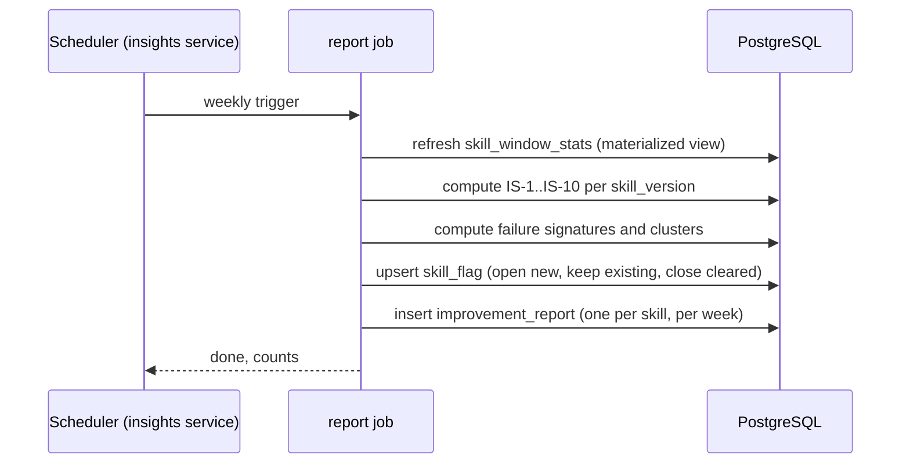
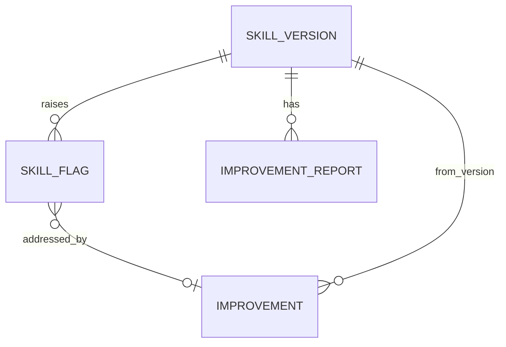
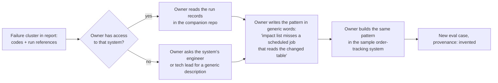
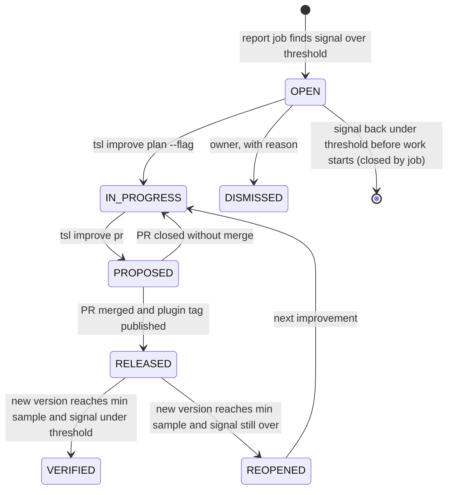

# SDD-11 · Improvement Loop

| Field | Value |
| --- | --- |
| Status | Draft for owner review |
| Owner | Abhishek Verma, Ekjot Singh (skills, `/truminds:improve`); Gaurav Saini (report data and queries) |
| Approver | Puneet Singh Nanda |
| Related docs | [PRD](../product/01-prd.md) FR-IMP-01, FR-IMP-02, G6 · [Personas and Stories](../product/02-personas-and-stories.md) US-15, US-16 · [Constraints](../product/06-constraints.md) C-02, C-09, X-02, X-06, X-11, X-17 · [Doc 3 Architecture](../architecture/03-architecture.md) §5, §8.1, §9, §12 · [Doc 5 API and Rules](../architecture/05-api-and-rules.md) §2, §5 · [SDD-01 Skill authoring](SDD-01-skill-authoring.md) · [SDD-02 Orchestration](SDD-02-workflow-orchestration.md) · [SDD-03 Harness](SDD-03-harness.md) · [SDD-05 Claude Code integration](SDD-05-claude-code-integration.md) §4.1 · [SDD-08 Telemetry and insights](SDD-08-telemetry-insights.md) · [SDD-09 Web portal](SDD-09-web-portal.md) · [Readiness tracker](../planning/readiness-tracker.md) Q5, Q26, Q27 |

## 1. Scope

### 1.1 What this document decides

This is feature spec F12. It covers the improvement part of tracker Q5 ("the weekly improvement report: its queries, layout and where it is delivered"). It decides:

- which telemetry signals flag a skill for improvement, with formulas and thresholds;
- the weekly report job and the data it reads from the insights service;
- the `/truminds:improve` and `tsl improve plan` flow;
- how a change is proposed as a pull request with eval evidence (before and after runs, no regression);
- who approves what;
- the guardrails: evals hold only invented data, never client data.

### 1.2 What it does not decide

| Topic | Owner document |
| --- | --- |
| Eval-case file format, rubric format, SKILL.md template | [SDD-01](SDD-01-skill-authoring.md) |
| How `/truminds:eval` runs cases, and the signed `eval-result.v1` | SDD-01 and [SDD-04](SDD-04-tsl-cli.md) |
| Calibration audits of High-band outcomes (OQ-11) | [SDD-03](SDD-03-harness.md) |
| Event ingestion, tables, retention | [SDD-08](SDD-08-telemetry-insights.md) |
| Portal screens and read API | [SDD-09](SDD-09-web-portal.md) |

### 1.3 Ground rules

- **No LLM in the report.** The weekly report is plain code: SQL and Python in the insights service (FR-IMP-01, C-02, X-02).
- **Evidence first.** A change starts with a failing eval case and ships only if that case passes and nothing regresses (US-16).
- **Never automatic.** No change is applied without an eval case and owner review (X-11).
- **Metadata only.** The report sees ids, counts, outcomes and signals. It never sees artifact text, findings text or client names (NFR-10, X-06).
- **Invented data only.** Eval cases contain no client code, data or names (C-09, X-17, T-01).

## 2. The loop at a glance

```mermaid
flowchart LR
  R[Runs on engineer laptops] -->|step.decided, approval.recorded,\nquestion.*, ci.verified| S[(Insights DB)]
  GH[GitHub webhook] --> S
  S --> J[Weekly report job\nplain code]
  J --> F[skill_flag rows\n+ improvement report]
  F --> P[Portal: Skill performance\nImprovement report]
  P --> O[Skill owner]
  O -->|/truminds:improve skill| I[tsl improve plan\nnew eval case, invented data]
  I --> B[Before eval run: new case fails]
  B --> E[Edit SKILL.md / rubric / references]
  E --> A[After eval run: new case passes,\nno regression]
  A --> PR[PR to skill-library repo\nwith signed evidence]
  PR --> CI[CI: tsl validate + tsl improve check]
  CI --> AP[Skill owner approves\nCODEOWNERS]
  AP --> REL[Plugin release tag]
  REL --> R
  REL -. next reports compare versions .-> J
```



## 3. Signals that flag a skill

### 3.1 Signal definitions

Each signal is computed per **skill version** over a rolling window. The default window is 28 days. Each signal has a minimum sample: below it, the signal shows "not enough data" and raises no flag.

Terms: a **step** is one `(run_id, seq)` pair; an **attempt** is one `step` table row. `cause` comes from SDD-02 §5.3.

| Id | Signal | Formula | Flag when (proposed) | Min sample |
| --- | --- | --- | --- | --- |
| IS-1 | First-try pass rate | Steps whose attempt 1 outcome is PASS or PASS-WITH-FINDINGS ÷ steps with an attempt 1 | < 0.80 (the amber line in Doc 4 §2.0.4) | 10 steps |
| IS-2 | Retries per step | Attempts with `cause` in `retry_checks`, `retry_review`, `retry_verifier` ÷ steps | > 0.50 | 10 steps |
| IS-3 | Retry exhaustion | Steps that escalated with reason "retry budget exhausted" ÷ steps | > 0.05 | 10 steps |
| IS-4 | Dropped findings rate (reviewer) | Findings dropped by code (no valid citation, R-13) ÷ findings reported, per artifact type the reviewer reviewed | > 0.20 | 30 findings |
| IS-5 | Unverified claims (generator) | 1 − mean S1 evidence coverage over PASS-path attempts | > 0.15 (mean S1 < 0.85) | 10 steps |
| IS-6 | Reviewer disagreement | Human verdicts that contradict the harness ÷ human verdicts (§3.2) | > 0.15 | 10 verdicts |
| IS-7 | Human override rate | Steps where a human changed the harness result (§3.2) ÷ steps | > 0.10 | 10 steps |
| IS-8 | Input-pause rate | Steps with any NEEDS-INPUT ÷ steps | > 0.30 (informational; may be a ticket quality problem, not the skill) | 10 steps |
| IS-9 | Top failure cause share | Share of failed attempts with the same failure signature (§4.3) | > 0.40 of failures in one signature (shown as a cluster, not a flag on its own) | 5 failures |
| IS-10 | Version regression | IS-1 of the current version minus IS-1 of the previous version | < −0.10, with both versions at min sample | 10 steps each |

The thresholds are proposals until pilot data exists (same status as OQ-12). They live in one config file in the insights service (`improvement_thresholds.yaml`) and change by PR, so they are not hard-coded.

### 3.2 Reviewer disagreement and human overrides

Both use human decisions that already exist as events. They differ by what they blame.

| Human decision (source) | Counts as override (IS-7) | Counts as reviewer disagreement (IS-6) | Direction |
| --- | --- | --- | --- |
| ESCALATE gate decided `approve` (accept as is) (`approval.recorded`, kind escalate) | Yes | Yes, if the escalation came from reviewer findings (S3 or major/blocker findings), not from a hard gate | Harness too strict |
| Workflow gate decided `changes` or `reject` on a step that was PASS with band High (`approval.recorded`, kind workflow) | Yes | Yes | Harness too lenient |
| Calibration audit marks a High-band outcome as a miss (audit records, SDD-03) | Yes | Yes | Harness too lenient |
| PR gets "changes requested" when every step in the run was High (`pull_request_review` webhook) | No (PR review is normal work) | Counted separately as "PR pushback on High runs" | Too lenient (weak signal) |
| Non-blocking question default overridden by an answer (`question.answered`) | No | No | Informational |

IS-6 is reported for the reviewer (the `review` skill and the `truminds:reviewer` agent), split by the artifact type under review. IS-7 is reported for the skill that produced the artifact.

### 3.3 Who each flag goes to

| Flag | Goes to | Why |
| --- | --- | --- |
| IS-1, IS-2, IS-3, IS-5, IS-7, IS-10 | Owner of the producing skill | The skill's output is weak |
| IS-4, IS-6 | Harness owners (Japman Singh, Yash Khorwal) and the reviewer rubric owner for that artifact type | The reviewer or rubric is weak |
| IS-8 | Skill owner and the workflow owner (informational) | Might be the skill asking poor questions, or tickets lacking detail |
| IS-3 with a high H6 share | Workflow owner | Chain problem, not a skill problem |

## 4. Weekly report job

### 4.1 Where it runs

A scheduled job inside the insights service (FastAPI + PostgreSQL 16, SDD-08). It runs once a week and on demand by an admin. It is plain SQL and Python, with no network calls to any model.



### 4.2 Data it reads

All of this is metadata already defined in Doc 3 §9 and Doc 5 §5.3. Items marked **needs** are additive fields this design depends on.

| Source | Fields used | Needs |
| --- | --- | --- |
| `step` table | `run_id, seq, skill_id, skill_version, attempt, outcome, band, signals, duration_ms` | Column `attempt_cause` (from `step.decided.cause`, SDD-02 §5.3) |
| `step.decided` event body | `gate_failures[]`, `findings_count{blocker, major, minor}`, `caps`, `outcome` | Fields `findings_dropped_count`, `cause`, `escalate_reason` (`band_low` \| `budget_exhausted` \| `blocker` \| `critical`) |
| `approval.recorded` event body | `gate`, `decision`, `approver_role` | Fields `gate_kind` (workflow \| escalate), `step`, `skill`, `skill_version`, `harness_outcome`, `harness_band` |
| `question.created` / `question.answered` | `step`, `blocking`, `age_s` | Field `default_overridden` (bool) on `question.answered` |
| `run` table | `workflow`, `workflow_version`, `system_id` | — |
| `pull_request` table and review webhook | `review_comments`, review state | — |
| Calibration audits (SDD-03) | `run_id, seq, attempt, verdict (ok \| miss)` | An `audit.recorded` event or table, owned by SDD-03 |
| `skill_version` table | `status`, `eval_pass_rate`, `published_at` | — |

**Never read:** artifact files, findings text, question text, comment text, file paths, client names. These are not in the database (X-06), so the job cannot read them even by mistake.

### 4.3 Failure signatures

The report cannot cluster by text, because there is no text. It clusters by a **failure signature** built only from codes:

```text
signature = outcome | sorted(gate_failures) | failing signals | severity mix | escalate_reason
example   = RETRY | H5 | S1<0.75 | major:1 | -
```

Each cluster shows the count, the share of failures, the workflows and step positions it appears in, and up to 10 example references `(system code, run_id, step, attempt)`. A reference is a pointer, not content. Only people who have access to that system's companion repo can open it (Doc 2 §2). A skill owner without that access asks the system's engineer or tech lead to describe the pattern in invented terms (§7.2).

### 4.4 Report layout and delivery

Delivered in the portal, as the "Improvement report" view under Insights › Engineering monitoring › Skill performance (Doc 4 §2.4 "Open improvement report"; screen in SDD-09). Engineers persona only; visible to the skill owner, the harness owners, eng leads and admins.

| Section | Content |
| --- | --- |
| Header | Skill, version, owner pseudonym, window, sample sizes, eval pass rate of this version (signed) |
| Flags | Each open flag: signal, value, threshold, trend over the last 4 windows, status (§6) |
| Failure clusters | Top 5 signatures with counts and references |
| Version comparison | IS-1, IS-2, IS-7 for the current and previous version |
| Improvement history | Improvements proposed and released for this skill, with before and after eval pass rates |

Push notification (email or chat) is not designed for Release 1 (open item 4).

### 4.5 New tables (for SDD-08)



```sql
CREATE MATERIALIZED VIEW skill_window_stats AS ...;      -- IS-1..IS-10 inputs per skill_version and window
CREATE TABLE skill_flag (
  id text PRIMARY KEY,                                    -- flg_<ULID>
  skill_id text NOT NULL, skill_version text NOT NULL,
  signal text NOT NULL CHECK (signal ~ '^IS-[0-9]+$'),
  value numeric NOT NULL, threshold numeric NOT NULL, sample int NOT NULL,
  status text NOT NULL CHECK (status IN ('OPEN','IN_PROGRESS','PROPOSED','RELEASED','VERIFIED','REOPENED','DISMISSED')),
  dismissed_reason text CHECK (char_length(dismissed_reason) <= 200),
  opened_at timestamptz NOT NULL, updated_at timestamptz NOT NULL,
  FOREIGN KEY (skill_id, skill_version) REFERENCES skill_version);
CREATE TABLE improvement_report (
  skill_id text, skill_version text, window_end date, body jsonb NOT NULL,  -- metadata only
  PRIMARY KEY (skill_id, skill_version, window_end));
CREATE TABLE improvement (
  id text PRIMARY KEY,                                    -- imp_<ULID>
  skill_id text NOT NULL, from_version text NOT NULL, to_version text,
  flag_ids text[] NOT NULL, owner_id uuid REFERENCES app_user,
  before_pass_rate numeric, after_pass_rate numeric, cases_added int,
  pr_repo text, pr_number int, state text NOT NULL CHECK (state IN ('planned','proposed','merged','released','abandoned')),
  created_at timestamptz NOT NULL, updated_at timestamptz NOT NULL);
```

## 5. `/truminds:improve` and `tsl improve`

### 5.1 Commands

| Command | Who | What it does | Exit |
| --- | --- | --- | --- |
| `/truminds:improve <skill>` | Skill owner or engineer (Doc 2 §2 matrix) | Skill (SDD-05 §4.1) that runs `` !`tsl improve plan $0 --json` `` and guides the steps below | — |
| `tsl improve plan <skill> [--flag <flg_id>] [--offline]` | Same | Fetches the report and open flags; checks the working copy; creates branch `improve/<skill>/<imp_ULID>` in the skill-library clone; writes `improve/<imp_id>/plan.json`; sends nothing to Jira | 0, 2, 3, 10 |
| `tsl improve case <skill> --id <case-id>` | Same | Scaffolds a new eval case from the SDD-01 template with `provenance: invented` and the attestation block | 0, 2 |
| `tsl eval plan` / `tsl eval record` | Same | Existing (SDD-05 §4.1, Doc 5 §2.2): list cases, sign results | — |
| `tsl improve check <skill>` | Author and CI | Compares the signed before and after results; writes `improvement.v1` | 0, 2 |
| `tsl improve pr <skill>` | Author | Pushes the branch and opens a PR on the skill-library repo with the evidence; sends `improvement.proposed` | 0, 3, 10 |

`tsl improve plan` reads the report with the user's Entra ID token (ADR 0002) from the read API (§5.4). With `--offline`, it uses the last cached report from `~/.truminds/cache/improve/`, and says how old it is.

### 5.2 Flow

```mermaid
sequenceDiagram
  actor O as Skill owner
  participant CC as improve skill
  participant T as tsl
  participant API as Insights read API
  participant G as Skill-library repo
  O->>CC: /truminds:improve impact-analysis
  CC->>T: tsl improve plan impact-analysis --json
  T->>API: GET /v1/improvement/skills/impact-analysis
  API-->>T: flags, clusters (metadata only)
  T->>G: branch improve/impact-analysis/imp_...
  T-->>CC: plan: flags, current version, eval set, next steps
  O->>CC: pick flag (for example IS-1, cluster RETRY|H5)
  CC->>T: tsl improve case impact-analysis --id ia-021
  Note over O,CC: Owner and Claude write the case with invented data only,<br/>on the sample system (ADR 0004)
  CC->>T: before: /truminds:eval on the current version, all cases
  T->>G: eval-result before (signed): new case FAILS
  CC->>G: edit SKILL.md, rubric or references; bump version
  CC->>T: after: /truminds:eval on the new version, all cases
  T->>G: eval-result after (signed)
  CC->>T: tsl improve check impact-analysis
  T-->>CC: pass: new case passes, no regression, rate >= min
  CC->>T: tsl improve pr impact-analysis
  T->>G: push branch, open PR with evidence
```

### 5.3 Step rules

1. **Pick a flag.** The improvement links at least one flag id, or the reason `owner-initiated` (for problems found outside telemetry).
2. **Write the failing case first.** The new case reproduces the failure pattern with invented data. It must **fail** on the current version in the before run. If it passes, it is not a reproduction, and `tsl improve check` fails with E-IMP-01.
3. **Change the skill.** Edits are to the skill folder only (SKILL.md, rubric, references, metadata). Version bump follows SemVer: patch for wording, minor for new behaviour, major when an input or output schema changes (R-10). A major bump also needs a workflow PR (§8).
4. **Run after evals** on the new version, all cases, including the new one.
5. **Check** (§6.1), then open the PR.

Threshold changes for a skill (band thresholds, Doc 3 §5.6) follow the same loop. They need the harness owners' approval, and loosening one also needs audit data (§8).

### 5.4 Read API (for SDD-09)

| Method | Path | Auth | Returns |
| --- | --- | --- | --- |
| GET | `/v1/improvement/flags?skill=&status=&signal=` | Bearer (Entra ID); roles `skill_owner` (own skill), `eng_lead`, `admin`; harness owners for IS-4, IS-6 | Flag list |
| GET | `/v1/improvement/skills/{skill_id}?version=&window=` | Same | Latest report body (§4.4), clusters with references |
| PATCH | `/v1/improvement/flags/{flag_id}` | `skill_owner` of that skill | Status change to `IN_PROGRESS` or `DISMISSED` with reason (≤ 200 characters, no free client text; deny-list check as in Doc 5 §5.3) |

References in responses carry system **codes**, never names (Doc 4 §6.3).

## 6. Evidence and the no-regression rule

### 6.1 What `tsl improve check` verifies

| # | Check | Error |
| --- | --- | --- |
| 1 | Before and after `eval-result.v1` files exist, signatures verify against registered, non-revoked keys, and the signer is the PR author | E-IMP-04 |
| 2 | Before result's `skill_sha256` equals the hash of the skill folder at the base commit; after result's equals the PR head | E-IMP-04 |
| 3 | The new case (or cases) exist in `evals/`, appear in both results, **fail before** and **pass after** | E-IMP-01 |
| 4 | **No regression:** every case that passed before passes after | E-IMP-02 |
| 5 | After pass rate ≥ `evals.min_pass_rate` (default 0.9, Q26) and ≥ before pass rate | E-IMP-03 |
| 6 | Case count ≥ `evals.min_cases`; no case removed or edited unless the PR also contains a signed justification reviewed by the skill owner | E-IMP-02 |
| 7 | Forbidden-content scan of every changed file in `evals/` passes (§7.3) | E-IMP-05 |

All checks are plain code. Marketplace CI runs `tsl improve check` on every PR that changes a skill folder, next to `tsl validate`. No LLM runs in CI (C-02).

**Run-to-run variance.** The same case can pass once and fail once on the same version. Proposed rule: each case runs 3 times in both the before and after runs; a case "passes" when it passes in at least 2 of 3. The before and after runs record the Claude Code version and, where Claude Code reports it, the model id. Whether the model id is available to `tsl` is unverified; spike needed (open item 2).

### 6.2 `improvement.v1` evidence file

Written by `tsl improve check` to `plugins/truminds/skills/<skill>/evals/improvements/<imp_id>.json` and committed in the PR.

```json
{
  "schema": "improvement.v1",
  "id": "imp_01JA2C...",
  "skill": "impact-analysis", "from_version": "1.1.2", "to_version": "1.1.3",
  "flags": ["flg_01JA1Z..."], "signature": "RETRY|H5|S1<0.75|major:1|-",
  "cases_added": ["ia-021"],
  "before": {"result": "evals/results/1.1.2-imp_01JA2C.json", "sha256": "...", "pass_rate": 0.82, "new_cases_failed": ["ia-021"]},
  "after":  {"result": "evals/results/1.1.3-imp_01JA2C.json", "sha256": "...", "pass_rate": 0.95, "new_cases_passed": ["ia-021"]},
  "regressions": [],
  "checked_by": "tsl@1.7.0"
}
```

### 6.3 PR body (generated by `tsl improve pr`)

```markdown
## impact-analysis 1.1.2 → 1.1.3

**Improvement:** imp_01JA2C... · flags: IS-1 (first-try 0.71), cluster RETRY|H5
**What changed:** <one paragraph by the author>

| Eval run | Cases | Pass rate | New case ia-021 |
|---|---|---|---|
| Before (1.1.2) | 22 | 0.82 | fail |
| After (1.1.3) | 22 | 0.95 | pass |

Regressions: none

- [ ] Eval cases use invented data only (author attestation in each case)
- [ ] Version bump matches the change (patch / minor / major)

<!-- tsl:improvement=imp_01JA2C... -->
```

The hidden marker lets the GitHub webhook join the PR to the `improvement` row (G6 "promoted versions").

## 7. Guardrails: invented data only

### 7.1 Rules

| # | Rule | Enforced by |
| --- | --- | --- |
| GR-1 | Eval cases, fixtures and expected outputs use invented data only: the sample system (ADR 0004) or synthetic snippets written for the case | Author attestation + CI scan + reviewer |
| GR-2 | No client names, client codes, ticket ids, repo names, people, customer data or credentials in any eval file (C-09, R-15) | CI scan (§7.3) |
| GR-3 | No artifact or code copied from a companion repo or client product repo | Process (§7.2) + scan for known structure markers (`run_id`, `tsl:run_id`, companion paths) |
| GR-4 | The report and API carry no content, only codes and counts | Data model: content is never stored (X-06) |
| GR-5 | No LLM in the report or CI | Design (C-02) |
| GR-6 | Every eval case declares `provenance: invented` and an `attestation: {by, statement}` block | Schema check in `tsl validate` (field added to SDD-01 eval-case format) |
| GR-7 | Improvement work happens in the skill-library repo, not in a companion repo session | Process; see open item 3 for enforcement |

### 7.2 How a real failure becomes an invented case



The generic description is written fresh. It never quotes the artifact, ticket or code. Example: "the change edits the order-history query, and a nightly retention job that reads the same table is not listed as impacted". The case is then built on the sample system, which has its own invented retention job.

### 7.3 Forbidden-content scan in CI

`tsl validate` and `tsl improve check` scan changed eval files:

- **Secrets and PII:** the same detectors as hard gate H4 (choice of detectors is in SEC-01).
- **Client identifiers:** a list of client names, codes and repo names cannot sit in the repo, because the list itself would break C-09. CI gets a list of salted SHA-256 hashes of normalised tokens from a CI secret, maintained by the admin from the `client` table. CI hashes word n-grams (1 to 3 words) of each eval file and fails on any match (E-IMP-05). Proposal; SEC-01 owns the final design (open item 5).
- **Structure markers:** `run_` ULIDs, `tsl:run_id`, `artifacts/<ticket>/` paths and `pack_sha` blocks inside eval files fail the scan.

A failure blocks the PR. It is reported to the author with the file and line, never with the matched token.

## 8. Who approves

| Change | Approver | Enforced by |
| --- | --- | --- |
| Skill change with evidence (patch or minor) | A skill owner of that skill who is not the PR author (US-15) | CODEOWNERS on the skill folder; branch protection |
| Author is the only skill owner | A second skill owner from the same agent group, or an eng lead | CODEOWNERS fallback team (TBD by Puneet) |
| Major version (schema change) | Skill owner + workflow owners (Abhishek Verma, Ekjot Singh), because workflows pin ranges such as `^1.1` | CODEOWNERS on `workflows/` |
| Reviewer agent, `review` skill, rubric format or thresholds | Harness owners (Japman Singh, Yash Khorwal) | CODEOWNERS |
| Loosening a threshold | Harness owners + Puneet, with audit data attached | PR checklist |
| Promote `experimental` → `production` | Stage approver (OQ-07) | CODEOWNERS on `status` field changes |
| Dismiss a flag | Skill owner, with a reason | Read API role check |
| Change `improvement_thresholds.yaml` | Gaurav Saini + Puneet | CODEOWNERS on the insights repo |

Merged changes ship in the next plugin release tag (SDD-05 §3.4). Runs already in progress keep their pinned versions (R-08, SDD-02 §11.4).

## 9. Flag lifecycle



`VERIFIED` and `REOPENED` close the loop: the report checks real use after release, not only evals. IS-10 (version regression) on a released version opens a new flag. The fix is a revert PR and a new patch release, through the same approval. Nothing is rolled back automatically (X-11).

## 10. Events, errors and interfaces added

| Kind | Item | Owner doc to update |
| --- | --- | --- |
| Commands | `tsl improve plan`, `tsl improve case`, `tsl improve check`, `tsl improve pr` | SDD-04, Doc 5 §2.2 |
| Endpoints | `GET /v1/improvement/flags`, `GET /v1/improvement/skills/{skill_id}`, `PATCH /v1/improvement/flags/{flag_id}` | SDD-09 |
| Tables | `skill_window_stats` (view), `skill_flag`, `improvement_report`, `improvement`; column `step.attempt_cause` | SDD-08 |
| Event | `improvement.proposed {improvement_id, skill, from_version, to_version, flag_ids, before_pass_rate, after_pass_rate, cases_added}`, sent by `tsl improve pr` | Doc 5 §5.3, SDD-08 |
| Event fields (additive) | `step.decided`: `cause`, `findings_dropped_count`, `escalate_reason`. `approval.recorded`: `gate_kind`, `step`, `skill`, `skill_version`, `harness_outcome`, `harness_band`. `question.answered`: `default_overridden` | Doc 5 §5.3, SDD-08 |
| Event (dependency) | `audit.recorded` or an audit table for calibration audits | SDD-03 |
| Webhook | Install the GitHub webhook on the skill-library repo too, to join improvement PRs (`tsl:improvement` marker) | SDD-08 |
| Schemas | `improvement.v1`; eval-case fields `provenance`, `attestation`; `eval-result.v1` fields `skill_sha256`, `repeats`, `claude_code_version` | SDD-01, Doc 5 §3 |
| Errors (exit 2) | E-IMP-01 new case does not fail before (not a reproduction) · E-IMP-02 regression, or cases removed or edited without justification · E-IMP-03 pass rate below minimum or below before · E-IMP-04 eval result unsigned, signer mismatch or skill hash mismatch · E-IMP-05 forbidden content in eval files | Doc 4 §5.2 |

## 11. Security

- The report API is read-only except the flag status `PATCH`. Every call is authorised from the Entra ID token roles (ADR 0002, NFR-09).
- Run references in the report are codes. A skill owner cannot open a companion repo without GitHub access to it (Doc 2 §2).
- Eval results are signed by the author's key (Doc 3 §8.1). CI rejects unsigned, revoked or mismatched results.
- The client-identifier hash list is a CI secret, never in git (org rule: no secrets in git).
- Data at rest in the insights database is encrypted (NFR-08).

## 12. Test plan

| Layer | Tests |
| --- | --- |
| Unit (insights) | IS-1 to IS-10 on seeded `step` and event rows; min-sample suppression; signature building; flag state transitions |
| Golden-file | Report body for a fixed seed dataset equals the stored JSON |
| Unit (`tsl`) | `tsl improve check` on fixture result pairs: pass, new case passes before (E-IMP-01), regression (E-IMP-02), low rate (E-IMP-03), bad signature or hash (E-IMP-04) |
| Scan | Eval file with a planted secret, a planted hashed client token, a `tsl:run_id` marker: each blocked (E-IMP-05) |
| Contract | `improvement.v1` and the read API responses against OpenAPI |
| Privacy | Report and API responses contain no field longer than 200 characters and no path outside the companion layout (Doc 5 §5.3 deny list) |
| End-to-end | On the sample system: seed runs that fail H5 for `impact-analysis`; report flags IS-1; `/truminds:improve` adds a case, before fails, after passes; PR opens; CI passes; flag goes PROPOSED, then RELEASED |

All seed data is invented (T-01).

## 13. Done criteria

- Report job, `skill_window_stats`, `skill_flag`, `improvement_report` and `improvement` built, with the unit and golden-file tests passing on seed data.
- The additive event fields in §10 are accepted by the events API (SDD-08) and sent by `tsl`.
- `tsl improve plan|case|check|pr` implemented; `improve` skill written; the end-to-end test in §12 passes.
- Marketplace CI runs `tsl improve check` and the forbidden-content scan on every skill PR.
- CODEOWNERS set for the approvals in §8.
- Portal improvement report view built from the read API (SDD-09).

## 14. Open items

| # | Item | Ref | Owner |
| --- | --- | --- | --- |
| 1 | Confirm the signal thresholds, window (28 days) and minimum samples in §3.1 | new (like OQ-12) | Puneet; Gaurav Saini proposes after pilot |
| 2 | Run-to-run variance: confirm "2 of 3" per case; check whether `tsl` can read the model id for eval records (spike) | Q26 | Abhishek Verma, Ekjot Singh; Shubham Bansal (spike) |
| 3 | GR-7 is process only: the pre-tool hook does not match `Read` (SDD-05 §5.2), so reads of a companion repo during an improve session are not blocked. Options: add an improve-mode read check, or accept with CI scans | new | Shubham Bansal; decision Puneet |
| 4 | Notification of new flags (email or chat) is not designed; portal only in Release 1 | new | Gaurav Saini |
| 5 | Client-identifier detection by salted hashes (§7.3): confirm with the security reviewer | Q12, Q28 | Security reviewer TBD by Puneet |
| 6 | CODEOWNERS fallback when a skill has one owner | OQ-07 | TBD by Puneet |
| 7 | Calibration audit rate and audit record format (feeds IS-6, IS-7) | OQ-11, Q27 | Japman Singh, Yash Khorwal; rate Puneet |
| 8 | PRD G2 uses `artifact_edited.changed_ratio`, but no such event is defined in Doc 5 §5.3. It would be a strong improvement signal (human edits after PASS) | new | Gaurav Saini |
| 9 | 90% eval pass threshold | Q26 | Puneet |
