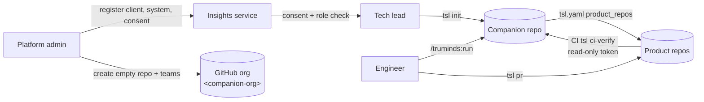
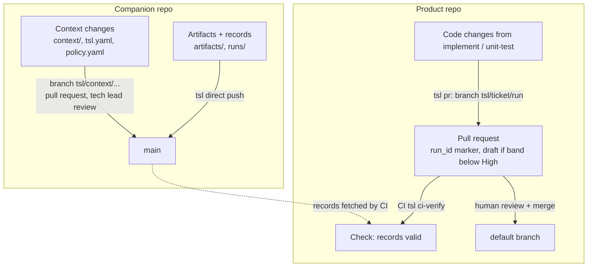
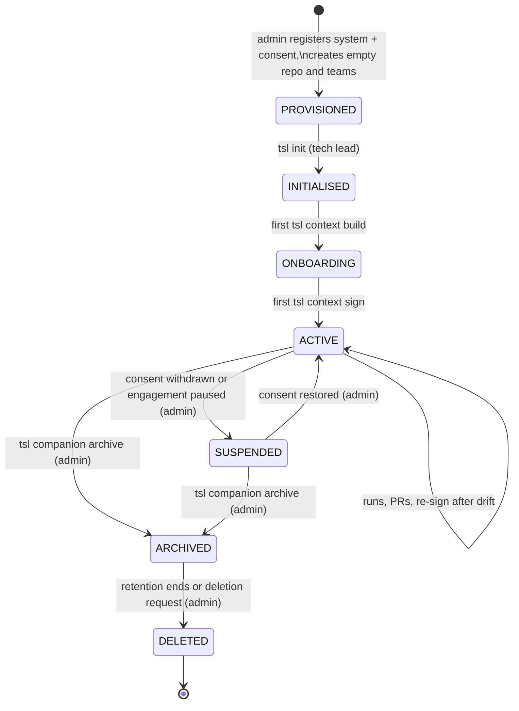

# SDD-12 · Companion Repo Lifecycle

| Field | Value |
| --- | --- |
| Status | Draft for owner review |
| Owner | TBD by Puneet |
| Approver | Puneet Singh Nanda |
| Related docs | [Doc 3 Architecture](../architecture/03-architecture.md) §2, §3, §4, §8 · [Doc 5 API and Rules](../architecture/05-api-and-rules.md) §2.2, §3, §6 · [Doc 2 Personas and Stories](../product/02-personas-and-stories.md) §2 · [SDD-02 Workflow orchestration](SDD-02-workflow-orchestration.md) · [SDD-04 `tsl` CLI](SDD-04-tsl-cli.md) · [SDD-05 Claude Code integration](SDD-05-claude-code-integration.md) · [SDD-06 Context pack](SDD-06-context-pack.md) · [SDD-07 Identity and signing](SDD-07-identity-signing.md) · [SDD-13 Onboarding and admin](SDD-13-onboarding-admin.md) · [LEG-01 Consent template](../legal/LEG-01-client-consent-template.md) · [Readiness tracker](../planning/readiness-tracker.md) Q22 (F14) |

## 1. Scope

### 1.1 What this document decides

There is one companion repo per client system (D-13). It is Truminds-owned and holds the knowledge plane: the context pack, run state, artifacts and check records. The product repo only receives code changes by pull request. This document decides:

- the companion repo layout;
- how a companion repo is created (`tsl init`), how it is named, and the GitHub org placeholder (OQ-10);
- the branching and pull request flow for artifacts and context, versus product code changes (`tsl pr`);
- how the companion repo relates to product repos (`product_repos` in `tsl.yaml`);
- retention and archiving;
- access control;
- the client consent prerequisites (LEG-01);
- what must never go in a companion repo;
- the lifecycle states of a companion repo.

### 1.2 What it does not decide

| Topic | Where |
| --- | --- |
| What the pack contains and how it is built and signed | [SDD-06](SDD-06-context-pack.md) |
| Step order, retries, which artifact feeds which step | [SDD-02](SDD-02-workflow-orchestration.md) |
| Every `tsl` flag and edge case | [SDD-04](SDD-04-tsl-cli.md) |
| Admin screens for clients, systems and consent | [SDD-13](SDD-13-onboarding-admin.md), [SDD-09](SDD-09-web-portal.md) |
| Consent wording | [LEG-01](../legal/LEG-01-client-consent-template.md) (Legal) |
| Repos for Truminds' own code (skill library, insights service, portal) | [DEV-01](../development/DEV-01-developer-guide.md) |

## 2. Context and dependencies



| Depends on | For |
| --- | --- |
| Insights service (SDD-08) | Role grants (`GET /v1/me`), system registration and consent status (`GET /v1/systems/{code}`, new, §5.3) |
| GitHub | Hosting, teams, branch protection, CODEOWNERS |
| `tsl` (SDD-04) | All writes to `runs/`, `artifacts/`, `context/manifest.json` and signatures |
| SDD-07 | Keys that sign records, approvals and the pack |

### 2.1 Ground rules

- Only `tsl` commits run data. Claude writes artifact and run files on disk; `tsl` stages, commits and pushes them.
- Every run writes only inside its own folders, so two engineers on different tickets never touch the same file (Doc 3 §3).
- Nothing in a companion repo is ever force-pushed or rewritten. Signed records are append-only (R-03).
- No client name appears anywhere: repo name, `tsl.yaml`, commit messages or branch names use codes only (C-09).

## 3. Layout

### 3.1 Folder tree

```text
<client-code>-<system-code>-companion/
├─ tsl.yaml                          # tsl-config.v1: system codes, product_repos, limits, gates
├─ policy.yaml                       # policy.v2 additions for this system (may only add denies, SDD-05 §6.4)
├─ CODEOWNERS                        # tech leads own tsl.yaml, policy.yaml, context/
├─ .gitignore                        # from template; includes .tsl/
├─ .gitattributes                    # text=auto eol=lf (stable hashes, Doc 5 §1.1)
├─ .github/workflows/
│  └─ tsl-companion-check.yml        # runs tsl companion check on push and pull_request (§6.4)
├─ .tsl/                             # never committed
│  └─ local.yaml                     # this laptop's clone paths for each product repo
├─ context/                          # SDD-06
│  ├─ manifest.json
│  ├─ pack.signature.json
│  ├─ system-baseline.md  architecture.md  data-model.md
│  ├─ glossary.md  conventions.md  test-strategy.md  intent-baseline.md
│  └─ generated/*.json
├─ artifacts/
│  └─ <ticket>/<run_id>/
│     ├─ <step>.md                   # artifact with YAML envelope (Doc 5 §3.6)
│     ├─ <step>.checks.json          # checks.v1 (latest attempt)
│     ├─ <step>.review.json          # review.v1
│     ├─ <step>.verification.json    # verification.v1, signed
│     └─ history/<step>/a<N>/        # earlier attempts, moved by tsl verify, never edited (SDD-03 §2.1)
└─ runs/
   ├─ active/
   │  └─ <ticket>__<workflow>.lock   # run-lock.v1: run_id, holder, key_id, heartbeat. The mutual-exclusion key (§3.3)
   └─ <run_id>/
      ├─ state.json                  # run-state.v1
      ├─ workflow.snapshot.yaml      # SDD-02 §3.1
      ├─ open-questions.md           # open-questions.v1, when NEEDS-INPUT happened
      ├─ approvals.md                # approvals.v1, when a gate or ESCALATE happened
      ├─ feedback/<step>.a<N>.json   # feedback.v1 (SDD-02 §8.2)
      └─ tool-log.jsonl              # tool-log.v1 (SDD-03 §2.1)
```

### 3.2 Who writes what

| Path | Written by | How it reaches `main` | Review |
| --- | --- | --- | --- |
| `tsl.yaml`, `policy.yaml`, `CODEOWNERS` | Tech lead | Pull request | Another tech lead of the system (CODEOWNERS) |
| `context/**` except signature | `tsl context build`, `/truminds:context-draft`, tech lead edits | Pull request on branch `tsl/context/<short-sha>` | Tech lead (CODEOWNERS) |
| `context/pack.signature.json` | `tsl context sign` only | Inside the same context pull request, as its last commit | — (it is the signature) |
| `artifacts/<ticket>/<run_id>/**` | Claude during a run (allowed by `policy.yaml` write scope); committed by `tsl` | Direct push by `tsl` | None at this point. Each artifact has a signed record; humans review through the product PR |
| `runs/<run_id>/state.json`, `artifacts/<ticket>/<run_id>/*.checks.json`, `*.review.json`, `*.verification.json`, `history/**` | `tsl` only | Direct push by `tsl` | Records are signed |
| `runs/<run_id>/open-questions.md` answers | Engineer, or anyone with write access (OQ-14) | Direct commit; `tsl state resume` checks answers | Named decider in the file (US-04) |
| `runs/<run_id>/approvals.md` signature blocks | `tsl approve` | Direct push by `tsl` | Signed by the approver |
| `runs/active/*.lock` | `tsl state start`, removed at COMPLETED or by `tsl state unlock` | Direct push by `tsl` | — |
| `.github/workflows/**` | Platform admin | Pull request | Admin (CODEOWNERS) |

### 3.3 Locks

**Registry decision** ([registry](../architecture/registry.md) §10, row 9): there is one lock file per ticket and workflow, `runs/active/<ticket>__<workflow>.lock`, holding `run-lock.v1` (Doc 5 §3.5, SDD-02 §11.1). An earlier draft of this document split it into a `.claim` file plus `runs/<run_id>/lock`. That split is not needed: the lock's path is fixed per ticket and workflow, so a second laptop's `git push` of the same path fails, which is the multi-laptop guarantee. The heartbeat lives in the same file. SDD-02 owns the protocol; this section keeps the push loop it uses.

Lock algorithm in `tsl state start`:

```python
def take_lock(repo, ticket, workflow, run_id):
    lock = f"runs/active/{safe(ticket)}__{workflow}.lock"
    git_fetch(repo); git_rebase_onto_origin_main(repo)       # offline: E-LOCK-03, exit 10
    if exists_at("origin/main", lock):
        raise LockHeld(read_at("origin/main", lock))          # E-LOCK-01
    write(lock, lock_body(run_id)); write(f"runs/{run_id}/state.json", state())
    git_commit([lock, f"runs/{run_id}/"], f"tsl({run_id}): start {workflow} {ticket}")
    for attempt in range(3):
        if git_push(repo, "main"): return
        git_fetch(repo)
        if exists_at("origin/main", lock):                    # someone else won the race
            git_reset_soft_drop_last_commit(repo); raise LockHeld(read_at("origin/main", lock))
        git_rebase_onto_origin_main(repo)                     # unrelated paths: always clean
    raise NetworkError("E-LOCK-04")                           # push still rejected with the network up
```

Ticket ids are made path-safe by `safe()`: upper-case letters, digits and `-` are kept; anything else becomes `_`. A run that cannot reach the remote cannot start (L-08) but can continue.

### 3.4 Commit protocol for `tsl`

| Rule | Detail |
| --- | --- |
| Message format | `tsl(<run_id>): <action> <step?>` for run data; `tsl: <action>` for context. No client names, no ticket titles |
| When | After each `tsl` action that changes run data: `state start`, `decide`, `approve`, `state resume`, `pr`, run end |
| Push | Fast-forward to `main`. On rejection: fetch, rebase (paths never overlap between runs), retry up to 3 times. Still failing: keep the commit locally, state shows `unpushed: true`, the next `tsl` call retries; the run continues |
| Never | Force push, history rewrite, edits to another run's folder, edits to `context/` from a run |
| Author | The engineer's git identity; `tsl` adds a `Tsl-Run: <run_id>` trailer for tracing |

## 4. Relationship to product repos

### 4.1 `product_repos` in `tsl.yaml`

This extends Doc 5 §3.1 (`tsl-config.v1`). New fields are marked.

```yaml
schema: tsl-config.v1
system: {code: SYS-SMP, project: PRJ-SMP, client: CL-INT}
companion: {org: <companion-org>, name: cl-int-sys-smp-companion}       # new
product_repos:
  - name: sample-system                 # short name used in citations: sample-system:api/src/...
    url: git@github.com:<client-or-truminds-org>/sample-system.git
    default_branch: main                # new; SDD-06 freshness and tsl pr base
    path: .                             # scope inside the repo (monorepo sub-path)
    verifier_profile: node-20@1
    pr: {branch_prefix: tsl, draft_below: High, labels: [tsl]}         # new
read_only_repos: []
gates: {self_approval: false, lock_timeout_hours: 24}
```

| Rule | Detail |
| --- | --- |
| Names | `name` is unique in the file, `[a-z0-9-]{1,40}`, and is the prefix in every citation |
| Scope | A run edits only `product_repos` paths (Doc 3 §3.1, H5). Writes elsewhere are blocked by the pre-tool hook (E-POL-01) |
| Local clones | `.tsl/local.yaml` maps each `name` to a clone path on this laptop. `tsl init` and `tsl doctor` write it. It is git-ignored because paths differ per laptop |
| Adding a repo | Pull request on `tsl.yaml`, then `tsl context build` and re-sign (the pack is stale until then) |
| Removing a repo | Pull request on `tsl.yaml`; existing records stay; new runs cannot target it |

```yaml
# .tsl/local.yaml (not committed)
schema: tsl-local.v1
product_repos:
  sample-system: /Users/eng-4f2a/src/sample-system
```

### 4.2 Pull request flow: artifacts versus product code



| Change type | Branch | Review | Merge |
| --- | --- | --- | --- |
| Artifacts, run state, records | None (direct to companion `main` by `tsl`) | Through the product PR; records are signed and re-checked by CI | Not applicable |
| Context pack, `tsl.yaml`, `policy.yaml` | `tsl/context/<short-sha>` or `tsl/config/<short-sha>` in the companion repo | Tech lead (CODEOWNERS) | Tech lead, by hand |
| Product code | `tsl/<ticket>/<run_id last 8>` in each changed product repo | Product repo owners and the PR checklist (Doc 4 §4.1) | Always a human (C-14). No tool may merge (`merge_and_deploy: never`) |
| Read-only workflows (`estimate`, `ux-review`) | None | Through artifacts and approvals | — |

`tsl pr <run_id> [--draft]` per product repo with changes:

1. Checks every step of the run has a verification record that ends in PASS or PASS-WITH-FINDINGS, or an approved ESCALATE (else exit 3, E-RUN-05, SDD-04 §6.12), and that every record is pushed to the companion repo (else exit 3, E-PR-01, new).
2. Creates the branch from `origin/<default_branch>` in the local clone, commits the run's changes with the `Tsl-Run` trailer, and pushes the branch. `tsl` is exempt from the Bash network deny (Doc 5 §4.3).
3. Opens the PR with the Doc 4 §4.1 body and the `<!-- tsl:run_id=... -->` marker. Draft when the lowest band in the run is below `pr.draft_below`.
4. Records the PR number and URL in `runs/<run_id>/state.json` (`prs[]`), pushes the companion repo, and sends `pr.opened`.

A multi-repo run opens one PR per changed repo; all carry the same run id and link to the same `artifacts/<ticket>/<run_id>/` folder (Doc 3 §3.1).

Opening a PR on a client-owned product repo is a write to a client system. It happens only under the client consent (§7) and the autonomy table (Doc 3 §5.5). If a client's consent does not cover opening PRs, `tsl pr` stops with E-CONS-02 (new) and prints the patch path for a person to submit.

## 5. Creation

### 5.1 Naming and the org placeholder

| Item | Rule | Example |
| --- | --- | --- |
| Repo name | `<client-code>-<system-code>-companion`, lower-case | `cl-int-sys-smp-companion` |
| Org | `<companion-org>` until OQ-10 decides between a Truminds org and the client's org | `<companion-org>/cl-int-sys-smp-companion` |
| Visibility | Private (or internal, if the org policy prefers). Never public | — |
| Template | `truminds-companion-template` (tracker Q22) | — |
| GitHub teams | `tsl-<client-code>-<system-code>-engineers`, `tsl-<client-code>-<system-code>-leads` | `tsl-cl-int-sys-smp-leads` |

System codes must be unique within a client so the repo name is unique. The current DDL (`system.code`) does not enforce that; SDD-08 adds `UNIQUE (project_id, code)` plus a check across the client (§12).

The Doc 2 §2 example `truminds/acme-orders-service-tsl` uses a client name. It conflicts with C-09 and is replaced by the code-only rule above.

### 5.2 Sequence

```mermaid
sequenceDiagram
  autonumber
  actor A as Platform admin
  actor TL as Tech lead
  participant S as Insights service
  participant G as GitHub
  participant T as tsl
  A->>S: register client (consent_ref), project, system (portal admin, SDD-13)
  A->>G: create empty private repo from naming rule; create teams; set branch protection
  A->>S: record companion repo name on the system; grant tech_lead to TL
  TL->>T: tsl init --system SYS-SMP --product-repo sample-system=<url>
  T->>S: GET /v1/systems/SYS-SMP (consent, state, repo name) + GET /v1/me (role)
  alt no consent / wrong role / repo not registered
    T-->>TL: E-CONS-01 / E-AUTH-04 / E-INIT-01, exit 3, nothing written
  else ok
    T->>G: clone empty repo
    T->>T: copy template, write tsl.yaml, .tsl/local.yaml, CODEOWNERS, CI workflow
    T->>G: initial commit to main (only commit allowed without PR)
    T-->>S: companion.lifecycle (PROVISIONED → INITIALISED)
    T-->>TL: Next: tsl context build
  end
```

### 5.3 `tsl init`

| Item | Value |
| --- | --- |
| Signature | `tsl init --system <code> --product-repo <name>=<url>[,path=<p>][,branch=<b>][,verifier=<profile>] ... [--clone-dir <dir>] [--json]` |
| Who | `tech_lead` on the system |
| Pre-conditions | System registered; consent recorded (§7); companion repo name recorded on the system; the remote repo exists and is empty |
| Writes | The template files, `tsl.yaml` with the product repos, `.tsl/local.yaml`, CODEOWNERS with the two team names |
| Exit codes | 0 · 3 (E-CONS-01, E-AUTH-04 not a tech lead, E-INIT-01 repo not registered, E-INIT-02 remote repo not empty) · 10 (network, login) |
| Does not | Create the GitHub repo or teams (admin task, needs org rights a tech lead should not hold), build the context pack, or touch the product repo |

`GET /v1/systems/{code}` (new, owned by SDD-08) returns:

```json
{"code": "SYS-SMP", "project": "PRJ-SMP", "client": "CL-INT",
 "companion_repo": "<companion-org>/cl-int-sys-smp-companion",
 "lifecycle_state": "PROVISIONED",
 "consent": {"recorded": true, "scope": ["code_processing", "companion_storage", "product_prs", "ci_webhook"], "ref": "CONSENT-0007"}}
```

The response holds codes only. `tsl` caches it for 24 hours for offline use (Doc 2 §2).

## 6. Access control

### 6.1 Who gets what

| Role (Doc 2) | GitHub access to the companion repo | Notes |
| --- | --- | --- |
| `engineer` on the system | Write, through the `-engineers` team | Can push run data; cannot merge to protected paths without tech lead review |
| `tech_lead` on the system | Maintain, through the `-leads` team; CODEOWNER of `tsl.yaml`, `policy.yaml`, `context/` | Signs the pack; approves gates |
| `admin` | Admin | Creates repo and teams; owns `.github/workflows/` |
| `viewer`, `skill_owner`, `stage_approver`, `eng_lead` | None | They see metadata in the portal, never repo content |
| Product repo CI | Read-only token (`TSL_COMPANION_READ_TOKEN`, Doc 5 §6.2) scoped to this one repo | A GitHub App installation token or fine-grained token; the choice is in OPS-01 |
| Client people | None by default | OQ-14 decides whether a client product owner may answer open questions directly |

Team membership is driven by role grants: when an admin grants or revokes `engineer` or `tech_lead` on a system, the same change is made to the GitHub team. Automating that sync is an SDD-13 item; until then it is a manual admin checklist step.

### 6.2 Repository settings

| Setting | Value |
| --- | --- |
| Forking | Disabled |
| Default branch | `main`, protected: no force push, no deletion |
| Pull request required for | `tsl.yaml`, `policy.yaml`, `CODEOWNERS`, `context/**`, `.github/**` (with CODEOWNERS review) |
| Direct push allowed for | `runs/**`, `artifacts/**`, by the `-engineers` and `-leads` teams |
| Secret scanning and push protection | On, where the org plan allows |
| Actions | Only `tsl-companion-check` and the org's allowed actions |

Whether GitHub can require a pull request for some paths while allowing direct pushes for others on the same branch is **not verified** here. Spike CR-01 (§10) checks it. Fallback if it cannot: direct pushes stay allowed on `main`, and `tsl companion check` (§6.4) fails any push that changes a protected path without a merged, approved pull request, and sends `companion.policy_violation` so the tech lead sees it on the portal Health tab.

### 6.3 Encryption and laptops

| Place | Control |
| --- | --- |
| GitHub | Relies on GitHub's storage encryption at rest; to be confirmed by the security reviewer in SEC-01 |
| Laptop clones | Full-disk encryption required by IT; `tsl doctor` warns when it cannot confirm it (SDD-13) |
| Signing keys | Never in the repo; OS keychain only (R-06) |

### 6.4 Companion CI: `tsl companion check`

Runs in `.github/workflows/tsl-companion-check.yml` on every push and pull request. No LLM (D-11).

| Check | Fails when |
| --- | --- |
| Schemas | Any file with a `schema:` key fails its JSON Schema |
| Path ownership | A direct push changed a path in the PR-required list (§6.2) |
| Run isolation | One commit changes files in more than one `runs/<run_id>/` or `artifacts/<ticket>/<run_id>/` folder (except `runs/active/`) |
| Append-only records | A `*.checks.json`, `*.review.json` or `*.verification.json` file, or anything under `artifacts/*/*/history/`, was modified or deleted after it was first committed (a move into `history/` by `tsl verify` is allowed) |
| Forbidden content | Secret, PII or deny-term detectors (SDD-06 §9) hit any file; excluded file patterns (SDD-06 §9.1) are present |
| Size | Any file over 5 MB, or the repo over the archive threshold (§8) |
| Pack state | Informational only: prints `tsl context status` |

Exit 0 pass, 2 fail with codes E-COMP-01 (schema), E-COMP-02 (path ownership), E-COMP-03 (records changed), E-COMP-04 (forbidden content), E-COMP-05 (size). All new.

## 7. Client consent prerequisites (LEG-01)

No companion repo is created, initialised or used for a client system without written consent recorded by an admin (C-04, FR-ADM-03, R-16). Truminds-internal systems record an internal authorisation reference in the same field, so the check is the same for every system.

| Consent scope item | Needed for | Checked by | Error if missing |
| --- | --- | --- | --- |
| `code_processing`: client code processed by Claude on company seats | Any run, `tsl context build` | `tsl state start`, `tsl context build`, `tsl init` | E-CONS-01 |
| `companion_storage`: artifacts, records and the context pack about the client's system stored in a Truminds-owned repo (or the client's org, per OQ-10) | `tsl init`, every push of run data | `tsl init`, `tsl state start` | E-CONS-01 |
| `product_prs`: opening branches and PRs on client product repos | `tsl pr` | `tsl pr` | E-CONS-02 (new) |
| `ci_webhook`: CI action and webhook on client repos (A-05) | `tsl-ci-verify` install, webhook | Admin checklist (SDD-13); webhook receiver ignores repos without it (Doc 5 §6.1) | — |
| Retention period and return or deletion at the end | Archiving (§8) | Admin, at archive time | — |

Consent wording is for Legal to write (OQ-06). The scope names above are the machine-readable keys the insights service stores against `client.consent_ref`; LEG-01 should map each clause to one key.

**Withdrawal.** When an admin records consent withdrawal, the system moves to SUSPENDED (§9). `tsl` refuses new runs, resumes, context builds and PRs with E-CONS-01. Existing data is then handled under §8.

## 8. Retention and archiving

### 8.1 Rules

| Data | Kept for | Source |
| --- | --- | --- |
| Verification records, approvals, pack signatures | Life of the engagement, then per contract | NFR-16 |
| Artifacts, run state, open questions | Same as records (they are what records point to) | NFR-16 |
| After engagement end | Contract-stated period; if the contract is silent, open (new OQ, §13) | — |

### 8.2 Archive procedure

`tsl companion archive [--reason <code>] [--json]`, run by an admin from a clean clone.

1. Refuses if any run is RUNNING or PAUSED (E-COMP-06, new), unless `--abandon-runs`, which marks each `COMPLETED` with `end_reason: archived` and removes their lock files.
2. Runs `tsl companion check` and refuses if it fails.
3. Writes `ARCHIVE.json` (`companion-archive.v1`): system code, last commit SHA, count of runs and records, a SHA-256 over the sorted list of all record file hashes, `archived_by`, signed by the admin's key (SDD-07).
4. Commits and pushes it, tags `archive/final`, then archives the GitHub repo (read-only).
5. Sends `companion.lifecycle` (ACTIVE or SUSPENDED → ARCHIVED). The insights service updates `systems.lifecycle_state`.

### 8.3 Deletion or return

At the end of the retention period, or on a valid deletion request:

| Step | Who |
| --- | --- |
| Optional: hand the client a bundle (`git bundle` of the repo plus `ARCHIVE.json`) | Admin, if the contract asks for return |
| Delete the GitHub repo | Admin |
| Remove local clones: `tsl doctor` lists clones of systems in ARCHIVED or DELETED state, and engineers are told to delete them | Engineers; confirmed by the system's tech lead |
| Set `systems.lifecycle_state = DELETED`; keep metadata rows (runs, steps, verification hashes) per OQ-08 retention, without content | Admin, in the portal |

Telemetry and the insights database never held content (NFR-10), so deleting the repo removes all client-derived content Truminds holds, apart from laptop clones.

## 9. Lifecycle

### 9.1 States



| State | Runs | Context build and sign | `tsl pr` | Who moves it on | Recorded in |
| --- | --- | --- | --- | --- | --- |
| PROVISIONED | No | No | No | Tech lead (`tsl init`) | `systems.lifecycle_state` |
| INITIALISED | No | Yes | No | First `tsl context build` | Same |
| ONBOARDING | Greenfield only | Yes | Greenfield only | First `tsl context sign` | Same |
| ACTIVE | Yes (stale pack caps band, SDD-06) | Yes | Yes | Admin | Same |
| SUSPENDED | No (E-CONS-01) | No | No | Admin | Same |
| ARCHIVED | No (E-COMP-07, new) | No | No | Admin | Same, plus `ARCHIVE.json` |
| DELETED | — | — | — | — | Metadata row only |

`tsl` reads the state from `GET /v1/systems/{code}` (cached 24 hours). Transitions done by `tsl` send `companion.lifecycle` with `{system, from, to, reason_code}`; transitions done by an admin are written by the portal directly.

## 10. What never goes in a companion repo

| Never | Why | Enforced by |
| --- | --- | --- |
| Secrets: passwords, tokens, API keys, private keys, connection strings with credentials, `.env` files | Org rule; C-06 | Managed deny rules on read (SDD-05 §6.2); H4 on artifacts; SDD-06 §9; `tsl companion check`; GitHub push protection |
| Signing private keys or `tsl login` tokens | R-06 | Keys live in the OS keychain; `.gitignore` template |
| Customer or end-user data: rows, dumps, exports, production logs, screenshots with data | C-09, privacy | Excluded file patterns; PII detector; H4 |
| Copies of client source files | The product repo is the only home of client code (D-13) | Artifacts cite `repo:path#Lnn`; `tsl companion check` flags artifacts whose code blocks exceed 40 lines (new soft rule) |
| Client names | C-09, X-13 | Codes in `tsl.yaml`, repo and team names; deny-term hashes |
| Prompts, chat transcripts, Claude session logs | NFR-10; they may hold anything the model read | Not written by `tsl`; `.gitignore` covers `~/.truminds` exports |
| Build outputs, binaries, `node_modules`, verifier container images | Size and supply chain | `.gitignore` template; 5 MB file limit |
| Personal data beyond what the process needs | DPDP, GDPR | Pseudonyms in records; only the `Answered by` name and email that US-04 requires, under consent |

## 11. Error handling, security and tests

### 11.1 Error codes

| Code | Exit | Message | Next action |
| --- | --- | --- | --- |
| E-CONS-01 | 3 | No client consent recorded for `<client code>` (or the scope lacks `<scope>`). | Admin records consent in the portal |
| E-CONS-02 (new) | 3 | Consent for `<client code>` does not cover opening PRs on product repos. | Submit the patch at `<path>` by hand, or extend consent |
| E-INIT-01 (new) | 3 | System `<code>` has no companion repo registered. | Admin registers it (SDD-13) |
| E-INIT-02 (new) | 3 | Companion repo `<name>` is not empty. | Use the existing repo, or ask the admin |
| E-LOCK-01 | 3 | `<ticket>` / `<workflow>` is locked by `<user>` in `<run_id>`. | Resume if yours; else ask a tech lead to release |
| E-LOCK-04 (new; registry §2) | 10 | Could not push the run lock to the companion repo after 3 retries. | Check write access (`-engineers` team, §6.1); retry |
| E-PR-01 (new) | 3 | Run `<run_id>` has records that are not pushed to the companion repo. | Reconnect; the next `tsl` call pushes them |
| E-COMP-01 to 05 (new) | 2 | Companion check failed (§6.4). | Fix the listed files |
| E-COMP-06 (new) | 3 | Cannot archive: `<n>` runs are not completed. | Finish them or use `--abandon-runs` |
| E-COMP-07 (new) | 3 | System `<code>` is archived. | None; read-only |

### 11.2 Security

| Threat | Control | Residual |
| --- | --- | --- |
| Someone edits another run's records to fake a pass (TM-04) | Append-only check; records signed; CI re-runs code checks | Reviewer result not re-run (L-04) |
| Unreviewed change to `policy.yaml` loosens rules | PR required plus CODEOWNERS; `tsl validate` refuses removed denies (SDD-05 §6.4) | Path-level protection unverified (spike CR-01) |
| Repo exposed to the wrong people | Private, no forks, team per system, role-driven membership | Manual team sync until SDD-13 automates it |
| Client data stored in the repo | §10 controls | Pattern detectors miss some data (SDD-06 §9.5) |
| Companion repo read token leaked from product CI | Read-only, single repo; rotated per OPS-01 | Read exposure of artifacts |

### 11.3 Spikes

| Spike | Proves | Pass condition | Fallback |
| --- | --- | --- | --- |
| CR-01 | GitHub can require PRs for some paths while allowing direct pushes to others on `main` | A direct push to `context/x.md` is refused and a push to `runs/x` is accepted | `tsl companion check` detects and alerts (§6.2) |
| CR-02 | Lock race: two laptops start the same ticket at once | Exactly one succeeds; the other gets E-LOCK-01 | — (design bug if it fails) |
| CR-03 | 20 parallel runs pushing to one companion repo | All pushes land within 3 retries | Raise retries; batch commits per step |

### 11.4 Test plan

| Layer | Test | Pass condition |
| --- | --- | --- |
| Unit | `safe()` ticket paths, naming rule, `tsl-config.v1` additions | Fixtures pass and fail as expected |
| Integration | `tsl init` against a local bare repo with a stubbed insights service | Each pre-condition failure gives its code and writes nothing |
| Integration | Claim algorithm with two clones of one bare repo | CR-02 result |
| Integration | `tsl pr` on the sample system to a test GitHub repo | Branch name, PR body, marker, draft rule, `prs[]` in state |
| Integration | `tsl companion check` | One fixture per E-COMP code |
| Integration | Archive | `ARCHIVE.json` verifies; repo read-only; `tsl state start` gives E-COMP-07 |
| End to end | Full lifecycle on the sample system, PROVISIONED to ARCHIVED | Every state reached; events received |

## 12. Changes this document makes to other documents

| Document | Change |
| --- | --- |
| Doc 3 §3 | Layout per §3.1: records stay next to the artifact; one lock file `runs/active/<ticket>__<workflow>.lock`; add `policy.yaml`, `CODEOWNERS`, `.tsl/` |
| Doc 5 §2.2 | Add `tsl init`, `tsl companion check`, `tsl companion archive`; `tsl pr` gains E-PR-01 and E-CONS-02 |
| Doc 5 §3.1 | `tsl-config.v1` additions: `companion`, `default_branch`, `pr` per product repo |
| Doc 5 §3.4 | `state.json` gains `prs[]` and `unpushed` |
| Doc 5 §3.5 | Push loop and E-LOCK-04 (§3.3) |
| Doc 5 §5.1, §5.3 | New endpoint `GET /v1/systems/{code}`; new events `companion.lifecycle`, `companion.policy_violation` |
| Doc 3 §9.1 / SDD-08 §10.2 | `systems` gains `lifecycle_state`, `archived_at`; uniqueness of system code within a client; `clients` gains `consent_scope` (done in SDD-08 §10.2) |
| Doc 2 §2 | Replace the `truminds/acme-orders-service-tsl` example with the code-only naming rule |
| Doc 4 §5.2 | Add E-CONS-02, E-INIT-01/02, E-LOCK-04, E-PR-01, E-COMP-01 to 07 |
| SDD-02, SDD-04 | Own the lock algorithm and commit protocol implementation |
| SDD-13 | Admin steps: register system, create repo and teams, record consent scope, team sync |
| LEG-01 | Map consent clauses to the scope keys in §7 |

## 13. Done criteria

- `truminds-companion-template` exists with the §3.1 files, `.gitignore`, `.gitattributes`, CODEOWNERS template and the CI workflow.
- `tsl init`, `tsl companion check`, `tsl companion archive` and the lock algorithm are implemented with the tests in §11.4.
- Spikes CR-01 to CR-03 are recorded, and the CR-01 fallback is built if needed.
- `GET /v1/systems/{code}` and the `companion.lifecycle` event are in SDD-08's OpenAPI and event schemas.
- The full lifecycle runs on the sample system in a test org.
- §12 changes are applied after the owner validates this document.

## 14. Open items

| Item | Ref | Owner |
| --- | --- | --- |
| Owner and validator of this document | new | TBD by Puneet |
| Which GitHub org hosts companion repos (Truminds or client); `<companion-org>` stays a placeholder until then | OQ-10 | Puneet |
| May client people answer open questions directly in the companion repo? | OQ-14 | Puneet |
| Consent wording and scope keys | OQ-06, LEG-01 | Legal, TBD by Puneet |
| Retention after engagement end when the contract is silent | new | Puneet, with Legal |
| CI read token: GitHub App or fine-grained token | new | OPS-01 owner, TBD by Puneet |
| Automated sync of role grants to GitHub teams | new | SDD-13 owner, TBD by Puneet |
| Confirm GitHub encryption at rest meets the org rule | new | Security reviewer TBD by Puneet |
| Closed: one lock file, no claim file (registry §10, row 9) | new | Abhishek Verma, Ekjot Singh; Japman Singh, Yash Khorwal |
