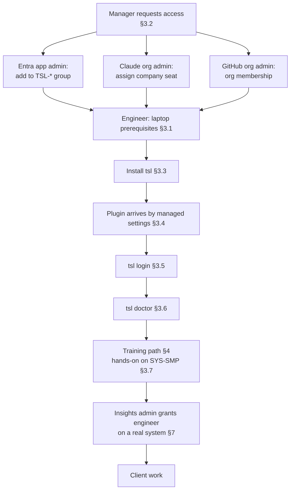
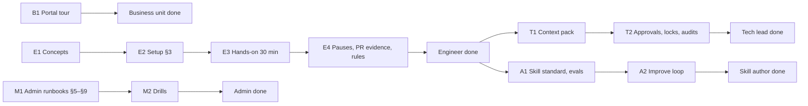
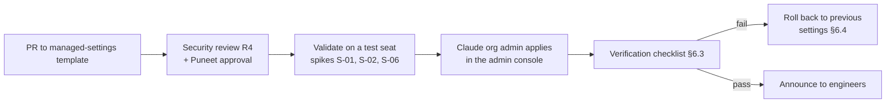
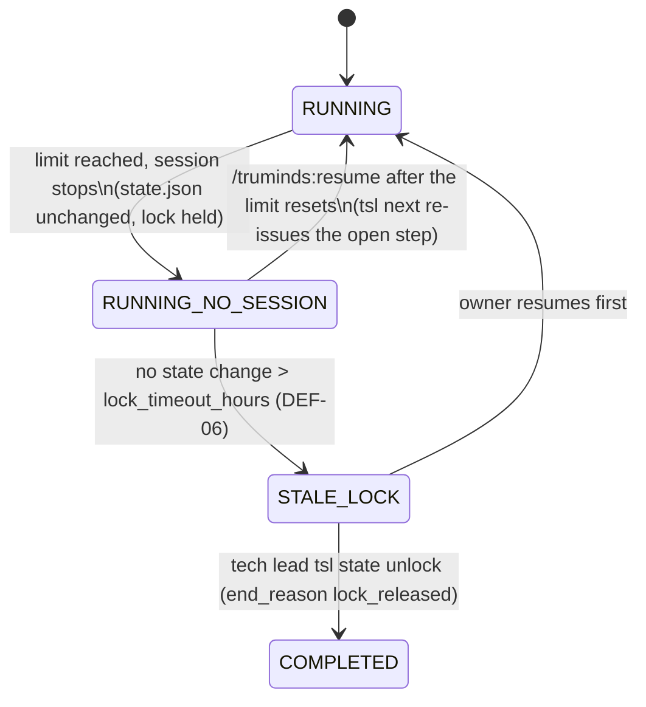
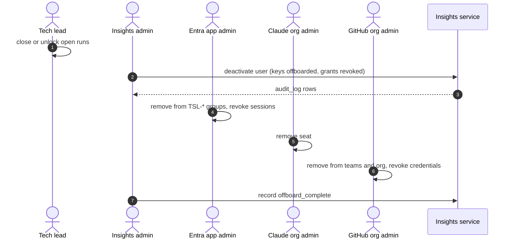

# SDD-13 · Onboarding and administration

| Field | Value |
| --- | --- |
| Status | Draft for owner review |
| Owner | TBD by Puneet |
| Approver | Puneet Singh Nanda |
| Related docs | [Doc 2 Personas](../product/02-personas-and-stories.md) §1, §2, US-18 · [Doc 4 Design and UX](../ux/04-design-and-ux.md) §2 · [Doc 6 Constraints](../product/06-constraints.md) C-03, C-16 to C-18 · [SDD-04 `tsl` CLI](SDD-04-tsl-cli.md) §6.1–§6.3 · [SDD-05 Claude Code integration](SDD-05-claude-code-integration.md) §6, §7 · [SDD-07 Identity and signing](SDD-07-identity-signing.md) · [SDD-08 Telemetry and insights](SDD-08-telemetry-insights.md) · [SDD-12 Companion repo](SDD-12-companion-repo.md) §5, §6 · [SEC-01 Threat model](../security/SEC-01-threat-model.md) · [LEG-01 Consent template](../legal/LEG-01-client-consent-template.md) · [TST-01 Test plan](../testing/TST-01-master-test-plan.md) §4 · [Readiness tracker](../planning/readiness-tracker.md) Q30, Q34, Q38 (F13) |

## 1. Scope

### 1.1 What this document decides

- Engineer onboarding: prerequisites, access requests, installing `tsl` with `uv tool install`, `tsl login`, `tsl doctor`, and a first run on the sample system (tracker Q34).
- A training path for each persona, including the 30-minute hands-on session (Q34).
- The admin roles, what each one owns and what access it needs (Q30). People are not named: every owner is **TBD by Puneet**.
- The admin flows for clients, systems, consent and role grants (closes the SDD-08 open item on who creates them).
- How managed settings are rolled out and changed.
- Seat usage limits: what is known, what a run does when it hits one, and how we measure (Q38).
- Offboarding: key revocation, access removal, and the lost-laptop case.

### 1.2 What it does not decide

| Topic | Owner document |
| --- | --- |
| Managed settings content | [SDD-05](SDD-05-claude-code-integration.md) §6.2 |
| Login, keys, revocation semantics | [SDD-07](SDD-07-identity-signing.md) |
| Companion repo creation and archive | [SDD-12](SDD-12-companion-repo.md) |
| Admin screens and the read API | SDD-09 |
| Release and support process | OPS-03 |
| Consent wording | [LEG-01](../legal/LEG-01-client-consent-template.md) |

### 1.3 Ground rules

- Company Claude seats only (C-03). Runs only in **local** sessions of the desktop app or the CLI; never cloud sessions, the Cowork tab or WSL (C-16, C-17).
- No client names, client code or real personal data in training material. All hands-on work uses the Truminds-written sample system (ADR 0004, TST-01 §4).
- Access follows Doc 2 §2. Entra app roles are the ceiling; `role_grants` give scope (SDD-07 §3.3).
- Nothing here is a timeline. Steps are ordered; durations of training sessions are given in minutes.

## 2. Overview



| Who | Uses | Gets access through |
| --- | --- | --- |
| Engineers (P-01 to P-08) | Desktop app + plugin + `tsl`; portal Engineer view | `TSL-Engineers`, seat, GitHub team per system, `engineer@system` |
| Tech leads (P-10), engineering leads (P-12) | Same, plus pack signing, approvals | `TSL-TechLeads`, `tech_lead@system`, `eng_lead@project` |
| Skill authors and owners (P-11) | Plugin, skill-library repo | `TSL-Engineers`, `skill_owner@skill`, CODEOWNERS |
| Business unit (P-09, leadership, delivery managers) | Portal Business view only | `TSL-Business` |
| Admins (P-13 and the roles in §5) | Admin console, Entra, GitHub, portal admin view | Per §5 |

## 3. Engineer onboarding

### 3.1 Prerequisites

| # | Item | Check | Owner of the fix |
| --- | --- | --- | --- |
| P-01 | Company-managed laptop: macOS, or Windows used natively (not WSL) | IT asset record | IT |
| P-02 | Full-disk encryption on (FileVault, BitLocker) | `tsl doctor` warns E-ENV-07 when it cannot confirm (SEC-01 §9) | IT |
| P-03 | Company Entra account with MFA | Sign-in works | IT |
| P-04 | Member of `TSL-Engineers` (or `TSL-TechLeads`) | `tsl login` succeeds without E-AUTH-08 | Entra app admin |
| P-05 | Company Claude seat with Claude Code; signed in to the desktop app with the company account, never a personal one | Desktop app shows the org | Claude org admin |
| P-06 | GitHub account in the Truminds org, with org SSO if enabled; a git credential helper or SSH key that works for `git push` | `git ls-remote` on the training companion repo | GitHub org admin |
| P-07 | Python 3.12, `uv`, git ≥ 2.40, Docker running | `tsl doctor` checks `python`, `uv`, `git`, `docker` | Engineer, with IT for installs |
| P-08 | Docker Desktop licence where needed | IT licence list | TBD by Puneet (SDD-05 open item) |
| P-09 | Network path to the insights service (intranet or VPN) | `tsl doctor` check `service` | IT |

### 3.2 Access request

The engineer's manager (or delivery manager) raises one access request through the internal IT process. It lists:

| Access | Granted by | System |
| --- | --- | --- |
| Entra group `TSL-Engineers` (or `TSL-TechLeads`, `TSL-Business`) | Entra app admin | Entra |
| Claude seat | Claude org admin | claude.ai admin console |
| GitHub org membership; later, system teams | GitHub org admin | GitHub |
| `engineer@SYS-SMP` for training | Insights admin | Portal admin view |
| `engineer@<system>` for client work, after training | Insights admin, on the tech lead's request | Portal admin view + GitHub team (§7.3) |

No grant on a client system before the training evidence in §4.2 exists (proposal, OI-13-07).

### 3.3 Install `tsl`

The `tsl` wheel and `SHA256SUMS` are attached to the GitHub release `vX.Y.Z` of the skill-library repo (SDD-05 §7.1, SEC-01 §8.2). `X.Y.Z` is the plugin version that managed settings install. Download both files from the release page in the browser (the repo is private, so the browser's GitHub sign-in is used), then check the hash **before** installing.

macOS or Linux:

```sh
cd ~/Downloads
grep truminds_tsl-X.Y.Z-py3-none-any.whl SHA256SUMS
shasum -a 256 truminds_tsl-X.Y.Z-py3-none-any.whl       # must print the same hash
uv tool install --python 3.12 ./truminds_tsl-X.Y.Z-py3-none-any.whl
tsl --version                                             # tsl X.Y.Z
```

Windows (PowerShell, native):

```powershell
cd $HOME\Downloads
Select-String truminds_tsl-X.Y.Z-py3-none-any.whl .\SHA256SUMS
(Get-FileHash .\truminds_tsl-X.Y.Z-py3-none-any.whl -Algorithm SHA256).Hash.ToLower()
uv tool install --python 3.12 .\truminds_tsl-X.Y.Z-py3-none-any.whl
tsl --version
```

- Installing from a checked local file replaces the URL form in SDD-05 §7.1 for onboarding, because the hash is checked first (SEC-01 §8.2). Both give the same isolated tool environment.
- `uv` fetches Python 3.12 itself if it is missing.
- Upgrade: the same steps with the new version and `uv tool install --force`. The session-start hook prints the exact version needed (E-VER-01).
- If the hashes differ: stop, do not install, report to the release maintainer (§5.1).

### 3.4 Plugin

The `truminds` plugin is force-enabled by managed settings (SDD-05 §6). Engineers do **not** add the marketplace or install the plugin by hand. To check it:

1. Open the Claude Code desktop app, Code tab, and start a **Local** session in any folder.
2. Type `/truminds:status`. A reply from `tsl` (even "no runs") shows that the plugin, its skills and `tsl` are wired up.
3. If the session-start hook shows a message about `tsl` missing or the wrong version, repeat §3.3 with the version it names.

Doc 4's "Get started" screen still lists "add marketplace" and "install plugin" steps. Those are for plugin developers only (DEV-01) and must be replaced on the screen (OI-13-08).

### 3.5 `tsl login`

Run in a terminal (not through Claude): `tsl login`. It shows the app name and publisher, a code and a Microsoft URL (SDD-07 §4.1). Continue only if you just typed the command yourself. After sign-in:

```text
✔ Logged in as eng-4f2a                      [OK]
  Roles: Engineer · grants: engineer@SYS-SMP
  Signing key key_01J9... registered for this laptop (laptop-4f2a)
  Next:  tsl doctor
```

Failures: E-AUTH-08 (no app role: §3.2 not done), E-KEY-01 (no usable keychain: on Linux start GNOME Keyring or another Secret Service), E-NET-02 (service unreachable: check VPN).

### 3.6 `tsl doctor`

All checks of SDD-04 §6.3 must be `pass`; `warn` is allowed for `key` near expiry and `outbox`.

| Check | Common failure | Fix |
| --- | --- | --- |
| `python`, `uv`, `git` | Missing or too old | Install; rerun §3.3 |
| `docker` | Docker Desktop not running | Start it; `docker info` |
| `version` | `tsl` differs from the plugin | Install the version printed |
| `keychain` | Disallowed backend | See §3.5 |
| `login`, `key` | Token expired or key revoked | `tsl login` |
| `service` | No intranet route | VPN |
| Disk encryption (E-ENV-07) | Cannot confirm | IT confirms; warning only |

### 3.7 First run on the sample system

The training system is the sample Order Tracker (TST-01 §4) registered as client `CL-INT`, project `PRJ-SMP`, system `SYS-SMP`, with companion repo `<companion-org>/cl-int-sys-smp-companion` (SDD-12 §5.1) and a training copy of the product repo. The facilitator prepares it (§4.3).

```sh
git clone git@github.com:<companion-org>/cl-int-sys-smp-companion.git
cd cl-int-sys-smp-companion
tsl doctor                         # now also checks tsl.yaml and the pack ("repo")
```

Then, in a **Local** desktop session opened in that folder:

| Step | Do | Expect |
| --- | --- | --- |
| 1 | `/truminds:run estimate TRN-<nn>` (your seat number) | One step, `estimate-review`, ends PASS or PASS-WITH-FINDINGS; run COMPLETED; a signed `estimate.verification.json` |
| 2 | `/truminds:status` | The completed run and its band |
| 3 | `/truminds:run brownfield-change TRN-<nn>` | Steps up to `design`, then pause at `G-design` (PAUSED_APPROVAL) |
| 4 | Tech-lead trainee runs `tsl approve <run_id> G-design` | Signed block in `approvals.md` |
| 5 | `/truminds:resume <run_id>` | Continues; finishing to a PR is optional homework |

`TRN-<nn>` tickets are copies of sample tickets ABC-170 and ABC-142, one per trainee, so runs never collide on a lock (R-11). How a run reads a ticket from a file instead of Jira is not yet defined: SDD-02 reads `run.ticket` through the Jira MCP read tools (OI-13-05).

## 4. Training paths

### 4.1 Paths per persona



| Path | Modules | Format and length | Completion evidence |
| --- | --- | --- | --- |
| **Business unit** (P-09, leadership, delivery managers) | B1: portal Home (Business), capability map, Business impact, pods, what numbers mean; what never to show (client names, X-13); the "Get started" business steps (consent, LEG-01) | Live walkthrough, 30 min | Attendance |
| **Engineer** (P-01 to P-08) | E1: the seven objects (skill, workflow, pod, context pack, run, artifact, check record); harness order (code checks H1–H7, reviewer, citation check, `tsl decide`); signals S1–S6, bands, six outcomes. E2: §3. E3: §3.7 hands-on. E4: answering `open-questions.md`, `/truminds:resume`, reading the PR evidence and `tsl-ci-verify`; rules: company seat, local sessions only, no WSL, no external writes without a signed approval, what to do on a stale lock | E1 self-study 20 min (portal "How it works"); E2 30 min; E3 30 min live; E4 30 min | A signed check record on `SYS-SMP` made with the trainee's key (portal shows it) |
| **Tech lead** (P-10, P-12) | Engineer path, then T1: `tsl init`, `tsl context build`, reviewing AI drafts, `tsl context sign` (SDD-06); T2: `tsl approve`, self-approval rule, `tsl state unlock` and DEF-06, calibration audits (SDD-03 §16.3), reading verification records | T1 45 min, T2 30 min, live on `SYS-SMP` | A signed approval block and a re-signed training pack after a drift exercise |
| **Skill author / owner** (P-11) | Engineer path, then A1: SDD-01 standard, `skill-metadata.v1`, rubric, eval cases, `tsl validate`, `/truminds:eval`; A2: improvement report, `/truminds:improve` (eval case first, X-11), release via PR and CODEOWNERS | A1 60 min, A2 30 min | A signed eval result for an existing skill on the sample system |
| **Admins** (§5) | M1: this document §5 to §9 for their role, SDD-05 §6, SDD-07 §5.6, LEG-01 checklist. M2: drills: managed-settings verification on a test seat; key revocation for a lost laptop (tabletop, on a test user); offboarding of a test user | M1 self-study; M2 60 min | Drill record filed in the skill-library repo (no personal data) |

Note for skill authors: managed settings block sideloading, so authors cannot load unreleased skills (SDD-01 O-02). A1 therefore uses released skills until O-02 is decided.

### 4.2 Hands-on session (E3, 30 minutes)

| Minutes | Activity | Facilitator checks |
| --- | --- | --- |
| 0–5 | Everyone opens a Local session in the training companion clone; `/truminds:status` | Plugin visible on every seat |
| 5–12 | Run 1: `estimate TRN-<nn>`; read the status line, band and the check record | Every trainee has a PASS or PASS-WITH-FINDINGS |
| 12–25 | Run 2: `brownfield-change TRN-<nn>` to `G-design`; look at a RETRY if one happens and at `artifact.checks.json` | Runs reach PAUSED_APPROVAL |
| 25–30 | Tech-lead trainees approve; engineers resume; Q&A | Signed approvals in `approvals.md` |

Seat usage during the session is not yet measured (§8); the facilitator records tokens per run from the portal (M-32) to feed spike S-11.

### 4.3 Facilitator preparation

| # | Step | Who |
| --- | --- | --- |
| 1 | `CL-INT`, `PRJ-SMP`, `SYS-SMP` registered; consent recorded as "internal, invented data, no client code" | Insights admin |
| 2 | Training product repo created from `examples/sample-system/`; companion repo created and initialised; pack built and signed | GitHub org admin, facilitator (tech lead) |
| 3 | `TRN-01`…`TRN-<n>` ticket files created from ABC-170 and ABC-142 | Facilitator |
| 4 | `engineer@SYS-SMP` for the cohort; `tech_lead@SYS-SMP` for tech-lead trainees; GitHub team membership | Insights admin, GitHub org admin |
| 5 | Training PRs are never merged; after the session the facilitator closes them and removes stale locks | Facilitator |

Training material lives in the skill-library repo under `docs/training/` (proposed, new folder), reviewed by PR like any document (GOV-01).

## 5. Admin roles and access

### 5.1 Roles

| Admin role | Owns | Works in | Access needed | Owner | Backup |
| --- | --- | --- | --- | --- | --- |
| **Claude org admin** | Seat assignment and removal; Claude Code managed settings (SDD-05 §6.3); seat usage view; the OTel collector token value in managed settings | claude.ai admin console | Claude organisation admin rights | TBD by Puneet | TBD by Puneet |
| **Entra app admin** | The three app registrations, app roles, `TSL-*` group assignments, Conditional Access for device code, sign-in session revocation (SDD-07 §3) | Entra admin center | Application administrator for the three apps; group owner of `TSL-*` | TBD by Puneet | TBD by Puneet |
| **Insights admin** (app role `Admin`) | Clients, projects, systems, consent records, role grants, user deactivation, key revocation for others, client-name denylist entries (SEC-01 §7.4) | Portal admin view | `TSL-Admins` group | TBD by Puneet | TBD by Puneet |
| **Platform operator** | Ingest tokens (`python -m app.admin token ...`, SDD-08 §9.3), service secrets, deployments | Hosting (OPS-01) | Deploy rights; secret store | TBD by Puneet | TBD by Puneet |
| **GitHub org admin** | Companion repos and teams (SDD-12 §5, §6), branch protection, CI secrets (`TSL_COMPANION_READ_TOKEN`, `TSL_CI_TOKEN`), webhooks | GitHub | Org owner | TBD by Puneet | TBD by Puneet |
| **Skill maintainers** | CODEOWNERS for skills, workflows, hooks, policy, `tsl`, managed-settings template, schemas (SEC-01 §8.1); stage approvers (OQ-07) | Skill-library repo | Maintain role on the repo | TBD by Puneet | TBD by Puneet |
| **Release maintainer** | Signed release tags `vX.Y.Z`, `SHA256SUMS`, release notes (SEC-01 §8.2) | Skill-library repo, GitHub Actions | Tag signing key; release rights | TBD by Puneet | TBD by Puneet |
| **Training facilitator** | §4.2, §4.3 | Sample system | `tech_lead@SYS-SMP` | TBD by Puneet | — |
| **Security reviewer** | SEC-01 §12 reviews, including every managed-settings change (R4) | — | Read access | TBD by Puneet (SEC-OI-01) | — |

### 5.2 Separation of duties

| Rule | Why | Enforced by |
| --- | --- | --- |
| At least two people hold `Admin`; no more than needed | Revocations and grants stay possible when one is away; limits insider risk (SDD-07 TM-35) | Entra group review |
| An insights admin cannot grant a role to themselves | No self-escalation | API check (new, §7.2) |
| The Entra app admin should not be the only insights admin | Otherwise one person controls both the ceiling and the grants | Review; flagged if the team is too small (OI-13-10) |
| Managed-settings changes need the security reviewer (R4) and Puneet's approval before the Claude org admin applies them | Policy cannot be weakened quietly | PR on `managed-settings/`; §6 |
| Release tags signed by a release maintainer who did not author the change | TM-05 | Branch protection and review |

### 5.3 Access review

On a fixed cycle (frequency TBD by Puneet, proposal: every 90 days) and at each phase gate, the insights admin exports from the portal: users with app roles, active grants, active keys by device and last use, and members of each `TSL-*` group and GitHub team. Owners confirm or remove. The review is recorded as an `audit_log` entry (`access_review`).

## 6. Managed settings rollout

### 6.1 Source and change flow

The template is `managed-settings/managed-settings.template.json` in the skill-library repo (SDD-05 §6.2). The filled copy, with the real host and collector token, exists only in the admin console, never in git (C-06).



| Item | Rule |
| --- | --- |
| Delivery | claude.ai admin console (SDD-05 §6.3, recommended). Only one managed source applies, so MDM and files are not used in production |
| Test seat | A test laptop with the settings as a file on disk (SDD-05 V-09, testing only) |
| Record | Each applied version is logged in `managed-settings/CHANGELOG.md`: template commit, who applied, verification result. No token values |

### 6.2 Scope of a rollout — unverified

Whether the admin console can apply managed settings to a **subset** of users is not in SDD-05 §2 and is **unverified** (spike S-12, new). If it cannot, a rollout reaches every Claude Code user in the organisation at once, including people who never use the library. They would get the plugin, the deny rules and the OTel export to the Truminds collector. That needs a privacy notice to all seat holders (DPDP purpose notice, Doc 6 §3.2) and a decision by Puneet (OI-13-03).

### 6.3 Verification after each change

| Id | Check | Pass |
| --- | --- | --- |
| MS-01 | On a seat: add a second marketplace | Refused (SEC-T-25) |
| MS-02 | Read `a/b/.env`; run `curl` | Denied, no prompt (SEC-T-07) |
| MS-03 | Start a Local session | session-start hook runs; `/truminds:status` answers |
| MS-04 | A user hook added on the test seat | Does not run (S-06) |
| MS-05 | Portal device list | The test device's `last_seen_at` updates; OTel data points arrive |
| MS-06 | Managed `env` | None of the four content-logging variables set (SEC-T-26) |

### 6.4 Plugin and `tsl` updates, rollback

- A release is a signed tag; engineers get the new plugin from the marketplace and the session-start hook tells them which `tsl` to install (§3.3). Runs in progress keep working within the same major version (SDD-04 §10).
- Pinning the marketplace to a tag is unverified (SDD-05 U-05, S-07). Until it is proven, rollback is a new patch release that restores the previous content, plus the same `tsl` step. OPS-03 owns the details.
- A managed-settings rollback re-applies the previous logged version (§6.1 record).

## 7. Provisioning clients, systems and access

### 7.1 Sequence

```mermaid
sequenceDiagram
  autonumber
  actor EL as Engagement lead
  actor IA as Insights admin
  actor GA as GitHub org admin
  actor TL as Tech lead
  participant S as Insights service
  EL->>IA: signed consent (LEG-01), codes CL-xx / PRJ-xx / SYS-xx
  IA->>S: create client (code, display name, aliases for the denylist)
  IA->>S: record consent (consent_ref, scope)
  IA->>S: create project and system; record companion repo name
  GA->>GA: create private companion repo + two teams (SDD-12 §5)
  IA->>S: grant tech_lead@system to TL
  GA->>GA: add TL to -leads team
  TL->>TL: tsl init; tsl context build; tsl context sign
  TL->>IA: request engineer@system for trained engineers
  IA->>S: grant engineer@system
  GA->>GA: add engineers to -engineers team
```

### 7.2 Admin operations

All writes come from the portal admin view with the `Portal.Write` scope and app role `Admin` (SDD-07 §9). The endpoints are documented in the published OpenAPI file; there are no hidden admin routes. Names are proposed here and owned by SDD-09 (OI-13-04).

| Operation | Endpoint (proposed) | Checks | `audit_log.action` |
| --- | --- | --- | --- |
| Create client | `POST /v1/admin/clients` | Code pattern `^CL-[0-9A-Z]{2,8}$`; display name encrypted (SDD-08 §9.2) | `client_create` |
| Record or withdraw consent | `POST /v1/admin/clients/{code}/consent` | `consent_ref`, scope list (SDD-12 §7); withdrawal sets `withdrawn_at` | `consent_record`, `consent_withdraw` |
| Create project, system | `POST /v1/admin/projects`, `POST /v1/admin/systems` | Codes only; system code unique within client; companion repo name | `project_create`, `system_create` |
| Grant role | `POST /v1/admin/role-grants` | Ceiling (SDD-07 §3.3); not to self; scope exists | `role_grant` |
| Revoke role | `POST /v1/admin/role-grants/{id}/revoke` | Reason | `role_revoke` |
| Deactivate user | `POST /v1/admin/users/{pseudonym}/deactivate` | Also revokes keys (`offboarded`) and grants | `user_deactivate` |
| Revoke a key | `POST /v1/keys/{key_id}/revoke` | SDD-07 §5.6 | `key_revoke` |

### 7.3 GitHub team sync

SDD-12 §6.1 ties companion-repo access to role grants. Release 1: a manual step — the portal shows, after every grant or revoke of `engineer` or `tech_lead`, the exact team change to make, and the GitHub org admin confirms it in the portal (`audit_log.action = team_sync_manual`). Later: a worker job with a GitHub App that has organisation member write permission makes the change itself. That needs each user's GitHub login stored against the user (`users.github_login`, new) and the App's permission approved (OI-13-06).

## 8. Seat usage limits

### 8.1 What is known

| Question | Status |
| --- | --- |
| Which limits apply to company seats (per session, rolling window, weekly) and their size | **Unverified.** Not in SDD-05 §2. Needs the Claude org admin (Q38) |
| What the desktop app shows when a limit is hit | **Unverified** |
| Whether any hook event fires when a limit stops a session (for example SessionEnd) | **Unverified** |
| Whether the admin console shows usage per seat or lets admins set caps | **Unverified** |
| How many tokens one workflow run uses | Unknown; measured by S-11 from Claude Code OTel (`run_usage`, M-32), once the OTel allowlist exists (SDD-08 S-10) |

Nothing in the design depends on these answers. A limit behaves like a closed session (SDD-02 §11.3).

### 8.2 What a run does when it hits a limit



`RUNNING_NO_SESSION` is not a stored status; `state.json` still says RUNNING (Doc 3 §4.1).

| Where the run stopped | On disk | On resume |
| --- | --- | --- |
| Inside a skill, before the artifact is written | No artifact | `tsl next` returns the same `run_skill`; same attempt (SDD-02 §11.3) |
| Artifact half-written | Invalid artifact | H1 fails at the hook or `tsl verify`; Claude rewrites (counts as a checks round) |
| During the reviewer subagent | `checks.json`, no `review.json` | Review step runs again |
| After `tsl decide` | Signed record | Nothing lost; next step |
| Telemetry | `session.ended` may be missing (unverified); events already queued stay in the outbox | Flushed at the next session start |

Rules (proposals for Puneet):

- An engineer who hits a limit leaves the run as is and resumes later. They do **not** start the same ticket in another account; personal accounts are never allowed (C-03).
- If the limit lasts longer than `lock_timeout_hours` (default 24, Doc 3 DEF-06), the engineer tells the tech lead, who must not release the lock while the owner still intends to resume. `tsl state show` shows how long until the lock becomes stale.
- Another engineer cannot take over a run today: a run belongs to its owner (E-RUN-06). A hand-over to a different user is undefined (OI-13-09).
- Skill authors run large eval sets (`/truminds:eval`) on their own seats, not on seats doing client work that day.

### 8.3 Measurement plan (spike S-11, new)

| Item | Value |
| --- | --- |
| Runs | `estimate` (ABC-170), `defect-fix` (ABC-150), `brownfield-change` (ABC-142) on the sample system, each 3 times, on a company seat in a Local session |
| Record per run | Tokens in and out per step (from `run_usage` and `steps.tokens_in/out`), wall time, number of sessions needed, whether a limit was hit, what the app showed, whether SessionEnd fired |
| Output | A table per workflow: median and highest tokens, limit hits; added here as §8.4 and to OPS-03 guidance |
| Who | TBD by Puneet, with the Claude org admin for the plan's limits |

## 9. Offboarding

### 9.1 Triggers

| Trigger | Do |
| --- | --- |
| Leaves Truminds | §9.2, all steps |
| Leaves a system or project | Steps 1, 3 (that grant only), 7 (that team), 9 (that system's clones). Keys stay active |
| Role change (for example tech lead → engineer) | Entra group change; grants revoked by app-role sync (SDD-07 §3.4) and confirmed by the insights admin; GitHub team change |
| Laptop lost or stolen | §9.3 |
| Erasure request (DPDP or GDPR) | After §9.2, the insights admin erases name and email (SDD-08 §8.1). The pseudonym and signed records stay (NFR-16) |

### 9.2 Leaving Truminds: steps in order

Keys and grants go first, because they are what CI and the portal rely on; account removal follows.

| # | Step | Owner | System | Check |
| --- | --- | --- | --- | --- |
| 1 | List the person's open runs; finish, or the tech lead releases locks with `tsl state unlock --reason offboarded` | Tech lead of each system | `tsl state show --all`, portal | No RUNNING or PAUSED run owned by them |
| 2 | If the person still has the laptop: `tsl logout --revoke-key` | Engineer | `tsl` | Key shows `user_request` |
| 3 | Deactivate the user: revokes every active key with reason `offboarded` (`revoked_at` = now, **not** back-dated, so their earlier honest records stay valid) and every role grant | Insights admin | Portal (§7.2) | No active key or grant |
| 4 | Reassign `skill_owner` grants and CODEOWNERS entries | Skill maintainers | Repo, portal | CODEOWNERS PR merged |
| 5 | Remove from `TSL-*` groups; disable the account (HR process); revoke sign-in sessions | Entra app admin, IT | Entra | Sign-in fails |
| 6 | Remove the Claude seat | Claude org admin | Admin console | Seat count |
| 7 | Remove from system teams and the GitHub org; revoke their tokens and SSH keys authorised for the org | GitHub org admin | GitHub | Org audit log |
| 8 | If they held platform or admin secrets: rotate ingest tokens, webhook secrets, CI secrets they could see (SDD-08 §9.3) | Platform operator, GitHub org admin | Secret store, GitHub | `last_used_at` of old tokens stops |
| 9 | Delete local clones of companion and product repos (LEG-01 retention); laptop returned and wiped | Engineer, IT | Laptop | IT confirmation |
| 10 | Record completion | Insights admin | `audit_log` (`offboard_complete`) | Row present |



### 9.3 Lost or stolen laptop

| # | Step | Owner |
| --- | --- | --- |
| 1 | Engineer reports the loss and the last time the laptop was surely in their control (T) | Engineer |
| 2 | Revoke the laptop's key with reason `lost_device` and `compromised_since = T` (SDD-07 §5.6). If T is unknown, leave the default (the key's creation time) | Insights admin |
| 3 | Revoke Entra sign-in sessions; IT remote-wipes the device | Entra app admin, IT |
| 4 | Revoke GitHub credentials stored on that laptop (SSH keys, tokens) | GitHub org admin |
| 5 | Tech lead lists records signed by the key at or after T, and unanchored ones before T, in the portal (query on `check_records.key_id` and `decided_at`) | Tech lead |
| 6 | The engineer, on a new laptop, runs §3.3 to §3.6 (new device, new key), then `/truminds:resume`; affected steps re-run as new attempts. CI rejects the old records (E-CI-02), so no PR passes on them | Engineer |
| 7 | If a client system was in scope, the engagement lead decides whether the client must be told (LEG-01) | Engagement lead |

Records the key signed and anchored before T stay valid (SDD-07 §7.3). This is the "back-dated revocation" that SEC-01 RR-08 refers to.

## 10. Error codes and interfaces introduced here

| Item | Kind | Status |
| --- | --- | --- |
| `POST /v1/admin/clients`, `/clients/{code}/consent`, `/projects`, `/systems`, `/role-grants`, `/role-grants/{id}/revoke`, `/users/{pseudonym}/deactivate` | Endpoints | New, proposed for SDD-09 / SDD-08 |
| `audit_log.action` values: `client_create`, `consent_record`, `consent_withdraw`, `project_create`, `system_create`, `role_grant`, `role_revoke`, `user_deactivate`, `team_sync_manual`, `access_review`, `offboard_complete` | Enum values | New |
| `users.github_login` | Column | New (later phase, §7.3) |
| E-ADM-01 (403): an admin cannot grant a role to themselves | Error code | New |
| S-11 (seat usage measurement), S-12 (managed-settings scope) | Spikes | New |

## 11. Changes this document makes to other documents

| Document | Change |
| --- | --- |
| Doc 4 §2.0 "Get started" | Engineer steps become: install `tsl` with hash check, open a Local session, `tsl login`, `tsl doctor`, clone companion repo, first run. Remove manual marketplace and plugin install |
| SDD-05 §7.1 | Onboarding installs from a hash-checked local wheel (§3.3) |
| SDD-08 §15 | Closes "Who creates systems, system_repos and role grants" (§7) |
| SDD-12 §6.1 | Team sync: manual with portal prompt in Release 1; automated later (§7.3) |
| SDD-02 | File-based tickets for training runs (OI-13-05); cross-user run hand-over (OI-13-09) |
| SEC-01 §8.2, §13 | References to SDD-13 §3.3, §5, §8 and §9 now resolve |
| Doc 4 §5.2 | Add E-ADM-01 |

## 12. Done criteria

- Every role in §5.1 has a named owner and backup, recorded by Puneet (Q30).
- A new engineer on a clean macOS and a clean native Windows laptop completes §3 using only this document and reaches a signed check record on `SYS-SMP`.
- Training material for all five paths exists under `docs/training/` and one hands-on session has run (Q34).
- Managed settings were applied through the §6 flow at least once, with MS-01 to MS-06 recorded.
- The admin operations in §7.2 exist in SDD-09 and write the listed `audit_log` actions.
- Spike S-11 is recorded and §8 has measured numbers (Q38).
- An offboarding drill and a lost-laptop drill on a test user have been run end to end, and CI rejected a record signed after the drill's T.

## 13. Open items

| Id | Item | Ref | Owner |
| --- | --- | --- | --- |
| OI-13-01 | Name the owner and backup for each admin role in §5.1 | Q30 | TBD by Puneet |
| OI-13-02 | Seat limits of the company plan, and what the app shows at a limit | Q38, S-11 | Claude org admin, TBD by Puneet |
| OI-13-03 | Can managed settings target a subset of users? If not, privacy notice to every seat holder and approval of an org-wide rollout | new, S-12 | Claude org admin; decision Puneet |
| OI-13-04 | Admin endpoints in §7.2 adopted by SDD-09 and SDD-08 | SDD-08 §15 | Gaurav Saini |
| OI-13-05 | How a run reads a ticket from a file (training, sample system) instead of the Jira MCP | new | Abhishek Verma, Ekjot Singh |
| OI-13-06 | Automated GitHub team sync: GitHub App permission and `users.github_login` | SDD-12 §6.1 | TBD by Puneet |
| OI-13-07 | Require training evidence before any grant on a client system | new | Puneet Singh Nanda |
| OI-13-08 | Conflict: Doc 4 "Get started" shows manual marketplace and plugin install; SDD-05 §3.3 says engineers never install by hand | new | Ekjot Singh (screen), Puneet |
| OI-13-09 | Hand-over of a run to another engineer (leaver, long limit, absence) | new | Abhishek Verma, Ekjot Singh; Shubham Bansal |
| OI-13-10 | Separation of duties may not be possible in a team of five (C-11); accept or name extra people | new | Puneet Singh Nanda |
| OI-13-11 | Access review frequency | new | Puneet Singh Nanda |
| OI-13-12 | Docker Desktop licensing | SDD-05 §8.4 | TBD by Puneet |
| OI-13-13 | Full-disk encryption mandatory on engineer laptops | SDD-04 OI-06 | TBD by Puneet |
| OI-13-14 | Authors cannot load unreleased skills (affects path A1) | SDD-01 O-02 | Puneet, Shubham Bansal |
| OI-13-15 | Spike id S-10 is used twice (SDD-08 OTel names; SEC-01 WebFetch deny syntax). This document starts at S-11 | new | Shubham Bansal |
