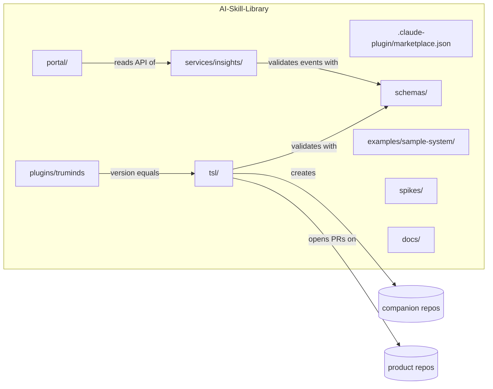
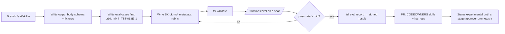

# DEV-01 · Developer Guide

| Field | Value |
| --- | --- |
| ID | DEV-01 |
| Status | Draft for owner review |
| Owner | TBD by Puneet |
| Approver | Puneet Singh Nanda |
| Related docs | [Repo README](../../README.md) · [Doc 3 Architecture](../architecture/03-architecture.md) §11 · [Doc 5 API and Rules](../architecture/05-api-and-rules.md) · [SDD-05](../design/SDD-05-claude-code-integration.md) · [SDD-01](../design/SDD-01-skill-authoring.md) · [SDD-02](../design/SDD-02-workflow-orchestration.md) · [SDD-04](../design/SDD-04-tsl-cli.md) · [TST-01](../testing/TST-01-master-test-plan.md) · [OPS-03](../operations/OPS-03-release-rollout-support.md) · [ADR 0003](../adr/0003-repo-is-source-of-truth.md) |
| Tracker | [Readiness Tracker](../planning/readiness-tracker.md) Q22, Q23 |

## 1. Scope

How a developer works on the Truminds AI Skill Library repository.

**Covers:**

- repositories and branching, code owners and commit messages;
- local setup for every component;
- coding standards and the tools that enforce them;
- how to add a skill or a workflow;
- how to run the plugin locally in Claude Code;
- the pull request checklist.

**Does not cover:**

- the release pipeline and rollout (OPS-03);
- the test plan (TST-01);
- how engineers use the library on client work (SDD-13 onboarding).

**Who reads it:** the five developers named in the [repo README](../../README.md), skill authors, and anyone running Claude Code to build parts of the system.

## 2. Repositories and branching

### 2.1 Repositories

The skill library is one repository (a monorepo). It is the source of truth for documents and code ([ADR 0003](../adr/0003-repo-is-source-of-truth.md)).

| Repository | Holds | Who writes | Notes |
| --- | --- | --- | --- |
| `AI-Skill-Library` (this repo; final org and name are OQ-10) | Marketplace, `truminds` plugin, `tsl`, schemas, insights service, portal, sample system, spikes, docs | The delivery team, by PR | Currently `puneetsinghnanda/AI-Skill-Library` |
| `<system>-companion` (one per client system) | Context pack, runs, artifacts, records (Doc 3 §3) | `tsl` and engineers during runs | Created from a template (SDD-12). Never holds platform code |
| Product repos | Client or Truminds application code | Engineers, through `tsl pr` | Receive code changes and PRs only (D-13) |

The tracker's Q22 proposed five separate repos. The README layout puts them in one; this guide follows the README. One open point remains: where the `tsl-ci-verify` GitHub Action lives (§9, open item).



### 2.2 Branching model

Trunk-based development on `main`.

| Rule | Detail |
| --- | --- |
| Trunk | `main` is always releasable. Direct pushes are blocked by branch protection |
| Branches | Short-lived, one change each, merged within a few working days. Name: `<type>/<scope>-<short-desc>`, for example `feat/tsl-decide-caps` or `docs/ops-04-runbook` |
| Merge | Squash merge. The squash commit message must follow §2.4 |
| Rebase | Rebase on `main` before merge; no merge commits from `main` into branches |
| Required checks | `required` job from TST-01 §6, plus one approval from a code owner of every touched area |
| Releases | Tags on `main` (OPS-03 §2). No long-lived release branches |
| Hotfix | Branch from `main`, fix, merge, tag a patch release |

**Conflict to resolve:** SDD-05 §3.4 says that, until spike S-07 proves the marketplace can be pinned to a tag, `main` should only receive tagged, CI-passed merges, because engineers install the plugin from the default branch. That conflicts with trunk-based development, where `main` gets every merged PR. OPS-03 §4.2 proposes a distribution channel that removes the conflict; until Puneet decides, treat every merge to `main` as reaching engineers and keep plugin changes behind review by Shubham Bansal.

### 2.3 Code owners per team area

`.github/CODEOWNERS` maps paths to the team areas in the [repo README](../../README.md). GitHub handles are placeholders until the GitHub org is chosen (OQ-10).

| Path | Area | Owners |
| --- | --- | --- |
| `plugins/truminds/skills/**` (except the command skills and `review`), `plugins/truminds/workflows/**` | Skills, workflows, roles | Abhishek Verma, Ekjot Singh |
| `tsl/**`, `plugins/truminds/skills/review/**`, `plugins/truminds/agents/**`, `tsl/tests/golden/**` | Harness, execution, `tsl verify` | Japman Singh, Yash Khorwal |
| `plugins/truminds/hooks/**`, `plugins/truminds/bin/**`, `plugins/truminds/policy/**`, `plugins/truminds/skills/{run,resume,status,eval,improve}/**`, `plugins/truminds/.claude-plugin/**`, `.claude-plugin/**`, `managed-settings/**`, `spikes/**` | Skill execution, hook execution | Shubham Bansal |
| `services/insights/**`, `portal/**` | Telemetry, events, portal statistics | Gaurav Saini (portal UI co-owner TBD by Puneet) |
| `schemas/**` | Contracts | Owner of each schema's area (as above), plus one harness owner |
| `examples/**`, `docs/**`, `.github/**` | Anything unassigned | TBD by Puneet |
| `docs/adr/**` | Decisions | Puneet Singh Nanda |

```text
# .github/CODEOWNERS (sketch; replace @<org>/<team> once OQ-10 is decided)
/plugins/truminds/skills/            @<org>/skills
/plugins/truminds/workflows/         @<org>/skills
/plugins/truminds/skills/review/     @<org>/harness
/plugins/truminds/agents/            @<org>/harness
/tsl/                                @<org>/harness
/plugins/truminds/hooks/             @<org>/execution
/plugins/truminds/bin/               @<org>/execution
/plugins/truminds/policy/            @<org>/execution
/plugins/truminds/skills/run/        @<org>/execution
/plugins/truminds/skills/resume/     @<org>/execution
/plugins/truminds/skills/status/     @<org>/execution
/plugins/truminds/skills/eval/       @<org>/execution
/plugins/truminds/skills/improve/    @<org>/execution
/plugins/truminds/.claude-plugin/    @<org>/execution
/.claude-plugin/                     @<org>/execution
/managed-settings/                   @<org>/execution
/services/insights/                  @<org>/telemetry
/portal/                             @<org>/telemetry
/schemas/                            @<org>/harness @<org>/telemetry
/docs/adr/                           @<puneet-handle>
```

Later rules in CODEOWNERS win, so the specific `skills/review/` and command-skill lines come after the general `skills/` line.

### 2.4 Commit messages: Conventional Commits

```text
<type>(<scope>)!: <summary in the imperative, ≤ 72 chars>

<body: what and why, wrapped at 100>

<footer: Refs: Q25, OQ-12 · BREAKING CHANGE: ... · Co-Authored-By: ...>
```

| Field | Allowed values |
| --- | --- |
| type | `feat`, `fix`, `docs`, `test`, `refactor`, `perf`, `build`, `ci`, `chore`, `revert` |
| scope | `tsl`, `plugin`, `skills`, `workflows`, `hooks`, `policy`, `schemas`, `insights`, `portal`, `sample`, `spikes`, `docs`, `adr`, `ci` |
| `!` / `BREAKING CHANGE:` | Required for a breaking change: a schema version bump, a removed `tsl` command or flag, a changed exit code, or an API change outside `/v1` rules. It drives the major version (OPS-03 §2.2) |

A commit-message check runs in CI on the PR title (squash merges use the title).

## 3. Local setup

### 3.1 Prerequisites

| Tool | Version | Used for | Check |
| --- | --- | --- | --- |
| Git | 2.40 or later | Everything | `git --version` |
| Python | 3.12 | `tsl`, insights service | `python3.12 --version` |
| uv | Current stable | Python environments, `uv tool install` | `uv --version` |
| Node.js | 20 LTS (pinned in `.nvmrc`) | Portal, sample system | `node --version` |
| Docker | Docker Desktop or Docker Engine with Compose v2 | PostgreSQL, verifier containers, sample system | `docker compose version` |
| Claude Code | Desktop app on a company seat, local session (C-16); native on Windows, not WSL (C-17) | Running the plugin | Code tab › Local |

Docker Desktop licensing for company laptops is an open item (SDD-05 §8.4).

After `tsl` is installed, `tsl doctor` checks all of the above (SDD-05 §7.1, SDD-04).

### 3.2 First clone

```bash
git clone git@github.com:puneetsinghnanda/AI-Skill-Library.git
cd AI-Skill-Library
uv tool install pre-commit
pre-commit install               # ruff, mypy, eslint, prettier, commit message, data guard
```

### 3.3 Component setup

| Component | Path | Setup | Run | Test |
| --- | --- | --- | --- | --- |
| `tsl` | `tsl/` | `uv sync` | `uv run tsl --help`; to use it from Claude Code: `uv tool install --editable ./tsl --force` | `uv run pytest` |
| Schemas | `schemas/` | Uses the `tsl` environment | — | `uv run --project tsl pytest ../schemas` (fixtures, TST-01 §2.2) |
| Hooks | `plugins/truminds/hooks/`, `bin/` | Needs `tsl` installed with `uv tool install --editable` | Fired by Claude Code | `uv run --project tsl pytest tests/hooks` |
| Insights service | `services/insights/` | `uv sync`; `docker compose -f compose.dev.yml up -d postgres`; `uv run alembic upgrade head`; `uv run python -m insights.seed` (invented seed data) | `uv run uvicorn insights.main:app --reload --port 8000` | `uv run pytest` (starts its own PostgreSQL testcontainer) |
| Portal | `portal/` | `nvm use` (Node 20); `npm ci` | `npm run dev` (port 5173, proxies `/v1` to port 8000) | `npm test` (Vitest); `npx playwright install --with-deps chromium`; `npm run e2e` |
| Sample system | `examples/sample-system/` | — | `docker compose up` (db 5433, api 3000, web 5174 on loopback) | `docker compose run --rm api npm test` |
| Plugin | `plugins/truminds/` | `tsl` installed (editable) | §5 | `uv run tsl validate plugins/truminds` |

**`compose.dev.yml` for the insights service** (development only; production is OPS-01):

```yaml
services:
  postgres:
    image: postgres:16
    ports: ["127.0.0.1:5432:5432"]
    environment:
      POSTGRES_DB: insights
      POSTGRES_USER: insights
      POSTGRES_PASSWORD_FILE: /run/secrets/pg_password
    secrets: [pg_password]
    volumes: [pgdata:/var/lib/postgresql/data]
secrets:
  pg_password:
    file: ${HOME}/.truminds-dev/pg_password    # created locally, never committed
volumes:
  pgdata: {}
```

Create the password file once with a random value: `mkdir -p ~/.truminds-dev && openssl rand -hex 24 > ~/.truminds-dev/pg_password`.

### 3.4 Signing in during development

- There is no login bypass in any component (org rule: no back doors or debug bypasses).
- The portal and `tsl login` use a **development** Microsoft Entra ID app registration with real company SSO ([ADR 0002](../adr/0002-identity-microsoft-entra-id.md)). The dev app registration IDs go in `portal/.env.development.local` and `~/.truminds/config.toml`; they are not secrets but are kept out of git per environment. Getting the dev app registration is an open item for the Entra admin (TBD by Puneet).
- Automated tests simulate tokens only inside the test process (TST-01 §2.4, §2.5).

### 3.5 Local environment files

| File | Committed? | Holds |
| --- | --- | --- |
| `*.example` files (`portal/.env.example`, `services/insights/.env.example`) | Yes | Variable names with placeholder values |
| `.env`, `.env.*`, `*.pem`, `*.key` | Never (in `.gitignore`; also blocked from Claude by managed deny rules) | Local values |
| `~/.truminds/` | Never (outside the repo) | `tsl` config, outbox, hook log; private key stays in the OS keychain (R-06) |

## 4. Coding standards

### 4.1 Python (`tsl/`, `services/insights/`)

| Tool | Config | Rule |
| --- | --- | --- |
| ruff (lint) | `pyproject.toml` `[tool.ruff]`, rule sets `E,F,W,I,B,UP,S,SIM,RUF`, line length 100 | Zero warnings |
| ruff (format) | Same | `ruff format --check` clean |
| mypy | `strict = true` for `tsl` and `insights` packages | Zero errors; `# type: ignore` needs a reason comment |
| pytest | `pyproject.toml` `[tool.pytest.ini_options]` | Coverage gates from TST-01 §8 |

Further rules:

- Typer for CLI commands; every command supports `--json` and returns the Doc 5 §2.3 envelope.
- Pydantic v2 models for every file format; the model and the JSON Schema in `schemas/` must agree (a test compares them).
- Error codes are constants in one module (`tsl/errors.py`), matching the catalogue in Doc 4 §5.2. Never invent a code in place; add it to the catalogue in the same PR.
- No network call from `tsl` except telemetry, key registration, `git` and GitHub for `tsl pr`.
- Never log file contents, prompts or tokens.

### 4.2 TypeScript and JavaScript (`portal/`, `examples/sample-system/`)

| Tool | Config | Rule |
| --- | --- | --- |
| ESLint | `eslint.config.js` (flat config) with `typescript-eslint`, `react-hooks`, `jsx-a11y` | Zero errors |
| Prettier | `.prettierrc` (print width 100, single quotes) | `prettier --check` clean |
| TypeScript | `strict: true` (portal) | `tsc --noEmit` clean |

The sample system's `api/` is plain JavaScript on purpose (TST-01 §4.2). Keep it in that style, and do not fix its seeded defects (TST-01 §4.3).

### 4.3 Skills, workflows and docs

- SKILL.md bodies follow the Agent Skills standard with no Claude-only syntax in the body (NFR-12); Claude Code frontmatter keys are allowed (SDD-05 §4).
- Documents follow the writing rules in the doc index: plain English, short sentences, tables, mermaid diagrams, no calendar dates.
- Examples are domain-agnostic and use invented data only (C-09, C-10).

## 5. Running the plugin locally

For development only. In production, IT force-enables the plugin through managed settings (SDD-05 §6).

```bash
# from the repo root, inside a local Claude Code session's terminal or any shell
claude plugin marketplace add ./
claude plugin install truminds@truminds-skill-library
uv tool install --editable ./tsl --force      # tsl version must equal plugin version
tsl doctor
tsl login                                     # dev Entra app registration (§3.4)
```

Then in the Claude Code desktop app, open a **local** session (not cloud, not Cowork) on the sample system's companion repo and run `/truminds:status`.

| Task | How |
| --- | --- |
| Pick up a change to a skill or hook | Reload plugins or start a new session. Whether the desktop app reloads a locally added marketplace on change is not verified; start a new session to be sure |
| See hook activity | `~/.truminds/hook.log` |
| Try a run end to end | Create a throwaway companion repo for the sample system (TST-01 §4.5), then `/truminds:run brownfield-change ABC-142` |
| Remove the dev install | `claude plugin uninstall truminds@truminds-skill-library`, then `claude plugin marketplace remove truminds-skill-library` |

**Limits to know:**

- The local-path form `claude plugin marketplace add ./` is not listed in SDD-05 §2 (V-05 shows the GitHub form). Confirm it during spike S-09.
- On a laptop that already has the production managed settings, `strictKnownMarketplaces` and `disableSideloadFlags` (V-07) are expected to block a local marketplace. Developers need a development seat profile without those keys. Who provides it is an open item (§9).
- `tsl` and the plugin must have the same version (SDD-05 §7.1). After changing `tsl/pyproject.toml` or `plugin.json` versions, reinstall both.

## 6. Adding a skill or a workflow

SDD-01 owns the skill format and SDD-02 owns the workflow format; this section is the contributor's path through them.

### 6.1 Add a skill

```text
plugins/truminds/skills/<skill-id>/
├─ SKILL.md                  # frontmatter + body (SDD-01 template)
├─ skill-metadata.yaml       # skill-metadata.v1 (Doc 5 §3.2); file name confirmed by SDD-01
├─ rubric.md                 # what the reviewer scores against
└─ evals/
   ├─ cases/<case-id>/       # input files + expect.yaml (TST-01 §3.1)
   └─ results/               # signed eval-result.v1 files from tsl eval record
schemas/artifacts/<output>.v1.json   # body schema for the artifact this skill writes
```



Steps:

1. Choose an id in kebab-case that is unique in `skills/`, and an agent from Doc 3 §7.
2. Write the artifact body schema in `schemas/artifacts/` with valid and invalid fixtures (TST-01 §2.2).
3. Write the eval cases before the skill. Use the sample system only; no client material (TST-01 §9).
4. Write `SKILL.md` from the SDD-01 template. Its body must start with the input check `` !`tsl verify --inputs ...` `` (SDD-05 §5.1) and must declare `allowed_tools` in metadata (H7).
5. Run `uv run tsl validate plugins/truminds/skills/<id>`.
6. Run `/truminds:eval <id>` in a local session, then `tsl eval record <id> <results.json>`.
7. Open the PR with status `experimental`. Promotion to `production` is a separate PR approved by the stage approver (Doc 2 §2, OQ-07).

**Changing an existing skill:**

- Add a failing eval case first (X-11).
- Bump the version: patch for wording, minor for new optional behaviour, major when input or output schemas change (R-10).
- Re-run evals and commit the new signed record.

### 6.2 Add a workflow

1. Create `plugins/truminds/workflows/<workflow-id>.yaml` as `workflow.v1` (Doc 5 §3.3; SDD-02 owns binding and parallel rules).
2. Reference skills with version ranges (`design@^1.4`). Every input must be produced by an earlier step; `tsl validate` checks this and writes the lockfile of exact skill versions (FR-WFL-02).
3. Put human gates where Doc 3 §5.5 requires a human (design approval, PR review).
4. Add an end-to-end case on the sample system to TST-01 §5 (a `TC-E2E-*` row) and a ticket in `examples/sample-system/tickets/` if none fits.
5. Run `uv run tsl validate plugins/truminds/workflows/<workflow-id>.yaml` and the E2E case on a seat.

## 7. Pull request checklist

Copy this into `.github/pull_request_template.md`.

```markdown
## What and why
<!-- one paragraph; link tracker Q, OQ, SDD section or issue -->

## Checklist
- [ ] PR title follows Conventional Commits (DEV-01 §2.4); breaking changes marked with `!`
- [ ] Tests added or updated; `required` CI job green (TST-01 §6)
- [ ] Coverage not lower than the targets (TST-01 §8)
- [ ] ruff, mypy, eslint, prettier clean
- [ ] Schemas changed? Fixtures updated; version bumped if breaking (Doc 3 §9.2)
- [ ] New or changed error code? Added to Doc 4 §5.2 in this PR
- [ ] New or changed event type? Added to Doc 5 §5.3 / SDD-08 in this PR
- [ ] Skill or workflow changed? `tsl validate` passes; new signed eval record; version bumped (R-10)
- [ ] Plugin or `tsl` version changed? Both equal (SDD-05 §7.1)
- [ ] Docs updated where behaviour changed; deviation from Doc 3 or Doc 5 has an ADR
- [ ] No client names, customer data, client code or credentials anywhere, including fixtures, evals and screenshots (C-09)
- [ ] No secrets in code or config; nothing read from `.env` committed
- [ ] No writes to Jira, Confluence or client systems added without an approval step (R-14)
- [ ] Auth uses company SSO libraries only (MSAL / Entra ID); no bypass flags or hidden endpoints
- [ ] Any rule conflict found is flagged in this PR description, not worked around (R-17)
```

## 8. Done criteria

- `.github/CODEOWNERS`, `.github/pull_request_template.md`, `.pre-commit-config.yaml`, `.nvmrc` and the commit-message check exist and match this guide.
- Branch protection on `main`: PR required, `required` check required, code-owner review required, squash merge only.
- A new developer can go from clone to green tests on every component (§3.3) on macOS and native Windows by following this guide alone.
- §5 has been run once on a development seat, and the result of the local-marketplace check is recorded.
- One skill (`requirement-review`) has been added by following §6.1 end to end.

## 9. Open items

| Ref | Item | Owner |
| --- | --- | --- |
| OQ-10 | Final GitHub org and repo name; team handles for CODEOWNERS | TBD by Puneet |
| new | Trunk-based `main` vs the SDD-05 §3.4 rule that `main` only receives tagged merges; resolve with OPS-03 §4.2 | TBD by Puneet |
| new | Where the `tsl-ci-verify` GitHub Action lives: a separate repo (needed for `uses: <org>/tsl-ci-verify@v1` as in Doc 5 §6.2) or a sub-path of this repo | TBD by Puneet |
| new | Development seat profile without `strictKnownMarketplaces` / `disableSideloadFlags`, so developers can load a local marketplace | Claude admin, TBD by Puneet |
| new | Development Entra ID app registrations for `tsl login` and the portal | Entra admin, TBD by Puneet |
| SDD-05 §8.4 | Docker Desktop licensing for company laptops | TBD by Puneet |
| new | Owner of `examples/**`, `docs/**` and `.github/**` | TBD by Puneet |
| OQ-07 | Stage approvers who promote skills to production | TBD by Puneet |
