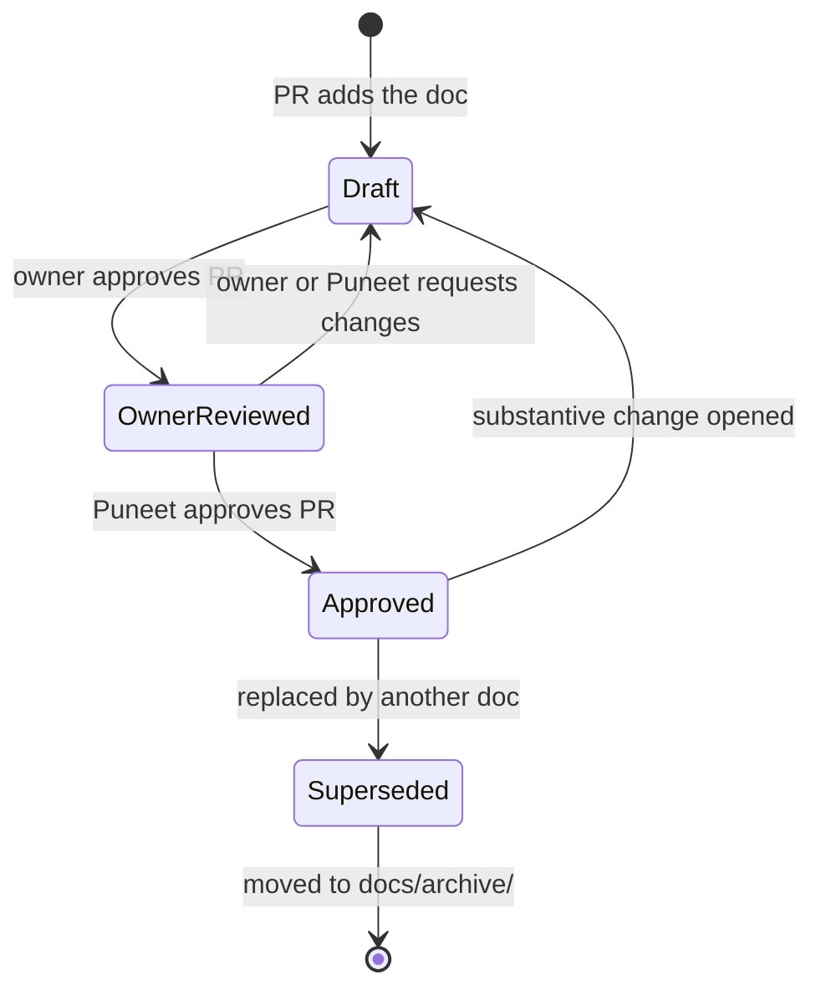
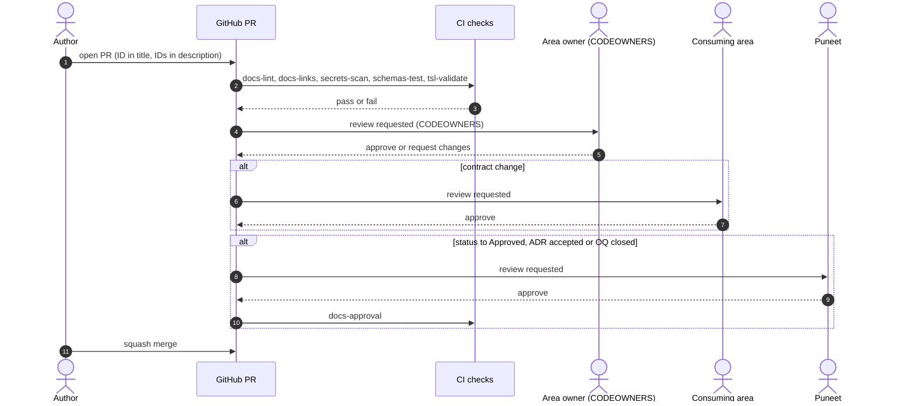
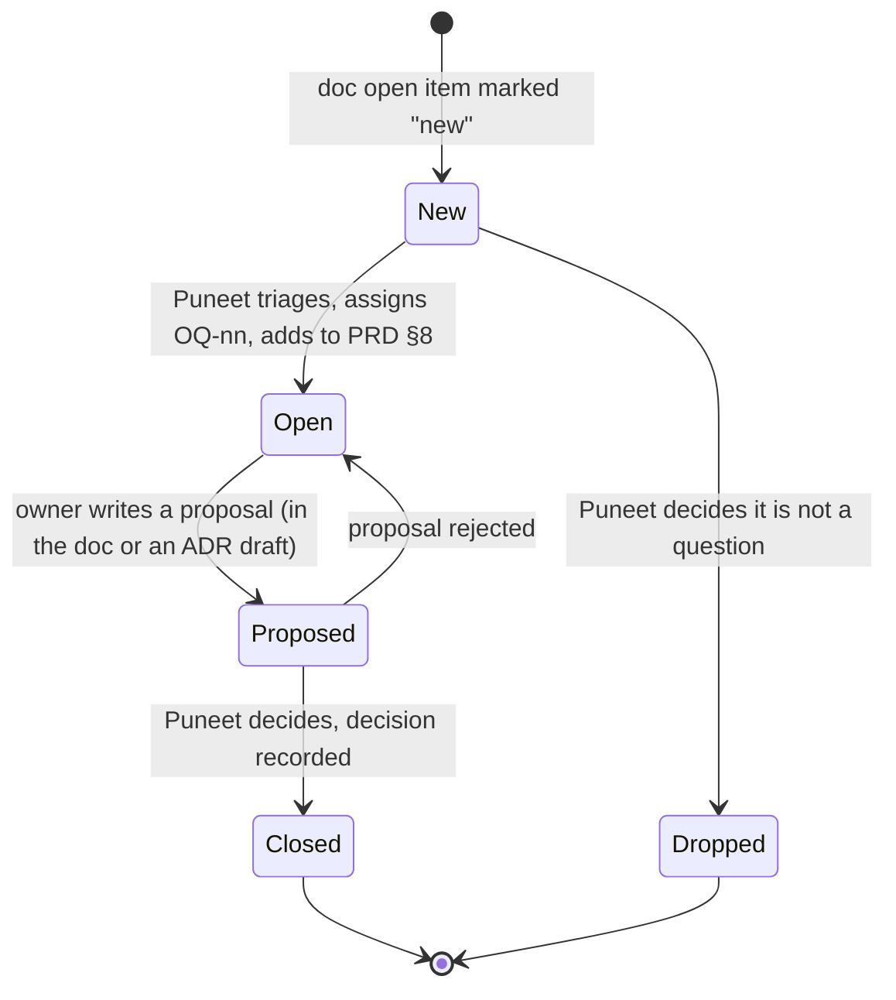
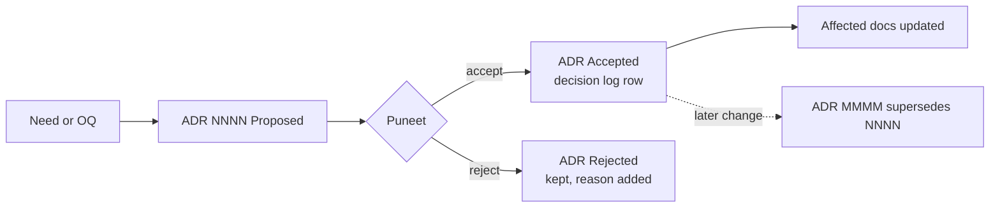

# GOV-01 · ADR Log and Change Process

| Field | Value |
| --- | --- |
| Status | Draft for owner review |
| Owner | Puneet Singh Nanda |
| Approver | Puneet Singh Nanda |
| Related docs | [ADR 0003 Repository is the source of truth](../adr/0003-repo-is-source-of-truth.md) · [ADR index](../adr/README.md) · [ADR template](../adr/0000-template.md) · [docs index](../README.md) · [PRD](../product/01-prd.md) §7, §8 · [Personas and Stories](../product/02-personas-and-stories.md) §2 · [PLN-01](../planning/PLN-01-delivery-plan.md) · [Readiness Tracker](../planning/readiness-tracker.md) Q39, Q40, §10 |

## 1. Scope

### 1.1 What this document decides

- Where every document and decision lives (ADR 0003).
- The lifecycle of a document, from draft to approved.
- How a change is proposed, reviewed and merged (PR rules).
- Which team area owns which path (CODEOWNERS).
- How open questions (OQ-xx) are raised, tracked and closed.
- How an architecture decision record (ADR) is written and accepted.
- The decision log: one index of every decision taken so far.

### 1.2 What it does not decide

- Branching and release tagging for code and the plugin. That is DEV-01 and OPS-03. This document covers only the rules every PR shares.
- Who the co-approver for security and legal is. That is OQ-01, still open.
- Skill promotion to production. That uses stage approvers (Doc 2 §2, OQ-07) and SDD-01.

### 1.3 Principles

- **One place.** The repository is the only source of truth (ADR 0003).
- **One approver.** Puneet Singh Nanda approves every document and every ADR.
- **Nothing silent.** Every decision is written down before code depends on it.
- **Append, never rewrite.** Decisions and ADRs are never edited after acceptance; a new one supersedes the old one.
- **Flag conflicts.** When two documents disagree, raise it as an open item. Do not pick one quietly (org rule, R-17).

## 2. Source of truth

### 2.1 Rule (ADR 0003)

| Thing | Lives in | Changed by |
| --- | --- | --- |
| Product docs (PRD, personas, constraints) | `docs/product/` | PR |
| Architecture docs (Doc 3, Doc 5) | `docs/architecture/` | PR |
| UX doc and prototype | `docs/ux/` | PR |
| SDD-01 to SDD-13 | `docs/design/` | PR |
| SEC, TST, DEV, OPS, PLN, GOV, LEG docs | `docs/<area>/` per [docs/README.md](../README.md) | PR |
| ADRs | `docs/adr/` | PR |
| Readiness tracker | `docs/planning/readiness-tracker.md` | PR |
| Superseded docs | `docs/archive/` (read-only) | Never edited |
| Earlier Claude Docs copies | Claude Docs, with a "Moved to repo: `<path>`" banner | Never edited |

The tracker §10 decision of 12 Oct put SDDs, SEC-01, TST-01 and PLN-01 in Claude Docs. ADR 0003 supersedes that row: every document is now in the repo. See the decision log (§8, entry X-DOC).

### 2.2 Cross-links

- Links between documents are repo-relative markdown paths, for example `../architecture/05-api-and-rules.md`.
- Link to a section with its number in text (`Doc 5 §4`), not with an anchor URL. Anchors break when headings change.
- A document's path never changes after it is first merged. If a document is replaced, the old file moves to `docs/archive/` and the index points to the new one.

## 3. Document lifecycle

### 3.1 States



| State | Status text in the control table | Who moves it here | What it means |
| --- | --- | --- | --- |
| Draft | `Draft for owner review` | Author | Content is proposed. Code must not depend on it yet |
| Owner reviewed | `Owner reviewed` | The document owner (from [docs/README.md](../README.md)) | The owner agrees it is correct and buildable |
| Approved | `Approved by Puneet` | Puneet Singh Nanda | Code may depend on it |
| Superseded | `Superseded by <ID or path>` | Puneet | Kept for history only |

**Status text alignment.** Existing docs use `Draft for review` (Docs 1–6) and `Draft for validation` (SDD-05). Both are read as `Draft for owner review`. Each doc switches to the exact text on its next PR.

### 3.2 Moving a state

Each state move is a PR that changes the `Status` row in the control table, and nothing else is required in that PR.

| Move | Required approvals on the PR |
| --- | --- |
| Draft → Owner reviewed | Every owner listed for the doc (for a doc with two owners, both) |
| Owner reviewed → Approved | Puneet Singh Nanda |
| Any → Superseded | Puneet Singh Nanda |

When the owner is "TBD by Puneet", Puneet acts as owner until one is named.

### 3.3 Changes after approval

| Change type | Examples | Status after merge | Approvals |
| --- | --- | --- | --- |
| Editorial | Typo, broken link, wording that keeps the meaning | Stays Approved | One code owner |
| Substantive | A new field, rule, threshold, flow or scope change | Back to `Draft for owner review` in the same PR, then up again | Owner, then Puneet |
| Contract | A schema, API, CLI command, exit code, error code, event type or DB table that another area consumes | As substantive, plus every consuming area approves (PLN-01 §5) | Owner, consumers, Puneet |
| Deviation from Doc 3 or Doc 5 | An SDD wants something Doc 3 or Doc 5 forbids or defines differently | ADR first (§7), then the doc change | ADR accepted by Puneet |

A doc that changes another doc's content adds a one-line note in the changed section, for example "Updated per SDD-05 §8.3", so the reason is visible without reading git history.

## 4. Pull request rules

### 4.1 Rules for every PR

| # | Rule |
| --- | --- |
| PR-01 | Every change to `main` goes through a PR. No direct pushes. Force pushes to `main` are blocked |
| PR-02 | The PR title starts with the doc or story ID, for example `SDD-03: add H6 fixture rules` or `ST-02.3: tsl state start` |
| PR-03 | The PR description lists: what changed, why, the IDs it touches (doc, ADR, OQ, story), and the lifecycle move if any |
| PR-04 | At least one approval from a code owner of every path changed (§5). Branch protection enforces "Require review from Code Owners" |
| PR-05 | The author never approves their own PR. A second person in the area, or Puneet, approves |
| PR-06 | Moving a doc to Approved, accepting an ADR, or closing an OQ needs Puneet's approving review on that PR (§4.3) |
| PR-07 | A contract change needs approval from every consuming area (PLN-01 §5.2) |
| PR-08 | All required CI checks pass (§4.2) |
| PR-09 | No client names, customer data, credentials, client code or secrets in any file, sample, fixture or example (C-09, R-15). Examples are domain-agnostic, for example an order-tracking ticket `ABC-142` |
| PR-10 | Conflicts with another doc or rule are listed in the PR description and as an open item. They are not resolved silently |
| PR-11 | Squash merge. The squash message keeps the PR title |
| PR-12 | A PR that builds an item on the Doc 6 §5 DO NOT BUILD list is rejected unless Puneet first removes the item |

### 4.2 Required CI checks

| Check | Runs on | Fails when |
| --- | --- | --- |
| `docs-lint` | `docs/**/*.md` | Markdown lint errors; a doc without the control table rows `Status`, `Owner`, `Approver`; a doc without "Done criteria" and "Open items" sections (exempt: `docs/archive/`, `docs/adr/`, tracker) |
| `docs-links` | `docs/**/*.md` | A repo-relative link points to a missing file |
| `secrets-scan` | All files | A secret pattern is found |
| `schemas-test` | `schemas/**` | A valid sample fails or an invalid sample passes |
| `tsl-validate` | `plugins/truminds/skills/**`, `workflows/**`, `policy/**` | `tsl validate` reports an error |
| `docs-approval` | PRs that change a `Status` row to `Approved by Puneet`, set an ADR to `Accepted`, or close an OQ | The PR has no approving review from Puneet's GitHub account |

`docs-approval` is needed because GitHub CODEOWNERS accepts approval from **any one** listed owner. It cannot by itself require Puneet in addition to the area owner. The check reads the PR's reviews through the GitHub API with the job's read-only token. It is a new CI job; DEV-01 owns its implementation.

### 4.3 Review flow



## 5. CODEOWNERS

### 5.1 Areas and GitHub teams

GitHub CODEOWNERS needs GitHub usernames or teams. The GitHub org is still open (OQ-10), so this uses team names with an `<org>` placeholder. Each team holds the people of one area (PLN-01 §1.4).

| GitHub team | Area | Members |
| --- | --- | --- |
| `@<org>/tsl-approver` | Approver | Puneet Singh Nanda |
| `@<org>/tsl-skills` | SK: skills, workflows, roles | Abhishek Verma, Ekjot Singh |
| `@<org>/tsl-harness` | HX: harness, execution, `tsl verify` | Japman Singh, Yash Khorwal |
| `@<org>/tsl-claude-code` | CC: skill execution, hook execution | Shubham Bansal |
| `@<org>/tsl-insights` | TL: telemetry, events, portal statistics | Gaurav Saini |
| `@<org>/tsl-portal-ui` | Portal UI | TBD by Puneet (until named: Gaurav Saini) |
| `@<org>/tsl-security` | Security reviewer | TBD by Puneet |

### 5.2 `.github/CODEOWNERS`

The committed file is [`.github/CODEOWNERS`](../../.github/CODEOWNERS): the block below with `<org>` set to the placeholder `truminds`, plus lines for folders added since (`pods/`, `ops/`, `deploy/`, `scripts/`, `plugins/truminds/verifiers/`). CI checks this section names: `docs-lint`, `docs-links` and `docs-approval` in `ci-docs.yml`; `secrets-scan` is `ci-security.yml`; `schemas-test` is `ci-schemas.yml`; `tsl-validate` runs in `ci-plugin.yml`.

GitHub uses the **last** matching line, so the general rules come first.

```text
# Default: anything not matched below
*                                         @<org>/tsl-approver

# Governance, planning, ADRs, top-level product and architecture docs
/docs/                                    @<org>/tsl-approver
/docs/adr/                                @<org>/tsl-approver
/docs/governance/                         @<org>/tsl-approver
/docs/planning/                           @<org>/tsl-approver
/docs/archive/                            @<org>/tsl-approver

# Design documents by area
/docs/design/SDD-01-*                     @<org>/tsl-skills
/docs/design/SDD-02-*                     @<org>/tsl-skills @<org>/tsl-claude-code
/docs/design/SDD-03-*                     @<org>/tsl-harness
/docs/design/SDD-04-*                     @<org>/tsl-harness
/docs/design/SDD-05-*                     @<org>/tsl-claude-code
/docs/design/SDD-08-*                     @<org>/tsl-insights
/docs/design/SDD-09-*                     @<org>/tsl-insights @<org>/tsl-portal-ui
/docs/design/SDD-10-*                     @<org>/tsl-skills
/docs/design/SDD-11-*                     @<org>/tsl-skills @<org>/tsl-insights
/docs/operations/OPS-02-*                 @<org>/tsl-insights
/docs/security/                           @<org>/tsl-security @<org>/tsl-approver
/docs/ux/                                 @<org>/tsl-portal-ui

# Plugin and marketplace
/.claude-plugin/                          @<org>/tsl-claude-code
/plugins/truminds/.claude-plugin/         @<org>/tsl-claude-code
/plugins/truminds/hooks/                  @<org>/tsl-claude-code
/plugins/truminds/bin/                    @<org>/tsl-claude-code
/plugins/truminds/policy/                 @<org>/tsl-claude-code @<org>/tsl-security
/plugins/truminds/skills/                 @<org>/tsl-skills
/plugins/truminds/skills/run/             @<org>/tsl-claude-code
/plugins/truminds/skills/resume/          @<org>/tsl-claude-code
/plugins/truminds/skills/status/          @<org>/tsl-claude-code
/plugins/truminds/skills/review/          @<org>/tsl-harness @<org>/tsl-claude-code
/plugins/truminds/agents/                 @<org>/tsl-harness @<org>/tsl-claude-code
/plugins/truminds/workflows/              @<org>/tsl-skills
/managed-settings/                        @<org>/tsl-claude-code @<org>/tsl-approver
/spikes/                                  @<org>/tsl-claude-code

# tsl, schemas, services, portal, samples
/tsl/                                     @<org>/tsl-harness
/schemas/                                 @<org>/tsl-harness @<org>/tsl-skills @<org>/tsl-claude-code @<org>/tsl-insights
/services/insights/                       @<org>/tsl-insights
/portal/                                  @<org>/tsl-portal-ui @<org>/tsl-insights
/examples/sample-system/                  @<org>/tsl-approver

# Repository controls
/.github/                                 @<org>/tsl-approver
/.github/CODEOWNERS                       @<org>/tsl-approver
```

**Notes:**

- Docs owned by "TBD by Puneet" (SDD-06, 07, 12, 13, DEV-01, OPS-01, 03, 04, LEG-01) fall to the `/docs/` default: Puneet. Add a line when an owner is named.
- `/schemas/` lists all four teams, so any one may approve under CODEOWNERS. PR-07 still requires every consuming area to approve a contract change; the reviewer checks this by hand until a per-schema owner file exists (open item GOV-OI-04).
- The `tsl hook` code lives under `/tsl/` and is owned by HX, while the hook behaviour is owned by CC (SDD-05). Add a narrower line for the hook module once SDD-04 fixes the package layout.
- `/managed-settings/` changes what IT pushes to every seat, so Puneet is also an owner.

## 6. Open questions (OQ-xx)

### 6.1 Register

The single register is PRD §8 (`docs/product/01-prd.md`). Other docs refer to OQ ids; they do not keep their own OQ list. Doc-local items that are not yet OQs sit in each doc's "Open items" table with the reference `new`.

| Field (PRD §8 table) | Meaning |
| --- | --- |
| ID | `OQ-nn`, next free number. Never reused. Next free: OQ-17 |
| Question | One question, answerable by one person |
| Blocks | The gate (G0–G3) or activity it blocks |
| Status (column to add) | Open, Proposed, Closed |
| Closed by (column to add) | ADR number, decision ID, or "withdrawn" with a reason |

### 6.2 Lifecycle



### 6.3 Steps

1. **Raise.** Any author adds a row to their doc's "Open items" with reference `new`.
2. **Triage.** Puneet reviews new items in the next planning review. Each becomes an `OQ-nn` in PRD §8, or is answered at once, or is dropped. Triage is one PR that edits PRD §8 and the source doc's reference.
3. **Propose.** The owner named in the row writes a proposal. Architecture or contract questions get an ADR with status `Proposed`. Other questions get a short proposal in the PR description.
4. **Decide.** Puneet approves. The answer is recorded as an ADR (`Accepted`) or a decision log row (§8).
5. **Close.** In the same PR: the OQ row gets `Closed` and `Closed by`; every doc that referenced the OQ is updated, or gets an open item to update it. Example: OQ-15 is closed by ADR 0001.
6. **Gate check.** A gate in PLN-01 cannot pass while an OQ that blocks it is Open or Proposed.

## 7. ADR process

### 7.1 When an ADR is required

| Situation | ADR? |
| --- | --- |
| Choosing a technology, product or hosting option | Yes |
| A change to a cross-area contract (PLN-01 §5) that breaks consumers | Yes |
| An SDD that deviates from Doc 3 or Doc 5 | Yes, before the SDD change |
| Closing an OQ about architecture, security or data | Yes |
| A product scope or process decision (phases, priorities, targets) | No; decision log row (§8) |
| A wording or detail change inside one area | No |

### 7.2 Writing one

1. Copy [`docs/adr/0000-template.md`](../adr/0000-template.md) to `docs/adr/NNNN-short-title.md`. `NNNN` is the next free number. Numbers are never reused or renumbered.
2. Fill every section: Status (`Proposed`), Deciders (Puneet as approver, plus the owners), Related (doc IDs, OQ ids, story IDs), Context (facts only, with links), Options considered (at least two, with pros and cons), Decision (one or two sentences), Consequences (which docs change, what becomes harder).
3. Add a row to [`docs/adr/README.md`](../adr/README.md) with status `Proposed`.
4. Open a PR titled `ADR NNNN: <title>`. Reviewers: owners of every affected area.
5. Puneet accepts by approving the PR. The status changes to `Accepted` in the same PR, and the decision log (§8) gets a row.
6. Docs listed under Consequences are updated in the same PR or in follow-up PRs that reference the ADR. Until they are, each affected doc has an open item pointing to the ADR.

The template's `Date` field records when the ADR was accepted. It is a record, not a plan.

### 7.3 Changing a decision

An accepted ADR is never edited except to set `Superseded by NNNN`. A new ADR states the new decision and links back. The same applies to decision log rows: a change is a new row.



`Rejected` is added to the template's status list by this document (Proposed, Accepted, Rejected, Superseded by NNNN). See GOV-OI-05.

## 8. Decision log

This is the one index of every decision taken. Earlier decisions D-01 to D-16 stay in PRD §7 and are not edited. From now on:

- architecture and contract decisions are ADRs (`docs/adr/`);
- product and process decisions are new `D-nn` rows in PRD §7 (append-only), next free D-17;
- this table indexes both.

| ID | Decision | Source | Status | Notes |
| --- | --- | --- | --- | --- |
| D-01 | Reset and re-architect; the September prototype is kept as lessons, not code | PRD §7 | Accepted | |
| D-02 | Build on existing products and open standards; never re-implement what exists | PRD §7 | Accepted | |
| D-03 | Engineers and Sales served equally; Sales sees a read-only view of engineering evidence | PRD §7 | Accepted | Portal personas are now Business unit and Engineers (Doc 4) |
| D-04 | Sell AI-augmented pods (people plus AI), never AI headcount | PRD §7 | Accepted | |
| D-05 | Domain-agnostic: any brownfield system via its context pack; domain packs optional | PRD §7 | Accepted | |
| D-06 | No calendar timelines; phases defined by scope and gates | PRD §7 | Accepted | PLN-01 follows it |
| D-07 | First release supports all eight roles and both greenfield and brownfield workflows | PRD §7 | Accepted | |
| D-08 | Pilots on Truminds-owned code and on client code with written consent | PRD §7 | Accepted | |
| D-09 | Numeric success targets set after pilot baselines | PRD §7 | Accepted | |
| D-10 | Execution is local only: Claude Code desktop app with the Truminds plugin, on company Claude seats | PRD §7 | Accepted | Narrowed by C-16, C-17 (local sessions, no WSL; SDD-05 §7.3) |
| D-11 | No Claude API anywhere; CI re-runs code checks only and verifies signed records; improvement and evals run on owners' seats | PRD §7 | Accepted | |
| D-12 | Open questions are answered in a file and fed back with `/truminds:resume`; the decider is always named | PRD §7 | Accepted | |
| D-13 | Packs, artifacts and run state live in a Truminds-owned companion repo per client system; the product repo receives only code changes | PRD §7 | Accepted | Hosting org still OQ-10 |
| D-14 | Platform code (`tsl`, hooks, telemetry service) in Python | PRD §7 | Accepted | |
| D-15 | Dashboards and catalogue in Backstage | PRD §7 | **Superseded by ADR 0001** | |
| D-16 | Six outcomes; confidence computed by harness rules, never self-reported; code makes every final decision | PRD §7 | Accepted | |
| X-DOC | Design docs (SDDs, SEC-01, TST-01, PLN-01) in Claude Docs; ADRs, DEV-01, OPS, GOV-01 in the repo | Tracker §10 (12 Oct table) | **Superseded by ADR 0003** | No D-number was given; listed for history |
| ADR 0001 | Portal is a custom React web app on the FastAPI insights service; Backstage dropped | Tracker §10; [ADR 0001](../adr/0001-portal-custom-react-on-fastapi.md) | Accepted | Closes OQ-15; supersedes D-15 |
| ADR 0002 | Identity is Microsoft Entra ID: device-code for `tsl login`, auth code + PKCE for the portal | Tracker §10; [ADR 0002](../adr/0002-identity-microsoft-entra-id.md) | Accepted | |
| ADR 0003 | This repository is the source of truth for all documents and code | [ADR 0003](../adr/0003-repo-is-source-of-truth.md) | Accepted | Supersedes X-DOC |
| ADR 0004 | Sample brownfield system is React + Node.js with PostgreSQL | Tracker §10; [ADR 0004](../adr/0004-sample-system-react-node.md) | Proposed (tentative) | Database "PostgreSQL proposed" in tracker §10 |
| X-TEAM | Team areas and owners (tracker §1) replace the module owners in Doc 3 §12.2 | Tracker §1 | Accepted | Needs a D-number at triage (GOV-OI-02) |

Decisions proposed in draft SDDs (for example SDD-05's commands-as-skills and managed deny rules) are not in this log. They enter it when the SDD reaches `Approved by Puneet`, or earlier through an ADR.

## 9. Done criteria

- This document reaches `Approved by Puneet`.
- `.github/CODEOWNERS` from §5.2 is committed with the real GitHub org and team names (after OQ-10).
- Branch protection on `main`: PR required, code owner review required, force push blocked, required checks from §4.2.
- `docs-lint`, `docs-links` and `docs-approval` CI jobs exist and pass on the current docs.
- PRD §8 has `Status` and `Closed by` columns; OQ-15 is marked Closed by ADR 0001.
- ADR template status list includes `Rejected`.
- X-DOC and X-TEAM have D-numbers or are confirmed as history-only.

## 10. Open items

| ID | Item | Owner | Ref |
| --- | --- | --- | --- |
| GOV-OI-01 | Co-approver for security and legal | Puneet | OQ-01 |
| GOV-OI-02 | Give X-TEAM (team areas) a D-number in PRD §7 | Puneet | new |
| GOV-OI-03 | GitHub org and team names for CODEOWNERS | Puneet | OQ-10 |
| GOV-OI-04 | Per-schema owner file so PR-07 can be checked by CI instead of by hand | TBD by Puneet | new |
| GOV-OI-05 | Add `Rejected` to the status list in `docs/adr/0000-template.md` and `docs/adr/README.md` | Puneet | new |
| GOV-OI-06 | Who may change which document (tracker Q39): this doc proposes "owner from docs/README.md, Puneet approves". Confirm | Puneet | Q39 |
| GOV-OI-07 | Stage approvers for skill promotion | Puneet | OQ-07 |
| GOV-OI-08 | PRD §1 says Doc 4 holds "Backstage screens" and §3 diagrams show Backstage; these need updating to ADR 0001 | Puneet | ADR 0001 |
