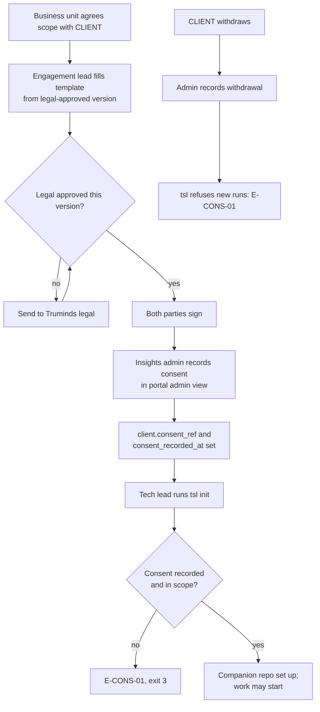

# LEG-01 · Client Consent and Data-Processing Template

> **Not legal advice; draft for Truminds legal.**
> This is a working draft written by the product team so that Truminds legal has something concrete to review. It has not been reviewed by a lawyer. Nothing in it may be sent to a client until legal has approved the wording. Every item marked **[LEGAL TO CONFIRM]** needs a decision from legal.

| Field | Value |
| --- | --- |
| Status | Draft for owner review (DRAFT FOR LEGAL REVIEW) |
| Owner | Legal, TBD by Puneet |
| Approver | Puneet Singh Nanda (product); final wording approved by Truminds legal |
| Related docs | [Doc 6 Constraints](../product/06-constraints.md) §3.2 (C-03, C-04, C-07, C-13, L-01, L-02) · [Doc 3 Architecture](../architecture/03-architecture.md) §9 · [Doc 5 API and Rules](../architecture/05-api-and-rules.md) §5.3, §6.1, R-15, R-16 · [SEC-01 Threat model](../security/SEC-01-threat-model.md) §4 · [SDD-13 Onboarding and admin](../design/SDD-13-onboarding-admin.md) · [SDD-12 Companion repo](../design/SDD-12-companion-repo.md) · [SDD-08 Telemetry](../design/SDD-08-telemetry-insights.md) |
| Tracker | [Readiness Tracker](../planning/readiness-tracker.md) Q29 · PRD OQ-03, OQ-06, OQ-08, OQ-10 |

## 1. Scope

### 1.1 What this document is

- **Part A** (§3–§12) is the template text that would go to a client, with placeholders.
- **Part B** (§13–§15) is for Truminds: how consent is recorded in the system, the engagement checklist, and the questions legal must answer.

### 1.2 Placeholders

| Placeholder | Meaning |
| --- | --- |
| [CLIENT] | The client's legal entity name |
| [CLIENT CODE] | The short code used inside Truminds systems (for example `CL-03`). Never the name |
| [CLIENT SYSTEM] | The client system or systems in scope (for example "order-tracking service") |
| [CLIENT REPOS] | The client repositories in scope, listed in Schedule 1 |
| [ENGAGEMENT] | The master agreement or statement of work this consent attaches to |
| [N] | A number to be filled in by legal or the engagement |
| [HOST ORG] | The GitHub organisation that hosts the companion repository (Truminds or [CLIENT]; OQ-10) |

No real client is named anywhere in this document, and none may be added to the repository version of it (org rule R-15).

### 1.3 Ground rule

Truminds does not process any [CLIENT] code, tickets or documents with the AI Skill Library until this consent is signed by both parties and recorded by a Truminds admin (C-04, R-16). The system enforces this: without a recorded consent, `tsl init` refuses to set up the system (error E-CONS-01).

## Part A — Template

## 2. Title

**Consent to AI-assisted software engineering and related data processing**
between Truminds [legal entity, LEGAL TO CONFIRM] ("Truminds") and [CLIENT], under [ENGAGEMENT].

## 3. Purpose

Truminds engineers will use an AI-assisted engineering toolset (the "Truminds AI Skill Library") when working on [CLIENT SYSTEM]. The toolset helps engineers review requirements, analyse impact, design, write code and tests, and review security. Every AI output is checked by automated rules, and a Truminds engineer and the [CLIENT] review process remain responsible for every change. Nothing is merged or deployed automatically.

This document explains what data is processed, where, for how long, and what choices [CLIENT] has.

## 4. What is processed

| Category | Examples | Processed for |
| --- | --- | --- |
| Source code | Files in [CLIENT REPOS] that an engineer works on | Understanding the system; proposing code changes |
| Work items | Tickets and their descriptions, comments and attachments the engineer opens | Understanding the requested change |
| Documentation | Design pages, wiki pages, design files the engineer opens | Context for the change |
| Build and test output | Compiler output, test results, CI logs | Checking that changes work |
| Generated work products | Requirement reviews, designs, test plans, review findings ("artifacts"), and the verification records that show which checks ran | Evidence of quality; review by [CLIENT] |
| Engineer activity metadata | Which workflow ran, step outcomes, durations, token counts, pull-request status | Running and improving the service (§6) |

**Personal data.** Truminds does not intend to process personal data of [CLIENT]'s customers or staff. However, such data may be present inside source code, test data, tickets or logs that the engineer opens. The toolset cannot mask data inside ordinary source files before the AI model reads them (Doc 6 L-01). It does block known sensitive files (such as `.env` files, key files and folders named `secrets`) and stops personal data and secrets from being written into outputs. [CLIENT] should tell Truminds of any repository paths that hold personal data so they can be excluded (§9, option O-4). **[LEGAL TO CONFIRM]** whether Truminds acts as processor for any such personal data under applicable law (for example the India DPDP Act 2023, or the EU GDPR where relevant), and what processing terms are needed.

## 5. Where it is processed

| Location | What is there | Notes |
| --- | --- | --- |
| Truminds engineers' company laptops | Local copies of [CLIENT REPOS] and the companion repository, while work is in progress | Company-managed devices with full-disk encryption. The AI toolset runs locally in the Claude Code desktop application. No Truminds server runs the AI |
| The AI model provider (Anthropic) | The content an engineer's session sends to the model: code, ticket text and documents the engineer opens | Processed under Truminds' company (business) seat terms with Anthropic, not personal accounts. **[LEGAL TO CONFIRM]**: the applicable commercial terms, whether inputs are used for model training, the provider's retention period, processing locations and sub-processors. Model settings are the same for all Truminds clients; per-client model choice is not available (C-13, L-02) |
| [CLIENT REPOS] | Code changes, delivered as pull requests for [CLIENT] review | Truminds never merges or deploys |
| Companion repository in [HOST ORG] | Context notes about [CLIENT SYSTEM], generated work products, and signed verification records for each run | One private repository per client system. Where it is hosted is chosen in §9 (O-2) |
| Issue tracker and wiki of [CLIENT] or Truminds (for example Jira, Confluence) | Read by the engineer's session | Nothing is written back without an explicit, recorded approval per action |
| Truminds insights service | Activity metadata only (§6) | Hosting provider and region **[TO BE CONFIRMED]** (OQ-02, OQ-03) |

## 6. What telemetry leaves the laptop

Only **metadata** is sent to Truminds' own insights service. It is used to run the service, measure quality and improve the toolset.

| Sent | Not sent |
| --- | --- |
| Run and step identifiers; workflow and skill names and versions | Source code or file contents |
| Step outcomes, confidence band, counts of findings by severity | Artifact text, findings text, prompts, AI responses |
| Durations, token counts and cost metrics from the Claude Code application | Names of [CLIENT] or its people; [CLIENT] is shown only as [CLIENT CODE] |
| Ticket reference (an identifier such as `ABC-142`), pull-request number, review counts, CI check result | Ticket text, comments, review comment text |
| Truminds engineer identity shown as a pseudonym on dashboards | Personal data of [CLIENT]'s customers or staff |

Pull-request metadata reaches the insights service through a repository webhook only if [CLIENT] agrees (§9, O-1). **[LEGAL TO CONFIRM]** whether the ticket reference and repository name count as [CLIENT] confidential information that needs further limits.

## 7. Retention

| Data | Kept for | Then |
| --- | --- | --- |
| Local copies on laptops | While the engineer works on [CLIENT SYSTEM] | Deleted at the end of the engineer's assignment (SDD-13 offboarding) |
| Companion repository (context notes, artifacts, verification records) | The life of [ENGAGEMENT] plus [N] days, as audit evidence | Handed over to [CLIENT] and/or deleted, as chosen in §9 (O-3) |
| Pull requests and code changes | Under [CLIENT]'s control in [CLIENT REPOS] | [CLIENT]'s own policy |
| Activity metadata in the insights service | [N] months (Truminds proposes 13 months; not yet decided, OQ-08) | Aggregated into counts that cannot identify a run or ticket, then raw records deleted |
| Content sent to the model provider | As set by the company seat terms **[LEGAL TO CONFIRM]** | Per those terms |
| This consent record | [ENGAGEMENT] life plus [N] years **[LEGAL TO CONFIRM]** | Deleted |

## 8. Client rights

[CLIENT] may, by written notice to the Truminds contact in §12:

| Right | What Truminds does |
| --- | --- |
| Information | Answers questions about how the toolset processes [CLIENT] data, and gives a copy of the current version of this document |
| Access to evidence | Gives read access to, or an export of, the companion repository for [CLIENT SYSTEM] |
| Correction | Corrects context notes about [CLIENT SYSTEM] that [CLIENT] says are wrong |
| Restriction | Excludes named repositories, paths or ticket types from processing (O-4) |
| Deletion | Deletes the companion repository and local copies, and deletes or aggregates activity metadata linked to [CLIENT CODE], within [N] days, and confirms in writing. Content already processed by the model provider is subject to the seat terms **[LEGAL TO CONFIRM]** |
| Audit | Receives a summary of the controls in [SEC-01](../security/SEC-01-threat-model.md) and the independent security review result **[LEGAL TO CONFIRM extent]** |
| Withdrawal | Withdraws consent at any time (§10) |

**[LEGAL TO CONFIRM]** any further rights required for personal data of [CLIENT]'s data principals or data subjects.

## 9. Options and opt-out

[CLIENT] chooses each option. The defaults are shown; a "No" never stops normal non-AI engineering work.

| Option | Choice | Default | Effect of "No" |
| --- | --- | --- | --- |
| O-1 Pull-request webhook to the Truminds insights service | Yes / No | No | No pull-request metadata is collected; Truminds dashboards show runs without merge data |
| O-2 Companion repository host | Truminds GitHub organisation / [CLIENT] GitHub organisation | **[TO BE DECIDED, OQ-10]** | — |
| O-3 At end of engagement, companion repository is | Handed over / Deleted / Both (handed over, then Truminds copy deleted) | Both | — |
| O-4 Excluded repositories or paths | List in Schedule 1 | None | Listed paths are blocked from reading and editing by the toolset's policy |
| O-5 CI verification job in [CLIENT REPOS] (reads Truminds verification records with a read-only token) | Yes / No | Yes | Pull requests are reviewed by [CLIENT] without the automatic evidence check |
| O-6 Issue-tracker access | Read only / Read, and write only after per-action approval / None | Read only | With "None", engineers paste ticket text manually; that text is still sent to the model |
| O-7 Full opt-out of AI-assisted work | Yes / No | No | Truminds engineers do not use the toolset on [CLIENT SYSTEM]; the rest of [ENGAGEMENT] is unchanged |

## 10. Withdrawal

- [CLIENT] may withdraw this consent in writing at any time.
- Within [N] business days of receiving it, Truminds records the withdrawal. From that point the toolset refuses to start new work on [CLIENT SYSTEM].
- Runs already in progress are stopped. No new content is sent to the model provider.
- Data is then handled as in §8 "Deletion" unless [CLIENT] asks for handover first.

## 11. Written consent before processing

Truminds will not process any [CLIENT] code, tickets or documents with the toolset before:

1. this document is signed by an authorised person of [CLIENT] and of Truminds; and
2. a Truminds admin has recorded the consent reference in the Truminds system.

Any change to the scope in Schedule 1 needs a signed amendment before the new scope is processed.

## 12. Sign-off

| | [CLIENT] | Truminds |
| --- | --- | --- |
| Name | ______________________ | ______________________ |
| Title | ______________________ | ______________________ |
| Authority to sign for | [CLIENT] | Truminds [legal entity] |
| Signature | ______________________ | ______________________ |
| Date signed | ______________________ | ______________________ |
| Contact for questions and notices | ______________________ | ______________________ |

**Schedule 1: scope**

| Item | Value |
| --- | --- |
| [CLIENT SYSTEM] | ______________________ |
| [CLIENT REPOS] in scope | ______________________ |
| Repositories or paths excluded (O-4) | ______________________ |
| Issue tracker and wiki spaces in scope | ______________________ |
| Options chosen (O-1 to O-7) | ______________________ |
| Consent reference (filled in by Truminds) | `CONS-[CLIENT CODE]-[N]` |

## Part B — For Truminds use

## 13. How consent is recorded and enforced



### 13.1 Consent record (`consent-record.v1`)

The signed document is stored in Truminds' contract store, not in any git repository. The insights service keeps only the fields below. It extends the `client` table in Doc 3 §9.1 (`consent_recorded_at`, `consent_ref`); the full table is proposed to SDD-08 as `client_consent`.

```yaml
schema: consent-record.v1
consent_ref: CONS-CL-03-001          # req, unique
client: CL-03                        # req, code only
systems: [SYS-ORD]                   # req
repos_in_scope: [orders-api, orders-web]       # req, repo short names
excluded_paths: ["orders-api:test-data/**"]    # O-4, become policy read and write denies
options:
  webhook: false                     # O-1
  companion_host: truminds           # O-2: truminds | client
  end_of_engagement: handover_then_delete      # O-3
  ci_verify: true                    # O-5
  tracker_access: read_only          # O-6: read_only | read_write_with_approval | none
template_version: LEG-01@0.1         # legal-approved template version used
signed_at: 2026-01-01T00:00:00Z      # placeholder value; real value from the signed copy
recorded_by: admin-7c1e              # pseudonym of the recording admin
withdrawn_at: null
```

### 13.2 Enforcement points

| Consent field | Enforced by |
| --- | --- |
| Consent exists and not withdrawn | `tsl init`, `tsl context build`, `tsl state start` (E-CONS-01) |
| `systems`, `repos_in_scope` | `tsl init` refuses repos not listed |
| `excluded_paths` | Added to the system's `policy.yaml` as read and write denies (SDD-05 §6.4) |
| `webhook: false` | GitHub org admin does not install the webhook; the insights service drops webhook deliveries for repos of this client |
| `tracker_access` | Becomes the pre-mcp classification for that system |

## 14. Engagement checklist

Complete in order. The engagement lead keeps the checklist with the signed copy.

| # | Step | Who | Done |
| --- | --- | --- | --- |
| 1 | Confirm the latest legal-approved template version is used | Engagement lead | ☐ |
| 2 | Fill placeholders; confirm [CLIENT] name appears only in the signed copy, never in repos or tickets | Engagement lead | ☐ |
| 3 | Agree options O-1 to O-7 and Schedule 1 with [CLIENT] | Engagement lead | ☐ |
| 4 | Confirm with [CLIENT] which paths hold personal data or secrets; add them to O-4 | Tech lead | ☐ |
| 5 | Both parties sign | Authorised signatories | ☐ |
| 6 | File signed copy in the Truminds contract store | Engagement lead | ☐ |
| 7 | Record consent in the portal admin view; check `consent_ref` shows | Insights admin | ☐ |
| 8 | Create the companion repository in the chosen [HOST ORG], private, with one team for the system | GitHub org admin | ☐ |
| 9 | Install webhook and CI job only if O-1 and O-5 are "Yes" | GitHub org admin, [CLIENT] repo owner | ☐ |
| 10 | Confirm every engineer on the system uses a company Claude seat with managed settings (SDD-13) | Claude org admin | ☐ |
| 11 | Tech lead runs `tsl init`; confirm it succeeds | Tech lead | ☐ |
| 12 | At end of engagement or withdrawal: handover/delete per O-3, confirm in writing, record `withdrawn_at` | Engagement lead, insights admin | ☐ |

## 15. Questions for legal

| # | Question |
| --- | --- |
| LQ-01 | Which Truminds legal entity signs, and does this attach to the master agreement or stand alone? |
| LQ-02 | Do the company seat terms with Anthropic meet our client contracts on confidentiality, training use, retention and processing location? Which wording describes them? |
| LQ-03 | What is Truminds' role (processor or other) for personal data found in client code or tickets, under DPDP and GDPR? Is a separate data-processing agreement needed? |
| LQ-04 | Which sub-processors must be listed (model provider, GitHub, Microsoft for identity, Atlassian where Truminds hosts the tracker, the hosting provider once chosen)? |
| LQ-05 | Retention periods: companion repository after engagement, consent record, telemetry (OQ-08) |
| LQ-06 | Is a ticket reference or repository name client confidential information, and does it need further limits in telemetry? |
| LQ-07 | Does withdrawal need a defined notice period? |
| LQ-08 | Data residency commitments we can make given the seat terms and the hosting choice (OQ-03) |

## 16. Done criteria

- Truminds legal has reviewed Part A and answered LQ-01 to LQ-08.
- Every **[LEGAL TO CONFIRM]** marker is resolved or removed by legal.
- The legal-approved version is tagged `LEG-01@1.0` in the repository and the banner is updated to name the approver.
- `consent-record.v1` schema and the `client_consent` table are accepted by SDD-08 and SDD-13.
- E-CONS-01 enforcement is tested (SEC-T-06) for missing, out-of-scope and withdrawn consent.

## 17. Open items

| Ref | Item | Owner |
| --- | --- | --- |
| OQ-06 | Consent wording legal will accept | Legal, TBD by Puneet |
| OQ-03 | Data residency and retention terms of the company Claude plan | TBD by Puneet with legal |
| OQ-08 | Telemetry retention | TBD by Puneet |
| OQ-10 | Companion repository host org | TBD by Puneet |
| OQ-02 | Hosting provider and region for the insights service | TBD by Puneet |
| OQ-14 | May [CLIENT] people answer open-questions files directly? Affects §5 and the companion host choice | TBD by Puneet |
| new | Named legal contact for this review | TBD by Puneet |
| new | Where the signed copies are stored (contract store) | TBD by Puneet |
