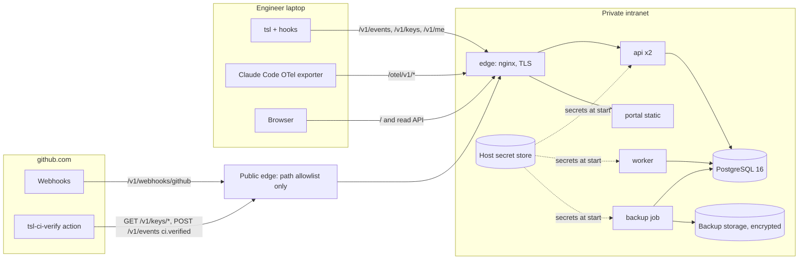
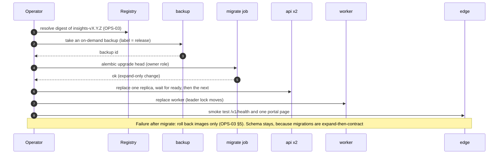
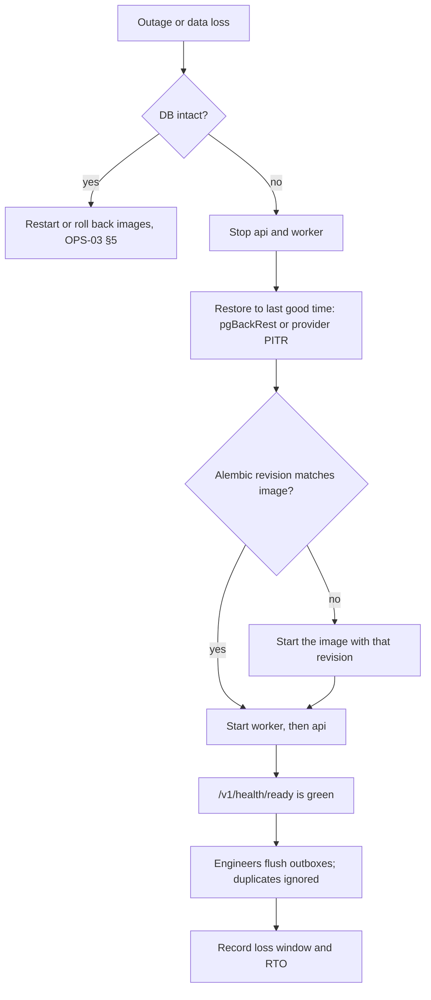

# OPS-01 · Deployment and Hosting

| Field | Value |
| --- | --- |
| Status | Draft for owner review |
| Owner | TBD by Puneet |
| Approver | Puneet Singh Nanda |
| Related docs | [Doc 3 Architecture](../architecture/03-architecture.md) §2, §10, §11 · [Doc 5 API and Rules](../architecture/05-api-and-rules.md) §5, §6 · [Doc 6 Constraints](../product/06-constraints.md) C-05, C-06, C-07 · [SDD-05 Claude Code integration](../design/SDD-05-claude-code-integration.md) §6.2 · [SDD-08 Telemetry and insights](../design/SDD-08-telemetry-insights.md) §3, §8, §9, §11 · [SDD-12 Companion repo](../design/SDD-12-companion-repo.md) §6.1 · [SEC-01 Threat model](../security/SEC-01-threat-model.md) · [DEV-01 Developer guide](../development/DEV-01-developer-guide.md) §3.3 · [OPS-02 Monitoring](OPS-02-monitoring-alerting.md) · [OPS-03 Release and rollout](OPS-03-release-rollout-support.md) · [OPS-04 Failure runbook](OPS-04-failure-runbook.md) · [ADR 0001](../adr/0001-portal-custom-react-on-fastapi.md) · [ADR 0002](../adr/0002-identity-microsoft-entra-id.md) · [Readiness tracker](../planning/readiness-tracker.md) Q31 |

## 1. Scope

### 1.1 What this document decides

How the server side of the Skill Library runs on the private intranet:

- what is deployed: the insights service (`api`, `worker`, `migrate`), PostgreSQL 16 and the React portal;
- three hosting options for Puneet to choose from (OQ-02), with the trade-offs;
- the container images, a Docker Compose file for a single-VM baseline, and TLS;
- where secrets come from (the host's secret store, never git);
- network exposure, including the public edge that GitHub needs;
- backup and restore, with proposed RPO and RTO;
- a cost model built from cost drivers only. It contains no prices.

### 1.2 What it does not decide

| Topic | Where |
| --- | --- |
| Which hosting option is used | **TBD by Puneet (OQ-02).** Data residency is OQ-03 |
| Service code, schema, retention values | [SDD-08](../design/SDD-08-telemetry-insights.md) |
| Alerts, dashboards, paging | [OPS-02](OPS-02-monitoring-alerting.md) |
| Release tags, pipeline, rollout and rollback | [OPS-03](OPS-03-release-rollout-support.md) |
| What to do when something fails | [OPS-04](OPS-04-failure-runbook.md) |
| Laptop side (plugin, `tsl`, managed settings) | [SDD-05](../design/SDD-05-claude-code-integration.md), [SDD-04](../design/SDD-04-tsl-cli.md) |

### 1.3 Ground rules

- The server side never runs an LLM and never calls the Claude API (C-01, C-02).
- It holds metadata only (NFR-10, X-06). It is not on the engineer's critical path: runs never wait for it (NFR-03).
- Every human login uses Microsoft Entra ID (ADR 0002). There is no local user database, no admin back door and no debug endpoint (C-05, X-07).
- Data is encrypted in transit (TLS 1.2+) and at rest, including backups (NFR-08, C-06).
- No secret is stored in git, in an image or in a committed env file.
- Availability target is 99.5% monthly (NFR-05). This is a business tool, so a single site is enough.

## 2. What is deployed

| Component | Image | Process | Replicas | State |
| --- | --- | --- | --- | --- |
| `api` | `truminds/insights` | `uvicorn app.main:app --workers 2` (SDD-08 §3.2) | 2 | Stateless |
| `worker` | `truminds/insights` | `python -m app.worker` | 1 (leader lock via `pg_try_advisory_lock`) | Stateless |
| `migrate` | `truminds/insights` | `alembic upgrade head` | Job, once per deploy | — |
| `admin` | `truminds/insights` | `python -m app.admin ...` (token create and revoke, SDD-08 §9.3) | On demand, `docker compose run` / `kubectl exec` | — |
| `portal` | `truminds/portal` | Static React build served by unprivileged nginx | 1–2 | Stateless |
| `edge` | `nginx` (pinned digest) | Reverse proxy, TLS termination, path routing | 1–2 | TLS keys |
| `postgres` | `postgres:16` (pinned digest), **or** managed PostgreSQL 16 | Database | 1 (+ standby, option dependent) | All data |
| `backup` | `truminds/pg-backup` (thin image with `pgBackRest`) | Scheduled base backups and WAL archive | 1 | — |

**One host name, same origin.** The portal is served at `/` and the API at `/v1` and `/otel` on one intranet host name, for example `skills.<intranet-domain>`. Same origin means no CORS rules and one certificate. The host name is a placeholder until OQ-02 closes.



## 3. Network exposure

SDD-08 §15 flags a conflict: the portal is intranet-only, but GitHub webhooks and the `tsl-ci-verify` action (running on GitHub-hosted runners) call the service from the internet. This document does not work around it. It offers two options for Puneet.

### 3.1 Path exposure matrix

| Path | Caller | Intranet | Public edge (option E1) |
| --- | --- | --- | --- |
| `/` (portal), read API (SDD-09) | Browser | Yes | **No** |
| `POST /v1/events` (Entra bearer) | `tsl` | Yes | No (see §3.3) |
| `POST /v1/events` (CI token, `ci.verified` only) | `tsl-ci-verify` | Yes | Yes |
| `POST /v1/keys`, `GET /v1/me` | `tsl login` | Yes | No |
| `GET /v1/keys/{key_id}` | `tsl ci-verify` | Yes | Yes |
| `POST /v1/signatures/verify` (SDD-04 OI-07, not yet in SDD-08) | `tsl ci-verify` | Yes | Yes, once the endpoint exists |
| `POST /v1/webhooks/github` (HMAC) | GitHub | Yes | Yes |
| `/otel/v1/metrics`, `/otel/v1/logs` | Claude Code | Yes | No |
| `GET /v1/health` | Probes | Yes | No |
| `GET /v1/health/ready`, `/metrics` (internal port) | Probes, OPS-02 | Internal network only | No |

### 3.2 Options for the GitHub-facing paths

| Option | How | For | Against |
| --- | --- | --- | --- |
| **E1 · Public edge with a path allowlist** | A reverse proxy in the DMZ forwards only the "Yes" rows above. Everything else returns 404 at the edge. Optional source filter on GitHub's published webhook and Actions IP ranges | Simple; webhooks arrive in real time | One internet-facing component to harden and patch |
| **E2 · Relay inside the intranet** | No inbound path. Webhook data is pulled by the `worker` from the GitHub REST API (PR and check-run state) on a timer. `tsl-ci-verify` runs on **self-hosted runners inside the intranet**, so it reaches the service directly | No inbound internet traffic | More code (polling); client repos must accept self-hosted runners; slower PR metrics |

Decision: **TBD by Puneet** (new open item, with OQ-02). E2 changes SDD-08 §6.1 and the CI action, so it needs an ADR if chosen.

### 3.3 Laptops off the intranet

Laptops reach the intranet host through the company VPN. When an engineer is off VPN, `tsl` keeps events in the outbox (R-04) and runs continue (NFR-03). Two things need the VPN: `tsl login` and starting a run, because `state start` checks the role online unless the 24 h grant cache is fresh (SDD-04 §6.7). If engineers often work off VPN, the laptop paths would also need the public edge; that is a separate decision (open item).

## 4. Hosting options (OQ-02)

The service is small: two stateless processes, one database and a static site. Any of the three options below works. They can be combined: the database choice (self-run or managed) is separate from where the containers run.

| Criterion | **H1 · Containers on an internal VM** | **H2 · Internal Kubernetes** | **H3 · Managed PostgreSQL** (with H1 or H2 for the app) |
| --- | --- | --- | --- |
| What runs where | One Linux VM with Docker Engine and Compose v2; PostgreSQL in a container on the same VM, data on an encrypted volume | `api`, `worker`, `portal` as Deployments; `migrate` as a Job; PostgreSQL via an operator or external | The provider runs PostgreSQL 16; app containers run as in H1 or H2 |
| Team effort to set up | Low | Medium (manifests or Helm chart, ingress, secrets operator) | Low for the DB |
| Team effort to run | Medium: OS patching, Docker, Postgres upgrades, backups are ours | Low to medium if a platform team already runs the cluster | Lowest for the DB: patching, backups, PITR by the provider |
| Availability | Single VM: a host failure is an outage until restore (fits 99.5% only with a tested RTO) | Pods reschedule; DB HA depends on the operator | Provider HA (standby) usually available |
| Backup and PITR | `pgBackRest` to encrypted storage (§9) | Operator feature or `pgBackRest` | Built in; confirm retention and encryption |
| Encryption at rest | LUKS or hypervisor disk encryption on the data volume | Encrypted storage class | Provider storage encryption with a key in the provider key service |
| Region pinning (C-07, OQ-03) | Where the VM is | Where the cluster is | Choose region; confirm with OQ-03 |
| Secret store | Host-level store (§7.2) | Secrets operator from the store | Provider secret manager or the company store |
| Fits if… | No cluster exists and the pilot is small | A company cluster and its team exist | A cloud account with managed PostgreSQL exists |

**What decides it:** an existing company platform (cluster or cloud account), the residency answer (OQ-03), and who will run the database day to day. Decision: **TBD by Puneet (OQ-02).**

### 4.1 Environments

| Environment | Purpose | Data | Identity |
| --- | --- | --- | --- |
| `dev` | Each developer's laptop (DEV-01 §3.3, `compose.dev.yml`) | Invented seed data (SDD-08 §11.3) | Development Entra app registration |
| `staging` | Release checks: migration dry run, load test NFR-06 (TST-01 §7), pilot ring smoke tests (OPS-03 §4.4) | Invented seed data only. Never a copy of production | Test-tenant or staging app registration |
| `prod` | Real use | Real metadata | Production app registration |

`staging` and `prod` use the same images and the same Compose file or chart, with different secrets and host names. The seed command refuses to run when `ENV=prod` (SDD-08 §11.3).

## 5. Container images

### 5.1 Image list

| Image | Built from | Base | Tag and pin |
| --- | --- | --- | --- |
| `truminds/insights` | `services/insights/Dockerfile` | `python:3.12-slim` (digest pinned) | `X.Y.Z` from tag `insights-vX.Y.Z` (OPS-03 §2); deploys reference the **digest** |
| `truminds/portal` | `portal/Dockerfile` | `node:20` build stage → `nginxinc/nginx-unprivileged` run stage | `X.Y.Z` from tag `portal-vX.Y.Z` |
| `truminds/pg-backup` | `deploy/images/pg-backup/Dockerfile` (new) | `postgres:16` + `pgbackrest` | Built with the insights release |
| `postgres:16`, `nginx` | Upstream | — | Digest pinned in the deploy files |

Registry: a private company registry. Which one is open (depends on OQ-02). Images are built and pushed only by the release pipeline (OPS-03 §3). Nobody pushes images from a laptop.

### 5.2 `services/insights/Dockerfile` (sketch)

```dockerfile
# build stage
FROM python:3.12-slim@sha256:<digest> AS build
COPY --from=ghcr.io/astral-sh/uv:<version> /uv /usr/local/bin/uv
WORKDIR /src
COPY pyproject.toml uv.lock ./
RUN uv sync --frozen --no-dev --no-install-project
COPY app ./app
COPY alembic ./alembic
COPY alembic.ini ./
RUN uv sync --frozen --no-dev

# run stage
FROM python:3.12-slim@sha256:<digest>
RUN useradd --uid 10001 --no-create-home insights
WORKDIR /srv
COPY --from=build /src /srv
ENV PATH="/srv/.venv/bin:$PATH" PYTHONDONTWRITEBYTECODE=1 PYTHONUNBUFFERED=1
USER 10001
EXPOSE 8000 9100
# entrypoint chosen by the deploy file: api | worker | migrate | admin
ENTRYPOINT ["python", "-m", "app.entry"]
```

Rules for every image:

- runs as a non-root user with a read-only root file system (writable `/tmp` as tmpfs only);
- holds no secrets, no `.env` file, no test data and no seed data in the `prod` stage;
- carries labels `org.opencontainers.image.version` and `.revision` (git SHA);
- has an SBOM produced in the release pipeline (OPS-03 §3).

`app.entry` is a small dispatcher (new file in SDD-08's layout) that maps `api`, `worker`, `migrate` and `admin` to the commands in SDD-08 §3.2. It accepts no other argument, so the image has no hidden mode.

### 5.3 Runtime configuration

All values come from environment variables or from secret files. `app/config.py` (pydantic-settings) reads a variable `X` or, if `X_FILE` is set, the file at that path. Secrets use only the `_FILE` form.

| Variable | Secret? | Example value | Note |
| --- | --- | --- | --- |
| `ENV` | No | `prod` | `dev`, `staging`, `prod` |
| `PUBLIC_BASE_URL` | No | `https://skills.<intranet-domain>` | Used in links and OTLP docs |
| `ENTRA_TENANT_ID` | No | `<tenant guid>` | ADR 0002 |
| `ENTRA_API_AUDIENCE` | No | `api://truminds-insights` | SDD-08 §4.1 |
| `DATABASE_HOST`, `DATABASE_NAME`, `DATABASE_SSLMODE` | No | `postgres`, `insights`, `verify-full` | NFR-08 |
| `DATABASE_APP_PASSWORD_FILE` | Yes | `/run/secrets/db_app_password` | Role `insights_app` |
| `DATABASE_READ_PASSWORD_FILE` | Yes | `/run/secrets/db_read_password` | Role `insights_read` |
| `DATABASE_OWNER_PASSWORD_FILE` | Yes | `/run/secrets/db_owner_password` | `migrate` job only |
| `PSEUDONYM_PEPPER_FILE` | Yes | `/run/secrets/pepper` | SDD-08 §8.1 |
| `DATA_KEY_FILE` | Yes | `/run/secrets/data_key` | Wrapped data key for column encryption (SDD-08 §9.2) |
| `CATALOGUE_READ_TOKEN_FILE` | Yes | `/run/secrets/catalogue_token` | Read-only token for the marketplace repo (SDD-08 §6.4) |
| `RETENTION_EVENTS_MONTHS` | No | `13` | OQ-08 |
| `DATABASE_CA_FILE` | No | `/etc/ssl/insights/db-ca.pem` | For `verify-full` |

GitHub hook secrets and ingest-token hashes live in the database (`github_hooks.secret_enc`, `ingest_tokens`), protected by the data key and the DB encryption (SDD-08 §9.2, §9.3).

## 6. Single-VM baseline (option H1)

### 6.1 Files

```text
deploy/                                  # new folder at the repo root
├─ compose/
│  ├─ compose.prod.yml                   # this section; same file for staging
│  ├─ edge/nginx.conf                    # TLS, routing, path allowlist for E1
│  └─ env/prod.env.example               # non-secret variables only (§5.3); real file lives on the host
├─ images/pg-backup/Dockerfile
└─ scripts/fetch-secrets.sh              # §7.2: secret store -> tmpfs files, run by systemd before compose
```

`deploy/**` holds no secret and no real host name. The real `prod.env` sits on the VM and is managed by the operator.

### 6.2 `deploy/compose/compose.prod.yml`

```yaml
name: truminds-insights

x-insights: &insights
  image: ${REGISTRY}/truminds/insights@${INSIGHTS_DIGEST}
  env_file: [/etc/truminds/prod.env]
  read_only: true
  tmpfs: [/tmp]
  user: "10001"
  security_opt: ["no-new-privileges:true"]
  networks: [app, db]
  restart: unless-stopped
  logging: {driver: json-file, options: {max-size: "20m", max-file: "5"}}

services:
  edge:
    image: nginx@${NGINX_DIGEST}
    ports: ["443:8443"]                       # HTTP 80 only redirects to 443
    volumes:
      - ./edge/nginx.conf:/etc/nginx/nginx.conf:ro
      - /run/truminds-secrets/tls:/etc/nginx/tls:ro
    networks: [edge, app]
    read_only: true
    tmpfs: [/var/cache/nginx, /var/run]
    depends_on: [api, portal]
    restart: unless-stopped

  api:
    <<: *insights
    command: ["api"]
    deploy: {replicas: 2}
    secrets: [db_app_password, db_read_password, pepper, data_key]
    healthcheck:
      test: ["CMD", "python", "-m", "app.entry", "probe", "ready"]
      interval: 15s
      timeout: 3s
      retries: 4
    depends_on: {migrate: {condition: service_completed_successfully}}

  worker:
    <<: *insights
    command: ["worker"]
    secrets: [db_app_password, pepper, data_key, catalogue_token]
    depends_on: {migrate: {condition: service_completed_successfully}}

  migrate:
    <<: *insights
    command: ["migrate"]
    secrets: [db_owner_password]
    restart: "no"

  portal:
    image: ${REGISTRY}/truminds/portal@${PORTAL_DIGEST}
    read_only: true
    tmpfs: [/tmp, /var/cache/nginx]
    networks: [app]
    restart: unless-stopped

  postgres:                                   # omit when option H3 (managed) is chosen
    image: postgres@${POSTGRES_DIGEST}
    environment:
      POSTGRES_DB: insights
      POSTGRES_USER: postgres
      POSTGRES_PASSWORD_FILE: /run/secrets/db_superuser_password
    command: ["postgres", "-c", "ssl=on", "-c", "ssl_cert_file=/tls/server.crt", "-c", "ssl_key_file=/tls/server.key",
              "-c", "archive_mode=on", "-c", "archive_command=pgbackrest --stanza=insights archive-push %p"]
    volumes:
      - /srv/truminds/pgdata:/var/lib/postgresql/data      # on the encrypted volume (§8.2)
      - /run/truminds-secrets/db-tls:/tls:ro
    secrets: [db_superuser_password]
    networks: [db]
    restart: unless-stopped

  backup:
    image: ${REGISTRY}/truminds/pg-backup@${PGBACKUP_DIGEST}
    command: ["schedule"]                     # full weekly, differential daily, WAL continuous (§9)
    volumes: [/srv/truminds/pgdata:/var/lib/postgresql/data:ro]
    secrets: [db_superuser_password, backup_cipher_key, backup_store_credentials]
    networks: [db]
    restart: unless-stopped

networks:
  edge: {}
  app: {internal: true}
  db: {internal: true}

secrets:                                       # files are written to tmpfs by fetch-secrets.sh; never in git
  db_superuser_password:    {file: /run/truminds-secrets/db_superuser_password}
  db_owner_password:        {file: /run/truminds-secrets/db_owner_password}
  db_app_password:          {file: /run/truminds-secrets/db_app_password}
  db_read_password:         {file: /run/truminds-secrets/db_read_password}
  pepper:                   {file: /run/truminds-secrets/pepper}
  data_key:                 {file: /run/truminds-secrets/data_key}
  catalogue_token:          {file: /run/truminds-secrets/catalogue_token}
  backup_cipher_key:        {file: /run/truminds-secrets/backup_cipher_key}
  backup_store_credentials: {file: /run/truminds-secrets/backup_store_credentials}
```

Notes:

- `app` and `db` are internal networks. Only `edge` publishes a port. PostgreSQL is never reachable from outside the VM.
- `/metrics` listens on port 9100 inside the `app` network for the OPS-02 scraper. The edge never routes it.
- The `probe ready` entrypoint calls `/v1/health/ready` locally, which fails if the DB revision is not head (SDD-08 §11.1).
- Under option H2, the same services become Kubernetes objects. A chart in `deploy/k8s/` (new) mirrors this file: two Deployments, one Job, NetworkPolicies equal to the three networks, and secrets from the secrets operator.

### 6.3 Edge routing (`edge/nginx.conf`, essentials)

| Location | Upstream | Extra rules |
| --- | --- | --- |
| `/` | `portal:8080` | `Content-Security-Policy` with `default-src 'self'`; Entra login host in `connect-src` and `frame-src` as MSAL needs |
| `/v1/` | `api:8000` | `client_max_body_size 1m` (SDD-08 §4.1) |
| `/otel/` | `api:8000` | `client_max_body_size 4m`; gzip bodies passed through |
| `/metrics`, `/v1/health/ready` | — | `return 404` at the edge |
| Public server block (E1 only) | `api:8000` | Exact-match locations for the §3.1 "Yes" rows; `return 404` for everything else |

## 7. TLS and secrets

### 7.1 TLS

| Hop | Rule |
| --- | --- |
| Browser, `tsl`, Claude Code → edge | TLS 1.2 and 1.3 only; HSTS; certificate from the **company internal CA** for the intranet host name |
| GitHub → public edge (E1) | Certificate from a **public CA**, because GitHub does not trust the internal CA |
| Edge → `api`, `portal` | Plain HTTP inside the internal `app` network on one host (H1). Under H2, follow the cluster's mesh or network-policy standard |
| `api`, `worker`, `backup` → PostgreSQL | TLS with `sslmode=verify-full` (SDD-08 §9.2) |

**Laptop trust.** `tsl` uses the OS certificate store through `truststore` (SDD-04 §2.2), so the internal CA must be installed on every engineer laptop (IT, SDD-04 OI-05). Whether the Claude Code OTel exporter trusts the OS store, or needs an extra CA variable in the managed `env` block, is **not verified** in SDD-05 §2. It needs a spike before rollout (new; add to the SDD-05 spike list). If it fails, OTel data does not arrive; runs are not affected.

**Renewal.** Internal certificates: renewed by the operator or an ACME client against the internal CA, before expiry. OPS-02 owns the expiry alert.

### 7.2 Secrets: from the host's secret store, never from git

The org rule is that no secret lives in git. This holds for the deploy files too: `deploy/**` contains secret **names** only.

| Option | Secret store | How secrets reach the containers |
| --- | --- | --- |
| H1 | The company secret store the VM can reach (for example a vault service, or the cloud secret manager of the hosting account). Choice depends on OQ-02 | `fetch-secrets.sh` runs as a systemd unit before `docker compose up`. It authenticates with the VM's machine identity, writes each secret to `/run/truminds-secrets/` (tmpfs, mode 0400, owner root), and Compose mounts them read-only at `/run/secrets/` |
| H2 | Same store | A secrets operator syncs them into Kubernetes Secrets, mounted as files. Secrets are never put in Helm values files |
| H3 | Provider secret manager | Same as H1 or H2; DB password rotation can be handled by the provider |

### 7.3 Secret inventory

| Secret | Used by | Rotation | Who rotates |
| --- | --- | --- | --- |
| DB passwords (`superuser`, `insights_owner`, `insights_app`, `insights_read`) | postgres, migrate, api, worker, backup | On staff change and on suspicion | Service operator |
| Pseudonym pepper | api | **Never** in normal operation. Pseudonyms are stored once (SDD-08 §8.1), so a new pepper affects only new users | Service operator, with Puneet's approval |
| Data key (wrapped) and its key-encryption key | api, worker | Yearly proposal; key id stored with each value (SDD-08 §9.2) | Service operator |
| Catalogue read token | worker | When the token type allows, at least yearly | Platform admin |
| TLS private keys | edge, postgres | With each certificate renewal | Service operator |
| Backup cipher key and storage credentials | backup | Yearly proposal; old keys kept until the last backup that uses them expires | Service operator |
| OTel ingest token | Claude Code (managed settings) | SDD-08 §9.3: new token, update managed settings, revoke old after 7 days | Platform admin + Claude admin |
| CI ingest token (`TSL_CI_TOKEN`) | `tsl-ci-verify` on client repos | Same procedure, per client GitHub org | Platform admin |
| GitHub webhook secrets | api (stored encrypted in DB) | Per hook, on suspicion or staff change | Platform admin |
| Companion read token (`TSL_COMPANION_READ_TOKEN`) | Product repo CI | §7.4 | Tech lead with platform admin |

### 7.4 Companion repo read token for CI (asked by SDD-12 §6.1)

| Choice | How | For | Against |
| --- | --- | --- | --- |
| **GitHub App** (proposal) | A Truminds GitHub App with read-only `contents` on companion repos; the action exchanges the App key for a short-lived installation token per job | Short-lived tokens; scoped per repo; no personal account | The App private key becomes one more secret, stored as a repo or org secret on the client side |
| Fine-grained personal access token | One token per companion repo, read-only contents | Simple | Tied to a person; has an expiry that someone must renew |

Final choice: TBD by Puneet (SDD-12 open item). Either way the token is read-only and limited to one companion repo.

## 8. Database

### 8.1 Settings

| Item | Value |
| --- | --- |
| Version | PostgreSQL 16 |
| Size | 50 GB allocated at pilot volume (SDD-08 §11.4), alert at 70% (OPS-02) |
| Roles | `insights_owner`, `insights_app`, `insights_read` (SDD-08 §9.4). The superuser is used only by `backup` and for break-glass |
| Connections | `api` 2 replicas × 2 workers × pool 5, plus `worker` pool 5: about 25. `max_connections = 100` |
| Partitions | Created by the `worker` job, not by migrations (SDD-08 §11.1) |
| Extensions | Only those that SDD-08 migrations create |
| Time zone | UTC |

### 8.2 Encryption at rest

| Option | How | Check (SEC-01 SEC-T-31) |
| --- | --- | --- |
| H1 | Data volume `/srv/truminds/pgdata` on LUKS or on a hypervisor-encrypted disk; key outside the VM | Operator shows the volume is encrypted |
| H2 | Encrypted storage class | Cluster admin confirms |
| H3 | Provider storage encryption with a key in the provider key service | Provider setting screenshot in the hosting checklist |
| All | Backups encrypted before they leave the host (§9.1). Column encryption for names and emails on top (SDD-08 §9.2) | Restore test reads the encrypted backup with the backup key only |

### 8.3 Deploy order with migrations



Migrations are forward-only (SDD-08 §11.1). A release that removes a column does it in a later release than the one that stops using it, so the previous image always works with the current schema.

## 9. Backup and restore

### 9.1 What is backed up

| Data | Backed up? | How |
| --- | --- | --- |
| PostgreSQL | Yes | Option H1/H2: `pgBackRest` full backup weekly, differential daily, WAL archived continuously, encrypted with the backup cipher key, sent to storage outside the VM. Option H3: provider backups with point-in-time recovery |
| Secret store contents | Yes, by the secret store's own backup | Not our job; confirm with its owner |
| Deploy config (`deploy/**`) | Yes | It is in git |
| Host `prod.env` | Yes | Kept in the secret store or the config management of the host |
| Container images | No | Rebuilt from tags; digests recorded in the release |
| Companion repos, signed records | No (not on this host) | They live on GitHub (NFR-16) |
| Laptop outboxes | No | They hold unsent events until delivered |

### 9.2 Proposed RPO and RTO

The service is not on the critical path (NFR-03), and laptops keep pending events. But `tsl` deletes events once the service has accepted them (`sent` rows kept only `retain_sent_days`, default 7, SDD-04 §7.1). Events accepted after the last restore point are therefore lost, not re-sent. The RPO must be short for that reason.

| Item | Proposal (Puneet to confirm) | Why |
| --- | --- | --- |
| RPO | **≤ 15 minutes** with WAL archiving or provider PITR. Without WAL archiving: 24 hours, and the gap is lost | Metrics lost after a restore are lost for good |
| RTO | **≤ 4 hours** to a working API and portal | Fits 99.5% monthly (about 3.6 hours of downtime per month) only if outages are rare; runs keep working meanwhile |
| Backup retention | **35 days** of restore points, then deleted | Long enough to catch a silent bad migration. Short so that an erasure request (SDD-08 §8.1) is fully applied once old backups expire. Must not exceed the OQ-08 retention |
| Restore test | Before G1 and G2, and after any hosting change | PLN-01 gates; no calendar dates |

### 9.3 Restore procedure (H1, `pgBackRest`)

1. Declare an incident and freeze changes (OPS-04 §5 if data exposure is suspected; otherwise the service owner leads).
2. Stop `api` and `worker`: `docker compose stop api worker`. `tsl` keeps events in outboxes while the API is down (NFR-03).
3. Fetch secrets as usual. Restore into an empty data directory: `pgbackrest --stanza=insights --type=time "--target=<UTC time>" restore`.
4. Start `postgres`. Check `alembic current` equals the revision of the image you will start; if not, start the image whose revision matches.
5. Start `worker`, then `api`. Check `/v1/health/ready`.
6. Ask engineers to run `tsl events flush` (OPS-04 §4.6). Duplicate events are ignored (R-05), so a flush is always safe.
7. Record the restore point, the data-loss window and the time to recover. Feed them back into the RPO and RTO proposals.

Under H3, steps 3–4 are the provider's point-in-time restore into a new instance, then a change of `DATABASE_HOST`.



## 10. Cost model (drivers only)

This model lists what drives cost and how each driver grows. It contains **no prices**. To get a number, multiply each quantity by the company's internal rate card or the provider's price list for the chosen option.

```text
monthly cost = Σ (quantity of driver × unit rate of driver)
             + people time × internal hourly rate
```

| # | Driver | Unit | Pilot quantity (SDD-08 §11.4: ~40 engineers) | Grows with | H1 | H2 | H3 |
| --- | --- | --- | --- | --- | --- | --- | --- |
| D1 | App compute | vCPU and GB RAM, per month | Proposal: 4 vCPU, 16 GB for api ×2, worker, portal, edge (and PostgreSQL under H1) | Engineers × runs (ingest rate) | One VM | Share of cluster nodes | App part only |
| D2 | Database compute | vCPU and GB RAM | Included in D1 under H1; separate instance under H3 | Query load from the portal; view refresh | — | Operator pods | Managed instance class |
| D3 | Database storage | GB per month | 50 GB allocated (~15 GB used per 13 months of events) | Engineers × tool calls × retention months (OQ-08) | Disk | Volume | Managed storage |
| D4 | Database HA standby | Second instance | None in the baseline | Availability target | Not in baseline | Optional replica | Provider option |
| D5 | Backup storage | GB-months | About 4–6 × used DB size with 35-day retention and WAL | DB size × retention days | Object or file storage | Same | Often bundled up to a size |
| D6 | Data transfer | GB per month | Small: events are metadata, ≤ 1 MiB per batch | Engineers; OTel export interval (S-10) | Usually none on intranet | Same | Depends on account |
| D7 | Public edge (E1) | One small proxy, certificate | 1 | Fixed | DMZ VM or shared proxy | Ingress | Same |
| D8 | Container registry | GB stored | A few GB (images per release) | Number of releases kept | Company registry | Same | Same |
| D9 | Secret store and key service | Secrets, key operations | ~15 secrets; key operations at start-up | Fixed | Company store | Same | Provider pricing per secret or key |
| D10 | Monitoring stack (OPS-02) | Metrics series, log volume | Small | Engineers | Shared or own | Shared | Shared |
| D11 | Certificates | Count | 1 internal, 1 public (E1) | Fixed | — | — | — |
| D12 | CI minutes | Runner minutes | `tsl-ci-verify` on every PR of consented product repos; release pipeline matrix | PRs × verifier profile length | Client's GitHub plan or self-hosted runners (E2) | Same | Same |
| D13 | People time | Hours per month | Patching, upgrades, restore tests, token rotation | Option | Highest | Medium (shared platform) | Lowest for the DB |
| D14 | Laptop software | Licences | Docker Desktop for engineers (SDD-05 §8.4) | Engineers | Same for all options | | |

Claude seats are already paid for and are outside this model (C-03).

## 11. Hosting checklist (SEC-01 SEC-T-31)

Done once per environment, before the first real data arrives:

- [ ] Hosting option chosen and recorded as an ADR (OQ-02); region recorded (OQ-03).
- [ ] Database volume or instance encrypted at rest; backups encrypted; key outside the host.
- [ ] Secrets fetched from the secret store at start-up; `git grep` and the CI secrets scan find no secret in `deploy/**`.
- [ ] Only the edge publishes a port; PostgreSQL unreachable from outside its network; `/metrics` and `/v1/health/ready` not routed by the edge.
- [ ] Public exposure (E1 or E2) decided; under E1 only the allowlisted paths answer.
- [ ] TLS 1.2+ everywhere; `sslmode=verify-full` from the service to PostgreSQL.
- [ ] Production Entra app registrations created (ADR 0002); no other login path exists.
- [ ] `ENV=prod` set, so the seed command refuses to run.
- [ ] Restore test passed and its RPO and RTO recorded (§9.2).
- [ ] OPS-02 alerts wired to the on-call channel.

## 12. Done criteria

- OQ-02 and OQ-03 are decided and recorded in an ADR, and §4 is cut down to the chosen option.
- `deploy/compose/compose.prod.yml` (or the H2 chart) brings up `staging` from released image digests with secrets from the secret store only.
- `/v1/health/ready` is green in `staging` and `prod`; the portal loads over TLS on the intranet host name.
- The GitHub-facing exposure (E1 or E2) is decided and tested with a signed test webhook and one `tsl ci-verify` run.
- One full restore has been done in `staging` from an encrypted backup, meeting the confirmed RPO and RTO.
- The hosting checklist in §11 is complete for `prod` and signed off by the security reviewer (TBD by Puneet).
- The cost drivers in §10 have quantities filled in for the chosen option and unit rates from the company rate card.

## 13. Open items

| Ref | Item | Owner |
| --- | --- | --- |
| OQ-02 | Hosting option: H1, H2, H3, or H3 combined with H1 or H2 | TBD by Puneet |
| OQ-03 | Data residency and region | TBD by Puneet |
| OQ-08 | Event retention (sets D3 and the backup retention ceiling) | TBD by Puneet |
| new | Public exposure for GitHub: E1 (public edge with allowlist) or E2 (relay and self-hosted runners). E2 needs an ADR and changes SDD-08 §6.1 | TBD by Puneet |
| new | Laptop ingest off VPN: keep it intranet-only (outbox waits) or add the laptop paths to the public edge | TBD by Puneet |
| new | Whether the Claude Code OTel exporter trusts the internal CA from the OS store; add a spike to SDD-05 §8.1 | Shubham Bansal |
| new | Confirm the RPO (15 min), RTO (4 h) and backup retention (35 days) proposals | TBD by Puneet |
| new | Company registry and secret store to use | TBD by Puneet, after OQ-02 |
| SDD-12 | Companion read token for CI: GitHub App (proposal) or fine-grained token | TBD by Puneet |
| SDD-04 OI-07 | `POST /v1/signatures/verify` is not yet in SDD-08; it must be on the public edge under E1 | Gaurav Saini |
| new | `app.entry` dispatcher and `deploy/` folder are new paths; SDD-08 §3.1 and DEV-01 §2.1 should list them | Gaurav Saini; DEV-01 owner TBD by Puneet |
| closed | DEV-01 §3.3 now runs `app.main:app`, as SDD-08 §3.2 ([registry](../architecture/registry.md) §10) | Gaurav Saini |
| new | Service operator (runs deploys, restores, rotations) | TBD by Puneet |
