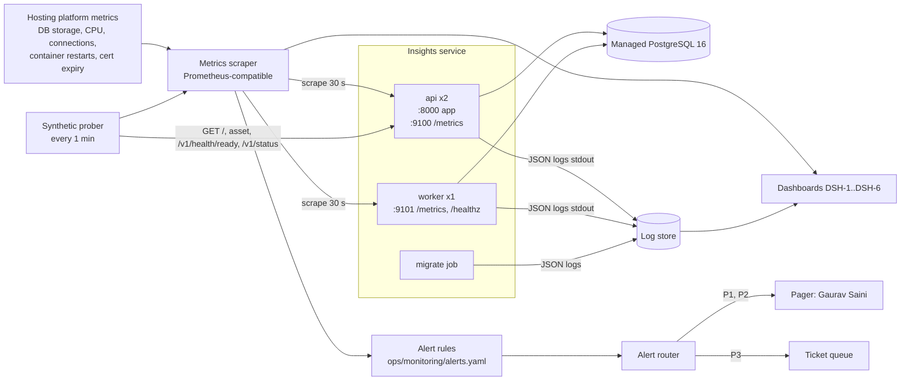
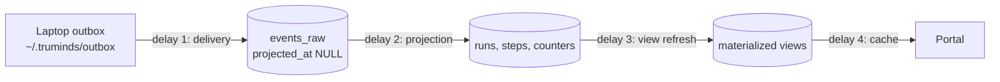
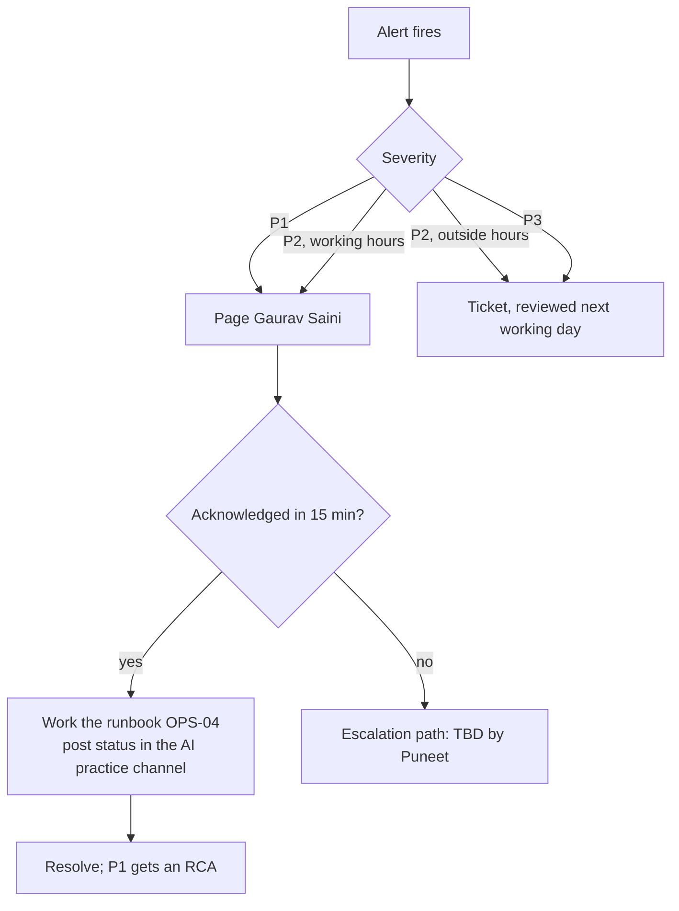

# OPS-02 · Monitoring and Alerting

| Field | Value |
| --- | --- |
| Status | Draft for owner review |
| Owner | Gaurav Saini |
| Approver | Puneet Singh Nanda |
| Related docs | [SDD-08 Telemetry and insights](../design/SDD-08-telemetry-insights.md) §3, §9, §11 · [SDD-09 Web portal and read API](../design/SDD-09-web-portal.md) §3.6, §5, §10 · [Doc 3 Architecture](../architecture/03-architecture.md) §10 (NFR-03, NFR-05, NFR-06, NFR-07) · [Doc 5 API and Rules](../architecture/05-api-and-rules.md) §5, R-04 · [SEC-01 Threat model](../security/SEC-01-threat-model.md) · [TST-01 Test plan](../testing/TST-01-master-test-plan.md) · OPS-01 Deployment and hosting · OPS-04 Failure-mode runbook · [Readiness tracker](../planning/readiness-tracker.md) Q33 |

## 1. Scope

### 1.1 What this document decides

How the insights service (`api`, `worker`, `migrate`) and the web portal are watched in staging and production:

- service level objectives (SLOs) and how they are measured;
- health endpoints and the internal metrics port;
- the metrics each process exports, and the log format;
- alert rules AL-01 to AL-26, with thresholds, severity and first action;
- how ingest lag and outbox backlog are detected;
- the dashboards;
- who is paged.

### 1.2 What it does not decide

| Topic | Where |
| --- | --- |
| Hosting, metrics and log tooling product, region | OPS-01 (blocked on OQ-02). This document is tool-neutral: rules use PromQL-style expressions that any Prometheus-compatible system runs |
| Step-by-step fixes for each alert | OPS-04 (this document gives the first action only) |
| Release and rollback | OPS-03 |
| Laptop-side health (`tsl doctor`, hook logs) | SDD-04, SDD-05 |
| Business metrics on the portal | SDD-08 §10.4, SDD-09 |

### 1.3 Ground rules

- The service is not on the engineer's critical path (NFR-03, TM-11). An outage loses no data: `tsl` keeps events in the outbox (R-04). Severity reflects this.
- No personal data in metrics, logs or alerts: no names, emails, Entra object ids, client names, ticket ids, run ids or file paths in labels or alert text (NFR-10, C-09). Pseudonyms may appear in logs only.
- No monitoring endpoint is public. `/metrics` is on an internal port only (SDD-08 §9.1).
- Every alert has an owner, a dashboard and a runbook entry.

## 2. Monitoring architecture



The product for each box (scraper, log store, alert router, pager) is chosen with hosting in OPS-01. Alert rules and dashboards are kept as code in the repository so they move with the choice.

```text
ops/monitoring/
├─ alerts.yaml           # AL-01..AL-26 in Prometheus rule format
├─ alerts.test.yaml      # promtool unit tests for each rule
├─ recording.yaml        # SLI recording rules (§3.2)
├─ dashboards/           # DSH-1..DSH-6 as JSON for the chosen tool
└─ synthetic/probe.yaml  # §4.3 checks
```

## 3. Service level objectives

### 3.1 SLOs

Window: 30 days, rolling. NFR-05 sets 99.5% availability for the API and the portal.

| SLO | SLI (good events ÷ valid events) | Target | Error budget per 30 days | Source |
| --- | --- | --- | --- | --- |
| SLO-1 Ingest availability | `POST /v1/events`, `/otel/v1/*`, `/v1/webhooks/github` responses that are not 5xx ÷ all (429 excluded from both) | 99.5% | 0.5% of requests (≈ 3.6 h of full outage) | `insights_http_requests_total` |
| SLO-2 Ingest latency | `POST /v1/events` requests answered in ≤ 1 s ÷ all | 95% | 5% | `insights_http_request_duration_seconds` |
| SLO-3 Projection freshness | Minutes in which projection lag ≤ 60 s ÷ all minutes | 99% | ≈ 7.2 h | `insights_projection_lag_seconds` |
| SLO-4 View freshness | Minutes in which every materialized view is ≤ 10 min old ÷ all minutes | 99% | ≈ 7.2 h | `insights_view_refresh_age_seconds` |
| SLO-5 Read availability | `GET /v1/*` read routes not 5xx ÷ all | 99.5% | 0.5% | `insights_http_requests_total` |
| SLO-6 Read latency | Read routes answered in ≤ 800 ms ÷ all | 95% | 5% | SDD-08 §11.4 |
| SLO-7 Portal availability | Synthetic portal checks that pass ÷ all checks | 99.5% | ≈ 3.6 h | Synthetic prober |
| SLO-8 Webhook processing | Webhook deliveries answered 2xx within 10 s ÷ all signed deliveries | 99.5% | 0.5% | `insights_webhook_duration_seconds` |

Portal page load (NFR-07, ≤ 3 s p95) is measured in CI and before each release by TC-POR-008, not in production. Release 1 sends no browser telemetry, because that would need a new write endpoint (Open items).

### 3.2 Recording rules

```yaml
# ops/monitoring/recording.yaml (excerpt)
groups:
- name: insights-sli
  rules:
  - record: sli:ingest_requests:rate5m
    expr: sum(rate(insights_http_requests_total{route_group="ingest",status_class!="429"}[5m]))
  - record: sli:ingest_errors:rate5m
    expr: sum(rate(insights_http_requests_total{route_group="ingest",status_class="5xx"}[5m]))
  - record: sli:read_requests:rate5m
    expr: sum(rate(insights_http_requests_total{route_group="read",status_class!="429"}[5m]))
  - record: sli:read_errors:rate5m
    expr: sum(rate(insights_http_requests_total{route_group="read",status_class="5xx"}[5m]))
  - record: sli:read_slow:ratio5m
    expr: 1 - (sum(rate(insights_http_request_duration_seconds_bucket{route_group="read",le="0.8"}[5m]))
               / sum(rate(insights_http_request_duration_seconds_count{route_group="read"}[5m])))
```

`route_group` is one of `ingest`, `read`, `health`, `static`, set from a fixed route table in `app/obs/metrics.py`.

## 4. Health endpoints and the metrics port

### 4.1 Endpoints

| Process | Endpoint | Port | Auth | Returns | Used by |
| --- | --- | --- | --- | --- | --- |
| api | `GET /v1/health` | 8000 | none | `200 {"status":"ok","version":"1.6.0"}` if the process serves requests. No DB call | Liveness probe |
| api | `GET /v1/health/ready` | 8000 | none | `200` when all checks in §4.2 pass, else `503` with `{"status":"fail","checks":{"db":"ok","migration":"behind",...}}`. No secrets, hosts or versions of dependencies in the body | Readiness probe, synthetic |
| api | `GET /metrics` | 9100 (internal only) | network policy | Prometheus text format | Scraper |
| worker | `GET /healthz` | 9101 (internal only) | network policy | `200` if the main loop ticked in the last 30 s, else `503` | Liveness probe |
| worker | `GET /metrics` | 9101 (internal only) | network policy | Prometheus text format | Scraper |
| portal | `GET /`, one hashed asset | 8000 | none (static) | `200`, `index.html` holds the expected build id | Synthetic |
| read API | `GET /v1/status` | 8000 | Bearer | SDD-09 §5.6.2 | Synthetic (authenticated, §4.3), portal banner |

`/v1/health` and `/v1/health/ready` are in the published OpenAPI file (SDD-08 §13). Ports 9100 and 9101 are not routed by any ingress.

### 4.2 Readiness checks (`/v1/health/ready`)

| Check | Pass rule | Timeout |
| --- | --- | --- |
| `db` | `SELECT 1` on the pool | 1 s |
| `migration` | `alembic_version` equals the head revision built into the image (SDD-08 §11.1) | 1 s |
| `secrets` | Pepper, data key and JWKS URL loaded at start-up | in memory |
| `jwks` | Entra signing keys cached and younger than 24 h | in memory |
| `static` | `/app/portal/index.html` exists (SDD-09 §10) | in memory |

Readiness never checks the worker. A stopped worker does not take ingest down; it raises AL-10.

### 4.3 Synthetic checks

| Check | Every | Pass rule |
| --- | --- | --- |
| SY-1 Portal shell | 1 min | `GET /` 200 within 2 s, body holds `<meta name="build-id"` matching the deployed version; one hashed JS asset 200 |
| SY-2 Ready | 1 min | `GET /v1/health/ready` 200 within 1 s |
| SY-3 Read API auth path | 1 min | `GET /v1/status` without a token → 401 `E-API-02` within 1 s (proves routing and token validation are live) |
| SY-4 Authenticated read | 5 min | `GET /v1/status` and `GET /v1/catalogue/summary` with a token for a monitoring identity → 200. Needs an Entra app registration with a `viewer` grant (Open items). Until then SY-4 is off |
| SY-5 Ingest path | 5 min | `POST /v1/events` with an empty batch and no token → 401 `E-ING-07` |

SY-5 sends no events, so it never writes data.

## 5. Metrics

### 5.1 Rules

- Prefix `insights_`. Units in the name (`_seconds`, `_bytes`, `_total`).
- Labels come only from fixed enums: `route` (route template, not the raw path), `method`, `status_class`, `type` (event type), `source`, `code` (error code), `view`, `job`, `table`, `reason`. Never `run_id`, user, system, project, repo or device.
- Histograms use buckets `0.05, 0.1, 0.25, 0.5, 0.8, 1, 2, 5, 10` seconds.

### 5.2 Catalogue

| Metric | Type | Labels | Process | Meaning |
| --- | --- | --- | --- | --- |
| `insights_http_requests_total` | counter | `route`, `route_group`, `method`, `status_class` | api | Every response |
| `insights_http_request_duration_seconds` | histogram | `route`, `route_group`, `method` | api | Time to response |
| `insights_events_received_total` | counter | `type`, `source` | api | Events accepted (new rows) |
| `insights_events_duplicate_total` | counter | `source` | api | Duplicates (R-05) |
| `insights_events_rejected_total` | counter | `code` | api | Per-event rejects E-ING-01..05 |
| `insights_event_delivery_delay_seconds` | histogram (buckets to 7 d) | `source` | api | `received_at - occurred_at` (outbox delay) |
| `insights_batch_events` | histogram | — | api | Events per batch |
| `insights_rate_limited_total` | counter | `route_group` | api | 429 responses |
| `insights_auth_failures_total` | counter | `kind` (`entra`, `ingest_token`, `hmac`), `reason` | api | 401 causes |
| `insights_otel_datapoints_total` | counter | `signal` | api | OTLP points kept (SDD-08 §9.3) |
| `insights_otel_dropped_total` | counter | `reason` (`not_allowlisted`, `content_attr`, `decode`) | api | OTLP points dropped (SDD-08 §5.2) |
| `insights_webhook_deliveries_total` | counter | `event`, `result` (`stored`, `duplicate`, `ignored`, `unknown_repo`) | api | GitHub deliveries |
| `insights_webhook_signature_failures_total` | counter | — | api | Bad HMAC or unknown hook (SDD-08 §6.1) |
| `insights_webhook_duration_seconds` | histogram | — | api | Webhook handling time |
| `insights_read_scope_denied_total` | counter | `route`, `code` (`E-API-03`, `E-API-04`) | api | Role or scope refusals |
| `insights_name_reveals_total` | counter | `route` | api | Requests that returned names (SDD-09 §5.3) |
| `insights_db_pool_in_use` / `_size` | gauge | `process` | api, worker | Connection pool |
| `insights_projection_backlog_events` | gauge | — | worker | Rows in `events_raw` with `projected_at IS NULL` |
| `insights_projection_lag_seconds` | gauge | — | worker | `now() - min(received_at)` over unprojected, unparked rows; 0 when none |
| `insights_projection_parked_events` | gauge | `code` | worker | Unprojected rows with `projection_error` set |
| `insights_projected_total` | counter | `type` | worker | Events projected |
| `insights_projection_errors_total` | counter | `type`, `code` | worker | Handler failures |
| `insights_view_refresh_age_seconds` | gauge | `view` | worker | `now() - view_refresh_log.refreshed_at` |
| `insights_view_refresh_duration_seconds` | gauge | `view` | worker | Last refresh time |
| `insights_view_refresh_failures_total` | counter | `view` | worker | Failed refreshes |
| `insights_job_last_success_timestamp` | gauge | `job` (`refresh_views`, `rollup`, `retention`, `partitions`, `outbox_watch`, `catalogue_sync`) | worker | Unix time of last success |
| `insights_job_failures_total` | counter | `job` | worker | Failed job runs |
| `insights_worker_leader` | gauge | — | worker | 1 when this worker holds the advisory lock |
| `insights_worker_heartbeat_timestamp` | gauge | — | worker | Main loop tick |
| `insights_partitions_ahead` | gauge | `table` (`events_raw`, `otel_events`) | worker | Future monthly partitions that exist |
| `insights_catalogue_items_skipped_total` | counter | `kind` (`skill`, `workflow`, `pod`) | worker | Invalid catalogue files (SDD-08 §6.4) |
| `insights_catalogue_last_sync_timestamp` | gauge | — | worker | Last successful sync |
| `insights_catalogue_unsynced_release` | gauge | — | worker | 1 when the latest `vX.Y.Z` tag is not in `catalogue_releases` |
| `insights_db_size_bytes` | gauge | — | worker | `pg_database_size` every 5 min |
| `insights_db_table_bytes` | gauge | `table` (fixed list) | worker | Largest tables and partitions |
| `insights_devices_seen` | gauge | `window` (`1d`, `14d`) | worker | Devices with `last_seen_at` in window |
| `insights_devices_outbox_nonempty` | gauge | — | worker | Devices seen in 14 d with `outbox_depth > 0` (M-26) |
| `insights_devices_outbox_events` | gauge | — | worker | Σ `outbox_depth` over those devices |
| `insights_devices_outbox_stale` | gauge | `age` (`gt_24h`, `gt_72h`, `gt_7d`) | worker | Devices whose `outbox_oldest_at` is older than the bucket |
| `insights_devices_outbox_oldest_age_seconds` | gauge | — | worker | Max of `now() - outbox_oldest_at` over devices seen in 14 d |
| `insights_ingest_token_last_used_age_seconds` | gauge | `kind` | worker | Newest `last_used_at` per token kind |
| `insights_tls_cert_expiry_seconds` | gauge | `host` | prober | From the synthetic prober |

Database server metrics (storage used, CPU, connections, replication lag, backup status) and container restarts come from the hosting platform (OPS-01).

## 6. Logs

### 6.1 Format

One JSON object per line on stdout, written by `app/obs/logging.py` (structlog or the standard `logging` module with a JSON formatter).

```json
{"ts":"2026-10-13T09:30:12.418Z","level":"info","service":"api","version":"1.6.0","instance":"api-7c9f",
 "request_id":"6f1c2b0e-3b1a-4c6e-9a51-0d2b6f0c1e77","route":"/v1/events","method":"POST","status":202,
 "duration_ms":184,"caller":"eng-4f2a","token_kind":"entra","events":{"accepted":120,"duplicates":3,"rejected":0},
 "msg":"batch stored"}
```

| Field | Rule |
| --- | --- |
| `request_id` | From `X-Request-ID` if it is a UUID, else generated; echoed in the response header and in problem+json (SDD-09 §5.1.4) |
| `caller` | Pseudonym, `ci:<token label>`, `otel`, `github` or `anonymous`. Never `oid`, email or name |
| `code` | Error code on failures (E-ING-*, E-KEY-*, E-API-*) |
| Worker lines | `job`, `batch`, `projected`, `parked`, `duration_ms` |

### 6.2 Never logged

Request and response bodies; `Authorization`, cookie and `X-Hub-Signature-256` headers; tokens of any kind; PR bodies; event `body` fields; decrypted names; SQL parameters. A unit test feeds a request with a token and a PR body through the middleware and asserts neither appears in the captured log.

### 6.3 Levels and retention

| Level | Use |
| --- | --- |
| `error` | Unhandled exception, failed job, failed refresh. Includes exception type and a stack trace without local variables |
| `warning` | Parked events, rejected events, 401 bursts, slow queries over 2 s |
| `info` | One line per request and per job run |
| `debug` | Off in staging and production. No runtime switch that turns on body logging |

Retention in the log store: 30 days (proposal; confirm with OPS-01 and OQ-08). `audit_log` in the database is separate and kept 24 months (SDD-08 §8.2).

## 7. Alert rules

Severities: **P1** pages at any time; **P2** pages during team working hours (time zone and hours TBD by Puneet) and becomes a ticket outside them; **P3** opens a ticket only. These levels are a proposal, given that the service is off the critical path (NFR-03).

| Id | Name | Condition (PromQL-style) | For | Sev | First action |
| --- | --- | --- | --- | --- | --- |
| AL-01 | API down | `up{job="insights-api"} == 0` for all instances, or SY-2 failing | 3 m | P1 | Check container status and restarts; OPS-04 |
| AL-02 | Not ready | `probe_success{check="SY-2"} == 0` while AL-01 is not firing | 5 m | P1 | Read the `checks` body: DB, migration or secrets |
| AL-03 | Ingest error rate | `sli:ingest_errors:rate5m / sli:ingest_requests:rate5m > 0.01` | 10 m | P1 | Logs by `route` and `code`; DB health |
| AL-04 | Read error rate | `sli:read_errors:rate5m / sli:read_requests:rate5m > 0.02` | 10 m | P2 | Logs by `route`; slow queries; view refresh |
| AL-05 | Read latency | `sli:read_slow:ratio5m > 0.05` | 15 m | P2 | Slowest routes on DSH-3; DB CPU; missing index |
| AL-06 | Ingest latency | p95 of `POST /v1/events` > 1 s | 15 m | P2 | DB write latency; batch size; pool use |
| AL-07 | Projection lag warning | `insights_projection_lag_seconds > 300` | 10 m | P2 | Worker logs; backlog trend; handler errors |
| AL-08 | Projection lag critical | `insights_projection_lag_seconds > 1800` | 5 m | P1 | As AL-07; check worker leader (AL-10) |
| AL-09 | Ingest silence | `sum(increase(insights_events_received_total[2h])) == 0 and insights_devices_seen{window="1d"} > 0`, working hours only | — | P2 | Check public ingress, Entra token validation (AL-17), `tsl` release; §8.2 |
| AL-10 | Worker stalled | `time() - insights_worker_heartbeat_timestamp > 120` or `sum(insights_worker_leader) == 0` | 2 m | P1 | Restart worker; check advisory lock holder |
| AL-11 | Views stale | `max(insights_view_refresh_age_seconds) > 1200` | 5 m | P2 | `refresh_views` job logs; long-running queries |
| AL-12 | Daily job failed | `time() - insights_job_last_success_timestamp{job=~"rollup|retention|partitions"} > 93600` (26 h) | — | P3 | Job logs; rerun job by hand (OPS-04) |
| AL-13 | DB storage high | DB storage used > 75% | 15 m | P3 | Check retention job, table sizes (DSH-4); plan resize |
| AL-14 | DB storage critical | DB storage used > 90% | 5 m | P1 | Resize storage now; then AL-13 actions |
| AL-15 | DB pool saturated | `insights_db_pool_in_use / insights_db_pool_size > 0.9` | 10 m | P2 | Long queries; raise pool or DB connections |
| AL-16 | Outbox backlog on devices | `insights_devices_outbox_stale{age="gt_72h"} >= 3` or `insights_devices_outbox_stale{age="gt_7d"} >= 1` | 30 m | P3 | §8.3; tech lead contacts the engineers by pseudonym lookup (admin only) |
| AL-17 | Auth failure spike | `sum(rate(insights_auth_failures_total[5m])) * 60 > 20` | 10 m | P2 | By `kind`/`reason`: JWKS fetch, audience, expired CI token, or probing |
| AL-18 | Deny-list hit | `increase(insights_events_rejected_total{code="E-ING-04"}[1h]) > 0` | — | P2 | Possible content leak or `tsl` bug. Notify the security reviewer (TBD by Puneet). Rejected events are not stored (SDD-08 §4.3) |
| AL-19 | Catalogue sync problem | `increase(insights_catalogue_items_skipped_total[1h]) > 0` or `insights_catalogue_unsynced_release == 1` for 2 h | — | P3 | Sync job log names the file and schema error; fix in the marketplace repo |
| AL-20 | Partitions missing | `min(insights_partitions_ahead) < 1` | 1 h | P2 | Run `jobs/partitions` by hand; inserts fail when the month rolls over (SDD-08 §11.1) |
| AL-21 | Webhook signature failures | `increase(insights_webhook_signature_failures_total[15m]) > 10` | — | P2 | Secret rotated without update, or forged traffic; check `github_hooks` |
| AL-22 | OTel volume anomaly | `rate(insights_otel_datapoints_total[1h]) > 5 * avg_over_time(rate(insights_otel_datapoints_total[1h])[7d:1h])` | 30 m | P3 | Possible misuse of the shared OTel token (SDD-08 §9.3); rotate if needed |
| AL-23 | Rejected events | `sum(rate(insights_events_rejected_total{code=~"E-ING-0[135]"}[1h])) / sum(rate(insights_events_received_total[1h])) > 0.01` | 1 h | P3 | Likely a `tsl` schema bug; check by `code` and `tsl_version` in logs |
| AL-24 | Certificate expiry | `insights_tls_cert_expiry_seconds < 14 * 86400` | — | P3 | Renew certificate (OPS-01) |
| AL-25 | Portal down | SY-1 failing 3 of the last 3 runs | 3 m | P2 | Image missing `portal/dist`; static route; ingress |
| AL-26 | Error budget burn | Fast: SLO-1 or SLO-5 burn rate > 14.4 over 1 h **and** 5 m. Slow: > 6 over 6 h **and** 30 m | — | P1 fast, P2 slow | Treat as AL-03/AL-04; freeze non-urgent releases until budget recovers |

Rule format in `alerts.yaml`:

```yaml
- alert: A-08_ProjectionLagCritical
  expr: insights_projection_lag_seconds > 1800
  for: 5m
  labels: {severity: P1, team: insights}
  annotations:
    summary: "Projection lag {{ $value | humanizeDuration }}; portal numbers are behind"
    dashboard: "DSH-2 Ingest pipeline"
    runbook: "docs/operations/OPS-04-failure-runbook.md#a-08"
```

Alert text holds counts and durations only. It never holds pseudonyms, system codes, run ids or repo names.

## 8. Ingest lag and outbox backlog

### 8.1 Four places data can wait



| Delay | Measured by | Normal | Alert | Portal effect |
| --- | --- | --- | --- | --- |
| 1 Delivery (outbox) | `insights_event_delivery_delay_seconds`; device-reported `outbox_depth`, `outbox_oldest_at` (§8.3) | Seconds online; up to 7 days offline (NFR-03) | AL-16 (devices), AL-09 (fleet-wide silence) | Late events land in the right day (aggregations use `occurred_at`, SDD-08 §4.1) |
| 2 Projection | `insights_projection_lag_seconds`, `insights_projection_backlog_events` | p95 ≤ 60 s (SDD-08 §11.4) | AL-07, AL-08 | Numbers behind |
| 3 View refresh | `insights_view_refresh_age_seconds` | ≤ 10 min (5-min cycle) | AL-11 | `meta.data_as_of` old; banner at 20 min |
| 4 Cache | SPA `staleTime` 60 s (SDD-09 §3.5) | ≤ 60 s | — | — |

### 8.2 Projection lag

The worker sets the gauges every 15 s with one indexed query (`events_unprojected` partial index, SDD-08 §10.2):

```sql
SELECT count(*)                                   AS backlog,
       count(*) FILTER (WHERE projection_error IS NOT NULL) AS parked,
       extract(epoch FROM now() - min(received_at)
               FILTER (WHERE projection_error IS NULL)) AS lag_s
FROM events_raw
WHERE projected_at IS NULL;
```

Parked events (for example an unknown system code) are excluded from lag so that one bad event does not hold the alert open; they are watched through `insights_projection_parked_events` on DSH-2 and listed by OPS-04.

Ingest silence (AL-09) catches the case where nothing arrives at all: a broken public ingress, an Entra configuration change that makes every token fail, or a bad `tsl` release. It fires only when devices were active in the last day and only in working hours, so quiet weekends do not page.

### 8.3 Outbox backlog on devices

Source: `session.started` and `session.ended` carry `outbox_depth` and `outbox_oldest_at` (SDD-08 §4.5); the projector keeps the latest values in `devices`. The `outbox_watch` job runs every 5 minutes:

```sql
SELECT count(*) FILTER (WHERE outbox_depth > 0)                                        AS nonempty,
       coalesce(sum(outbox_depth) FILTER (WHERE outbox_depth > 0), 0)                   AS events,
       count(*) FILTER (WHERE outbox_oldest_at < now() - interval '24 hours')           AS gt_24h,
       count(*) FILTER (WHERE outbox_oldest_at < now() - interval '72 hours')           AS gt_72h,
       count(*) FILTER (WHERE outbox_oldest_at < now() - interval '7 days')             AS gt_7d,
       extract(epoch FROM now() - min(outbox_oldest_at))                                AS oldest_age_s
FROM devices
WHERE last_seen_at > now() - interval '14 days';
```

| Pattern | Likely cause | Action |
| --- | --- | --- |
| One device, old events, still sending sessions | Events stuck after repeated 4xx (should be in `dead/`) or a `tsl` bug | Tech lead asks the engineer to run `tsl events flush` and share the output (no event content) |
| Many devices at once | Service unreachable from laptops, or an auth change | Check AL-09, AL-17, public ingress |
| Device not seen for > 7 days with depth > 0 | Laptop offline or user left | No page; listed on DSH-5; admin follows up through SDD-13 |

Limitation: a device that never reaches the service cannot report its outbox. It shows up only as "last seen" ageing on DSH-5 (Doc 6 L-09). The device list with pseudonyms is an admin-only view (SDD-13); metrics and alerts carry counts only.

## 9. Dashboards

| Id | Dashboard | Panels | Audience |
| --- | --- | --- | --- |
| DSH-1 | Service overview | SLO status and remaining error budget for SLO-1..SLO-8; requests by `route_group`; 5xx rate; p95 latency; firing alerts | On-call, Puneet |
| DSH-2 | Ingest pipeline | Events received by `type` and `source`; duplicates; rejects by `code`; batch size; delivery delay heatmap; projection lag and backlog; parked by `code`; projected by `type`; OTel kept vs dropped by `reason`; webhook deliveries by `result` | On-call |
| DSH-3 | Read API and portal | Requests and p95 by read `route`; errors by `code`; scope denials; name reveals; synthetic results SY-1..SY-5; view refresh age and duration per view | On-call, portal owner |
| DSH-4 | Database | Storage used and growth per day; largest tables and partitions; connections and pool use; slow statements (from the platform); partitions ahead; job last success; backup status | On-call |
| DSH-5 | Fleet and outbox | Devices seen 1 d / 14 d; devices with queued events; stale buckets; oldest outbox age; plugin version spread (count on latest vs others); `tsl` versions (counts) | On-call, tech leads (counts only) |
| DSH-6 | Security signals | Auth failures by `kind`/`reason`; HMAC failures; deny-list hits (E-ING-04); OTel volume vs 7-day average; ingest token last-used age by kind; name reveals per day | On-call, security reviewer (TBD by Puneet) |

Every alert annotation links to one of these dashboards. Dashboards show no personal data.

## 10. Paging and escalation



| Item | Rule |
| --- | --- |
| Primary on-call | Gaurav Saini, for P1 and P2 |
| Escalation path and secondary | TBD by Puneet |
| Acknowledge time | P1 15 min, P2 30 min in working hours (proposal) |
| Communication | Status note in the AI practice channel for any P1 or any outage over 30 min. Engineers need no action: their events wait in the outbox (NFR-03) |
| Post-incident | Every P1 gets a written root-cause analysis within 5 working days, stored with OPS-04 |
| Noise review | Monthly: alerts that fired without action are tuned or removed |
| Security alerts | AL-18, AL-21 and AL-22 also notify the security reviewer (TBD by Puneet) |

## 11. Implementation

| Item | Detail |
| --- | --- |
| Code | `services/insights/app/obs/`: `metrics.py` (registry, route table, middleware), `logging.py` (JSON formatter, request-id middleware, redaction), `probe.py` (readiness checks) |
| Library | `prometheus-client` (SDD-08 §3.1). The api exposes the registry on port 9100 through a separate ASGI app so it is never on the public port |
| Multi-worker api | `uvicorn --workers 2` uses Prometheus multiprocess mode (`PROMETHEUS_MULTIPROC_DIR`) |
| Worker gauges | Set by `jobs/outbox_watch` (5 min), a 15 s lag sampler, and each job's success hook |
| Rules as code | `ops/monitoring/alerts.yaml`, `recording.yaml`; CI runs `promtool check rules` and `promtool test rules alerts.test.yaml` |
| Synthetic | `ops/monitoring/synthetic/probe.yaml`, run by the chosen prober (OPS-01) |

## 12. Test plan

| Test | How | Pass |
| --- | --- | --- |
| Metric names | Unit test lists every metric in §5.2 from the registry | Names, types and labels match this document |
| Label safety | Unit test: no metric has a label outside the allowed set in §5.1 | Pass |
| Log redaction | Request with Bearer token and PR body through the middleware | Neither appears in captured logs |
| Rule tests | `promtool test rules` with series for each alert, firing and not firing | All pass |
| Readiness | Stop DB; set migration behind | `/v1/health/ready` 503 with the right check names |
| Worker stall | In staging, stop the worker | AL-10 fires within 3 min; AL-07 within 15 min |
| Ingest silence | In staging, block `/v1/events` at the ingress during a seeded "active" day | AL-09 fires |
| Outbox | Seed `devices` with stale `outbox_oldest_at` values | `insights_devices_outbox_stale` buckets and AL-16 match |
| Paging | Fire a test P1 through the alert router | Gaurav Saini receives it; acknowledgement recorded |

## 13. Changes this document makes to other documents

| Document | Change |
| --- | --- |
| SDD-08 §3.1 | `app/obs/` also holds `probe.py`; worker exposes `/healthz` and `/metrics` on port 9101 |
| SDD-08 §5.1, SDD-09 | SY-3 and SY-5 rely on `E-API-02` and `E-ING-07` responses without a token (no change in behaviour) |
| SDD-09 §5.6.2 | `behind` thresholds equal AL-09 and AL-11 |
| OPS-01 | Must provide: a Prometheus-compatible scraper, log store with 30-day retention, alert router, pager, synthetic prober, DB and container metrics, and network policy keeping ports 9100/9101 internal |
| OPS-04 | One runbook entry per alert id AL-01..AL-26, anchored `#al-nn` |
| TST-01 | Add the tests in §12 as TC-OPS-001..009 |

## 14. Done criteria

- `/v1/health`, `/v1/health/ready`, worker `/healthz` and both `/metrics` ports work as in §4 in staging.
- Every metric in §5.2 is exported; label-safety and log-redaction tests pass.
- `alerts.yaml` holds AL-01..AL-26 with passing `promtool` tests; every alert links to a dashboard and an OPS-04 entry.
- Dashboards DSH-1..DSH-6 exist in the chosen tool and in `ops/monitoring/dashboards/`.
- Staging drills pass: worker stall, ingest silence, readiness failure and a test page to Gaurav Saini.
- SLO panels show SLO-1..SLO-8 for at least one full week of pilot traffic before Release 1 (PLN-01 R1-11).
- Gaurav Saini has reviewed this document; Puneet approved it.

## 15. Open items

| Item | Ref | Owner |
| --- | --- | --- |
| Escalation path and secondary on-call | Q33 | TBD by Puneet |
| Team working hours and time zone for P2 paging and AL-09 | new | TBD by Puneet |
| Monitoring tools (scraper, log store, alert router, pager, prober) follow the hosting choice | OQ-02, OPS-01 | TBD by Puneet |
| Monitoring identity for SY-4 (Entra app registration with a `viewer` grant). Needs a decision that an app-only token may hold a role grant | ADR 0002, SDD-13 | Entra admin, TBD by Puneet |
| Log retention (30 days proposed) | OQ-08 | TBD by Puneet |
| Real-user page-load measurement would need a browser-telemetry endpoint; not in Release 1 | new | Gaurav Saini |
| Public ingress for GitHub webhooks and CI is not yet designed; AL-09 and AL-21 depend on it | SDD-08 §15, OPS-01 | TBD by Puneet |
| Security reviewer to receive AL-18, AL-21, AL-22 | Q28 | TBD by Puneet |
