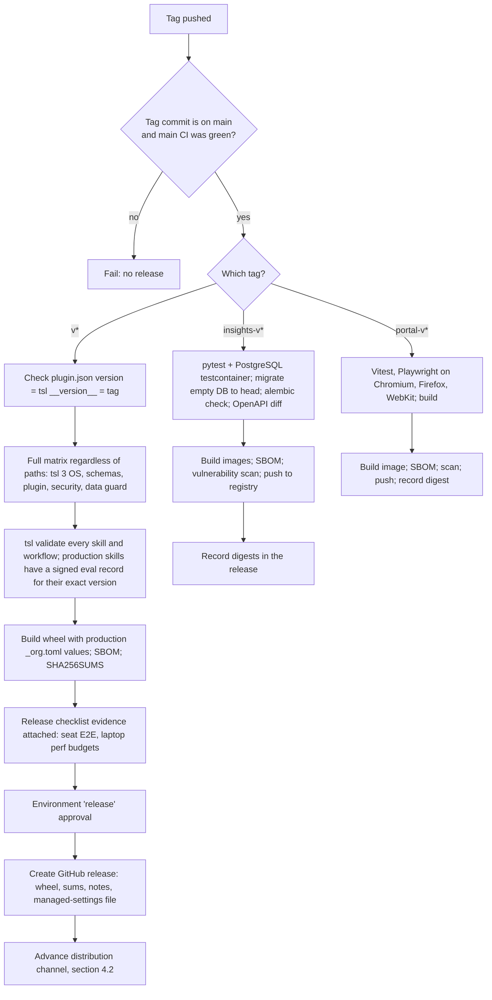
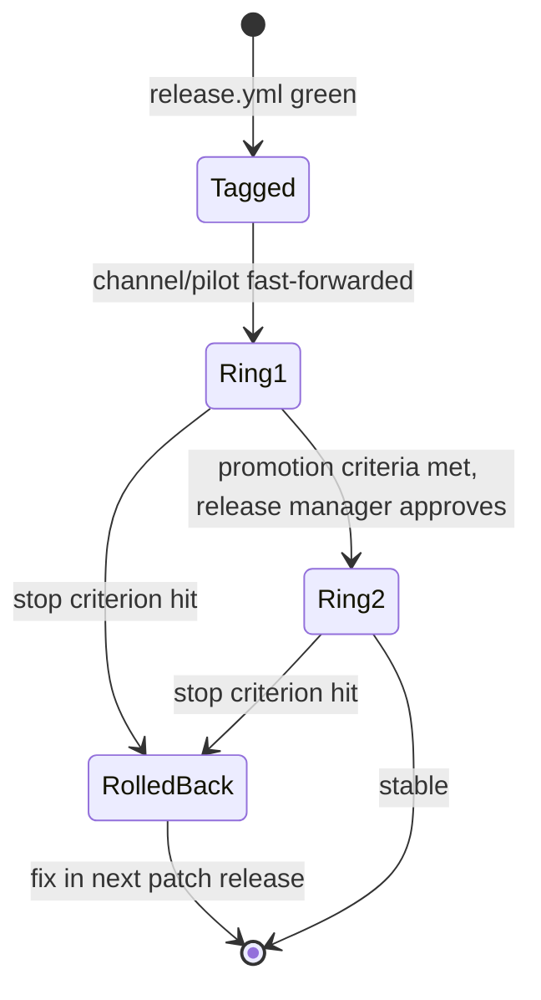
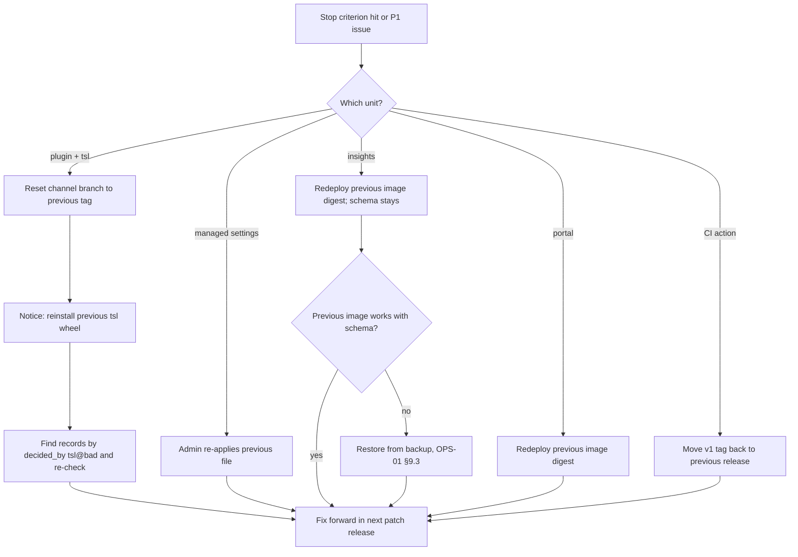
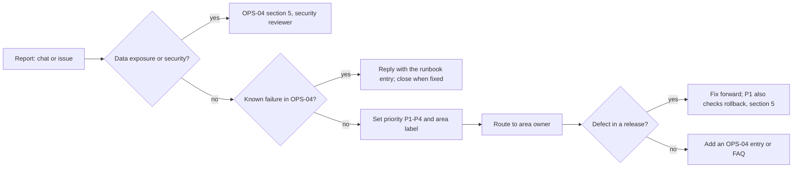

# OPS-03 · Release, Rollout and Support

| Field | Value |
| --- | --- |
| Status | Draft for owner review |
| Owner | TBD by Puneet |
| Approver | Puneet Singh Nanda |
| Related docs | [Doc 5 API and Rules](../architecture/05-api-and-rules.md) §1.1, §7 (R-08, R-09, R-10) · [SDD-01 Skill authoring](../design/SDD-01-skill-authoring.md) §6, §7 · [SDD-04 `tsl`](../design/SDD-04-tsl-cli.md) §2.1, §10 · [SDD-05 Claude Code integration](../design/SDD-05-claude-code-integration.md) §3.4, §6, §7.1 · [SDD-08 Telemetry](../design/SDD-08-telemetry-insights.md) §6.4, §11.1 · [DEV-01 Developer guide](../development/DEV-01-developer-guide.md) §2 · [TST-01 Master test plan](../testing/TST-01-master-test-plan.md) §6, §7 · [OPS-01 Deployment](OPS-01-deployment-hosting.md) · [OPS-04 Failure runbook](OPS-04-failure-runbook.md) · [PLN-01 Delivery plan](../planning/PLN-01-delivery-plan.md) · [Readiness tracker](../planning/readiness-tracker.md) Q32 |

## 1. Scope

### 1.1 What this document decides

- What a release is for each part of the system, and how it is tagged (`vX.Y.Z` and the service tags).
- The CI release pipeline (`release.yml`) that TST-01 §6 points to.
- How a release reaches engineers: the plugin channel, `tsl`, managed settings and the services.
- Staged rollout: a pilot group first, then everyone.
- Rollback for every part.
- The support channel and how issues are triaged. The support owner is **TBD by Puneet**.
- The deprecation policy for skills, workflows, commands, schemas, events and APIs.

### 1.2 What it does not decide

| Topic | Where |
| --- | --- |
| Branching, commit messages, code owners | [DEV-01](../development/DEV-01-developer-guide.md) §2 |
| Test layers and the CI matrix for PRs | [TST-01](../testing/TST-01-master-test-plan.md) §6 |
| Skill lifecycle states and promotion criteria | [SDD-01](../design/SDD-01-skill-authoring.md) §7 |
| How the services are hosted and deployed | [OPS-01](OPS-01-deployment-hosting.md) |
| What to do for each failure | [OPS-04](OPS-04-failure-runbook.md) |

### 1.3 Ground rules

- Only CI builds release artifacts. Nobody publishes a wheel, image or plugin from a laptop.
- Tags are never moved or deleted once pushed (the one exception is the CI action's floating major tag, §2.1). A bad release is fixed by a new release.
- A run already in progress keeps its pinned versions (R-08). A release must never break a running run (NFR-17).
- `tsl` version equals the plugin version (SDD-04 §2.1, SDD-05 §7.1).
- Merges and deploys to client systems stay human (C-14). This document covers only Truminds-owned components.

## 2. Release units and versions

### 2.1 Release units

| Unit | Tag | What is published | Who consumes it |
| --- | --- | --- | --- |
| **Plugin + `tsl`** (one unit) | `vX.Y.Z` | Plugin content at the tagged commit; `truminds_tsl-X.Y.Z-py3-none-any.whl` and `SHA256SUMS` attached to the GitHub release; schemas bundled in both | Engineers' Claude Code (through the channel, §4.2) and `uv tool install` |
| **Insights service** | `insights-vX.Y.Z` | Image `truminds/insights:X.Y.Z` (+ digest), `pg-backup` image, `openapi.json`, migration list | Service operator (OPS-01 §8.3) |
| **Portal** | `portal-vX.Y.Z` | Image `truminds/portal:X.Y.Z` (+ digest) | Service operator |
| **CI action** `tsl-ci-verify` | `vX.Y.Z` plus a floating `v1` | The action that wraps `tsl ci-verify` | Product repo workflows (`uses: <org>/tsl-ci-verify@v1`, Doc 5 §6.2). Where the action lives is open (DEV-01 §9) |
| **Verifier images** | No tag of their own | Images built by `verifier-images.yml` when `verifiers/**` changes; referenced **by digest** in `verifiers/<name>@<major>/profile.yaml` (SDD-03 §5.5) | Shipped inside the next `vX.Y.Z` plugin release |
| **Skills and workflows** | No git tag | Each has its own SemVer in `skill.yaml` (`skill-metadata.v1`) / `workflow.v1` (SDD-01 §6). They ship inside a plugin release | Runs pin them (R-08) |
| **Managed settings** | Versioned file in `managed-settings/`, released with `vX.Y.Z` | `managed-settings.json` for the Claude admin | Claude organisation admin (§4.3) |

The CI action's `v1` tag is moved to each new `v1.x.y` release, as is normal for GitHub Actions. It is the only moving tag.

### 2.2 Version rules (SemVer)

The commit type drives the bump (DEV-01 §2.4). A `!` or `BREAKING CHANGE:` footer forces a major bump.

| Unit | Major | Minor | Patch |
| --- | --- | --- | --- |
| Plugin + `tsl` | A schema version bump that `tsl` N-1 cannot read; a removed or renamed command, flag or exit code; a removed skill or workflow; a changed hook contract | New command, skill, workflow, check or optional field | Fixes, wording, new eval cases |
| Insights service | A new API path version (`/v2`); a dropped event `schema_version` | New endpoint, event type, view or column (expand) | Fixes; contract-step migrations of columns already unused |
| Portal | A removed screen or persona view | New screen or tile | Fixes |
| CI action | A changed input name or a stricter default that fails existing PRs | New optional input | Fixes |

**Pre-releases.** `vX.Y.Z-rc.N` is a release candidate for the pilot ring (§4.4). It goes through the same pipeline. `tsl --version` and `plugin.json` carry the same `-rc.N` suffix, so the version-equality check still works.

### 2.3 Changelog and release notes

| File | Written by | Read by |
| --- | --- | --- |
| `CHANGELOG.md` at the repo root | Generated from Conventional Commit titles at tag time, then edited by the release manager | Engineers; the insights catalogue sync (SDD-08 §6.4) |
| `plugins/truminds/skills/<id>/CHANGELOG.md` | Skill author, per version (SDD-01 §6) | Skill owners; Versions tab in the portal |
| GitHub release body | Pipeline: changelog section + "Upgrade" block (install command, managed-settings changes, required actions) | Engineers, Claude admin, service operator |

Every release body has an **Upgrade** block with exactly these lines, even when empty: `tsl install`, `managed settings`, `schema migrations`, `breaking changes`, `deprecations`.

## 3. CI release pipeline (`.github/workflows/release.yml`)

Triggered by pushing a tag that matches `v*`, `insights-v*` or `portal-v*` (TST-01 §6). Only members of the release-managers group can push these tags (protected tag rule). The group is TBD by Puneet.

### 3.1 Jobs in detail

| Job | Applies to | Steps | Fails when |
| --- | --- | --- | --- |
| `guard` | all | Tag matches `^(v\|insights-v\|portal-v)\d+\.\d+\.\d+(-rc\.\d+)?$`; `git merge-base --is-ancestor <tag> origin/main`; the `required` check on that commit was green | Any check false |
| `versions` | `v*` | `plugins/truminds/.claude-plugin/plugin.json` `version` = `tsl/src/tsl/__init__.py` `__version__` = tag without `v` | Mismatch |
| `matrix` | all | Runs every `ci-*.yml` job of TST-01 §6 without path filters | Any job fails |
| `catalogue` | `v*` | `tsl validate plugins/truminds`; for every skill with `status: production`, a signed `eval-result.v1` for its exact version and content hash (SDD-01 §6); workflows lock (`--lock`) resolves | Missing or invalid record |
| `build-wheel` | `v*` | `uv build` in `tsl/`; writes `tsl/_org.toml` from the CI variables `ORG_TENANT_ID`, `ORG_TSL_CLIENT_ID`, `ORG_API_SCOPE`, `ORG_SERVICE_URL` (not secrets, but held per environment; SDD-04 §7.1); SBOM (CycloneDX); `SHA256SUMS` | Build error |
| `build-images` | `insights-v*`, `portal-v*` | Build, SBOM, vulnerability scan (tool owned by SEC-01), push with the registry credential from the CI secret store | Critical vulnerability with a fix available |
| `checklist` | `v*` | Checks that the release PR links the checklist evidence (§3.2) | Missing evidence |
| `publish` | all | GitHub environment `release` with required reviewers (release manager + area owner); creates the GitHub release | Not approved |
| `channel` | `v*` | Fast-forwards `channel/pilot` on every `v*` tag; fast-forwards `channel/stable` only when run by hand (`workflow_dispatch`) with the Ring 2 approval (§4.4) | Branch not a fast-forward |
| `rollback-channel` | manual | Resets a channel branch to a named earlier tag (§5); needs the `release` environment approval | Target is not an earlier release tag |

Secrets used by the pipeline (registry push credential, the token that pushes channel branches) live in GitHub environment secrets, never in the repo.

### 3.2 Release checklist (manual evidence, `v*` only)

These need a company seat or a real laptop, so CI cannot run them (TST-01 §6, C-01, C-02):

- [ ] TC-E2E-001 to TC-E2E-007 pass on a seat against the sample system (TST-01 §10).
- [ ] Laptop performance budgets met: pre-tool ≤ 500 ms p95, `verify` + `decide` ≤ 5 s p95 (SDD-04 §11, TST-01 §7).
- [ ] `uv tool install` of the candidate wheel works on clean native Windows and macOS; `tsl doctor` is green.
- [ ] Upgrade test: a run started on the previous release resumes on this one (same major) or is refused with E-VER-01 (different major).
- [ ] Managed-settings changes, if any, applied to a test seat (SDD-05 S-01 method).
- [ ] Upgrade block in the release notes reviewed.

## 4. Rollout

### 4.1 How each unit reaches people

| Unit | Mechanism | Who acts |
| --- | --- | --- |
| Plugin | The marketplace source in managed settings (SDD-05 §6.2) points at a channel (§4.2). Claude Code installs the force-enabled plugin from it | Claude admin sets the source once; the pipeline advances the channel |
| `tsl` | At session start, `bin/tsl-hook` sees that `tsl` ≠ plugin version and shows the exact install command (SDD-05 §5.3). The engineer runs `uv tool install "truminds-tsl @ <wheel URL>" --force` | Engineer |
| Managed settings | Claude admin console, MDM or file (SDD-05 §6.3) | Claude admin (TBD by Puneet) |
| Services | OPS-01 §8.3 deploy order | Service operator (TBD by Puneet) |
| CI action | `v1` tag moved by the pipeline | Pipeline |

**Not verified:** when Claude Code refreshes a marketplace and updates an already-installed, force-enabled plugin (at session start, on a timer, or only on a manual update). SDD-05 §2 does not state it. This needs spike S-14 (SDD-05 §8.1) before the first rollout. Until then, the rollout notice tells engineers how to update by hand and `tsl doctor` reports the installed plugin version.

### 4.2 Distribution channels (resolves the DEV-01 §2.2 conflict)

DEV-01 uses trunk-based `main`, where every merged PR lands. SDD-05 §3.4 says engineers must get only reviewed, tagged releases. Both hold if engineers never install from `main`.

| Channel | Branch | Gets | Who installs from it |
| --- | --- | --- | --- |
| `pilot` | `channel/pilot` | Fast-forwarded by the pipeline to each `vX.Y.Z-rc.N` and `vX.Y.Z` | Ring 1 (pilot group) |
| `stable` | `channel/stable` | Fast-forwarded to a `vX.Y.Z` only after it passes the ring promotion criteria (§4.4) | Ring 2 (everyone) |
| `main` | `main` | Every merge | Developers only, with a local marketplace (DEV-01 §5) |

Both channel branches are protected: only the pipeline's token may push, and only fast-forwards to tagged commits.

This depends on managed settings being able to point a marketplace at a branch or ref (SDD-05 U-05, spike S-07).

| S-07 result | Channel mechanism |
| --- | --- |
| Pass | `extraKnownMarketplaces.truminds-skill-library.source` names the channel branch (exact key confirmed by S-07) |
| Fail | A separate **distribution repo** per channel (`AI-Skill-Library-pilot`, `AI-Skill-Library-stable`; final org OQ-10) that receives only the released plugin tree, pushed by the pipeline. Managed settings point at the repo, which is verified to work (SDD-05 V-05, V-06) |

### 4.3 Managed-settings changes

| Step | Rule |
| --- | --- |
| Source | `managed-settings/managed-settings.json` in the repo, changed only by PR; code owners: Shubham Bansal (execution) plus the security reviewer (TBD by Puneet) |
| Classes | **Low risk:** adding a deny rule. **Medium:** changing `env` (OTel endpoint or token). **High:** changing the marketplace source, `allowManagedHooksOnly`, `strictKnownMarketplaces`, or removing a deny rule |
| Test | Every change applied to a test seat first; the S-01 and S-02 checks repeated (plugin installs, second marketplace refused, deny rules hold) |
| Apply | Claude admin applies the released file in one managed source (SDD-05 §6.3). Medium and High changes go to Ring 1 first if per-group targeting exists (below) |
| Record | Release notes Upgrade block; the admin notes which file version is live |
| Rollback | Re-apply the previous released file (§5) |

**Not verified:** whether the Claude admin console can apply different managed settings to different groups of users. MDM can target device groups (SDD-05 V-09 says MDM delivery exists; group targeting is an MDM feature). If the console cannot target groups and MDM is not used, managed-settings changes go to everyone at once, and only plugin content can be staged (§4.2). Spike S-12 (SDD-13 §6.2 asks the same question; one spike answers both).

### 4.4 Staged rollout

| Ring | Who | Channel | Enters when |
| --- | --- | --- | --- |
| Ring 0 | The delivery team, on development seats | `main` or `pilot` | Every merge |
| Ring 1 | The pilot group: pilot teams (OQ-04), named by Puneet | `pilot` | Tag `vX.Y.Z-rc.N` or `vX.Y.Z` published |
| Ring 2 | Everyone with a seat | `stable` | Ring 1 promotion criteria met and the release manager approves |

**Promotion criteria, Ring 1 → Ring 2** (proposals for Puneet; counted from telemetry, not calendar time):

| Measure | Source | Threshold |
| --- | --- | --- |
| Usage on the new version | `session.started.plugin_version` and `step.decided.decided_by` | ≥ 20 decided steps by ≥ 3 engineers on the new version |
| Internal errors | Support issues with `E-INT-01`; error codes in `run.status_changed.reason_code` | 0 new P1 or P2 issues (§6.3) |
| Hook health | `hook.decision` with code `E-HOOK-01` or `E-VER-01` | No increase per session against the previous version after engineers upgraded `tsl` |
| Harness behaviour | First-try pass rate and band mix per skill | No drop of more than 10 points for any skill without an explained cause |
| CI | `ci.verified` results on pilot repos | No new `E-CI-03` (laptop and CI disagree) |
| Services | OPS-02 dashboards | No open alert caused by the release |

**Stop criteria** (any one triggers §5): a new P1 issue; any `E-CI-03` traced to the release; a security abort (`security.abort`) caused by the release's own code; `tsl` crash rate rising after upgrade.

Services follow the same idea: deploy to `staging` (OPS-01 §4.1), run the smoke tests and the load test when ingest code changed, then `prod`. The portal and the API have one `prod` ring, because there is one shared service.

### 4.5 Version skew

| Situation | What happens | Reference |
| --- | --- | --- |
| Plugin updated, `tsl` not yet | Outside a run: hooks allow, warn. Inside a run: pre-tool denies with `E-HOOK-01` until `tsl` matches | SDD-05 §5.4 |
| Run started on N, resumed on N+1 minor | Continues; `tsl` reads schemas N and N-1 | R-08, R-09, SDD-04 §10 |
| Run started on major N, resumed on N+1 | Refused with `E-VER-01` | SDD-04 OI-03 (rule conflict, open) |
| Pinned skill version no longer in the plugin | `tsl next` fails `E-RUN-10`; `tsl state repin` proposed | SDD-02 §11.4 (open) |
| New event type sent to an older service | Per-event `E-ING-02`; event stays queued until the service is upgraded | SDD-08 §4.3 |

**Release order** when a plugin release needs a new service feature: `insights-v*` to `prod` first, then the plugin to Ring 1. The service always accepts N and N-1 event versions, so the reverse order only queues events.

## 5. Rollback

| Unit | Rollback | Time to effect | Notes |
| --- | --- | --- | --- |
| Plugin + `tsl` | The pipeline job `rollback-channel` resets `channel/stable` (or `pilot`) to the previous tag. This is the only time a channel branch moves backwards; it needs the release manager's approval. Engineers reinstall the previous wheel (same command, older URL) | Next marketplace refresh (unverified, §4.1) plus the engineer's reinstall | Runs started on the bad version: same major continues on the old version. Tags are never deleted |
| One bad skill version | Patch release that restores the previous skill content with a higher patch number; or set the bad version `deprecated` with `deprecated_by` (SDD-01 §7) | One plugin release | Runs pinned to the bad version keep it (R-08); the skill owner decides whether those runs are cancelled (`tsl state cancel`, SDD-02 §12) |
| Harness bug in `tsl` | As for plugin; then query `step.decided` where `decided_by = 'tsl@<bad>'` and list the affected PRs | — | CI re-runs code checks on open PRs (`tsl ci-verify`), so wrong code-check results are caught there; meaning checks are covered by human PR review (L-04) |
| Managed settings | Claude admin re-applies the previous released file | Next session start of each user (as managed settings load) | Keep the previous file in the release assets |
| Insights service | Redeploy the previous image digest. Migrations are expand-then-contract, so the previous image works with the new schema | Minutes | Restore from backup only if data was damaged (OPS-01 §9.3) |
| Portal | Redeploy the previous image digest | Minutes | No state |
| CI action | Move `v1` to the previous `v1.x.y` | Next PR run | Product repos pinned to an exact version are not affected |

**Rollback drill:** before G2, roll back one plugin release on Ring 0 and one insights release on `staging`, end to end (PLN-01 R1-11).

## 6. Support

### 6.1 Channel

| Item | Proposal |
| --- | --- |
| Owner of the support rota | **TBD by Puneet** |
| Ask a question | One company chat channel for the Skill Library (name TBD by Puneet) |
| Report a defect or request | An issue in the skill-library GitHub repo, from an issue template: `bug`, `skill-request`, `skill-quality`, `access`, `security` |
| Security issue | Not in the open channel: direct message to the security reviewer (TBD by Puneet) and OPS-04 §5 |
| Jira | Not used by the support flow. No tool writes to Jira or Confluence without explicit approval (R-14) |

### 6.2 What a report must contain, and must not

| Include | Never include |
| --- | --- |
| `tsl doctor --json` output | Client code, file contents, artifact text, prompts |
| `tsl --version`, plugin version, OS | Client names (use system codes such as `SYS-ORD`) |
| The error `code`, `next` and `log_id` (for `E-INT-01`) | Tokens, keys, `.env` values, screenshots with client data |
| `run_id`, step and attempt | Raw `tsl.log` (send only the lines for the `log_id`; logs are already redacted, SDD-04 §9) |

The issue template repeats this list and has a "no client data" checkbox.

### 6.3 Triage

| Priority | Meaning | Example | First response target (proposal) |
| --- | --- | --- | --- |
| P1 | Many engineers blocked, data exposure, or wrong PASS decisions | `tsl` crashes on every `decide`; client data in a shared output | Within 1 working hour; triggers §5 rollback check |
| P2 | One team blocked, or a workaround is painful | Verifier profile broken for one stack | Same working day |
| P3 | Annoying, workaround exists | Wrong `next` hint in a message | Within 3 working days |
| P4 | Request or idea | New skill | Backlog review |

Priorities are named P1–P4 so they do not clash with harness signals S1–S6.

| Area label | Routed to |
| --- | --- |
| `area:skills`, `area:workflows` | Abhishek Verma, Ekjot Singh |
| `area:harness`, `area:tsl` | Japman Singh, Yash Khorwal |
| `area:hooks`, `area:plugin`, `area:managed-settings` | Shubham Bansal |
| `area:telemetry`, `area:portal` | Gaurav Saini |
| `area:access`, `area:onboarding`, `area:hosting` | TBD by Puneet |

Every P1 and P2 closes with a short root-cause note in the issue, and a new or updated OPS-04 entry when the failure can happen again.

## 7. Deprecation policy

Nothing is removed without notice, and nothing a running run depends on is removed while that run is active (R-08, NFR-17).

| Item | Deprecate by | Earliest removal | How users are told |
| --- | --- | --- | --- |
| Skill version | `status: deprecated` + `deprecated_by` (SDD-01 §7) | When no active run pins it | Portal Versions tab; release notes |
| Whole skill | Same, with a production replacement named | Next major plugin release, and no active run pins it | Release notes; skill owner posts in the support channel |
| Workflow | `status: deprecated` in `workflow.v1` (new field) and release notes | Next major plugin release | `tsl state start` prints a warning |
| `tsl` command or flag | Marked deprecated in `--help` and release notes; using it adds a warning to the envelope | Next major release | `warnings[]` with code `E-DEP-01` (new, exit 0) |
| File schema version | Writer moves to N+1; readers keep N (R-09) | When N is two versions old; `tsl migrate` provided first | `E-SCH-01` after removal, pointing to `tsl migrate` |
| Event `schema_version` | Service keeps accepting N-1 | When N-1 sending versions are no longer seen in `session.started.tsl_version` for one full retention month | Release notes |
| API path (`/v1`) | `/v2` published alongside; `Deprecation` and `Sunset`-style headers on `/v1` responses | When no client calls `/v1` (measured) and at least one major plugin release later | Release notes; `tsl` warning |
| Error code | Never removed or reused; may be marked obsolete in Doc 4 §5.2 | — | — |
| Verifier profile major (`node-20@1`) | New major published; old one kept | When no `tsl.yaml` in use names it | Tech leads asked to update `tsl.yaml` |
| Managed-settings key | Kept until all seats run the release that no longer needs it | Next major release | Upgrade block |

`E-DEP-01` (new): exit 0 (warning), message "`<thing>` is deprecated and will be removed in `<version>`", next "use `<replacement>`". It must be added to Doc 4 §5.2.

## 8. Done criteria

- `release.yml` exists with the jobs in §3.1; a test tag on a fork produces a GitHub release with the wheel, `SHA256SUMS` and SBOM.
- Tag protection and the `release` environment with required reviewers are configured; the release-managers group is named.
- Spike S-07 is recorded and the channel mechanism in §4.2 is implemented accordingly; spikes S-14 (marketplace refresh) and S-12 (per-group managed settings) are recorded.
- One release has gone Ring 1 → Ring 2 using the §4.4 criteria, with the numbers read from the portal.
- The rollback drill in §5 has passed once for the plugin and once for the insights service.
- The support channel, issue templates and area labels exist; the support owner is named.
- `E-DEP-01` and the workflow `status` field are added to Doc 4 §5.2 and `workflow.v1`.

## 9. Open items

| Ref | Item | Owner |
| --- | --- | --- |
| new | Support rota owner and the chat channel name | TBD by Puneet |
| new | Release-managers group (who may push release tags and approve `publish`) | TBD by Puneet |
| OQ-04 | Pilot group for Ring 1 | TBD by Puneet |
| SDD-05 U-05 / S-07 | Marketplace pinned to a branch or ref; decides channel branches vs distribution repos | Shubham Bansal |
| S-14 | Spike: when Claude Code updates a force-enabled plugin after its marketplace changes | Shubham Bansal |
| S-12 | Spike: can the Claude admin console target managed settings at a group of users (shared with SDD-13) | Shubham Bansal with the Claude admin |
| DEV-01 §9 | Where the `tsl-ci-verify` action lives (separate repo needed for `uses: <org>/tsl-ci-verify@v1`) | TBD by Puneet |
| SDD-04 OI-03 | A run on major N cannot resume on major N+1 (conflicts with R-08 wording) | Puneet Singh Nanda |
| SDD-02 §11.4 | `tsl state repin` for skills removed from the plugin during a run | Puneet Singh Nanda |
| new | Confirm Ring 1 → Ring 2 thresholds and the P1–P4 response targets | TBD by Puneet |
| closed | New error code `E-DEP-01` (added to Doc 4 §5.2) and `workflow.v1` `status` field (added to SDD-02 §3.2), per the [registry](../architecture/registry.md) | Japman Singh, Yash Khorwal; Abhishek Verma, Ekjot Singh |
| new | Vulnerability scanner and SBOM tool choice (with SEC-01) | Security reviewer, TBD by Puneet |
