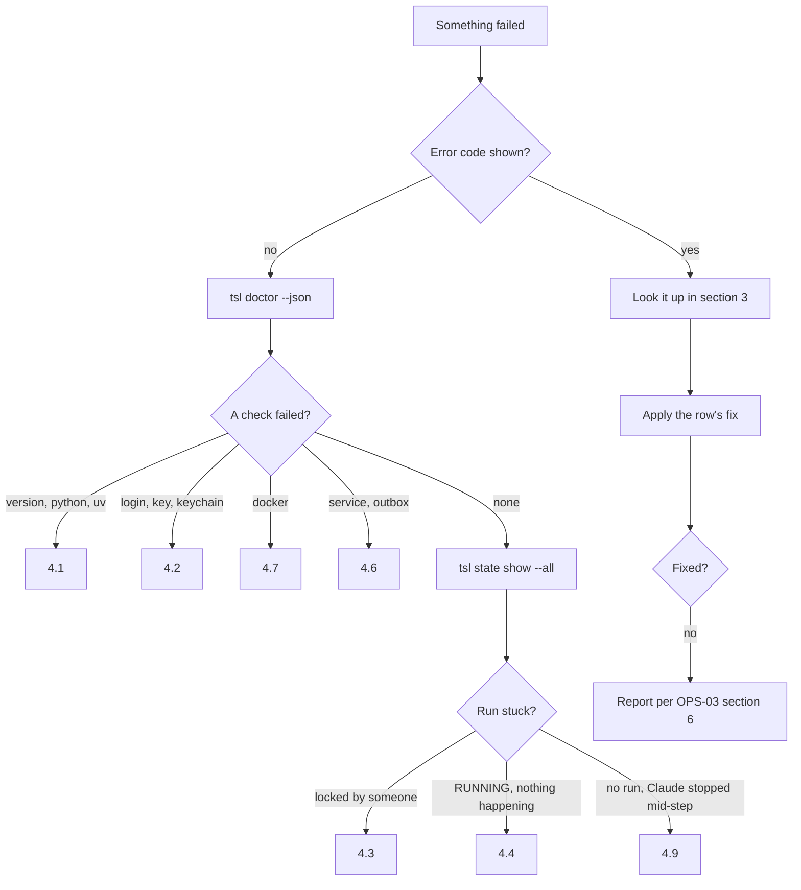

# OPS-04 · Failure-Mode Runbook

| Field | Value |
| --- | --- |
| Status | Draft for owner review |
| Owner | TBD by Puneet |
| Approver | Puneet Singh Nanda |
| Related docs | [Doc 4 Design and UX](../ux/04-design-and-ux.md) §5.2 (error catalogue) · [Doc 5 API and Rules](../architecture/05-api-and-rules.md) §4.2, §6.2, §7 · [SDD-02 Orchestration](../design/SDD-02-workflow-orchestration.md) §11 · [SDD-03 Harness](../design/SDD-03-harness.md) §5.5, §14 · [SDD-04 `tsl`](../design/SDD-04-tsl-cli.md) §5, §6, §8 · [SDD-05 Claude Code integration](../design/SDD-05-claude-code-integration.md) §5.4 · [SDD-08 Telemetry](../design/SDD-08-telemetry-insights.md) §4.3 · [SDD-12 Companion repo](../design/SDD-12-companion-repo.md) §3.4, §6.4 · [OPS-01 Deployment](OPS-01-deployment-hosting.md) · [OPS-02 Monitoring](OPS-02-monitoring-alerting.md) · [OPS-03 Release and support](OPS-03-release-rollout-support.md) · [Readiness tracker](../planning/readiness-tracker.md) Q36 |

## 1. Scope

This runbook says, for each failure that happens in practice, **who** acts and **what** they do. It is written as symptom → cause → fix tables. Every row names the error code from Doc 4 §5.2 (the catalogue, which Doc 5 refers to), SDD-04 §5 or SDD-05 §5.4, plus the newer codes from SDD-02, SDD-03, SDD-08 and SDD-12.

**Covers:** `tsl` missing or wrong version; expired login; stuck lock; a run that crashed mid-step; hook timeout; insights service down; verifier container failure; reviewer returning invalid JSON; seat limit reached; merge conflict in the companion repo; CI verify failure; and, briefly, the failures the specs already handle (stale pack, retries exhausted, abort). Section 5 covers security incidents.

**Does not cover:** alert thresholds (OPS-02), deploy and restore steps (OPS-01), release rollback (OPS-03 §5).

**Rule for every fix:** never work around a rule (R-17). No fix in this document skips a gate, forces an outcome, edits a signed record or writes to Jira, Confluence or a client system without approval. `tsl` has no flag to do any of these (SDD-03 §15, SDD-04 §1.3).

## 2. Roles and first look

| Role | Acts on |
| --- | --- |
| Engineer | Their own laptop, login, runs |
| Tech lead (`tech_lead` on the system) | Stale locks, context pack, approvals, companion repo |
| Skill owner | Reviewer and skill quality issues |
| Harness owners (Japman Singh, Yash Khorwal) | `tsl`, checks, verifier profiles, CI verify |
| Execution owner (Shubham Bansal) | Hooks, plugin, managed settings |
| Telemetry owner (Gaurav Saini) | Insights service, ingest, portal data |
| Service operator (TBD by Puneet) | Hosting, database, backups (OPS-01) |
| Platform admin, Claude admin (TBD by Puneet) | Roles, keys, tokens, seats, managed settings |
| Security reviewer (TBD by Puneet) | Section 5 |

**First look, always in this order:**

| Step | Command | Tells you |
| --- | --- | --- |
| 1 | `tsl doctor --json` | Python, uv, git, Docker, version match, keychain, login, key, service, outbox, repo (SDD-04 §6.3) |
| 2 | `tsl state show --all --json` | Every run, its status, step, attempt and what it waits on |
| 3 | `~/.truminds/logs/hook.log` | One line per hook call: event, decision, code, duration (SDD-04 §9) |
| 4 | `~/.truminds/logs/tsl.log` | Find the `log_id` from an `E-INT-01` |
| 5 | The `next` field of the last envelope | The single next action `tsl` proposes |



## 3. Error-code index

| Code | Source | Section |
| --- | --- | --- |
| E-HOOK-01 | Doc 5 §4.2, SDD-05 §5.4 | 4.1, 4.5 |
| E-VER-01, E-ENV-01, E-INT-01, E-USE-01 | SDD-04 §5 | 4.1 |
| E-SCH-01 | Doc 4 §5.2 | 4.1 |
| E-AUTH-01, E-AUTH-02 | Doc 4 §5.2 | 4.2 |
| E-AUTH-07, E-KEY-01 | SDD-04 §5 | 4.2 |
| E-ING-07 | SDD-08 §4.3 | 4.2 |
| E-LOCK-01, E-AUTH-04 | Doc 4 §5.2 | 4.3 |
| E-LOCK-02, E-LOCK-03 | SDD-02 §12 | 4.3, 4.10 |
| E-LOCK-04 | SDD-12 §3.3 | 4.3 |
| E-RUN-04, E-RUN-05, E-RUN-06 | SDD-04 §5 | 4.3, 4.4 |
| E-RUN-09, E-RUN-10, E-RUN-11 | SDD-02 §11–§12 | 4.3, 4.4, 4.9 |
| E-RUN-07, E-RUN-08 | SDD-02 §12 | 4.4, 4.10 |
| E-DEC-01, E-DEC-02 | SDD-03 §14 | 4.4, 4.5 |
| E-CHK-01 | Doc 4 §5.2 | 4.5, 4.12 |
| E-NET-01 | Doc 4 §5.2 | 4.6 |
| E-NET-02 | SDD-04 §5 | 4.6 |
| E-ING-01 to E-ING-06 | SDD-08 §4.3 | 4.6 |
| E-H3-01 to E-H3-07 | SDD-03 §14 | 4.7 |
| E-REV-01 | SDD-03 §14 (cannot prepare) | 4.8 |
| E-REV-02, E-REV-03, E-REV-04 | SDD-03 §14 | 4.8 |
| E-GIT-01 | SDD-04 §5 | 4.3, 4.10 |
| E-COMP-01 to E-COMP-05 | SDD-12 §6.4 | 4.10 |
| E-CI-01, E-CI-02, E-CI-03 | Doc 4 §5.2 | 4.11 |
| E-CI-04 | SDD-03 §14 (PR code differs) | 4.11 |
| E-CI-05, E-CI-06 | SDD-03 §14 | 4.11 |
| E-CTX-01, E-CTX-02, E-CTX-03 | Doc 4 §5.2 | 4.12 |
| E-RUN-01, E-RUN-02, E-RUN-03 | Doc 4 §5.2 | 4.12 |
| E-SEC-01, E-POL-01, E-POL-02, E-POL-03 | Doc 4 §5.2 | 4.12, 5 |
| E-SEC-02, E-POL-04, E-POL-05 | SDD-03 §14 | 4.12, 5 |

## 4. Runbook entries

### 4.1 `tsl` missing or the wrong version

**Who:** the engineer. Escalate to Shubham Bansal (launcher) or Japman Singh and Yash Khorwal (`tsl`).

**Why it matters:** inside a run, pre-tool and pre-mcp fail closed, so Claude cannot write. Outside a run, hooks allow and warn (SDD-05 §5.4).

| Symptom | Cause | Fix | Code |
| --- | --- | --- | --- |
| At session start Claude shows "install tsl X.Y.Z"; writes in a run are denied | `tsl` not installed, or not on PATH for the desktop app | Run the shown command: `uv tool install "truminds-tsl @ <wheel URL>"`. Check `uv tool dir` is on PATH; restart the desktop app so it sees the new PATH. Re-run `tsl doctor` | E-HOOK-01 |
| Same message right after a plugin update | Plugin moved to a new version; `tsl` is older (OPS-03 §4.5) | Install the wheel for the new version with `--force` | E-HOOK-01, E-VER-01 |
| `/truminds:resume` refused: "`tsl a` does not match run pin `b`" | Run started on another major version (SDD-04 §10, OI-03) | Finish the run on the pinned major: install that wheel, resume, finish, then upgrade. If the old version is withdrawn, ask a tech lead to cancel (`tsl state cancel`, SDD-02 §12) and restart | E-VER-01 |
| `tsl doctor` fails `python` or `uv` | Python 3.12 or uv missing (C-18) | Install Python 3.12 and uv per the onboarding guide (SDD-13); reinstall `tsl` | E-ENV-01 |
| `tsl` refuses to read a file: "uses schema v… that this tsl does not read" | File is two or more schema versions old, or newer than this `tsl` | Older: `tsl migrate --to v<N>` (tech lead). Newer: upgrade `tsl` | E-SCH-01 |
| Any command prints "Internal error `<log_id>`" | A bug in `tsl` | Report per OPS-03 §6.2 with the `log_id` lines from `tsl.log`. Do not retry in a loop | E-INT-01 |
| Windows: hooks never fire | Claude Code running inside WSL, where plugins do not load (C-17) | Use native Windows Claude Code | — |

**Prevention:** `tsl doctor` in onboarding; the Ring 1 → Ring 2 hook-health criterion in OPS-03 §4.4.

### 4.2 Expired login

**Who:** the engineer. Escalate to the platform admin for roles and keys.

| Symptom | Cause | Fix | Code |
| --- | --- | --- | --- |
| "Not logged in to Truminds" | Entra refresh token expired or revoked; token cache deleted (`tsl logout`) | `tsl login` (device code; the instruction is on stderr). Requires VPN to the intranet host (OPS-01 §3.3) | E-AUTH-01 |
| `tsl events flush` returns exit 10, events stay queued | Same; the outbox got a 401 and one silent refresh failed (SDD-04 §8.3) | `tsl login`, then `tsl events flush`. Nothing is lost | E-AUTH-01 (client), E-ING-07 (server) |
| `tsl decide` or `approve` fails: "signing key is revoked or unknown" | Key revoked (rotation, lost laptop, admin action) or this device never registered | `tsl login` registers a new key. If it repeats, the admin checks the key list in the portal; never reuse a compromised key (§5) | E-AUTH-02 |
| Offline, `state start` fails with role cache older than 24 h | Role grants are cached for 24 h; the service is unreachable | Reconnect (VPN), then repeat. A running run continues offline | E-AUTH-07 |
| `tsl login` fails: "No usable OS keychain backend" | Keychain locked or no supported backend (SDD-07) | Unlock the OS keychain; on Linux install a Secret Service backend. `tsl doctor` shows the backend | E-KEY-01 (SDD-04 meaning) |
| `tsl decide` fails right after the laptop wakes | Keychain locked during signing (SDD-03 §14.2) | Unlock and re-run `tsl decide`. No record was written | E-AUTH-01 |

### 4.3 Stuck lock

**Who:** the run owner first; a tech lead for a forced release.

A lock is the file `runs/active/<ticket>__<workflow>.lock` pushed to the companion repo when a run starts (Doc 5 §3.5, SDD-02 §11.1). It is released at COMPLETED. A lock is **stale** after 24 h with no state change and an owner who is not you (DEF-06).

| Symptom | Cause | Fix | Code |
| --- | --- | --- | --- |
| `/truminds:run` refused: "locked by `eng-xxxx` in `run_…`" — the holder is you | You already have a run for this ticket and workflow | `/truminds:resume <run_id>` | E-LOCK-01 |
| Same, the holder is someone else and they are active | One active run per ticket + workflow (R-11) | Coordinate with the holder; do not start a second run | E-LOCK-01 |
| Same, the holder left or the laptop was lost | Lock never released | Tech lead: `tsl state unlock <ticket> <workflow> --reason "<text>"` once stale. The old owner's `tsl` then closes their run with `end_reason: lock_released` | E-LOCK-01 → unlock |
| `state unlock` refused | Lock not stale yet (DEF-06), or caller is not a tech lead | Wait until stale, or ask the holder to finish or cancel; ask a tech lead | E-RUN-05, E-AUTH-04 |
| Old owner's next command fails "lock lost or released" | A tech lead released the lock | Start a new run if still needed. Records already pushed stay valid | E-LOCK-02 |
| `state start` fails offline | Git is the lock server; runs cannot start offline (L-08) | Reconnect and retry | E-LOCK-03, E-GIT-01 |
| `state start` fails after 3 push retries, network fine | Push rejected for access reasons, or a busy companion repo (many parallel runs) | Check write access (`-engineers` team, SDD-12 §6.1). Retry. Report if it repeats (spike CR-03) | E-LOCK-04, E-GIT-01 |
| `tsl` says "run busy in another process or session" | A second `tsl` process or a second Claude session on the same run (SDD-02 §11.2) | Close the other session, or `tsl state resume <run_id> --take-over` | E-RUN-11 |
| `state show` says "lock release pending" | Run completed offline | Nothing; the next online `tsl` call pushes the release | — |

### 4.4 A run that crashed mid-step

**Who:** the run owner. Escalate to Japman Singh and Yash Khorwal if `state repair` fails.

Records are the source of truth; `state.json` can be rebuilt from them (SDD-02 §11.3). Records are keyed by `run_id + step + attempt`, so repeating a step is safe (R-05).

| Symptom | Cause | Fix | Code |
| --- | --- | --- | --- |
| Session closed or app crashed, no artifact written | Crash before the skill wrote output | `/truminds:resume <run_id>`; `tsl next` returns the same `run_skill` | — |
| Artifact half-written | Crash during Write | Resume. The hook or `tsl verify` fails H1; Claude rewrites (counts as a checks round) | E-CHK-01 |
| `tsl decide` refuses: "artifact changed since checks ran" | Artifact edited after `verify`, or the post-write hook failed open | Run `tsl verify <artifact>`, then `tsl decide` | E-DEC-02 |
| `tsl decide` refuses: "Gate `<id>` still pending" | Detached H3 run still in progress | `tsl verify --status`, wait, then decide | E-DEC-01 |
| `.review.json` exists, no verification record | Crash between review and decide | Resume; `tsl next` returns `run_decide` | — |
| `state.json` damaged or missing | Disk or editor damage | `tsl state repair <run_id>` (SDD-02 §12) rebuilds from the snapshot, signed records and `approvals.md` | — |
| `tsl next` fails: pinned skill version not installed | Plugin upgraded mid-run (SDD-02 §11.4) | `tsl state repin <run_id>` once Puneet approves the rule (open item); otherwise finish on the old plugin | E-RUN-10 |
| Resume refused: "answers changed after resume" | Someone edited a frozen answer in `open-questions.md` | Restore the frozen answer from git history, or add a new question via the tech lead | E-RUN-07 |
| Resume refused: "approval does not match artifact" | Artifact changed after the approval was signed | Re-run the step and request a new approval | E-RUN-08 |
| Laptop lost mid-run | Unpushed work since the last sync point is gone | Revoke the lost device's key (§5); `tsl login` on the new device; `/truminds:resume`. Steps after the last push are re-run | E-AUTH-02 for old records only if back-dated revocation applies |
| `tsl state show` lists `unpushed: true` | Push failed at a sync point (SDD-12 §3.4) | Nothing; the next `tsl` call retries. If it persists, see 4.10 | — |

### 4.5 Hook timeout

**Who:** the engineer reports; Shubham Bansal owns hooks.

Timeouts in `hooks.json`: session-start 15 s, pre-tool 10 s, pre-mcp 10 s, post-write 90 s, session-end 15 s (SDD-05 §5.2). Budgets are much lower (NFR-02: 500 ms p95).

**Not verified:** what Claude Code does when **its own** hook `timeout` fires (allow, deny or error). SDD-05 §2 documents exit codes but not the timeout outcome. Fail-closed therefore must come from `bin/tsl-hook` itself: it should stop `tsl` and print the deny JSON before Claude Code's timeout (proposal: an internal deadline of 8 s for pre-tool and pre-mcp). This needs a spike (S-15, SDD-05 §8.1).

| Symptom | Cause | Fix | Code |
| --- | --- | --- | --- |
| In a run, every Write or Bash is denied with E-HOOK-01 after a pause | `tsl hook pre-tool` hung or crashed; launcher failed closed | Check `hook.log` for durations. Run `tsl doctor`. Common causes: antivirus scanning the venv on first start, a slow network share as home folder, a corrupted `sessions/<id>.policy.json` cache (delete it; `tsl` rebuilds it at the next call) | E-HOOK-01 |
| Writes are slow but allowed; `hook.log` shows > 500 ms | Fast path broken (heavy imports on the hook path) | Report to Japman Singh and Yash Khorwal with `hook.log` lines; check against SDD-04 §11 perf tests | — |
| After writing an artifact, no check feedback, then `decide` refuses | post-write hit 90 s and failed open (by design, SDD-05 §5.4) | `tsl verify <artifact>`, then `tsl decide`. Long H3 steps must use `--detach` and `--status` (SDD-03 §3.2) | E-DEC-02 |
| Session start is slow, warning about outbox | Flush capped at 1.5 s; large backlog | Nothing; run `tsl events flush` in a terminal | E-NET-01 |
| MCP tool calls denied with E-HOOK-01 | `pre-mcp` hung while parsing `approvals.md` | Same as the first row; report a large or malformed `approvals.md` | E-HOOK-01 |

### 4.6 Insights service down (outbox)

**Who:** engineers do nothing beyond the first row. The telemetry owner and service operator fix the service.

Runs never wait for the service (NFR-03). Events queue in `~/.truminds/outbox.db` and are retried with backoff (R-04); nothing is dropped except per-event schema rejects.

| Symptom | Cause | Fix | Code |
| --- | --- | --- | --- |
| Warning "Telemetry offline; `n` events queued" | Service, network or VPN down | Nothing. Events are sent later. Optionally `tsl events flush` when back | E-NET-01 |
| `tsl login`, `tsl init`, `tsl improve plan` fail: "service unreachable" | These commands need the service | Retry later; offline-safe commands still work | E-NET-02 |
| `tsl doctor` warns: pending events older than 24 h | Laptop rarely on VPN, or the service rejected the token | Connect to VPN; `tsl login` if E-AUTH-01; `tsl events flush` | E-NET-01 |
| `tsl doctor` warns: dead events | Server rejected events by schema or content | Report to Gaurav Saini with the codes from `tsl events flush --json` (`rejected`). Never edit `outbox.db` | E-ING-01, E-ING-03, E-ING-04, E-ING-05 |
| Events stay pending with "unknown schema_version" | `tsl` is newer than the service | Service operator deploys the newer `insights-v*` (OPS-03 §4.5). Then `tsl events flush --retry-dead` is not needed; these stay pending | E-ING-02 |
| Portal shows "last event received" old for many users (L-09) | Service down or ingest failing | Operator: §4.6.1 | — |

#### 4.6.1 Operator steps

| Symptom | Cause | Fix | Code |
| --- | --- | --- | --- |
| `GET /v1/health` fails | `api` containers down | `docker compose ps`; `docker compose logs api`; restart; if the last deploy caused it, roll back the image (OPS-03 §5) | — |
| `/v1/health/ready` fails, `/v1/health` OK | DB unreachable, or DB revision not head | Check PostgreSQL; run the `migrate` job; never downgrade (SDD-08 §11.1) | — |
| 401 for all laptops | Entra metadata or audience misconfigured; clock skew on the host | Check `ENTRA_TENANT_ID`, `ENTRA_API_AUDIENCE`; check NTP | E-ING-07 |
| 400 for some batches | Client bug | Collect a sample (metadata only) and report to the `tsl` owners | E-ING-06 |
| Ingest OK but portal numbers stale | `worker` down or the projector stuck | Restart `worker`; check the advisory lock holder; OPS-02 projection-lag alert | — |
| Disk full | Partitions or retention job not running | Check `jobs/partitions` and `retention`; expand the volume (OPS-01 §8) | — |
| Database lost | Disk failure | Restore (OPS-01 §9.3), then ask engineers to flush outboxes | — |

After any outage, post one line in the support channel: "Service back; run `tsl events flush` if `tsl doctor` shows pending events."

### 4.7 Verifier container failure

**Who:** the engineer for Docker; Japman Singh and Yash Khorwal for profiles and images; the tech lead for profile timeouts.

H3 runs the system's verifier profile in Docker: `prepare`, then `build`, `test`, `lint`, `sast`, `secrets` (SDD-03 §4.5, §5.5). Containers run with `--network none` (except `prepare`), read-only source, CPU 2, memory 4 GB, 512 PIDs, images pinned by digest.

| Symptom | Cause | Fix | Code |
| --- | --- | --- | --- |
| "Docker not running or image unavailable" | Docker Desktop stopped; or the image digest cannot be pulled (registry login, network) | Start Docker; `docker pull <image>@<digest>` to see the real error; then `tsl verify --gates H3`. Not counted as an attempt | E-H3-07 |
| Build or tests fail | Real failure in the change | Claude fixes (max 3 attempts, R-02), then ESCALATE | E-H3-01 to E-H3-05 |
| Step "timed out after `s` seconds" | Slow tests, or a laptop much slower than CI | Fix loop continues. A tech lead may raise `timeout_s` in a new profile version; never lower checks | E-H3-06 |
| `prepare` fails to install dependencies | No registry access for packages, or a lock file out of date | Check network and the package mirror; fix the lock file in the product repo | E-H3-01 |
| A step exits 137 | Out of memory (4 GB limit) | Report with the step name; harness owners decide on a new profile version | E-H3-01 to E-H3-05 |
| H3 passes on the laptop, fails in CI (or the reverse) | Different image digest, host-specific test, time zone, unpinned dependency | See 4.11 (E-CI-03) | E-CI-03 |
| Mobile change: band capped at Medium | No verifier profile for Android or iOS in Release 1 (L-10) | Expected; human review covers it | — (cap `no-verifier`) |
| Docker unavailable on a laptop by policy (A-04) | Docker not allowed | Verifiers run only in CI; laptop band capped at Medium | — |

### 4.8 Reviewer returns invalid JSON

**Who:** automatic retry first; the skill owner if it repeats; harness owners for the reviewer prompt.

The `review` skill forks `truminds:reviewer` (Read, Grep, Glob only). The main session passes its JSON to `tsl review record`, which validates it against `review.v1` (SDD-04 §6.9, SDD-05 §4.4).

| Symptom | Cause | Fix | Code |
| --- | --- | --- | --- |
| `review record` rejects: "not valid review.v1: `<pointer>`" | The reviewer returned prose, markdown fences, or a broken field | The skill runs `review` again, max 2 times (SDD-03 §14.2) | E-REV-02 |
| Still invalid after 2 tries | Reviewer cannot produce valid output for this artifact (size, prompt, model) | Skill records `tsl review record <artifact> --unavailable <reason>`. S3 is absent, band capped at Low, `decide` escalates | E-REV-04 → E-RUN-02 |
| `review record` rejects: review is for an older artifact | Artifact changed after `review prepare` | Run the review step again | E-REV-03 |
| `review prepare` refuses | `checks.json` missing or failing | `tsl verify <artifact>` and fix gates first | E-REV-01 |
| Many findings dropped at decide | Citations do not verify (R-13) | Not a JSON error; counts against S1. Skill owner checks the rubric and context sections | — |
| Pattern across many runs of one skill | Rubric or reviewer prompt issue | Skill owner adds a reviewer eval case (TST-01 §3.2) and fixes the rubric in a new skill version | — |

### 4.9 Seat limit reached

**Who:** the engineer; the Claude admin for limits (Q38).

The company seat has usage limits. A long workflow can hit one mid-run. `tsl` has **no error code** for this: Claude Code stops responding or shows its own message, and `tsl` is not called. To `tsl` it looks like a closed session (SDD-02 §11.3). Real numbers for workflow usage are still missing (Q38).

| Symptom | Cause | Fix | Code |
| --- | --- | --- | --- |
| Claude Code shows a usage-limit message mid-step | Seat limit reached | Stop. Later, `/truminds:resume <run_id>`. The run stays RUNNING, the lock stays held; the heartbeat keeps it from going stale for 24 h | — |
| Resume in a new session within 15 min refused | Old session still recorded as active | `tsl state resume <run_id> --take-over` | E-RUN-11 |
| Limit will outlast 24 h | Lock may become stale and a tech lead may release it | Tell the tech lead; or `tsl state cancel` and restart later | E-LOCK-02 if released |
| Limits hit often | Workflows too large for the plan | Report to the support owner with run ids; feed Q38 | — |

### 4.10 Merge conflict in the companion repo

**Who:** `tsl` handles most cases; the engineer or tech lead for the rest.

Each run writes only its own folders; the only shared files are the lock files, so rebases on run data are always clean (SDD-02 §11.1). `tsl` pushes fast-forward only, rebases and retries 3 times, and never force-pushes (SDD-12 §3.4). Real conflicts happen only when **people** edit the same file as `tsl`.

| Symptom | Cause | Fix | Code |
| --- | --- | --- | --- |
| `tsl` warns: push failed, commits kept locally (`unpushed: true`) | Network, or many runs pushing at once | Nothing; the next `tsl` call retries | — |
| `tsl approve` or `state resume` fails: git rebase conflict in `runs/<run_id>/open-questions.md` or `approvals.md` | Someone answered or edited on GitHub while the engineer edited locally | Resolve by hand: keep both people's answers; never change a signed block. `git rebase --continue`, then re-run the `tsl` command | E-GIT-01 |
| Rebase conflict in `context/**` | A tech lead's context PR merged while a local `context build` ran | Discard the local generated files, pull, run `tsl context build` again, then the tech lead re-signs (`tsl context sign`) | E-GIT-01 |
| Conflict in another run's folder or in `runs/*/records/**` | Hand edit, or a tool other than `tsl` | Stop. Never force-push and never edit a record (append-only). Ask the tech lead; companion CI flags it | E-COMP-02, E-COMP-03 |
| Companion CI fails after a push | Schema error, protected path changed, forbidden content, file too large | Fix the listed files in a new commit; for forbidden content follow §5 | E-COMP-01 to E-COMP-05 |
| Resume refused after resolving a conflict in answers | A frozen answer was changed during the merge | Restore the frozen text; add any new answer as a new question | E-RUN-07 |

### 4.11 CI verify failure

**Who:** the PR author first; harness owners for E-CI-03 and E-CI-06; the platform admin for tokens.

`tsl ci-verify` runs in the product repo's CI on every PR. It uses no LLM (C-02). It checks the run marker, signatures, hashes, the record chain, and re-runs the code checks and verifier profile (Doc 5 §6.2, SDD-03 §13.2).

| Symptom | Cause | Fix | Code |
| --- | --- | --- | --- |
| "PR has code changes but no verification records" | PR not opened by `tsl pr`, or the `<!-- tsl:run_id=… -->` marker removed from the body | Run the change through `/truminds:run`. Do not paste a marker by hand: signatures and hashes are then checked and will fail | E-CI-01 |
| "Record signature invalid or signer lacked role" | Key revoked, signer lost the role, or a record edited | Re-run the step with a valid key and role. If records were edited, treat as §5 | E-CI-02 |
| "CI re-run of code checks differs from laptop result" | Different verifier digest, environment-dependent test, unpinned dependency, or a laptop `checks.json` that does not match | Re-run the job once. If it repeats, harness owners compare `checks.json` with the CI summary; fix the profile or the flaky test; the engineer re-runs the step | E-CI-03 |
| "Key registry unreachable" | Service down or blocked from GitHub (OPS-01 §3) | Fix the service or exposure; re-run the job. CI fails closed by design | E-CI-06 |
| "PR code differs from the verified change" | Commits pushed to the PR branch after `tsl pr` | Resume the run so the code step is re-verified, or remove the extra commits | E-CI-04 |
| "Record chain incomplete" | A step not finished, not pushed, or ESCALATE without approval | Finish or resume the run; push; re-run the job | E-CI-05 |
| "Companion repo unreachable" | `TSL_COMPANION_READ_TOKEN` expired or lacks access | Platform admin rotates the token (OPS-01 §7.4); re-run the job | E-CI-06 |
| Check passes but no data reaches the portal | `TSL_CI_TOKEN` missing (optional) or revoked | Platform admin issues a CI token (SDD-08 §9.3) | E-ING-05 if the token kind is wrong |

### 4.12 Other failure modes already handled by the specs

| Symptom | Cause | Fix | Code |
| --- | --- | --- | --- |
| Warning: pack stale, band capped at Medium | Pack older than 30 days or drift over 50 files (DEF-01, DEF-03) | Tech lead: `tsl context build`, review, `tsl context sign` | E-CTX-02 |
| Run cannot start: pack missing, or signature does not verify | No pack, or a file changed after signing | Tech lead builds and signs the pack | E-CTX-01, E-CTX-03 |
| Step escalated after retries | RETRY limit reached (R-01, R-02) | Approver reads the findings in `approvals.md` and runs `tsl approve` | E-RUN-02 |
| Run paused for input; resume refused | Blocking questions unanswered | Answer `open-questions.md`; resume | E-RUN-01, E-RUN-03 |
| Hard gate failed | Artifact misses a section or schema field | Claude fixes automatically, within the retry limit | E-CHK-01 |
| Run aborted | Secret, PII, out-of-scope write, sensitive read, MCP write without approval, tool not permitted | Follow §5. The run cannot be resumed | E-SEC-01, E-SEC-02, E-POL-01 to E-POL-05 |

## 5. Security incidents

TST-01 §9 refers to this section for client data reaching `main`. The security reviewer (TBD by Puneet) leads; Puneet approves any history rewrite.

| Trigger | Code or signal | First actions |
| --- | --- | --- |
| Secret or PII in an artifact | E-SEC-01, E-SEC-02, `security.abort` event | Run is aborted. Engineer does not copy the artifact anywhere. Tech lead checks whether it was pushed to the companion repo; if so, treat as "data in a repo" below |
| Policy abort | E-POL-01 to E-POL-05 | Tech lead reads `hook.log` and the tool log; checks whether the attempt came from prompt injection in repo or ticket text (SEC-01). E-POL-05 (tool log altered) goes straight to the security reviewer |
| Client data, names or credentials in a Truminds repo (`main` or companion) | Data-guard job (TC-DATA-001), E-COMP-04, review | Stop merges to the affected path. Remove in a new commit. Rotate any credential at once. History rewrite only with Puneet's approval (TST-01 §9) |
| Deny-list hit at ingest | E-ING-04, alert AL-18 (OPS-02) | Telemetry owner finds the sending `tsl` version and field; fix in a patch release; the event is already dead (not stored) |
| Laptop lost or key compromised | — | Platform admin revokes the device key with a back-dated `revoked_at` (SDD-07; SEC-01 RR-08). Records signed after that time fail CI (E-CI-02). Affected runs are re-run |
| Ingest, CI, webhook or companion token leaked | — | Revoke and reissue (SDD-08 §9.3; OPS-01 §7.3). Check `last_used_at` and webhook signature failure counts |
| Unexpected write to Jira, Confluence or a client system | E-POL-03 should have blocked it | Treat as P1 (OPS-03 §6.3). Never "fix" by writing to the client system without approval; the delivery manager informs the client per contract |

```mermaid
sequenceDiagram
  autonumber
  actor F as Finder
  participant SR as Security reviewer
  participant TL as Tech lead / admin
  participant P as Puneet
  F->>SR: Report privately (not in the open channel)
  SR->>TL: Contain: abort run, stop merges, revoke keys or tokens
  TL-->>SR: Containment done, scope found
  SR->>P: Impact summary; ask approval for history rewrite or client notice
  P-->>SR: Decision
  SR->>TL: Remediate per decision; add a test or rule so it cannot repeat
  SR->>F: Close with root-cause note (no sensitive data in the note)
```

## 6. Escalation matrix

| Area | First owner | Then |
| --- | --- | --- |
| `tsl`, harness, verifiers, CI verify | Japman Singh, Yash Khorwal | Puneet Singh Nanda |
| Hooks, plugin, managed settings | Shubham Bansal | Claude admin (TBD by Puneet) |
| Skills, workflows, reviewer quality | Abhishek Verma, Ekjot Singh; skill owner | Stage approver (OQ-07) |
| Insights service, portal data | Gaurav Saini | Service operator (TBD by Puneet) |
| Hosting, database, backups | Service operator (TBD by Puneet) | Puneet Singh Nanda |
| Access, roles, keys, consent | Platform admin (TBD by Puneet) | Puneet Singh Nanda |
| Security | Security reviewer (TBD by Puneet) | Puneet Singh Nanda |

## 7. Done criteria

- Every code in §3 is raised by at least one test (TST-01 §8) and its row here is checked against the code's `next` text in Doc 4 §5.2.
- Each entry in §4 has been walked through once on the sample system by its first owner, and the fix works as written.
- The hook-timeout behaviour and the launcher deadline (§4.5) are confirmed by spike.
- The code conflicts listed in Open items are resolved and this document is updated to the single meaning.
- The support channel (OPS-03 §6) links to this runbook, and every P1/P2 root-cause note either matches an entry or adds one.
- The security reviewer has approved §5.

## 8. Open items

| Ref | Item | Owner |
| --- | --- | --- |
| closed | Resolved by the [registry](../architecture/registry.md) §10: **Code conflict:** `E-REV-01` means "invalid review.v1" in SDD-04 §5 but "cannot prepare review" in SDD-03 §14, where invalid JSON is `E-REV-02` | Japman Singh, Yash Khorwal |
| closed | Resolved by the [registry](../architecture/registry.md) §10: **Code conflict:** `E-CI-04` means "key registry unreachable" in SDD-04 §5 but "PR code differs from the verified change" in SDD-03 §14 (which uses `E-CI-06` for unreachable) | Japman Singh, Yash Khorwal |
| closed | Resolved by the [registry](../architecture/registry.md) §10: SDD-12's case is now E-LOCK-04. **Code conflict:** `E-LOCK-02` is "lock lost or released" (exit 3) in SDD-02 but "could not push the run claim" (exit 10) in SDD-12 | Abhishek Verma, Ekjot Singh; SDD-12 owner TBD by Puneet |
| closed | Resolved by the [registry](../architecture/registry.md) §10: SDD-08's 409 is now E-KEY-03. **Code conflict:** `E-KEY-01` is "no usable OS keychain" (exit 10) in SDD-04 but "same key id, different public key" (409) in SDD-08 §6.2 | Gaurav Saini; SDD-07 owner TBD by Puneet |
| closed | Resolved by the [registry](../architecture/registry.md) §10: one lock file `runs/active/<ticket>__<workflow>.lock`. Lock path differed: `runs/active/<ticket>__<workflow>.lock` (Doc 5 §3.5, SDD-02) vs `.claim` plus `runs/<run_id>/lock` (SDD-12 §3.3). This runbook says "claim" generically | SDD-12 owner TBD by Puneet |
| closed | Resolved by the [registry](../architecture/registry.md) §10: added to Doc 4 §5.2. `E-HOOK-01` is used by Doc 5 and SDD-05 but was missing from the Doc 4 §5.2 catalogue | Shubham Bansal |
| S-15 | Spike S-15 (SDD-05 §8.1): what Claude Code does when a hook's own `timeout` fires; add a launcher deadline if needed | Shubham Bansal |
| closed | Resolved by the [registry](../architecture/registry.md) §10: listed in SDD-04 §6.21. `tsl state cancel`, `state repair`, `state repin` and `resume --take-over` (SDD-02) were not in the SDD-04 command reference | Japman Singh, Yash Khorwal |
| Q38 | Seat usage of a full workflow and limit behaviour; no `tsl` code exists for it | Claude admin, TBD by Puneet |
| SDD-02 §11.4 | Repin rule for skill versions removed mid-run | Puneet Singh Nanda |
| new | Security reviewer, service operator, platform admin and Claude admin names | TBD by Puneet |
