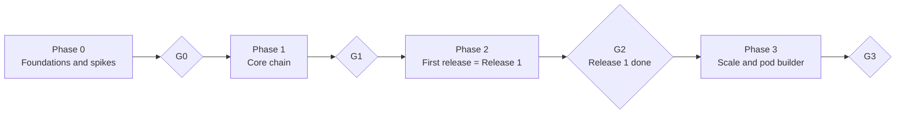
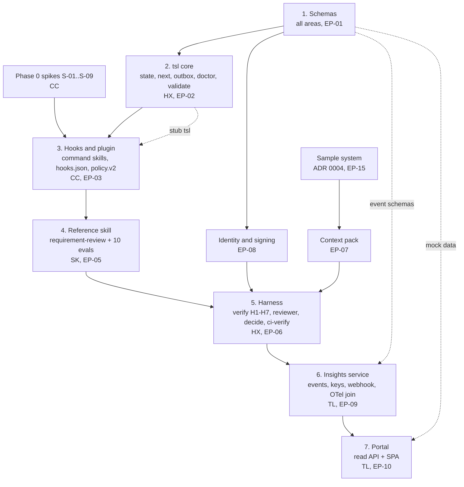
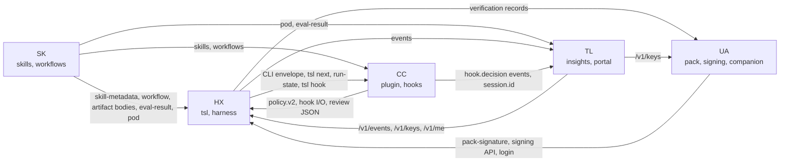
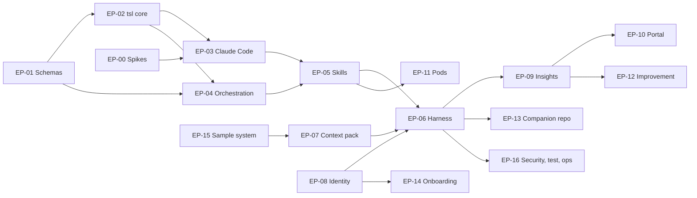

# PLN-01 · Delivery Plan

| Field | Value |
| --- | --- |
| Status | Draft for owner review |
| Owner | Puneet Singh Nanda |
| Approver | Puneet Singh Nanda |
| Related docs | [PRD](../product/01-prd.md) §4, §6, §8 · [Personas and Stories](../product/02-personas-and-stories.md) · [Architecture](../architecture/03-architecture.md) §7, §12 · [API and Rules](../architecture/05-api-and-rules.md) §3 · [Constraints](../product/06-constraints.md) · [SDD-05](../design/SDD-05-claude-code-integration.md) §8 · [Readiness Tracker](readiness-tracker.md) Q8, Q16–Q21 · [GOV-01](../governance/GOV-01-adr-and-change-process.md) · [docs index](../README.md) |

## 1. Scope

### 1.1 What this document decides

- The phase table: every feature, skill, workflow and pod placed in a phase (tracker Q8).
- The exit gate criteria for each phase, including what "done" means for Release 1 (Q16). These are **proposed, needs Puneet decision**.
- The first-build priority (Q17) and which open questions block which phase (Q18).
- The build order as a dependency graph (Q21).
- A backlog map: epics and stories with IDs, owner area and dependencies, covering every SDD (Q19).
- The contracts between team areas: what each area provides and consumes (Q20).
- The Phase 0 spike list S-01 to S-09 (from SDD-05 §8.1).

### 1.2 What it does not decide

- How each component works. That is in the SDDs listed in [docs/README.md](../README.md).
- Calendar dates. There are none, by rule (D-06, C-12). Order and gates only.
- Jira tickets. The backlog map here is the source. Jira epics and tickets are created **only after Puneet's explicit go-ahead** (org rule: no writes to Jira without approval; tracker Q19).

### 1.3 Terms

| Term | Meaning here |
| --- | --- |
| Phase | A block of scope closed by a gate (PRD §6) |
| Gate G0–G3 | The exit check of a phase. A phase is done only when every gate criterion is met and Puneet signs the gate |
| Release 1 | The end of Phase 2 (PRD §1: "First release means the end of Phase 2"). See open item PLN-OI-01 |
| Area | A team area of responsibility (tracker §1). Codes below |
| Epic `EP-nn` / story `ST-nn.m` | Backlog items in this plan. Not Jira keys |

### 1.4 Team areas

These replace the module owners in Doc 3 §12.2 (tracker §1).

| Code | Area | Owners | SDDs owned |
| --- | --- | --- | --- |
| SK | Skills, workflows, roles | Abhishek Verma, Ekjot Singh | SDD-01, SDD-02 (definition), SDD-10, SDD-11 |
| HX | Harness, execution, `tsl verify` | Japman Singh, Yash Khorwal | SDD-03, SDD-04 |
| CC | Skill execution, hook execution | Shubham Bansal | SDD-05, SDD-02 (runtime) |
| TL | Telemetry, logs, events, portal statistics | Gaurav Saini | SDD-08, SDD-09 (UI owner TBD by Puneet) |
| UA | Unassigned | TBD by Puneet | SDD-06, SDD-07, SDD-12, SDD-13, SEC-01, DEV-01, OPS-01, OPS-03, OPS-04, LEG-01 |

Puneet monitors and assesses all areas and signs every gate.

## 2. Phases

### 2.1 Phase flow

### 2.2 Phase table

| Phase | Goal | Scope (features) | Exit gate |
| --- | --- | --- | --- |
| **0 Foundations** | Prove the platform and fix the contracts before code depends on them | Spikes S-01 to S-09 (§6); all schema files in `schemas/` with valid and invalid samples (Q20); `tsl` skeleton (JSON envelope, exit codes, `tsl doctor`); plugin and marketplace skeleton; managed-settings template; companion repo template; context-pack spec (SDD-06); telemetry event schemas; sample system scope (ADR 0004); repo, CI, CODEOWNERS (GOV-01); Entra app registrations requested (ADR 0002) | G0 (§3.1) |
| **1 Core chain** | One real chain runs end to end on the sample system, checked by the harness, to a pull request | `tsl state`, `next`, `verify`, `review prepare/record`, `decide`, `pr`, `init-context`, `sign-context`, `login`, `approve`, `hook`, `validate`, `outbox flush`; harness H1–H7 and S1–S6; Ed25519 signing; command skills `/truminds:run`, `resume`, `status`; reviewer subagent; hooks; policy.v2; Node and React verifier containers; JavaScript/TypeScript context extractor; the 10 Phase 1 skills (§2.3); workflows `brownfield-change` and `defect-fix`; Jira and GitHub MCP (read; writes need approval); sample system with signed context pack; insights service with `POST /v1/events`, `/v1/keys`, webhook; `tsl ci-verify` GitHub Action; portal shell on mock data | G1 (§3.2) |
| **2 First release** | All eight roles served; three pilot teams use it weekly | Remaining Release-1 skills and workflows (§2.3); all 8 agents (D-07); Java and Python verifier containers; Android and iOS verifier containers (see PLN-OI-04); first domain pack (FR-DOM-01); portal read API and all Release-1 screens (Business and Engineer personas); capability map; Release-1 pods and pod pages (OQ-16); weekly improvement report; `/truminds:eval`, `/truminds:improve`; onboarding guides; OPS-01 to OPS-04 live; security review and consent template signed off | **G2 = Release 1 done** (§3.3) |
| **3 Scale** | Grow the catalogue and prove uplift | 25 to 40 skills; second domain pack; pod builder (US-22, X-04); Tier C embedded verifier; portability adapter design (tracker Q15) | G3 (§3.4) |

### 2.3 Feature-to-phase table (skills, workflows, pods)

Workflow and skill names follow Doc 3 §7, which overrides PRD FR-WFL-03 (PRD §1: Docs 3 and 5 override less precise text). See PLN-OI-02.

**Skills** (Doc 3 §7). "Priority" is the build order inside the phase (Q17 proposal: thinnest chain first).

| Skill | Agent | Phase | Priority | Needed by |
| --- | --- | --- | --- | --- |
| `requirement-review` (reference skill) | Business Analyst | 1 | 1 | `brownfield-change` |
| `impact-analysis` | Solution Architect | 1 | 2 | `brownfield-change` |
| `design` | Solution Architect | 1 | 3 | `brownfield-change` |
| `implement` | Developer | 1 | 4 | `brownfield-change`, `defect-fix` |
| `unit-test` | Developer | 1 | 5 | `brownfield-change`, `defect-fix` |
| `story-split` | Business Analyst | 1 | 6 | `brownfield-change` |
| `test-plan` | QA | 1 | 7 | `brownfield-change` |
| `threat-model` | Security | 1 | 8 | `brownfield-change` |
| `secure-code-review` | Security | 1 | 9 | `brownfield-change` |
| `defect-triage` | Developer | 1 | 10 | `defect-fix` |
| `test-automation` | QA | 2 | 11 | — |
| `pipeline-review` | DevOps | 2 | 12 | — |
| `deployment-failure-analysis` | DevOps | 2 | 13 | — |
| `ux-flow-review` | UX | 2 | 14 | `ux-review` |
| `accessibility-review` | UX | 2 | 15 | `ux-review` |
| `estimate-review` | Delivery Manager | 2 | 16 | `estimate` |
| `status-report` | Delivery Manager | 2 | 17 | — |
| Further skills (25 to 40 total) | Any | 3 | — | — |

Phase 1 holds 10 skills because `brownfield-change` (Doc 5 §3.3) cannot run end to end with fewer. PRD §6 says "first 8 skills". See PLN-OI-03.

**Workflows** (Doc 3 §7.1)

| Workflow | Phase | Note |
| --- | --- | --- |
| `brownfield-change` | 1 | The G1 proof run |
| `defect-fix` | 1 | Second G1 proof run |
| `greenfield-feature` | 2 | Same chain, design against intent baseline |
| `ux-review` | 2 | Figma MCP, read-only |
| `estimate` | 2 | Read-only |

**Pods** (Doc 4 §2.0.3; the list and composition need sign-off, OQ-16)

| Pod (example names from Doc 4) | Phase | Built from |
| --- | --- | --- |
| Brownfield Change | 2 | `brownfield-change` |
| Greenfield Feature | 2 | `greenfield-feature` |
| Quality and Security | 2 | `test-plan`, `test-automation`, `threat-model`, `secure-code-review` |
| UX Review | 2 | `ux-review` |
| Pod builder | 3 | X-04, US-22 |

### 2.4 Open questions by phase (Q18)

| Blocks | Open questions |
| --- | --- |
| G0 | OQ-01 co-approver; OQ-02 hosting (PRD); OQ-10 GitHub org (needed for CODEOWNERS teams and marketplace path) |
| Phase 1 coding | None. Phase 1 can start on defaults |
| G1 | OQ-08 retention; OQ-09 NFR limits; OQ-12 default limits; OQ-14 client people answering questions; OQ-16 Release-1 pods |
| Phase 2 | OQ-04 pilots; OQ-05 domain SME |
| Pilots on client code | OQ-03 residency; OQ-06 consent wording |
| G2 | OQ-11 audit rate; OQ-13 brand |
| First production promotion of a skill | OQ-07 stage approvers |

OQ-15 is closed by ADR 0001. PRD §8 says OQ-02 blocks G0; tracker Q18 says it blocks going live, not coding. See PLN-OI-05.

## 3. Gate criteria

**All criteria in this section are proposed, needs Puneet decision.** Numbers are starting points (D-09: numeric success targets follow pilot baselines).

### 3.1 G0 — Foundations done

| # | Criterion | Evidence |
| --- | --- | --- |
| G0-1 | Spikes S-01 to S-09 run and recorded; each failed spike has its fallback chosen | SDD-05 §8.1 "Result" column filled |
| G0-2 | Every schema in §5.2 exists in `schemas/` with at least one valid and one invalid sample; contract tests pass in CI | `schemas/` CI job green |
| G0-3 | Every SDD in the index is at status "Owner reviewed" or later | GOV-01 status in each doc |
| G0-4 | An owner is named for every UA item, or Puneet keeps it | docs/README.md has no "TBD by Puneet" in an owner column for Phase 1 work |
| G0-5 | Plugin installs from the marketplace on a clean macOS and a clean native Windows machine | SDD-05 §8.2 |
| G0-6 | CODEOWNERS and branch protection live on the repo | GOV-01 §5 |
| G0-7 | Hosting decided (OQ-02), or Puneet moves it to G1 (PLN-OI-05) | ADR |

### 3.2 G1 — Core chain done

| # | Criterion | Evidence |
| --- | --- | --- |
| G1-1 | `brownfield-change` runs end to end on the sample system on at least 3 seeded tickets to an opened PR; a human merges at least one | Run folders, PR links |
| G1-2 | `defect-fix` runs end to end on at least 1 seeded defect to an opened PR | Same |
| G1-3 | Each hard gate H1–H7 blocks a seeded bad artifact (one fixture per gate) | SDD-03 fixtures green |
| G1-4 | `tsl decide` golden suite covers all six outcomes and both caps | CI |
| G1-5 | Each Phase 1 skill has ≥ 10 eval cases and ≥ 90% pass rate, signed | `eval-result.v1` files |
| G1-6 | `tsl ci-verify` rejects a PR with missing (E-CI-01), forged (E-CI-02) and mismatched (E-CI-03) records | CI on sample repo |
| G1-7 | Events from a run are visible in the insights database, joined to the Claude Code session by `session.id` | SQL query in SDD-08 |
| G1-8 | Pause and resume works after the session is closed | E2E test |
| G1-9 | NFR-01 (≤ 5 s harness) and NFR-02 (≤ 500 ms hook) met on a standard laptop | Release checklist |
| G1-10 | No client name, code or data in any fixture, eval or demo (C-09, T-01) | H4 scan of repo |

### 3.3 G2 — Release 1 done (proposed, needs Puneet decision)

This merges the tracker Q16 proposal with PRD §6 G2.

| # | Criterion | Target (proposed) | Evidence |
| --- | --- | --- | --- |
| R1-1 | Pilot system(s) chosen and consented (OQ-04, OQ-06) | At least 1 Truminds internal system; client systems only with signed consent | Consent ref in `client.consent_ref` |
| R1-2 | `brownfield-change` on real pilot tickets | 10 tickets end to end | Run records |
| R1-3 | First-try pass rate on pilot runs | ≥ 70% of steps PASS or PASS-WITH-FINDINGS on attempt 1 | `step` table |
| R1-4 | Merged PRs that bypassed records | 0 (`tsl-ci-verify` is a required check on pilot repos) | `ci.verified`, webhook |
| R1-5 | Calibration audit | Tech leads audit 1 in 10 High results (OQ-11); every audited High deserved High | Audit log (SDD-03) |
| R1-6 | Weekly use | 3 teams use it weekly for 4 consecutive weeks (PRD G2) | Weekly active engineers |
| R1-7 | Per-skill acceptance shown | Portal skill-performance screen shows first-try pass per skill | Portal |
| R1-8 | Security | SEC-01 review done by a named reviewer; no open security finding | SEC-01 sign-off |
| R1-9 | Catalogue | All 17 Release-1 skills and 5 workflows at status production or pilot, each with signed evals | Catalogue |
| R1-10 | Baseline recorded | Each pilot team recorded the PRD §5 baseline before first use | Baseline sheet |
| R1-11 | Operations | OPS-02 alerts live; OPS-03 rollback tested once; OPS-04 runbook reviewed | OPS docs |

### 3.4 G3 — Scale done

Measured uplift against baseline on at least 2 PRD §5 metrics (PRD §6). Targets set by Puneet after G2.

## 4. Build order

### 4.1 Dependency graph

Solid arrows are hard dependencies. Dashed arrows mean "can start early on mocks or stubs".

### 4.2 Why this order

| Step | Starts when | Why it comes here |
| --- | --- | --- |
| 1 Schemas | Now | Every area reads or writes these files. One shared version stops five people reading Doc 5 five ways (Q20) |
| 2 `tsl` core | Schemas for config, state, lock and CLI envelope are reviewed | Every command skill and hook calls `tsl` |
| 3 Hooks and plugin | `tsl hook` entry point exists (a stub is enough) and spikes S-01 to S-08 are recorded | Hooks and command skills wrap `tsl`; spikes decide which fallbacks are built |
| 4 Reference skill | Plugin installs and `/truminds:run` reaches the first step | Fixes the skill template every later skill copies (SDD-01) |
| 5 Harness | A real artifact exists to check; context pack exists for citations | `verify` and `decide` need real artifacts and a pack to test against |
| 6 Insights | `tsl` sends events from real runs | Ingest is tested on real event shapes; skeleton can start on schemas alone |
| 7 Portal | Insights holds real rows | Screens read real data; shell can start on mock data from step 1 |

### 4.3 Parallel lanes in Phase 1

| Lane | Area | Order of work |
| --- | --- | --- |
| A | HX | `tsl` core → `verify` → `review prepare/record` → `decide` → `ci-verify` |
| B | CC | Spikes → plugin package → hooks → command skills → managed settings handover |
| C | SK | Schemas for skill and workflow → skill template → `requirement-review` → priority 2–10 skills → workflow files |
| D | TL | Event schemas → service skeleton → `/v1/events` → webhook → OTel join → portal shell |
| E | UA | Sample system → context extractor → login and signing → companion template → `tsl pr` |

## 5. Contracts between team areas (Q20)

### 5.1 Rule

A contract is a file in `schemas/` (JSON Schema 2020-12) or an OpenAPI file. The provider owns it and changes it by PR. Every consumer area is a required reviewer on that PR (GOV-01 §5). A breaking change bumps the schema version (`.vN` → `.vN+1`, Doc 3 §9.2) and needs an ADR.

### 5.2 Contract table

| Contract | Schema / interface | Provider | Consumers | Defined in |
| --- | --- | --- | --- | --- |
| System config | `tsl-config.v1` (`tsl.yaml`) | HX | CC, SK, UA | Doc 5 §3.1, SDD-04 |
| Skill metadata | `skill-metadata.v1` | SK | HX (`validate`, H7), CC, TL (catalogue) | Doc 5 §3.2, SDD-01 |
| Workflow | `workflow.v1` | SK | HX (`tsl next`, `validate`), TL (pods) | Doc 5 §3.3, SDD-02 |
| Run state and lock | `run-state.v1`, `run-lock.v1` | HX | CC (hooks read lock), SK (resume), TL | Doc 5 §3.4–3.5, SDD-04 |
| Next-step answer | `tsl next --json` output | HX (with SK for rules) | CC (`run` skill loop) | SDD-02, SDD-04 |
| CLI envelope | `{ok, code, exit, message, next, data}` | HX | CC (skills read `code`, `exit`, `next`) | Doc 5 §2.3 |
| Artifact envelope and bodies | `<type>.v1` (`intent.v1`, `impact.v1`, `design.v1`, …) | SK | HX (H1, H2, H5, citations) | Doc 5 §3.6, SDD-01 |
| Check record | `checks.v1` | HX | HX (`decide`), CI | Doc 5 §3.7, SDD-03 |
| Review record | `review.v1` | HX (schema), CC (reviewer agent produces) | HX (`decide`) | Doc 5 §3.7, SDD-03, SDD-05 §4.3 |
| Verification record | `verification.v1` | HX | CI, TL (`step.decided`), UA (signing) | Doc 5 §3.7, SDD-03 |
| Open questions, approvals | `open-questions.v1`, `approvals.v1` | HX | SK (resume), people, TL | Doc 4 §3–4 |
| Context pack signature | `pack-signature.v1` | UA (SDD-06) | HX (S5, H6), CI | SDD-06 |
| Eval result | `eval-result.v1` | SK | HX (`validate`), TL (catalogue) | SDD-01, SDD-11 |
| Policy | `policy.v2` + managed deny rules | CC | HX (`tsl hook` evaluates), SEC-01 | SDD-05 §6 |
| Hook stdin / stdout | Claude Code hook JSON; `tsl hook <event>` | CC | HX (implements inside `tsl`) | SDD-05 §5 |
| Signing | Ed25519 over RFC 8785 JCS; `key_<ULID>` | UA (SDD-07) | HX (`decide`, `ci-verify`), TL (`/v1/keys`) | Doc 5 §1.1, SDD-07 |
| Events | Event body schemas v1 (Doc 5 §5.3) | TL | HX (`tsl` emits), CC (hooks emit `hook.decision`) | Doc 5 §5, SDD-08 |
| Ingest API | `POST /v1/events`, `/v1/keys`, `/v1/me`, webhook | TL | HX (`tsl`), UA (`tsl login`), CI | Doc 5 §5.1, SDD-08 |
| Read API | OpenAPI for portal reads | TL | Portal UI | SDD-09 |
| Pod | `pod.v1` | SK | TL (pod pages) | SDD-10 |
| Managed settings | `managed-settings.json` template | CC | Claude org admin (TBD by Puneet), SDD-13 | SDD-05 §6.2 |

### 5.3 Provides and consumes, by area

## 6. Phase 0 spikes (from SDD-05 §8.1)

Run by Shubham Bansal on a company seat, in a local desktop session, with a throwaway plugin and a stub `tsl`. A failed spike switches to its fallback.

| Spike | Proves | Pass condition | Fallback if it fails | Blocks story |
| --- | --- | --- | --- | --- |
| S-01 | Managed settings shapes (SDD-05 §6.2) | Plugin installs at next session start; second marketplace refused; `--plugin-dir` refused | Adjust value shapes; re-test | ST-03.6 |
| S-02 | Deny-rule globs | `.env`, `.pem` reads and `curl` blocked with no prompt | Add matching patterns to `pre-tool` hook | ST-03.6 |
| S-03 | U-01: PreToolUse on `Skill` | Fires with skill name in `tool_input` | Not needed: input check stays inside skills (V-16) | None (nice-to-have) |
| S-04 | U-02: PostToolUse input | `tool_input.file_path` present; result field name recorded | Read path only (already the design) | ST-03.3 |
| S-05 | U-04: `Agent` tool input | Subagent type visible | Rely on reviewer `tools` list and managed rules | ST-06.5 |
| S-06 | U-03: hook enforcement in desktop | Plugin hook fires; user hook does not | Rely more on CI (E-CI-01); raise as risk | ST-03.3 |
| S-07 | U-05: marketplace pinning | Only the tagged version installs | `main` receives only tagged, CI-passed merges | ST-03.7 |
| S-08 | U-06: env passing | `TSL_SESSION_ID` visible in skill `` !`env` `` and Bash | Pre-tool hook binds lock to session on first tool call | ST-02.3, ST-09.4 |
| S-09 | End to end with stub `tsl` | Whole loop works; pre-tool ≤ 500 ms; post-write overhead ≤ 1 s | Fix the failing link before Phase 1 | G0-1 |

## 7. Backlog map

Story IDs are stable. Each story maps to one owner area. "Depends on" lists story IDs. Jira keys are added only after Puneet approves creating them (§1.2).

### 7.1 Epics

| Epic | Title | Source doc | Area | Phase |
| --- | --- | --- | --- | --- |
| EP-00 | Platform spikes | SDD-05 §8.1 | CC | 0 |
| EP-01 | Schemas and contracts | Doc 5 §3, this doc §5 | All (coordination TBD by Puneet) | 0 |
| EP-02 | `tsl` core | SDD-04 | HX | 0–1 |
| EP-03 | Claude Code integration | SDD-05 | CC | 0–1 |
| EP-04 | Workflow orchestration | SDD-02 | SK, CC | 1 |
| EP-05 | Skill authoring and catalogue | SDD-01 | SK | 1–2 |
| EP-06 | Harness and CI verify | SDD-03 | HX | 1 |
| EP-07 | Context pack and extractors | SDD-06 | UA | 1 |
| EP-08 | Identity, signing and keys | SDD-07 | UA | 1 |
| EP-09 | Telemetry and insights service | SDD-08 | TL | 0–2 |
| EP-10 | Web portal and read API | SDD-09 | TL (UI owner TBD by Puneet) | 1–2 |
| EP-11 | Pods | SDD-10 | SK | 2–3 |
| EP-12 | Improvement loop | SDD-11 | SK, TL | 2 |
| EP-13 | Companion repo lifecycle | SDD-12 | UA, HX | 0–1 |
| EP-14 | Onboarding and administration | SDD-13 | UA | 1–2 |
| EP-15 | Sample brownfield system | ADR 0004, TST-01 | UA | 0–1 |
| EP-16 | Security, test, development and operations | SEC-01, TST-01, DEV-01, OPS-01–04, LEG-01 | UA, TL | 0–2 |

### 7.2 Stories

| Story | What | Area | Depends on | Phase |
| --- | --- | --- | --- | --- |
| **EP-00** | | | | |
| ST-00.1 | Build spike plugin and stub `tsl` that logs stdin (`spikes/`) | CC | — | 0 |
| ST-00.2 | Run S-01 to S-08 on a test seat and record results in SDD-05 §8.1 | CC | ST-00.1 | 0 |
| ST-00.3 | Run S-09 end to end and record timings | CC | ST-00.2 | 0 |
| **EP-01** | | | | |
| ST-01.1 | `schemas/` layout, sample folders `valid/` and `invalid/`, CI contract test job | HX | — | 0 |
| ST-01.2 | `tsl-config.v1`, `run-state.v1`, `run-lock.v1`, CLI envelope schema | HX | ST-01.1 | 0 |
| ST-01.3 | `skill-metadata.v1`, `workflow.v1`, `eval-result.v1` | SK | ST-01.1 | 0 |
| ST-01.4 | Artifact envelope and body schemas for Phase 1 types (`intent.v1`, `stories.v1`, `impact.v1`, `design.v1`, `change.v1`, `ut-result.v1`, `threat-model.v1`, `secure-review.v1`, `test-plan.v1`, `triage.v1`) | SK | ST-01.3 | 0 |
| ST-01.5 | `checks.v1`, `review.v1`, `verification.v1`, `open-questions.v1`, `approvals.v1` | HX | ST-01.1 | 0 |
| ST-01.6 | `pack-signature.v1` | UA | ST-01.1 | 0 |
| ST-01.7 | `policy.v2` and hook stdin/stdout fixtures | CC | ST-01.1 | 0 |
| ST-01.8 | Event body schemas v1 and OpenAPI for `/v1/events`, `/v1/keys`, `/v1/me`, webhook | TL | ST-01.1 | 0 |
| **EP-02** | | | | |
| ST-02.1 | `tsl` package skeleton (Typer, Pydantic), `--json` envelope, exit codes, `tsl --version` = plugin version | HX | ST-01.2 | 0 |
| ST-02.2 | `tsl doctor` (Python 3.12, uv, git, Docker, login) | HX | ST-02.1 | 0 |
| ST-02.3 | `tsl state start/resume/show/unlock`, git-push lock, ULID run ids, stale lock (DEF-06) | HX | ST-02.1 | 1 |
| ST-02.4 | Offline outbox and `tsl outbox flush` (R-04, R-05) | HX | ST-02.1, ST-01.8 | 1 |
| ST-02.5 | `tsl validate` for skills, workflows and system `policy.yaml` (add-only rule) | HX | ST-01.3, ST-01.7 | 1 |
| ST-02.6 | `tsl hook <event>` entry point with the SDD-05 §5.4 failure rules | HX | ST-02.1, ST-01.7 | 1 |
| ST-02.7 | `tsl migrate` (N to N+1) | HX | ST-02.3 | 2 |
| **EP-03** | | | | |
| ST-03.1 | Marketplace and plugin manifests; release tag rule (SDD-05 §3) | CC | ST-00.2 | 0 |
| ST-03.2 | Command skills `run`, `resume`, `status` with `disable-model-invocation` | CC | ST-03.1, ST-02.3 | 1 |
| ST-03.3 | `hooks.json` and `bin/tsl-hook` launcher (macOS, Linux, Windows) | CC | ST-02.6, ST-00.2 | 1 |
| ST-03.4 | `pre-tool` and `pre-mcp` policy logic (E-POL-01/02/03) | CC | ST-03.3, ST-01.7 | 1 |
| ST-03.5 | `session-start` and `session-end` hooks (version, login, outbox, `TSL_SESSION_ID`) | CC | ST-03.3, ST-02.4 | 1 |
| ST-03.6 | Managed-settings template validated on a test seat; handed to Claude admin (TBD by Puneet) | CC | ST-00.2 | 1 |
| ST-03.7 | Hook contract tests: allow, deny, fail-closed, fail-open, 500 ms budget | CC | ST-03.4, ST-03.5 | 1 |
| **EP-04** | | | | |
| ST-04.1 | Output-to-input binding rules and lockfile of exact skill versions (FR-WFL-02) | SK | ST-01.3 | 1 |
| ST-04.2 | `tsl next` next-step algorithm, gates, sequential run of parallel-eligible steps | HX | ST-04.1, ST-02.3 | 1 |
| ST-04.3 | Re-run and downstream invalidation on resume (H6, DEF-02) | SK | ST-04.2 | 1 |
| ST-04.4 | Workflow files `brownfield-change`, `defect-fix` | SK | ST-04.1 | 1 |
| ST-04.5 | Workflow files `greenfield-feature`, `ux-review`, `estimate` | SK | ST-04.4 | 2 |
| **EP-05** | | | | |
| ST-05.1 | SKILL.md template, rubric format, eval-case format, skill folder layout | SK | ST-01.3 | 0 |
| ST-05.2 | Reference skill `requirement-review` with rubric and 10 eval cases | SK | ST-05.1, ST-03.2 | 1 |
| ST-05.3 | Priority 2–5 skills: `impact-analysis`, `design`, `implement`, `unit-test` | SK | ST-05.2, ST-07.1 | 1 |
| ST-05.4 | Priority 6–10 skills: `story-split`, `test-plan`, `threat-model`, `secure-code-review`, `defect-triage` | SK | ST-05.3 | 1 |
| ST-05.5 | Role packs for the 8 agents (FR-AGT-01/02) | SK | ST-05.4 | 2 |
| ST-05.6 | Priority 11–17 skills | SK | ST-05.5 | 2 |
| ST-05.7 | First domain pack with eval set (FR-DOM-01; SME OQ-05) | SK | ST-05.6 | 2 |
| **EP-06** | | | | |
| ST-06.1 | `tsl verify` gates H1, H2, H4, H5, H6, H7 with one failing fixture each | HX | ST-01.4, ST-01.5, ST-02.1 | 1 |
| ST-06.2 | Verifier containers: Node and React (H3) | HX | ST-15.1 | 1 |
| ST-06.3 | Citation verifier (DEF-08) for JavaScript/TypeScript | HX | ST-07.1 | 1 |
| ST-06.4 | `tsl decide`: signals S1–S6, band, caps, six outcomes; golden suite | HX | ST-06.1, ST-06.3 | 1 |
| ST-06.5 | Reviewer agent, `review` skill, `tsl review prepare` and `tsl review record` | HX, CC | ST-01.5, ST-03.2, ST-00.2 | 1 |
| ST-06.6 | `tsl ci-verify` and GitHub Action `tsl-ci-verify` (E-CI-01/02/03) | HX | ST-06.4, ST-08.3 | 1 |
| ST-06.7 | Reviewer eval set (planted defects, no invented findings) | HX | ST-06.5 | 1 |
| ST-06.8 | Verifier containers: Java, Python; Android, iOS per PLN-OI-04 | HX | ST-06.2 | 2 |
| ST-06.9 | Calibration audit procedure (OQ-11) | HX | ST-06.4 | 2 |
| **EP-07** | | | | |
| ST-07.1 | `tsl init-context` with JavaScript/TypeScript extractor (`module-map.json`, `api-inventory.json`, `dependency-graph.json`); consent check E-CONS-01 | UA | ST-01.6, ST-15.1 | 1 |
| ST-07.2 | `tsl context-refresh --check` drift (DEF-03) and freshness (DEF-01) | UA | ST-07.1 | 1 |
| ST-07.3 | `tsl sign-context` | UA | ST-07.1, ST-08.2 | 1 |
| ST-07.4 | Extractors for Java and Python | UA | ST-07.2 | 2 |
| **EP-08** | | | | |
| ST-08.1 | `tsl login` with Entra device-code (ADR 0002) | UA | ST-02.1, ST-09.1 | 1 |
| ST-08.2 | Ed25519 key in OS keychain; register with `POST /v1/keys`; JCS signing library | UA | ST-08.1 | 1 |
| ST-08.3 | Key lookup and revocation for CI (`GET /v1/keys/{key_id}`, R-07) | UA, TL | ST-08.2 | 1 |
| ST-08.4 | `tsl approve` with role check and no self-approval (TM-13) | UA | ST-08.2 | 1 |
| **EP-09** | | | | |
| ST-09.1 | FastAPI service skeleton, Entra token validation, Alembic DDL from Doc 3 §9.1, `/v1/health`, `/v1/me` | TL | ST-01.8 | 0 |
| ST-09.2 | `POST /v1/events` with idempotency and per-event results | TL | ST-09.1 | 1 |
| ST-09.3 | GitHub webhook receiver with HMAC and delivery-id idempotency | TL | ST-09.1 | 1 |
| ST-09.4 | OTel collector config; join on `session.id` | TL | ST-09.2, ST-00.2 | 1 |
| ST-09.5 | Schema v1.1: pods, summary views, indexes, seed data | TL | ST-09.2 | 1 |
| ST-09.6 | Retention job (OQ-08) | TL | ST-09.5 | 2 |
| **EP-10** | | | | |
| ST-10.1 | Read API OpenAPI and permission rules (Business vs Engineer, pseudonyms) | TL | ST-09.5 | 1 |
| ST-10.2 | React SPA shell, MSAL auth code + PKCE, persona switch, mock data | TL | ST-01.8 | 1 |
| ST-10.3 | Skills, skill detail, how it works, get started screens | TL | ST-10.1, ST-10.2 | 2 |
| ST-10.4 | Insights (Engineer), run detail | TL | ST-10.1 | 2 |
| ST-10.5 | Insights (Business), capability map (no client names, X-13) | TL | ST-10.1 | 2 |
| ST-10.6 | Pods and pod detail screens | TL | ST-11.2 | 2 |
| **EP-11** | | | | |
| ST-11.1 | `pod.v1` format | SK | ST-01.3 | 2 |
| ST-11.2 | Release-1 pod files (OQ-16) | SK | ST-11.1, ST-04.5 | 2 |
| ST-11.3 | Pod builder (US-22, X-04) | SK, TL | G2 | 3 |
| **EP-12** | | | | |
| ST-12.1 | `/truminds:eval` with `tsl eval plan` and `tsl eval record` | SK, CC | ST-05.1, ST-08.2 | 1 |
| ST-12.2 | Weekly improvement report job (plain code) | TL | ST-09.5 | 2 |
| ST-12.3 | `/truminds:improve` with `tsl improve plan` | SK, CC | ST-12.1, ST-12.2 | 2 |
| **EP-13** | | | | |
| ST-13.1 | Companion repo template | UA | ST-01.2 | 0 |
| ST-13.2 | `tsl pr` with PR body template and `tsl:run_id` marker | HX | ST-06.4 | 1 |
| ST-13.3 | Multi-repo runs (one PR per product repo) | HX | ST-13.2 | 2 |
| **EP-14** | | | | |
| ST-14.1 | `tsl` install guide (uv) and engineer onboarding guide | UA | ST-03.6 | 1 |
| ST-14.2 | Admin onboarding: client consent record, role grants | UA | ST-09.1 | 2 |
| ST-14.3 | Skill-author and tech-lead guides; hands-on session on sample system | UA | ST-05.2 | 2 |
| **EP-15** | | | | |
| ST-15.1 | React + Node.js + PostgreSQL order-tracking sample system, invented data only | UA | — | 0 |
| ST-15.2 | Seeded tickets and seeded defects for G1 runs | UA | ST-15.1 | 1 |
| ST-15.3 | Signed context pack for the sample system | UA | ST-07.3, ST-15.1 | 1 |
| **EP-16** | | | | |
| ST-16.1 | DEV-01 setup guide and dev container | UA | ST-02.1 | 0 |
| ST-16.2 | CODEOWNERS, branch protection, PR template, docs CI (GOV-01) | UA | — | 0 |
| ST-16.3 | SEC-01 threat model review by named reviewer | UA | ST-06.4 | 1–2 |
| ST-16.4 | TST-01 E2E suite on sample system | UA | ST-05.4, ST-06.6 | 1 |
| ST-16.5 | OPS-01 hosting (OQ-02); OPS-02 alerts | UA, TL | ST-09.2 | 2 |
| ST-16.6 | OPS-03 release and rollback; OPS-04 failure runbook | UA | ST-03.1 | 2 |
| ST-16.7 | LEG-01 consent template for legal review | UA | — | 1 |

### 7.3 Story template (for Jira, after approval)

| Field | Content |
| --- | --- |
| Summary | `ST-nn.m <what>` |
| Links | Source SDD section; user story US-xx; this plan |
| Acceptance criteria | Given/When/Then, copied from the SDD test plan |
| Done criteria | Code merged by PR; tests green; schema and docs updated; SDD done criteria line ticked |
| Owner | Area owner from §1.4 |
| Depends on | Story IDs |

## 8. Done criteria

- Every SDD in [docs/README.md](../README.md) maps to at least one epic in §7.1.
- Every story has an owner area and a dependency list; no cycle exists in §7.2.
- Every gate criterion in §3 is accepted, changed or removed by Puneet, and the "proposed" label is dropped.
- Release-1 scope (Q17) and success criteria (Q16) are recorded as decisions in the GOV-01 decision log.
- Puneet approves creating the Jira epics and stories (or decides not to use Jira).

## 9. Open items

| ID | Item | Owner | Ref |
| --- | --- | --- | --- |
| PLN-OI-01 | Name of the first release. PRD §1 says Release 1 = end of Phase 2. Some briefs call Phase 1 "Release 1". This plan follows the PRD | Puneet | new |
| PLN-OI-02 | Workflow names differ: PRD FR-WFL-03 (`brownfield-feature`, `defect-triage`, `greenfield-architecture`, `greenfield-bootstrap`) vs Doc 3 §7.1 (`brownfield-change`, `defect-fix`, `greenfield-feature`, `ux-review`, `estimate`). This plan uses Doc 3. PRD needs updating | Puneet | new |
| PLN-OI-03 | Phase 1 skill count: PRD §6 says 8; the `brownfield-change` chain plus `defect-triage` needs 10 | Puneet | Q17 |
| PLN-OI-04 | Android and iOS verifiers: PRD §6 puts them in Phase 2 (part of Release 1); Doc 6 L-10 says "not in Release 1" | Puneet | new |
| PLN-OI-05 | Hosting (OQ-02) blocks G0 in PRD §8, but tracker Q18 says it blocks go-live only. Proposal: move to G1 | Puneet | OQ-02 |
| PLN-OI-06 | Release-1 success criteria R1-1 to R1-11 | Puneet | Q16, OQ-04 |
| PLN-OI-07 | Release-1 priority order of skills and pods | Puneet | Q17, OQ-16 |
| PLN-OI-08 | Owners for the UA area (SDD-06, 07, 12, 13, sample system, ops docs) | TBD by Puneet | Q30 |
| PLN-OI-09 | Go-ahead to create Jira epics and stories from §7 | Puneet | Q19 |
| PLN-OI-10 | Seat usage limits for long workflows; measure one E2E run in Phase 1 | Claude admin (TBD by Puneet) | Q38 |
| PLN-OI-11 | Thresholds: 90% eval pass, 1-in-10 audits | Puneet | OQ-11, OQ-12 |
