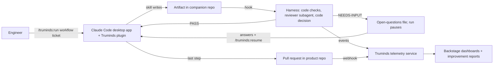
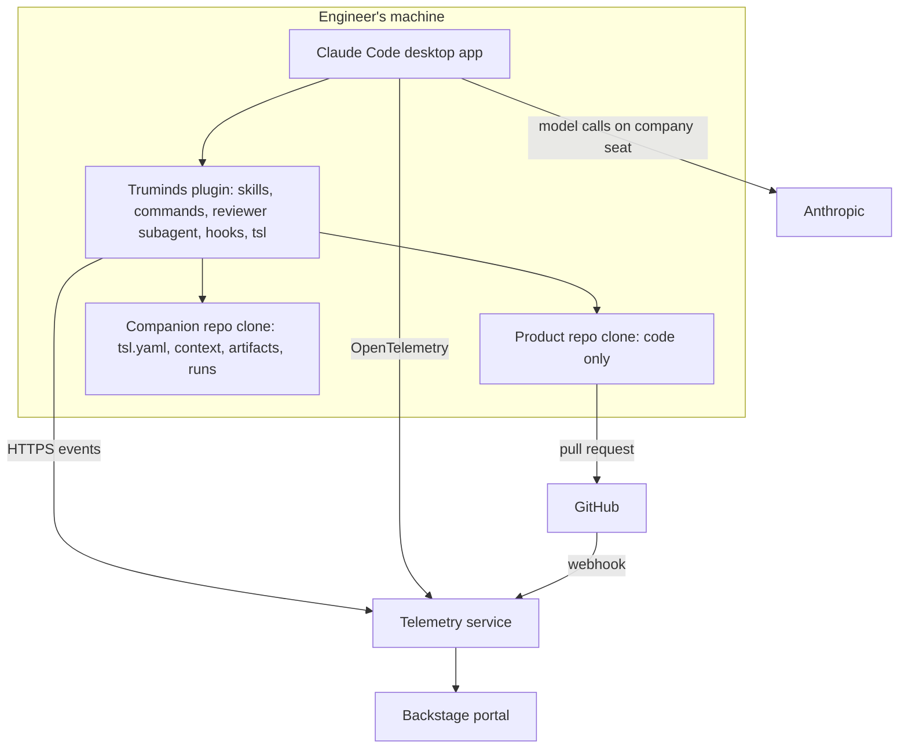
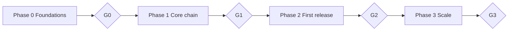

# 1 · Truminds AI Skill Library — Product Requirements Document

Oct 6, 2026 · @Puneet Singh Nanda

## 1. Document control

This is the business requirements document; build contracts (schemas, APIs, CLI, data model) live in documents 3 and 5 and override anything here that is less precise.

| Field | Value |
| --- | --- |
| Product | Truminds AI Skill Library |
| Owner and approver | @Puneet Singh Nanda |
| Co-approver (security and legal) | Open question OQ-01 |
| Version | 2.0 (replaces the single-file PRD v1.0) |
| Status | Draft for review |
| Delivery team | Abhishek, Shubham, Japman (backend); Ekjot, Gaurav (frontend) |

**The document set.** Each document has one job; nothing is defined in two places.

| # | Document | Holds | Audience |
| --- | --- | --- | --- |
| 1 | Product Requirements Document (this) | Problem, goals, functional requirements, metrics, release plan, decisions | Owner, leadership, team |
| 2 | [User Personas and Stories](02-personas-and-stories.md) | Personas, roles and permissions, user stories with Given/When/Then acceptance criteria | Team, testers, code-generating LLM |
| 3 | [System Architecture and Tech Stack](../architecture/03-architecture.md) | Components, local execution, companion repo, harness algorithm, trust model, data model, threat model, definitions, tech stack, test strategy | Engineers, code-generating LLM |
| 4 | [Design and UI/UX Assets](../ux/04-design-and-ux.md) | Backstage screens, CLI messages, file templates, design tokens, accessibility | Frontend, code-generating LLM |
| 5 | [API Specifications and Rules](../architecture/05-api-and-rules.md) | `tsl` CLI spec, file schemas, hook contracts, telemetry OpenAPI, event schemas, rules (retry, IDs, versioning) | Engineers, code-generating LLM |
| 6 | [Constraints and Out-of-Scope List](06-constraints.md) | Constraints, assumptions, compliance, known limitations, explicit DO NOT BUILD list | Everyone |

**How to read IDs.** `FR-<module>-<n>` functional requirement; `US-<n>` user story (document 2); `NFR-<n>` non-functional (document 3); `C-<n>` constraint and `X-<n>` out-of-scope item (document 6). Priority: **P0** first release, **P1** should be in first release, **P2** later.

**First release** means the end of Phase 2 (section 6).

## 2. Problem, goals and non-goals

Truminds' AI work today is scattered experiments that cannot be reused, trusted or shown to clients; the Skill Library makes it one governed set of skills that engineers run on real brownfield and greenfield work, with every result checked and every run measured.

**Problem**

- Prompts and agents are built per project, per person; nothing is versioned, evaluated or owned.
- AI outputs pass between steps as chat text, so early mistakes surface late.
- On existing systems the AI does not know the system, so it guesses.
- Sales can describe AI capability but cannot prove it.

**Goals**

| # | Goal | Measured by (document 1 §5) |
| --- | --- | --- |
| G1 | Engineers in every role reuse library skills instead of building their own | Weekly active engineers; runs per week |
| G2 | AI output is trustworthy enough to act on | First-pass acceptance; changes requested on PRs; escaped defects |
| G3 | Any brownfield system can be onboarded | Systems with a current, signed context pack |
| G4 | Chains are reliable from the first step | Root-caused rework |
| G5 | Capability shown to clients is backed by evidence | Capability cells backed by production skills and real runs |
| G6 | The library improves from its own use | Skill versions promoted through the improvement loop |

**Non-goals**

- Replacing engineers or selling AI agents as headcount.
- Building an LLM, agent runtime, IDE or chat product.
- Any use of the Claude API; all model work runs on company Claude seats in the Claude Code desktop app.
- Autonomous merge, deployment or infrastructure change.
- Reporting the number of skills as success.

## 3. Product overview

An engineer runs a workflow of skills in the Claude Code desktop app; each skill writes a typed artifact, hooks check it automatically, the run pauses for human answers when needed, and the last step opens a pull request; every step is reported to a Truminds telemetry service.

**Core concepts** (full definitions in document 3)

| Concept | One line |
| --- | --- |
| Skill | A folder with `SKILL.md` that does one job and produces one reviewable artifact |
| Agent | A role (for example Developer) with allowed skills and tools |
| Workflow | A versioned, ordered chain of skills with pause points |
| Artifact | A typed file with an envelope of traces and evidence |
| Context pack | Facts and judgement about one existing system |
| Domain pack | Optional industry knowledge with an eval set |
| Verifier profile | A container of stack tools that checks code artifacts |
| Harness | Code checks, a reviewer subagent and code-made decisions after every skill |
| Companion repo | A Truminds-owned repo per client system holding packs, artifacts and runs |

**How a run works**

**Where things live**

## 4. Functional requirements

Each requirement states what must be true; exact formats are in document 5 and acceptance criteria in the linked stories (document 2). Only P0 and P1 are in the first release.

### 4.1 Skills, agents and workflows

| ID | Requirement | Pri | Stories |
| --- | --- | --- | --- |
| FR-REG-01 | Each skill is a folder with `SKILL.md` and Truminds metadata (schema `skill-metadata.v1`) | P0 | US-15 |
| FR-REG-02 | CI on the skills repo rejects a skill with no owner, no evals, a body over the size budget, or an input type no skill produces | P0 | US-15 |
| FR-REG-03 | Skills carry maturity draft, pilot, production or deprecated; only production skills appear as client capability | P0 | US-17 |
| FR-AGT-01 | Eight agents ship: Requirements Analyst, Solution Architect, Developer (incl. mobile), Quality Engineer, DevOps Engineer, Security Engineer, UX Designer, Delivery Manager | P0 | US-01, US-08 to US-13 |
| FR-AGT-02 | Each agent lists its allowed skills; the plugin installs one role pack per agent | P0 | US-18 |
| FR-WFL-01 | Workflows are versioned files (schema `workflow.v1`) with ordered steps, inputs, outputs, pause points and retry limits | P0 | US-01 |
| FR-WFL-02 | `tsl validate` type-checks every step's inputs against earlier outputs and writes a lockfile of exact skill versions | P0 | US-15 |
| FR-WFL-03 | First-release workflows: `brownfield-feature`, `defect-triage`, `greenfield-architecture`, `greenfield-bootstrap` | P0 | US-01, US-08, US-14 |
| FR-WFL-04 | Release-1 skill catalogue (document 3 §7) is complete for all eight agents | P0 | US-08 to US-13 |

### 4.2 Local runs

| ID | Requirement | Pri | Stories |
| --- | --- | --- | --- |
| FR-RUN-01 | `/truminds:run <workflow> <ticket>` starts a run with a ULID run ID and a run folder in the companion repo | P0 | US-01 |
| FR-RUN-02 | Before any skill starts, a hook blocks it unless it is the next step and its inputs have valid PASS records | P0 | US-02 |
| FR-RUN-03 | On NEEDS-INPUT the run writes an open-questions file and pauses; on an approval step it writes an approval file and pauses | P0 | US-03, US-07 |
| FR-RUN-04 | `/truminds:resume <run>` continues only when every blocking item has an answer and a named decider | P0 | US-03, US-04 |
| FR-RUN-05 | Only one active run per ticket and workflow; a second start is refused with the owner of the active run | P0 | US-21 |
| FR-RUN-06 | The last step opens a pull request in the product repo with code, unit-test results, verification summary, decisions and run ID | P0 | US-01, US-05 |

### 4.3 Harness

| ID | Requirement | Pri | Stories |
| --- | --- | --- | --- |
| FR-HRN-01 | After every artifact write, code checks run first (schema, sections, trace links, fact lookups); failure returns the reasons to Claude to fix | P0 | US-02 |
| FR-HRN-02 | When code checks pass, the reviewer subagent checks meaning against the context pack and rubric and returns cited findings | P0 | US-02 |
| FR-HRN-03 | Code verifies every citation, drops unproven findings, computes band and outcome (algorithm in document 3 §5) and writes a signed verification record | P0 | US-02 |
| FR-HRN-04 | Code artifacts run the verifier profile (build, unit tests, lint, security and secrets scans) | P0 | US-01 |
| FR-HRN-05 | CI on the product repo re-runs code checks and verifier checks and verifies every record's signature | P0 | US-05 |

### 4.4 Knowledge

| ID | Requirement | Pri | Stories |
| --- | --- | --- | --- |
| FR-CTX-01 | `tsl init-context` extracts facts from the product repo into the companion repo; the tech lead adds judgement and signs | P0 | US-06 |
| FR-CTX-02 | A context pack is fresh only if its facts match the product repo's current commit and its judgement files were verified within 90 days | P0 | US-06 |
| FR-CTX-03 | Without a fresh context pack, brownfield results are capped at band Medium and labelled | P0 | US-02 |
| FR-DOM-01 | One domain pack, for the first pilot's domain, with an eval set; domain packs are optional for every workflow | P1 | US-17 |

### 4.5 Telemetry, portal and improvement

| ID | Requirement | Pri | Stories |
| --- | --- | --- | --- |
| FR-TEL-01 | `tsl` sends run events (document 5 §5) to the telemetry service; offline events queue and send later | P0 | US-20 |
| FR-TEL-02 | Claude Code OpenTelemetry export and a GitHub webhook feed the same service | P0 | US-19 |
| FR-TEL-03 | Events from client systems carry metadata only, no code or artifact text | P0 | US-18 |
| FR-POR-01 | Backstage portal: skill catalogue, run status, usage, skill performance | P0 | US-13, US-19 |
| FR-POR-02 | Capability map (read-only) for Sales | P1 | US-17 |
| FR-IMP-01 | A weekly code job produces an improvement report per skill from telemetry | P1 | US-16 |
| FR-IMP-02 | `/truminds:improve <skill>` lets the skill owner draft a fix from the report; `/truminds:eval <skill>` runs evals locally and signs the results | P1 | US-15, US-16 |

### 4.6 Administration

| ID | Requirement | Pri | Stories |
| --- | --- | --- | --- |
| FR-ADM-01 | Managed settings require the Truminds marketplace, enforce the plugin's hooks and enable the OpenTelemetry export | P0 | US-18 |
| FR-ADM-02 | `tsl login` with company SSO registers the user and their signing key | P0 | US-18 |
| FR-ADM-03 | A client system can be onboarded only with a recorded client consent reference | P0 | US-18 |
| FR-ADM-04 | Roles and permissions follow the matrix in document 2 §3 | P0 | US-18 |

## 5. Success metrics

Metrics are fixed now; numeric targets are set after pilot teams record a baseline, and no uplift is claimed before that.

| Goal | Metric | Definition | Source |
| --- | --- | --- | --- |
| G1 | Weekly active engineers | Distinct users with at least one `run_started` in the week | Telemetry |
| G1 | Runs per week | Count of `run_started` | Telemetry |
| G2 | First-pass acceptance | Share of artifacts with `artifact_edited.changed_ratio` below 0.10 | Telemetry |
| G2 | Changes requested | Share of Truminds PRs with at least one "changes requested" review | GitHub webhook |
| G2 | Escaped defects | Defects linked to a ticket after its PR merged, versus baseline | Jira |
| G3 | Systems onboarded | Systems with a fresh, signed context pack | Telemetry |
| G4 | Root-caused rework | Share of re-runs caused by a Foundation change | Telemetry |
| G5 | Evidence-backed cells | Capability cells with at least one production skill and 5 real runs | Registry + telemetry |
| G6 | Promoted versions | Skill versions promoted after an improvement report | Skills repo |
| Cost | Tokens and cost per run | From Claude Code OpenTelemetry, joined by session | Telemetry |

**Baseline rule.** Each pilot team records time to ready story, rework rate, cycle time (ticket start to merge) and escaped defects for its current way of working before first use.

## 6. Release plan

Four phases defined by scope, each closed by a gate; there are no calendar dates. Phase 3 scope is listed only so it is not built early (document 6 §4).

| Phase | Scope | Exit gate |
| --- | --- | --- |
| 0 Foundations | Schemas in document 5; plugin, hooks and reviewer-subagent spike in the Claude Code desktop app; `tsl` skeleton; telemetry event schema; companion repo template; context-pack spec; reference-system scope; Backstage catalogue model; repo, CI, SSO, private marketplace | **G0:** spike proves hooks, subagent and managed settings work in the desktop app; schemas reviewed; owners named; hosting decided (OQ-02) |
| 1 Core chain | `tsl` run, resume, verify, decide, pr, init-context; harness L0 to L3; signing; first 8 skills; 3 agents; Node and React verifier containers; Jira and GitHub MCP; reference system with context pack; telemetry service with core events; CI checks | **G1:** `brownfield-feature` and `defect-triage` run end to end on the reference system to a merged PR; every hard gate blocks a seeded bad output; events visible in the service |
| 2 First release | All 8 agents and the Release-1 skill catalogue; `greenfield-architecture`, `greenfield-bootstrap`; Java, Python, Android and iOS verifier containers; first domain pack; Backstage run status, usage and skill-performance dashboards; capability map; improvement report and `/truminds:improve`, `/truminds:eval`; 3 pilot teams | **G2:** 3 teams use it weekly for 4 consecutive weeks; per-skill acceptance reported; no open security finding |
| 3 Scale | 25 to 40 skills; second domain pack; pod builder; Tier C embedded verifier | **G3:** measured uplift against baseline on at least 2 metrics |

## 7. Decisions log

Every decision below was made by the owner; a change requires a new row, never an edit.

| ID | Decision | Date |
| --- | --- | --- |
| D-01 | Reset and re-architect; the September prototype is kept as lessons, not code | 2026-09-25 |
| D-02 | Build on existing products and open standards; never re-implement what exists | 2026-09-25 |
| D-03 | Engineers and Sales served equally; Sales sees a read-only view of engineering evidence | 2026-09-25 |
| D-04 | Sell AI-augmented pods (people plus AI), never AI headcount | 2026-09-28 |
| D-05 | Domain-agnostic: any brownfield system via its context pack; domain packs optional | 2026-09-28 |
| D-06 | No calendar timelines; phases defined by scope and gates | 2026-09-28 |
| D-07 | First release supports all eight roles and both greenfield and brownfield workflows | 2026-10-05 |
| D-08 | Pilots on Truminds-owned code and on client code with written consent | 2026-10-05 |
| D-09 | Numeric success targets set after pilot baselines | 2026-10-05 |
| D-10 | Execution is local only: Claude Code desktop app with the Truminds plugin, on company Claude seats | 2026-10-06 |
| D-11 | No Claude API anywhere; CI re-runs code checks only and verifies signed records; improvement and evals run on owners' seats | 2026-10-06 |
| D-12 | Open questions are answered in a file and fed back with `/truminds:resume`; the decider is always named | 2026-10-06 |
| D-13 | Packs, artifacts and run state live in a Truminds-owned companion repo per client system; the product repo receives only code changes | 2026-10-06 |
| D-14 | Platform code (`tsl`, hooks, telemetry service) in Python | 2026-10-06 |
| D-15 | Dashboards and catalogue in Backstage | 2026-10-06 |
| D-16 | Six outcomes; confidence computed by harness rules, never self-reported; code makes every final decision | 2026-09-28 |

## 8. Open questions

Each question has no default; the gate it blocks cannot pass until it is answered.

| ID | Question | Blocks |
| --- | --- | --- |
| OQ-01 | Who co-approves this document set for security and legal? A sole approver is a governance gap. | G0 |
| OQ-02 | Which cloud hosts the telemetry service and Backstage portal? | G0 |
| OQ-03 | Does the company Claude plan offer the data residency and retention terms clients require (document 6 C-07)? | Pilots on client code |
| OQ-04 | Which three pilot teams, systems and domains? | Phase 2 |
| OQ-05 | Who is the subject-matter expert for the first domain pack? | Phase 2 |
| OQ-06 | What consent wording will Legal accept for client code and for storing client artifacts in companion repos? | Pilots on client code |
| OQ-07 | Who are the stage approvers (CODEOWNERS) for each lifecycle stage? | First production promotion |
| OQ-08 | Retention period for telemetry events where a contract does not set one | G1 |
| OQ-09 | Confirm the proposed limits in document 3 §10 (NFRs) and §5 (harness thresholds) | G1 |
| OQ-10 | Which GitHub org hosts companion repos: Truminds or the client's? (Doc 3 §3) | G1 |
| OQ-11 | Sampling rate for calibration audits of High-band outcomes (Doc 3 §5.6) | G2 |
| OQ-12 | Confirm default limits: pack age, drift, change size, stale lock (Doc 3 §6) | G1 |
| OQ-13 | Truminds brand colours and logo for the portal (Doc 4 §6) | G2 |
| OQ-14 | May client people (e.g. a client PO) answer open-questions files directly in the companion repo? (Doc 4 §6) | G1 |
| OQ-15 | Intranet portal: build on Backstage, or as a custom web app on the same API? (Doc 4 §2.0) | G1 |
| OQ-16 | Release-1 pod list and each pod's composition (Doc 4 §2.0.3) | G1 |
