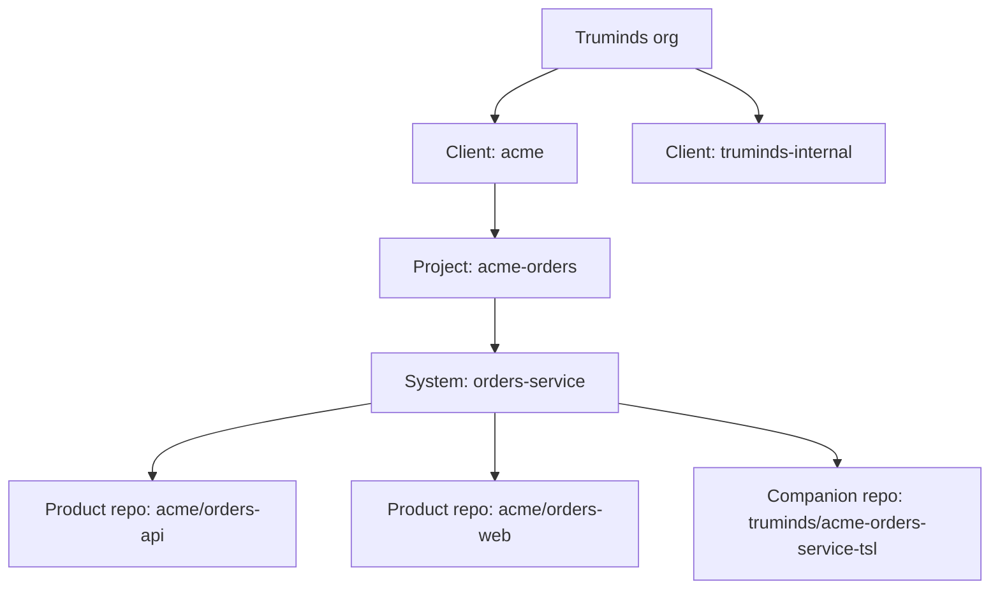

# 2 · Truminds AI Skill Library — User Personas and Stories

Oct 6, 2026 · @Puneet Singh Nanda

**Document set:** [1 PRD](01-prd.md) · 2 Personas & Stories (this) · [3 Architecture](../architecture/03-architecture.md) · [4 Design & UX](../ux/04-design-and-ux.md) · [5 API & Rules](../architecture/05-api-and-rules.md) · [6 Constraints & Out-of-Scope](06-constraints.md)

## 1. Personas

Thirteen personas: nine who use skills or results, and four who run the platform. Every engineering persona works in the Claude Code desktop app; Sales and managers use the Backstage portal.

**Engineering and business personas**

| ID | Persona | Main jobs with the library | Entry point | Frequency |
| --- | --- | --- | --- | --- |
| P-01 | Requirements Analyst / BA | Review requirements, draft stories and acceptance criteria | Plugin | Daily |
| P-02 | Solution Architect | Impact analysis, ADRs, NFR review, greenfield architecture | Plugin | Weekly |
| P-03 | Developer (incl. mobile) | Code changes, unit tests, defect triage | Plugin | Daily |
| P-04 | Quality Engineer | Test plans, test automation, failure analysis | Plugin | Daily |
| P-05 | DevOps Engineer | Pipeline review, deployment-failure analysis | Plugin | Weekly |
| P-06 | Security Engineer | Threat model, secure-code and dependency review | Plugin | Weekly |
| P-07 | UX Designer | User-flow review, accessibility review (Figma via MCP) | Plugin | Weekly |
| P-08 | Delivery Manager | Estimate review, status report; run status across tickets | Plugin, portal | Weekly |
| P-09 | Sales / Pre-sales | Capability map with evidence | Portal (read-only) | Monthly |

**Platform personas**

| ID | Persona | Responsibility | Entry point |
| --- | --- | --- | --- |
| P-10 | Tech lead (context-pack owner) | Onboards a system, signs its context pack, approves design | Plugin, portal |
| P-11 | Skill author / owner | Writes skills and evals, reviews improvement reports, approves versions | Plugin, skills repo |
| P-12 | Engineering lead | Usage, skill performance, adoption across teams | Portal |
| P-13 | Platform admin | Seats, managed settings, users, clients, consent records | Portal, admin CLI |

The **product owner** (client or internal) is not a platform user: they answer open questions through the engineer, who records them as the named decider.

## 2. Roles, permissions and tenancy

Access is granted by role at a scope in the tenancy tree; a role at a higher scope applies to everything below it.

**Tenancy model**

A system has one companion repo and one or more product repos (multi-repo systems are listed in the companion repo's `tsl.yaml`). A monorepo is one product repo serving one or more systems, each with its own companion repo and a `path` filter.

**Roles**

| Role | Granted at | Typical persona |
| --- | --- | --- |
| `viewer` | Org | Sales, leadership |
| `engineer` | System | P-01 to P-08 |
| `tech_lead` | System | P-10 |
| `skill_owner` | Skill | P-11 |
| `stage_approver` | Lifecycle stage | Named per stage (document 1 OQ-07) |
| `eng_lead` | Project or org | P-12 |
| `admin` | Org | P-13 |

**Permission matrix**

| Permission | viewer | engineer | tech\_lead | skill\_owner | stage\_approver | eng\_lead | admin |
| --- | --- | --- | --- | --- | --- | --- | --- |
| View skill catalogue and capability map | Yes | Yes | Yes | Yes | Yes | Yes | Yes |
| Start or resume runs on a system | No | Yes | Yes | No | No | No | No |
| Read and write the system's companion repo | No | Yes | Yes | No | No | No | Yes |
| Sign the system's context pack | No | No | Yes | No | No | No | No |
| Record a design or release approval | No | No | Yes | No | No | No | No |
| View run status | No | Own system | Own system | No | No | Scope | All |
| View usage and skill performance | No | Own runs | Own system | Own skill | Own stage | Scope | All |
| Open skill PRs, run evals, run `/truminds:improve` | No | Yes | Yes | Yes | No | No | No |
| Approve a skill version | No | No | No | Own skill | No | No | No |
| Promote a skill to production | No | No | No | No | Own stage | No | No |
| Onboard clients and systems; record consent | No | No | No | No | No | No | Yes |
| Manage users, roles and signing keys | No | No | No | No | No | No | Yes |
| Read raw events (with user identity) | No | No | No | No | No | No | Yes |

**Where each permission is enforced**

| Permission area | Enforced by |
| --- | --- |
| Companion repo and product repo access | GitHub team permissions, one team per system |
| Skill approval and promotion | CODEOWNERS in the skills repo |
| Starting a run | `tsl state start` (called by `/truminds:run`) asks the telemetry service for the user's role on the system (cached 24 hours for offline use) |
| Portal views and API reads | Telemetry service authorises each request from the SSO token's roles |

## 3. User stories US-01 to US-11

Every P0 story is testable from its acceptance criteria alone; file names, exit codes and event names refer to document 5.

### US-01 · Run a brownfield feature to a pull request (P0 · P-03)

As a developer, I want to run `brownfield-feature` on my Jira ticket, so that I get a tested change grounded in the real system.

- **AC1** Given the system has a fresh signed context pack and I have role `engineer` on it, when I run `/truminds:run brownfield-feature SW-123`, then `runs/<run_id>/state.json` is created with `status: RUNNING`, a lock `runs/active/SW-123__brownfield-feature.lock` is pushed, and a `run.started` event is queued.
- **AC2** Given every step ends PASS or PASS-WITH-FINDINGS, when the last step finishes, then one pull request per changed product repo is opened using the PR template (document 4 §4) with the run ID in its body, and `state.json` shows `status: COMPLETED`.
- **AC3** Given I do not have role `engineer` on the system, when I start the run, then it is refused with error `E-AUTH-03`, exit code 3, and nothing is written.

### US-02 · See the harness result after every skill (P0 · all engineers)

As an engineer, I want every artifact checked automatically, so that I never build on an unchecked output.

- **AC1** Given a skill writes an artifact under `artifacts/`, when the hook fires, then `tsl verify` completes the code checks within 30 seconds and writes `<artifact>.checks.json`.
- **AC2** Given a code check fails, then the hook exits with code 2 and the reasons, Claude fixes and rewrites the artifact; after 2 failed retries the outcome is ESCALATE and the run pauses.
- **AC3** Given code checks pass and the reviewer writes `<artifact>.review.json`, when `tsl decide` runs, then a signed `<artifact>.verification.json` is written with band and outcome computed per document 3 §5, and `step.decided` is queued.
- **AC4** Given the context pack is not fresh, then the band is at most Medium and the record contains `signals.S5: stale`.

### US-03 · Pause for open questions and resume (P0 · all engineers)

As an engineer, I want the run to stop and list exactly what it needs, so that I can get answers and continue later.

- **AC1** Given the outcome is NEEDS-INPUT, then `runs/<run_id>/open-questions.md` is written in the template of document 4 §3, `status` becomes `PAUSED_INPUT`, and `run.status_changed` (to `PAUSED_INPUT`) is queued.
- **AC2** Given a blocking question has no answer or no `Answered by`, when I run `/truminds:resume <run_id>`, then it is refused with exit code 4 and lists the unanswered IDs.
- **AC3** Given every blocking question is answered, when I resume, then `question.answered` is queued for each answer and the paused step re-runs with the answers as input.

### US-04 · Record who decided (P0 · P-01, P-03, product owner)

As a lead, I want every answer to name its decider, so that decisions are traceable.

- **AC1** Given an answer, then `Answered by` must contain a name and an email address; otherwise resume is refused.
- **AC2** Given a question has a proposed default, then the record shows `accepted_default: true` or `false`.
- **AC3** Given a run has resumed, then earlier answers cannot be edited; a change is a new answer revision with a reason.

### US-05 · Review a pull request with its evidence (P0 · reviewer)

As a reviewer, I want the code, test results, decisions and verification in the PR, so that I can approve with confidence.

- **AC1** Given a PR from a run, then its body contains the verification table, decisions with deciders, unit-test results and the companion-repo link for the run's artifacts.
- **AC2** Given the PR's CI runs `tsl ci-verify`, then the job fails if any record is missing, its signature is invalid, the artifact hash differs, or any code or verifier check fails.
- **AC3** Given a review or merge happens, then `pr_reviewed` or `pr_merged` is stored against the run ID.

### US-06 · Onboard an existing system (P0 · P-10)

As a tech lead, I want to onboard my system once and keep it fresh automatically, so that every skill knows it.

- **AC1** Given a companion repo exists, when I run `tsl context build` for system `SYS-ORD`, then `context/generated/` is created from each product repo at its current commit, with `manifest.json` recording the commit SHAs.
- **AC2** Then judgement files are created from templates, each with `Owner:` and `Verified:` lines.
- **AC3** Given I have role `tech_lead`, when I run `tsl context sign`, then `context/pack.signature.json` is written; any other role is refused with `E-AUTH-04`.
- **AC4** Given a product repo commit changes facts, when CI runs `tsl context build --check`, then generated facts are rebuilt and the pack shows `stale` until re-signed if judgement files reference changed items.

### US-07 · Approve a design gate (P0 · P-10)

As a tech lead, I want design approval recorded before build starts, so that wrong designs are stopped early.

- **AC1** Given a workflow step of type `approval`, then `runs/<run_id>/approvals.md` is written and `status` becomes `PAUSED_APPROVAL`.
- **AC2** Given the recorded approver lacks role `tech_lead` on the system, when the engineer resumes, then resume is refused with `E-AUTH-05`.
- **AC3** Given the decision is `reject` with a reason, then the run returns to the step named in the workflow's `on_reject` and the reason is passed as input.

### US-08 · Start a greenfield project (P0 · P-02)

As an architect, I want to go from a requirement to an approved architecture and skeleton, so that new projects start on the same rails.

- **AC1** Given `engagement-profile.md` exists in the companion repo, when I run `greenfield-architecture`, then architecture and ADR artifacts are produced and an approval step pauses the run.
- **AC2** Given approval, when I run `greenfield-bootstrap`, then a project skeleton is created in the named empty product repo and a PR is opened.

### US-09 · Plan and automate tests (P0 · P-04)

As a QA engineer, I want test plans and automation tied to acceptance criteria, so that coverage is provable.

- **AC1** Given a story set, when `test-plan-generator` runs, then a code check fails unless every acceptance criterion maps to at least one test case.
- **AC2** Given `test-automation` produces scripts, then they run in the verifier container and the results are attached to the artifact.

### US-10 · Review pipelines and deployment failures (P0 · P-05)

As a DevOps engineer, I want findings on CI/CD and failed deployments, so that I fix causes, not symptoms.

- **AC1** Given a repo's pipeline files, when `pipeline-review` runs, then every finding cites a file and line.
- **AC2** Given logs I provide, when `deployment-failure-analysis` runs, then it names a probable cause with evidence and proposes a fix as a PR only; nothing is applied to infrastructure.

### US-11 · Threat model and secure review (P0 · P-06)

As a security engineer, I want threat models and secure-code findings tied to the architecture, so that risks are traceable.

- **AC1** Given `architecture.md` in the context pack, when `threat-model` runs, then it outputs a STRIDE table per component, each row citing the architecture.
- **AC2** Given `secure-code-review` finds a critical issue, then the outcome is ESCALATE and the run pauses.

## 4. User stories US-12 to US-21

### US-12 UX reviewer checks a flow and its accessibility (P-06 UX Designer)

As a UX designer, I want to run a flow and accessibility review on a Figma design so that usability and WCAG gaps are caught before build.

- **Given** a ticket links a Figma file and the Figma MCP server is connected read-only
- **When** I run `/truminds:run ux-review <ticket>`
- **Then** `ux-flow-review` produces a flow-review artifact listing each screen, the user path, dead ends and missing states (empty, error, loading)
- **And** `accessibility-review` produces findings mapped to WCAG 2.1 AA success criteria, each citing the Figma node id
- **And** the harness rejects any finding without a node id citation (H-gate: citation required)
- **And** nothing is written back to Figma; comments are posted only if I approve them in `approvals.md`

### US-13 Delivery Manager reviews an estimate and gets a status report (P-08 Delivery Manager)

As a delivery manager, I want an AI-checked estimate and a status report so that I can spot risk without reading every artifact.

- **Given** a ticket has a requirements artifact and a design artifact at PASS or PASS-WITH-FINDINGS
- **When** I run `/truminds:run estimate-review <ticket>`
- **Then** the estimate artifact lists work items, assumptions, size per item and the evidence (artifact section) behind each size
- **And** items whose evidence is missing are marked UNSIZED, not guessed
- **When** I run `status-report` for a project
- **Then** the report lists runs by status (RUNNING, PAUSED\_INPUT, PAUSED\_APPROVAL, COMPLETED), open questions older than the agreed limit, and ESCALATE outcomes
- **And** the same data is visible on the portal run-status page without running Claude

### US-14 Engineer triages a defect (P-03 Engineer)

As an engineer, I want a defect triaged against the context pack so that I start from a likely root cause.

- **Given** a defect ticket with logs or steps attached and a fresh context pack
- **When** I run `/truminds:run defect-triage <ticket>`
- **Then** the triage artifact lists candidate components, each citing files or pack sections, ranked with a reason
- **And** a missing reproduction step creates an entry in `open-questions.md` and the run goes to PAUSED\_INPUT
- **And** no code change is made by this workflow

### US-15 Skill author publishes a skill (P-10 Skill Author)

As a skill author, I want to publish a new skill version safely so that engineers get it through the plugin.

- **Given** a skill folder with SKILL.md, `skill-metadata.v1` file, rubric and at least the minimum eval cases
- **When** I run `tsl validate <skill>`
- **Then** schema, naming, version bump and required files are checked; failures exit with code 2 and a list
- **When** I run `/truminds:eval <skill>` on my seat
- **Then** the eval result file is signed with my registered key
- **And** the marketplace PR is blocked by CI unless validation passes, the eval signature verifies and the pass rate meets the threshold
- **And** a skill owner approves the PR before merge

### US-16 Skill owner improves a skill from evidence (P-11 Skill Owner)

As a skill owner, I want a weekly improvement report so that I fix the skills that fail most.

- **Given** telemetry for the skill (outcomes, findings, retries, human overrides)
- **When** the weekly report job (plain code, no LLM) runs
- **Then** I see failure clusters with links to verification records (metadata only, no client content)
- **When** I run `/truminds:improve <skill>`
- **Then** I must first add an eval case that reproduces the failure; the proposed change is accepted only if the new case passes and no existing case regresses
- **And** the change ships as a new version through US-15

### US-17 Sales shows the capability map (P-12 Sales / Pre-sales)

As a sales lead, I want a capability map of production skills so that I can show clients what Truminds can do.

- **Given** skills with status `production` in the catalogue
- **When** I open the capability map in the portal
- **Then** I see skills grouped by SDLC phase, agent and domain, with aggregate metrics (runs, pass rate)
- **And** draft, pilot and deprecated skills are hidden
- **And** no client names, ticket ids or repo names appear anywhere on the page

### US-18 Admin onboards an engineer and a client (P-13 Admin)

As an admin, I want a repeatable onboarding so that every engineer runs with the same controls.

- **Given** the engineer has a company Claude seat and company SSO
- **When** the admin assigns the seat, applies managed settings (required marketplace, hooks, permissions) and grants a role
- **And** the engineer runs `tsl login`
- **Then** SSO completes, an Ed25519 key pair is created locally and the public key is registered against the user
- **And** for a client, the admin records written consent before any companion repo is created; without consent `tsl init` exits with code 3

### US-19 Engineering lead sees usage and performance (P-09 Engineering Lead)

As an engineering lead, I want dashboards so that I can see adoption and quality.

- **Given** events from `/v1/events`, OpenTelemetry and GitHub webhooks joined by run\_id
- **When** I open the usage and skill-performance dashboards
- **Then** I see runs per team, workflow and skill; outcomes by band; human override rate; PR merge rate
- **And** users are shown by pseudonymous id unless I hold `eng_lead` for that team

### US-20 Engineer works offline (P-03 Engineer)

As an engineer, I want runs to work without network so that a flaky connection does not lose data.

- **Given** the telemetry service is unreachable
- **When** a hook sends an event
- **Then** the event is written to `~/.truminds/outbox/` with its event\_id
- **And** the next successful `tsl` call flushes the outbox in order
- **And** the server ignores duplicates by event\_id, so a resend never double-counts

### US-21 Two runs on the same ticket are prevented (P-03 Engineer)

As an engineer, I want a clear block when someone else is running the same workflow on my ticket so that artifacts do not clash.

- **Given** `runs/active/<ticket>__<workflow>.lock` exists in the companion repo
- **When** I run the same workflow on the same ticket
- **Then** `tsl state` exits with code 3 and shows who holds the lock and the run\_id
- **And** I can `/truminds:resume` if the run is mine, or a tech lead can release a stale lock (definition in Doc 3)

### Later-phase story (not in Release 1)

- **US-22 Pod builder (Phase 3):** a delivery manager assembles a pod package (for example 1 SA + 1 FS + 1 QA agents with their workflows) from the catalogue. Listed in Doc 6 as DO NOT BUILD for Release 1.
