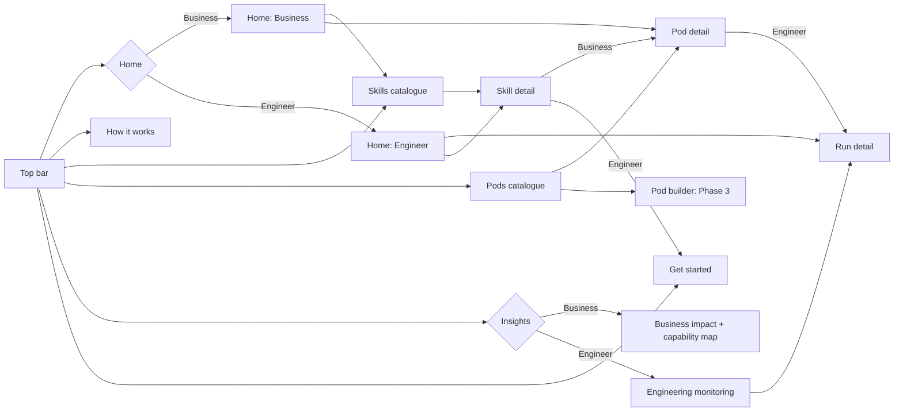
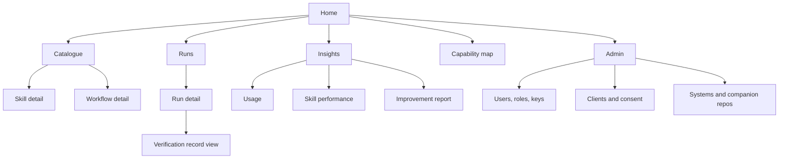

# Truminds AI Skill Library — 4. Design & UI/UX Assets

Oct 6, 2026 · @Puneet Singh Nanda

## 1. Document control and design principles

| Field | Value |
| --- | --- |
| Document | 4 of 6 — Design & UI/UX Assets |
| Status | Draft for review |
| Owner | Puneet Singh Nanda; design owners Ekjot (portal, catalogue) and Gaurav (dashboards, templates) |
| Related | [PRD](../product/01-prd.md) · [Personas & Stories](../product/02-personas-and-stories.md) · [Architecture](../architecture/03-architecture.md) |

### 1.1 Surfaces

| Surface | Who uses it | Built with | Owner |
| --- | --- | --- | --- |
| Claude Code chat (`/truminds:*` commands) | Engineers, tech leads, skill authors | Plugin commands + skill output | Shubham, Abhishek |
| Terminal (`tsl`) | Engineers, tech leads, admins | Typer CLI | Abhishek, Japman |
| Markdown files in the companion repo (open questions, approvals) | Engineers, POs, approvers | Templates (§3, §4) | Gaurav |
| Pull request body | Reviewers | `tsl pr` template (§4) | Gaurav, Shubham |
| Backstage portal | DM, eng lead, sales, skill owners, admins | Backstage plugins | Ekjot, Gaurav |

### 1.2 Principles

1. **Tell the next action.** Every pause, error or result ends with the exact command or file to act on.
2. **Show why.** Every outcome shows the gate or signal that caused it, with a link to the record.
3. **No client identity on shared screens.** Client and system codes, never names, outside admin views; users shown by pseudonym unless the viewer has `eng_lead` scope.
4. **Files over forms.** Humans answer questions and approve gates by editing markdown in git, so everything is reviewable and offline-friendly.
5. **Read-only portal.** The portal shows; it never starts runs (no web execution).

## 2. Portal screens

### 2.0 Web UI design (high fidelity, 6 Oct 2026)

**Hosting:** private intranet portal behind company SSO (Puneet, 6 Oct). Two persona views in one portal: **Business unit** (Raj, Ram, sales, marketing) and **Engineers** (software engineers, tech leads, architects, program owners).

| Asset | Link | Status |
| --- | --- | --- |
| Interactive prototype + all screens (canvas) | [Truminds AI Skill Library — Web UI](prototype/README.md) | 13 screens + persona map; Business/Engineer switch works in Play |
| Figma file | [Figma: Web UI (UX design)](https://www.figma.com/design/bMcqK99UQTiGOIf4G6PT4Z) | Brand variables, top-nav component, 3 screens (Home ×2, How it works). Paused: View seat hit the Figma tool-call limit |

**Screens:** Home (Business), Home (Engineer), How it works, Skill catalogue (search + role filter), Skill detail, Get started (GitHub + plugin install), Pod catalogue, Pod detail, Pod builder (Phase 3 preview), Insights: Business impact + capability map, Insights: Engineering monitoring (runs, skill performance, usage, health), Run detail, Persona map.

**Persona rules:** Business never sees run ids, tickets, repos, engineer or client names. Engineers see only their projects; other engineers appear as pseudonyms unless the viewer leads the team. Run detail is engineers-only.

**Brand:** placeholder palette held in one file (`brand.css` in the prototype, a variable collection in Figma); replace with the official Truminds colours and logo (OQ-13). All numbers on screens are labelled *Illustrative data*.

**Open:** OQ-15. The wireframes below assumed Backstage. Should the intranet portal be built on Backstage, or as a custom web app on the same API?

#### 2.0.1 Navigation map and persona switch

Top bar on every screen: logo (goes to Home), **Home · How it works · Skills · Pods · Insights · Get started**, a search box, the **Business / Engineer** switch and the user chip. The switch changes only the view; the current screen stays open.



| Rule | Behaviour |
| --- | --- |
| Default view | Proposed: follows the signed-in person's role (SSO group). The switch is for demos and for people with both roles |
| Persona-split screens | Home and Insights have two separate layouts; Skills, Skill detail, How it works, Get started, Pods and Pod detail are one layout with persona-specific blocks |
| Engineer-only | Run detail. A Business user who reaches it is sent to Insights |
| Active tab | Skill detail highlights Skills; Pod detail and Pod builder highlight Pods; Run detail highlights Insights |
| Layout | Desktop 1440 wide, content max 1280; at phone width menus wrap, cards stack, wide tables scroll inside their box |

#### 2.0.2 Shared screens

| Screen | Purpose | Business unit sees | Engineers see | Main actions |
| --- | --- | --- | --- | --- |
| **Home: Business** | Explain the library and what to sell | Hero ("Reusable AI skills that deliver the whole SDLC, with proof at every step") with a sample checked-step card; 4 impact numbers; 4 building blocks (Skills, Workflows, Pods, Quality harness); search; 8 role tiles with skill counts; domain chips; 3 featured pods; call to action band | n/a (Engineers land on Home: Engineer) | See how it works · Explore pods · Role tile → Skills · View pod · Open capability map · Request a pilot |
| **Home: Engineer** | Daily work view | n/a | Header with Install plugin, Open GitHub repo and a copyable run command; 4 personal numbers (active runs, waiting on me, first-try pass, PRs); My runs table; skills for my role; Waiting on me (questions, approvals); What's new (skill and plugin releases); My systems (context pack fresh or stale) | Install plugin → Get started · Run id → Run detail · Skill card → Skill detail · All runs → Insights |
| **How it works** | One story for everyone | Flow strip of 7 steps; 7 step cards, each with "For the client" text; the six harness outcomes; where things live (laptop, companion repo, portal) | Same, but each step card shows the command it uses (`tsl init-context`, `/truminds:run`, `/truminds:resume`, `tsl pr`, `/truminds:improve`) | None (reading page) |
| **Skills** | Find a skill | Search box and role filter chips (live filtering); cards with role, status, title, what it delivers, phase, output | Same cards plus skill id, version and first-try pass rate; "View source on GitHub" | Type to filter · Role chip · Card → Skill detail · Empty state "No skills match" |
| **Skill detail** (example: Threat model) | Decide to use or offer a skill | Summary, 4 quality numbers, "Why clients care", "What the client receives", pods that include it, one-pager | Run command, SKILL.md on GitHub, Install plugin; tabs: Inputs and outputs, Quality (top failure causes), Versions, Used in workflows | Back to Skills · See the pod · Install plugin · Tabs |
| **Get started** | Start using the library | 4 steps: share capability map, propose a pod, get written consent, hand over to delivery | 5 steps with commands: add marketplace, install plugin, `tsl login`, clone companion repo, first run; "Before you start" checklist (company seat, Claude Code desktop, SSO, Docker, consent) | Open on GitHub · copy commands |

#### 2.0.3 Pods

A pod is a ready-made delivery team: AI agents per role, the workflows they run, and the people who stay accountable.

| Persona | What they do with pods |
| --- | --- |
| Business unit | Choose and propose a pod, share its one-pager and track record, request a pilot |
| Engineers and tech leads | Run the pod's workflows in Claude Code, answer questions, approve gates, review PRs |
| Program owners and architects | Watch the pod's runs, waiting decisions and quality; decide which pod fits which client system |

| Screen | Purpose | Business unit sees | Engineers see | Main actions |
| --- | --- | --- | --- | --- |
| **Pod catalogue** | Compare pods | Persona explainer strip; 4 pod cards (Brownfield Change, Greenfield Feature, Quality and Security, UX Review) with status, description, AI agents, best for, first-try pass, people accountable | Same cards with workflows and skill count instead of best for and pass rate | View pod · Preview the builder |
| **Pod detail** (example: Brownfield Change Pod) | Sell or run one pod | Hero with Download one-pager and Request a pilot; Who is in the pod (3 agents + people accountable); How the pod works (11 steps, human gates as dashed amber boxes); What the client gets; Good fit when; Track record | Hero with run command; agents with their skills; same workflow strip; Active runs of this pod (table) | Back to Pods · Run id → Run detail |
| **Pod builder** (Phase 3 preview, X-04) | Assemble a custom pod | Banner "Phase 3 preview, not in Release 1"; agent list with Add/Remove; Your pod; What comes with it (skill count, suggested workflow, people accountable); Save disabled | Same | Add/Remove agent (works in prototype) |

Pods in the design are examples; the Release-1 pod list and each pod's composition need sign-off (OQ-16).

#### 2.0.4 Monitoring and insights

| Screen | Who | Content | Filters and actions | Data source |
| --- | --- | --- | --- | --- |
| **Insights: Business impact** | Business unit | 5 numbers: PRs delivered (with change vs previous period), first-try pass rate, client systems served, engineers using the library, active pods. Bar chart: PRs delivered per month. Most-used pods (bars). Capability map: roles × SDLC phases with production skills; pilot skills marked and hidden from the shared map | Period (90 days, 12 months, all time) · Share capability map | Aggregates over `run`, `step`, `pull_request` (Doc 3 §9); counts only |
| **Insights: Engineering monitoring**, tab Runs | Engineers | 5 status numbers (running, paused for input with oldest wait, waiting for approval, completed, aborted with reason); step-outcome bar (Pass, With findings, Retry, Needs input, Escalate, Abort); runs table (run, system, ticket, workflow, step, status, lowest band, engineer pseudonym, updated) | Project · System · Period · Run id → Run detail | `run`, `step`, `step.decided` events |
| … tab Skill performance | Engineers, skill owners | Per skill: version, runs, first-try pass (amber under 80%), High/Medium/Low band bar, retries per step, human overrides, top failure cause | Same filters | `step` signals, verification records (metadata) |
| … tab Usage | Engineers, eng leads | Active engineers, runs started, PR merge rate, PRs without a run record (E-CI-01); runs by workflow | Same filters | `run.started`, GitHub webhook, `ci.verified` |
| … tab Health | Tech leads, eng leads | Context packs (fresh or stale with drift); CI verification (verified, E-CI-01/02/03 counts); telemetry and plugin (events today, devices with queued events, plugin version spread, policy blocks) | Same filters | `context.*`, `ci.verified`, `hook.decision`, OTel |
| **Run detail** | Engineers only | Run header (full run id, status, ticket, workflow version, system, engineer, pack status); Next action box with resume command; step table (outcome, confidence, attempts, record); check record panel with S1–S6 for the chosen step and dropped findings; open question card with evidence | Back · View record per step (switches the panel) · Companion repo link | `state.json` summary + `verification` rows |

**Status colours** (always with a word, never colour alone): Pass green, Pass with findings blue, Retry grey, Needs input amber, Escalate orange, Abort red.

#### 2.0.5 Components, states and handoff notes

| Component | Variants / states | Used on |
| --- | --- | --- |
| Top bar | Active item; Business / Engineer switch (pressed state); user chip (initials + role) | All |
| Card | Default, clickable (whole card is a button, 44 px min target), dashed (Phase 3) | All |
| Stat tile | Label, value, sub-line; value colour only for status meaning | Home, Insights, Skill detail |
| Status badge | Pass, With findings, Retry, Needs input, Escalate, Abort, Running, Completed, Production, Pilot, Illustrative data | All |
| Button | Primary (navy), Accent (dark teal), Ghost (outline), Light (on navy), Disabled | All |
| Code chip | On light or dark background; monospace; selectable for copy | Home: Engineer, How it works, Get started, Skill detail, Pod detail, Run detail |
| Table | Header row, row hover, horizontal scroll box on narrow screens | Home: Engineer, Insights, Run detail, Capability map |
| Filter chips | Selected / unselected (aria-pressed) | Skills |
| Tabs | Selected underline, keyboard reachable | Skill detail, Engineering monitoring |
| Workflow strip | Skill step (white box), human gate (dashed amber) | Pod detail |

**Empty, loading and error states.** Every list has an empty state that says what to do next (for example, "No skills match. Try another word, or clear the role filter."). Until real data exists, number tiles show "No data yet", never sample numbers (C-09). If the telemetry service is down, the portal shows a banner "Insights are behind; last event received at \<time>" and keeps the last data.

**Accessibility.** Real buttons and links; visible focus; text contrast at least 4.5:1 (teal text uses `--tm-accent-ink` #00707B, not the decorative teal); 44 px touch targets; charts have an aria-label with their values.

**Brand tokens.** All colours and fonts live in `brand.css` (prototype) and the "Truminds Brand" variable collection (Figma). The palette is a placeholder (navy #0B2A4A, teal #00A3B4, IBM Plex Sans); swap it for the official Truminds values (OQ-13).

**Handoff.** Ekjot builds the catalogue, capability map, pods and Get started; Gaurav builds Home: Engineer, Insights and Run detail. Each screen in the prototype canvas has a matching board; numbers on screens map to the data sources in 2.0.4 and the events in Doc 5 §5.

*Sections 2.1–2.5 below are the earlier Backstage wireframes, kept for reference. The screens in 2.0 replace them.*

### 2.1 Information architecture



| Screen | Personas | Role needed | Story | Owner |
| --- | --- | --- | --- | --- |
| Catalogue, skill detail, workflow detail | All | viewer | US-15 | Ekjot |
| Runs list, run detail, record view | Engineer, tech lead, DM | engineer (own project) | US-13 | Gaurav |
| Usage | Eng lead | eng\_lead | US-19 | Gaurav |
| Skill performance, improvement report | Skill owner, eng lead | skill\_owner / eng\_lead | US-16 | Gaurav |
| Capability map | Sales, anyone | viewer | US-17 | Ekjot |
| Admin | Admin | admin | US-18 | Ekjot |

### 2.2 Wireframe — Runs list

```text
+--------------------------------------------------------------------------------+
| Truminds Skill Library    Catalogue  Runs  Insights  Capability map     [user] |
+--------------------------------------------------------------------------------+
| Runs   Project [ PRJ-07 v]  System [ all v]  Status [ all v]  Workflow [ all v] |
|--------------------------------------------------------------------------------|
| Run id        Ticket   Workflow           Step          Status          Age    |
| run_01J9..K2  ABC-142  brownfield-change  design (5/10) PAUSED_INPUT  ! 2d     |
| run_01J9..M7  ABC-150  defect-fix         unit-test     RUNNING         3h     |
| run_01J8..Q1  ABC-131  brownfield-change  PR            COMPLETED       1d     |
|--------------------------------------------------------------------------------|
| ! = waiting longer than the project limit       Open questions: 3  Escalations: 1|
+--------------------------------------------------------------------------------+
```

### 2.3 Wireframe — Run detail

```text
+--------------------------------------------------------------------------------+
| run_01J9..K2  ABC-142  brownfield-change v1.3   PAUSED_INPUT   user: eng-4f2a  |
|--------------------------------------------------------------------------------|
| Steps                                                                          |
|  1 requirement-review v1.2   PASS                 High    [record]             |
|  2 story-split v1.0          PASS-WITH-FINDINGS   Medium  [record] 2 minor     |
|  3 impact-analysis v1.1      RETRY -> PASS        High    [record] attempt 2   |
|  4 design v1.4               NEEDS-INPUT          -       [record] S4=1        |
|  5..10                       not started                                       |
|--------------------------------------------------------------------------------|
| Next action: answer runs/run_01J9..K2/open-questions.md, then                  |
|              /truminds:resume run_01J9..K2                                     |
| Companion repo: [link]   PR: none yet                                          |
+--------------------------------------------------------------------------------+
```

### 2.4 Wireframe — Skill performance

```text
+--------------------------------------------------------------------------------+
| Skill: design   Owner: skill-owner-9c   Versions [v1.4 v]   Period [90d v]     |
|--------------------------------------------------------------------------------|
| Runs  | First-try PASS | Bands H/M/L | Retries/run | Human overrides | PR merge |
| (n)   | (%)            | (bar)       | (n)         | (%)             | (%)      |
|--------------------------------------------------------------------------------|
| Top failure causes (from verification records)                                 |
|  H5 trace missing ......... n    |  S1 evidence < 0.9 ....... n                |
|  Reviewer blocker: retention .. n | H6 stale input .......... n                |
|--------------------------------------------------------------------------------|
| [Open improvement report]  Eval pass rate v1.4: (%) signed by key ...          |
+--------------------------------------------------------------------------------+
```

### 2.5 Wireframe — Capability map (sales-safe)

```text
+--------------------------------------------------------------------------------+
| What Truminds AI delivers           Domain [ all v]   (production skills only) |
|--------------------------------------------------------------------------------|
|          | Requirements | Design      | Build      | Test        | Operate     |
| BA       | req-review   |             |            |             |             |
|          | story-split  |             |            |             |             |
| SA       |              | impact      |            |             |             |
|          |              | design      |            |             |             |
| DEV      |              |             | implement  | unit-test   |             |
| QA       |              |             |            | test-plan   |             |
| DevOps   |              |             |            |             | pipeline-rv |
| Security |              | threat-model| sec-review |             |             |
|--------------------------------------------------------------------------------|
| Totals: runs (n) | first-try pass (%) | systems served (n)   - no client names |
+--------------------------------------------------------------------------------+
```

Metrics on these screens appear only after pilot data exists; until then the cells show "no data yet", never sample numbers.

## 3. Open-questions template

Written by `tsl decide` on NEEDS-INPUT to `runs/<run_id>/open-questions.md`. Humans fill only the `answer`, `answered_by` and `decision` fields. `/truminds:resume` refuses to continue while any blocking question has an empty answer. Schema: `open-questions.v1` (Doc 5).

```markdown
---
schema: open-questions.v1
run_id: run_01J9ZK2M4Q8X7T3B5N6R0VWYCD
ticket: ABC-142
workflow: brownfield-change@1.3
step: design@1.4
created_at: 2026-10-06T10:20:00Z
status: open            # open | answered (set by tsl, not by hand)
---

# Open questions — ABC-142 (design step)

Answer each question below the line `answer:`. Keep the ids. Then run:
`/truminds:resume run_01J9ZK2M4Q8X7T3B5N6R0VWYCD`

## Q-01 · blocking · ask: product owner
**Question:** The order history must cover 30 days, but data-model.md says history
is kept 24 hours. Which is correct for this change?
**Why it matters:** decides whether the design must extend retention.
**Evidence:** context/system-baseline.md#data-retention (line 41)
**Options:**
  A. Extend retention to 30 days (new storage cost)
  B. Keep 24 hours and change the requirement
**Proposed default:** none (decision, not a default)
answer:
answered_by:
decision:            # A | B | other

## Q-02 · non-blocking · ask: tech lead
**Question:** Time-zone boundary for "30 days" is not stated.
**Proposed default:** UTC, start-inclusive. Leave answer empty to accept.
answer:
answered_by:
```

**Rules shown to the user**

| Field | Rule |
| --- | --- |
| Severity | `blocking` must be answered; `non-blocking` uses the proposed default if empty |
| ask | Who should answer: product owner, tech lead, SME, client. The file can be shared; it holds no secrets |
| answered\_by | Name or pseudonym; recorded in the verification record of the re-run step |
| Evidence | Always a `path#anchor`; the question is dropped by code if the citation does not verify |

## 4. PR and approvals templates

### 4.1 Pull request body (generated by `tsl pr`)

```markdown
## ABC-142 · Show 30 days of order history

**Run:** run_01J9ZK2M4Q8X7T3B5N6R0VWYCD · workflow brownfield-change@1.3
**Companion records:** <link to artifacts/ABC-142/run_01J9.../>
**Context pack:** signed 2026-10-01 by tl-7a1c · fresh

### What changed
<summary from change.v1, max 10 lines>

### Harness results
| Step | Outcome | Band | Record |
|---|---|---|---|
| requirement-review | PASS | High | link |
| design | PASS-WITH-FINDINGS | Medium | link |
| implement | PASS | High | link |
| unit-test | PASS | High | link |

### Tests
Unit tests: <passed>/<total> · coverage <before> -> <after> · verifier profile java-maven@2

### Findings for the reviewer (not blocking)
- [minor] design: time-zone boundary defaulted to UTC start-inclusive (Q-02)

### Human decisions in this run
- Q-01 answered by po-31d2: option A (extend retention)
- Design gate approved by tl-7a1c

### Reviewer checklist
- [ ] Change matches the ticket and the approved design
- [ ] Findings above are acceptable
- [ ] No client data, secrets or unrelated files in the diff

<!-- tsl:run_id=run_01J9ZK2M4Q8X7T3B5N6R0VWYCD -->
```

The hidden `tsl:run_id` comment is what `tsl ci-verify` and the GitHub webhook use to join the PR to the run. The PR is opened as **draft** when the lowest band in the run is Medium (Doc 3 §5.5).

### 4.2 Approvals file (`runs/<run_id>/approvals.md`)

```markdown
---
schema: approvals.v1
run_id: run_01J9ZK2M4Q8X7T3B5N6R0VWYCD
---

## G-design · required role: tech_lead
Artifact: artifacts/ABC-142/run_01J9.../design.md (sha256 3f9a...)
Reason for gate: workflow gate (always)
decision:          # approve | reject | changes
comment:
<!-- signature block written by `tsl approve` - do not edit -->

## G-escalate-04 · required role: tech_lead
Artifact: .../implement.md · Reason: band Low (S6 change risk over limit)
decision:
comment:
```

The approver fills `decision` and `comment`, then runs `tsl approve <run_id> <gate>`. `tsl` checks the role (E-AUTH-05 if missing), refuses self-approval of a gate on a step the same user generated (configurable per system), and appends the signature block. Rejected or "changes" sends the step back to RETRY with the comment as input.

## 5. CLI and chat messages

### 5.1 Message pattern

Every `tsl` message and every plugin command reply follows: **status line → reason → next action**.

```text
✖ Step design (5/10) needs input        [NEEDS-INPUT]
  Reason: 1 blocking question (S4=1). See runs/run_01J9.../open-questions.md
  Next:   answer the file, then  /truminds:resume run_01J9...
```

```text
✔ Step implement (7/10) passed           [PASS · High]
  Checks 14/14 · evidence 0.96 · reviewer 4.4 · risk 120 lines / 6 files
  Next:   continuing with unit-test
```

```text
↻ Step unit-test (8/10) retry 1 of 2     [RETRY]
  Reason: H3 verifier — 2 tests failed (OrderHistoryTest.timezoneBoundary, ...)
  Next:   Claude is fixing; no action needed
```

Icons are paired with words so meaning never relies on symbol or colour alone.

### 5.2 Error code catalogue

| Code | Exit | Message (shown to user) | Next action shown |
| --- | --- | --- | --- |
| E-AUTH-01 | 10 | Not logged in to Truminds. | Run `tsl login` |
| E-AUTH-02 | 10 | Your signing key is revoked or unknown. | Run `tsl login` to register a new key; contact admin if it repeats |
| E-AUTH-03 | 3 | You do not have the engineer role for project `<code>`. | Ask your tech lead or admin for access |
| E-AUTH-04 | 3 | Only a tech lead can sign the context pack. | Ask the system's tech lead to run `tsl sign-context` |
| E-AUTH-05 | 3 | Approver lacks role `<role>` for gate `<gate>`. | Ask someone with that role to approve |
| E-AUTH-06 | 3 | You cannot approve a gate on a step you generated. | Ask another tech lead |
| E-CONS-01 | 3 | No client consent recorded for `<client code>`. | Admin records consent in the portal |
| E-CTX-01 | 3 | Context pack missing. | Tech lead runs `tsl init-context` then `tsl sign-context` |
| E-CTX-02 | 0 (warn) | Context pack is stale (drift `<n>` files / age `<d>` days). Band capped at Medium. | `tsl context-refresh` then re-sign |
| E-CTX-03 | 3 | Pack signature does not verify. | Re-sign with `tsl sign-context` |
| E-LOCK-01 | 3 | `<ticket>` / `<workflow>` is locked by `<user>` in `<run_id>`. | Resume if yours; else ask a tech lead to release (`tsl state unlock`) |
| E-IN-01 | 2 | Required input `<name>` missing for skill `<skill>`. | Provide it or run the upstream step |
| E-IN-02 | 2 | Input `<artifact>` is stale (H6). | Re-running upstream step `<step>` |
| E-CHK-01 | 2 | Hard gate `<Hn>` failed: `<detail>`. | Claude retries automatically (n of max) |
| E-POL-01 | 5 | Blocked: write outside allowed paths `<path>`. | Run aborted; check `tsl.yaml` product\_repos |
| E-POL-02 | 5 | Blocked: read of sensitive file `<path>`. | Run aborted; remove the need or ask tech lead to adjust policy |
| E-POL-03 | 5 | Blocked: MCP write `<tool>` without approval. | Add an approval entry, then resume |
| E-SEC-01 | 5 | Secret or PII detected in artifact (H4). | Run aborted; security event raised |
| E-RUN-01 | 4 | Run paused for input. | Answer open-questions.md, then resume |
| E-RUN-02 | 4 | Run paused for approval. | Approver runs `tsl approve` |
| E-RUN-03 | 2 | Cannot resume: `<n>` blocking questions unanswered. | Answer them |
| E-NET-01 | 0 (warn) | Telemetry offline; `<n>` events queued in outbox. | None; sent automatically |
| E-SCH-01 | 1 | File `<path>` uses schema `<v>` that this tsl does not read. | `tsl migrate` or upgrade the plugin |
| E-CI-01 | 2 | PR has code changes but no verification records for run `<id>`. | Run the change through `/truminds:run` |
| E-CI-02 | 2 | Record signature invalid or signer lacked role at signing time. | Re-run the step |
| E-CI-03 | 2 | CI re-run of code checks differs from laptop result. | Investigate; re-run the step |

Exit codes: 0 ok · 1 usage · 2 check failed (fed back to Claude) · 3 blocked/auth · 4 paused · 5 abort · 10 auth/network.

## 6. Design tokens, accessibility and content rules

### 6.1 Tokens

The portal uses the Backstage (MUI) theme. Truminds brand colours are not yet supplied (OQ-13); until then the default Backstage palette is used. Semantic tokens below map outcomes to theme roles, so a brand change touches one file.

| Token | Used for | Maps to | Icon + word (never colour alone) |
| --- | --- | --- | --- |
| `status.pass` | PASS, High band | theme success | ✔ Passed |
| `status.findings` | PASS-WITH-FINDINGS, Medium band | theme info | ✔! Passed with findings |
| `status.retry` | RETRY | theme neutral | ↻ Retrying |
| `status.input` | NEEDS-INPUT, PAUSED\_INPUT | theme warning | ? Needs input |
| `status.escalate` | ESCALATE, PAUSED\_APPROVAL, Low band | theme warning (strong) | ▲ Needs approval |
| `status.abort` | ABORT | theme error | ✖ Aborted |
| `space.*` | Layout | 8 px grid (Backstage default) | — |
| `type.mono` | Run ids, paths, commands | theme monospace | — |

### 6.2 Accessibility (portal, NFR-15)

- WCAG 2.1 AA: contrast ≥ 4.5:1 for text; keyboard reachable filters and tables; visible focus.
- Status shown as icon + word; charts have a table view.
- Tables have header cells and sortable columns announced to screen readers.
- Checked in CI with an automated accessibility scan (axe) on each portal page, plus a manual keyboard pass before release.

### 6.3 Content rules

| Rule | Applies to |
| --- | --- |
| Client and system shown by **code**; names only in Admin | Portal, PR body, events |
| Users shown by pseudonym (e.g. `eng-4f2a`); real names only for `eng_lead` of that team and admin | Portal, records |
| Run ids shortened in lists (`run_01J9..K2`), full on hover/copy | Portal, CLI |
| Dates in ISO 8601, UTC in files; viewer's local time in the portal | All |
| No sample or invented numbers on screens; "no data yet" until real data | Portal, sales map |
| Plain words: "needs input", "needs approval"; no internal jargon in user-facing text | All |

### 6.4 Open questions from this document

- **OQ-13** Truminds brand colours and logo for the portal.
- **OQ-14** Should any non-Truminds person (for example a client PO) answer open-questions files directly in the companion repo, or only via a Truminds engineer?
- **OQ-15** Build the intranet portal on Backstage, or as a custom web app on the same API?
- **OQ-16** Which pods are in Release 1, and what is each pod's composition?
